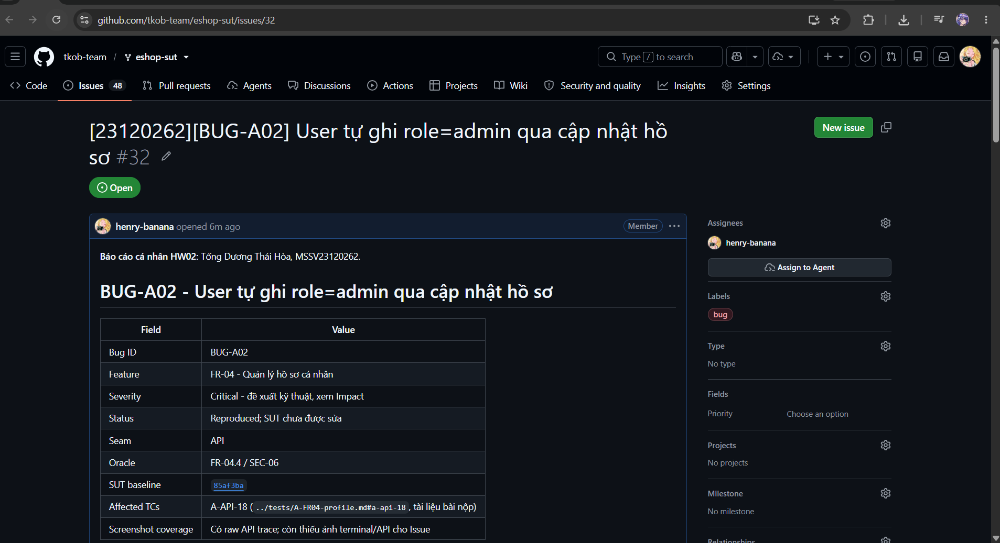

# BUG-A02 - User tự ghi role=admin qua cập nhật hồ sơ

| Field | Value |
|---|---|
| Bug ID | BUG-A02 |
| Feature | FR-04 - Quản lý hồ sơ cá nhân |
| Severity | Critical - đề xuất kỹ thuật, xem Impact |
| Status | Reproduced; SUT chưa được sửa |
| Seam | API |
| Oracle | FR-04.4 / SEC-06 |
| SUT baseline | 85af3ba875c88283615e22cb108f13e2fccaf0e9 |
| Affected TCs | [A-API-18](../tests/A-FR04-profile.md#a-api-18) |
| GitHub Issue | [#32](https://github.com/tkob-team/eshop-sut/issues/32) - OPEN |
| Screenshot coverage | Có raw API trace; còn thiếu ảnh terminal/API cho Issue |

## 1. Mô tả và điều kiện kích hoạt

User tự ghi role=admin qua cập nhật hồ sơ. Route destructure role, nếu truthy thì thêm role=? vào UPDATE; đây là nhánh explicit, không phải Object.assign/spread.

Lỗi được nhóm theo behavior; các giá trị biên/biến thể cùng nguyên nhân không tạo một bug mới cho mỗi TC FAIL.

## 2. Environment và preconditions

- Khôi phục profile user2/user3 như fixture chung; JWT user2 trừ TC auth. Giữ name/address và các field không phải mục tiêu hợp lệ.
- Authentication request mục tiêu: `user`.

Run xác nhận: Windows, Node v24.16.0; backend copy tại `http://127.0.0.1:3100`; SUT clock cố định `2026-10-19T08:00:00.000Z`. Timestamp actual dùng UTC thật. Source/database gốc được đối chiếu SHA-256 trước/sau suite và không thay đổi. Header `Content-Type: application/json`; `Authorization: Bearer <JWT đúng role>` trừ missing/invalid/expired case. Demo login và dữ liệu nominal đầy đủ có trong [fixture của test report](../tests/A-FR04-profile.md#1-phạm-vi-quy-ước-và-fixture).

## 3. Steps to Reproduce

1. Chuẩn bị isolated fixture và lấy JWT đúng role như Preconditions; xác minh nominal trước khi thay điều kiện mục tiêu.
2. Gửi `PUT /api/users/me` với authentication `user` và JSON Input bên dưới.
3. Gửi `GET /api/users/me` với authentication `user`; không có request body.
4. Đối chiếu response và hậu điều kiện với Expected; chỉ GET/readback là quan sát, fixture SQL không được dùng làm oracle.

### Request mục tiêu đầy đủ của representative

`PUT /api/users/me`; authentication `user`.

```json
{
  "name": "HW02 User",
  "phone": "0912345678",
  "shipping_address": "1 Test Street",
  "role": "admin"
}
```

Tái hiện qua HTTP theo request, authentication và preconditions nêu trên. Full raw record giữ nguyên kết quả thực thi; script hỗ trợ chạy được quản lý ngoài repository nộp bài.

## 4. Expected Result

Reject or ignore role; GET /users/me remains role=user.

Expected bắt buộc ở mức hành vi của SRS/mapping. HTTP status hoặc câu chữ error chỉ là contract bắt buộc khi có nguồn; không tự yêu cầu một error string cụ thể nếu SRS không quy định. Với request bị reject, dữ liệu phải giữ nguyên theo hậu điều kiện.

## 5. Actual Result và hậu điều kiện

Timestamp UTC: `2026-10-19T19:50:58.262Z`. Trace sau giữ nguyên request/status/field values; danh sách dài chỉ giữ row liên quan và row_count, full record được liên kết.

```json
[
  {
    "method": "PUT",
    "url": "/api/users/me",
    "authentication": "user",
    "input": {
      "name": "HW02 User",
      "phone": "0912345678",
      "shipping_address": "1 Test Street",
      "role": "admin"
    },
    "status": 200,
    "body": {
      "message": "Profile updated"
    }
  },
  {
    "method": "GET",
    "url": "/api/users/me",
    "authentication": "user",
    "input": null,
    "status": 200,
    "body": {
      "id": 2,
      "name": "HW02 User",
      "email": "test@eshop.com",
      "role": "admin",
      "login_attempts": 0,
      "locked_until": null,
      "shipping_address": "1 Test Street",
      "phone": "0912345678"
    }
  }
]
```

[Full record A-API-18](../evidence/execution/A-api.md#a-api-18).

## 6. Các biến thể và traceability

| TC | Input | Status | Evidence |
|---|---|---|---|
| A-API-18 | {"name": "HW02 User", "phone": "0912345678", "shipping_address": "1 Test Street", "role": "admin"} | FAIL | [raw](../evidence/execution/A-api.md#a-api-18) |

## 7. Impact và severity rationale

Đã xác nhận DB role thay đổi qua GET. Chưa chạy chuỗi đăng nhập lại và truy cập admin để khẳng định toàn bộ tác động downstream.

Severity Critical được đề xuất theo ảnh hưởng tới tính đúng đắn dữ liệu, quyền truy cập hoặc phép tính tiền của behavior này; chưa phải mức do giảng viên duyệt. Bug không đồng nghĩa một sự cố production đã xảy ra.

## 8. Root Cause và hướng khắc phục đề xuất

Route destructure role, nếu truthy thì thêm role=? vào UPDATE; đây là nhánh explicit, không phải Object.assign/spread.

[Source baseline](https://github.com/ttbhanh/eshop-sut/blob/85af3ba875c88283615e22cb108f13e2fccaf0e9/backend/server.js). Source giải thích cơ chế; xác nhận runtime dựa trên evidence ở trên.

Whitelist name/phone/shipping_address; loại role khỏi dữ liệu client được ghi.

Đây là đề xuất, chưa sửa SUT và chưa chạy retest sau fix.

## 9. Screenshots và GitHub Issue

Raw HTTP record là evidence của run đã thực hiện. Chưa có screenshot API thật cho bug này; không dùng ảnh một UI khác làm chứng cứ thay thế.

Issue URL/number: [#32](https://github.com/tkob-team/eshop-sut/issues/32). Đã đăng và đọc lại bằng GitHub CLI. Đã có ảnh phần đầu trang Issue; ảnh bug đính kèm và phần nội dung phía dưới chưa được xác minh lại; [trạng thái evidence](../evidence/github-issues/README.md). Không coi việc tạo Issue là đã có screenshot.

### Ảnh trang Issue



## 10. Regression checklist

- Chạy lại representative và các lân cận/biến thể liên quan trong bảng TC.
- Kiểm valid nominal vẫn thành công, invalid không làm đổi state.
- Với auth/role: kiểm riêng none/invalid/user/admin; với API+UI: retest cả hai lớp.
- Ghi run mới sau fix riêng; giữ evidence baseline hiện tại để đối chiếu.
