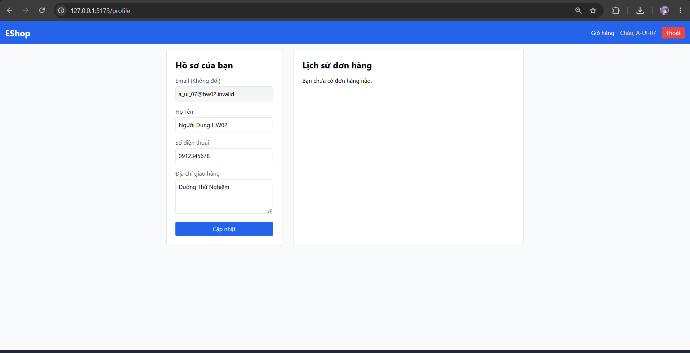
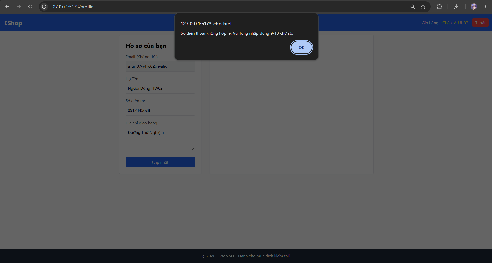
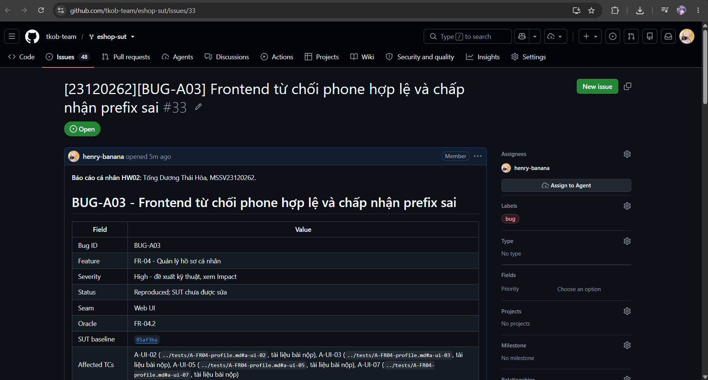

# BUG-A03 - Frontend từ chối phone hợp lệ và chấp nhận prefix sai

| Field | Value |
|---|---|
| Bug ID | BUG-A03 |
| Feature | FR-04 - Quản lý hồ sơ cá nhân |
| Severity | High - đề xuất kỹ thuật, xem Impact |
| Status | Reproduced; SUT chưa được sửa |
| Seam | Web UI |
| Oracle | FR-04.2 |
| SUT baseline | 85af3ba875c88283615e22cb108f13e2fccaf0e9 |
| Affected TCs | [A-UI-02](../tests/A-FR04-profile.md#a-ui-02), [A-UI-03](../tests/A-FR04-profile.md#a-ui-03), [A-UI-05](../tests/A-FR04-profile.md#a-ui-05), [A-UI-07](../tests/A-FR04-profile.md#a-ui-07) |
| GitHub Issue | [#33](https://github.com/tkob-team/eshop-sut/issues/33) - OPEN |
| Screenshot coverage | Có ảnh UI cụ thể dưới đây |

## 1. Mô tả và điều kiện kích hoạt

Frontend từ chối phone hợp lệ và chấp nhận prefix sai. Profile.jsx dùng /^[1-9][0-9]{8,9}$/ và thông báo 9-10 chữ số; khác starts0/10-11digits.

Lỗi được nhóm theo behavior; các giá trị biên/biến thể cùng nguyên nhân không tạo một bug mới cho mỗi TC FAIL.

## 2. Environment và preconditions

Ảnh trước từ Web localhost:5173, account A-UI-01; lượt bổ sung A-UI-07 từ 127.0.0.1:5173/profile, account a_ui_07@hw02.invalid trong runtime Web riêng. Dùng baseline và mapping đã ghi. Giữ nguyên bytes ảnh; không có video/HTTP trace UI tự động của lượt chụp.

## 3. Steps to Reproduce

1. Đăng nhập Web bằng account test có profile của chính mình; mở /profile; ghi lại email/name/phone/address trước thao tác.
2. Nhập đúng JSON thiết kế vào các field tương ứng; giữ các field không phải mục tiêu nominal.
3. Bấm Cập nhật một lần; chụp field cùng alert hoặc response.
4. Nếu thành công: đóng alert, tải lại/fresh login và kiểm tra dữ liệu lưu. Nếu validation chặn: ghi đúng bước bị chặn, không suy persistence.

### Input thiết kế

```json
{
  "phone": "0912345678"
}
```

**Variant thực tế:** Có thêm lượt với 0987654321 cũng bị từ chối. Những ảnh này là biến thể cùng TC, không cộng thêm số test.

## 4. Expected Result

Update succeeds; re-login shows the exact phone.

Expected bắt buộc ở mức hành vi của SRS/mapping. HTTP status hoặc câu chữ error chỉ là contract bắt buộc khi có nguồn; không tự yêu cầu một error string cụ thể nếu SRS không quy định. Với request bị reject, dữ liệu phải giữ nguyên theo hậu điều kiện.

## 5. Actual Result và hậu điều kiện

Phone hợp lệ 0912345678 bị cảnh báo không hợp lệ; thao tác cập nhật bị chặn ngay ở frontend. A-UI-07 bổ sung cả name `Người Dùng HW02` và address `Đường Thử Nghiệm` với cùng phone hợp lệ; alert `Số điện thoại không hợp lệ. Vui lòng nhập đúng 9-10 chữ số.` tiếp tục chặn valid update. Chưa đạt tới fresh-login/readback, nên không kết luận Unicode bị hỏng hoặc được lưu.

## 6. Các biến thể và traceability

| TC | Input | Status | Evidence |
|---|---|---|---|
| A-UI-02 | {"phone": "0912345678"} | FAIL | [UI case](../tests/A-FR04-profile.md#a-ui-02) |
| A-UI-03 | {"phone": "09123456789"} | FAIL | [UI case](../tests/A-FR04-profile.md#a-ui-03) |
| A-UI-05 | {"phone": "1912345678"} | FAIL | [UI case](../tests/A-FR04-profile.md#a-ui-05) |
| A-UI-07 | {"name":"Người Dùng HW02","shipping_address":"Đường Thử Nghiệm","phone":"0912345678"} | FAIL | [UI case](../tests/A-FR04-profile.md#a-ui-07) |

## 7. Impact và severity rationale

Người dùng không cập nhật được phone đúng SRS qua UI; phone sai prefix lại đi qua frontend. Việc sửa name/address hợp lệ có dấu cũng bị chặn khi gửi kèm phone hợp lệ như A-UI-07, ảnh hưởng toàn thao tác cập nhật hồ sơ.

Severity High được đề xuất theo ảnh hưởng tới tính đúng đắn dữ liệu, quyền truy cập hoặc phép tính tiền của behavior này; chưa phải mức do giảng viên duyệt. Bug không đồng nghĩa một sự cố production đã xảy ra.

## 8. Root Cause và hướng khắc phục đề xuất

Profile.jsx dùng /^[1-9][0-9]{8,9}$/ và thông báo 9-10 chữ số; khác starts0/10-11digits.

[Source baseline](https://github.com/ttbhanh/eshop-sut/blob/85af3ba875c88283615e22cb108f13e2fccaf0e9/frontend-web/src/pages/Profile.jsx). Source giải thích cơ chế; xác nhận runtime dựa trên evidence ở trên.

Thống nhất validation frontend/backend theo rule SRS; regression đủ 9/10/11/12 digits và prefix sai.

Đây là đề xuất, chưa sửa SUT và chưa chạy retest sau fix.

## 9. Screenshots và GitHub Issue






Issue URL/number: [#33](https://github.com/tkob-team/eshop-sut/issues/33). Đã đăng và đọc lại bằng GitHub CLI. Đã có ảnh phần đầu trang Issue; ảnh bug đính kèm và phần nội dung phía dưới chưa được xác minh lại; [trạng thái evidence](../evidence/github-issues/README.md). Không coi việc tạo Issue là đã có screenshot.

### Ảnh trang Issue



## 10. Regression checklist

- Chạy lại representative và các lân cận/biến thể liên quan trong bảng TC.
- Kiểm valid nominal vẫn thành công, invalid không làm đổi state.
- Với auth/role: kiểm riêng none/invalid/user/admin; với API+UI: retest cả hai lớp.
- Ghi run mới sau fix riêng; giữ evidence baseline hiện tại để đối chiếu.
