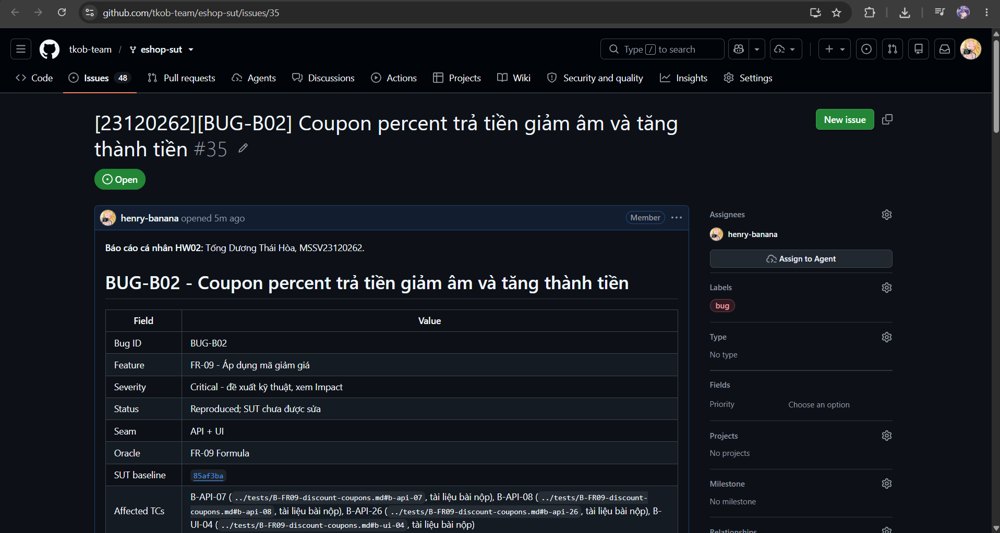

# BUG-B02 - Coupon percent trả tiền giảm âm và tăng thành tiền

| Field | Value |
|---|---|
| Bug ID | BUG-B02 |
| Feature | FR-09 - Áp dụng mã giảm giá |
| Severity | Critical - đề xuất kỹ thuật, xem Impact |
| Status | Reproduced; SUT chưa được sửa |
| Seam | API + UI |
| Oracle | FR-09 Formula |
| SUT baseline | 85af3ba875c88283615e22cb108f13e2fccaf0e9 |
| Affected TCs | [B-API-07](../tests/B-FR09-discount-coupons.md#b-api-07), [B-API-08](../tests/B-FR09-discount-coupons.md#b-api-08), [B-API-26](../tests/B-FR09-discount-coupons.md#b-api-26), [B-UI-04](../tests/B-FR09-discount-coupons.md#b-ui-04) |
| GitHub Issue | [#35](https://github.com/tkob-team/eshop-sut/issues/35) - OPEN |
| Screenshot coverage | Có ảnh UI cụ thể dưới đây |

## 1. Mô tả và điều kiện kích hoạt

Coupon percent trả tiền giảm âm và tăng thành tiền. Source tính Math.floor(total_amount * (1 - coupon.discount_value)) thành discount_amount; final trừ tiếp discount sai.

Lỗi được nhóm theo behavior; các giá trị biên/biến thể cùng nguyên nhân không tạo một bug mới cho mỗi TC FAIL.

## 2. Environment và preconditions

- Reset tám coupon; user2/VIP100 used=0, limit=2; user3 used=0. Coupon trong request phải có đúng type/value/minimum của fixture.
- Authentication request mục tiêu: `user`.

Run xác nhận: Windows, Node v24.16.0; backend copy tại `http://127.0.0.1:3100`; SUT clock cố định `2026-10-19T08:00:00.000Z`. Timestamp actual dùng UTC thật. Source/database gốc được đối chiếu SHA-256 trước/sau suite và không thay đổi. Header `Content-Type: application/json`; `Authorization: Bearer <JWT đúng role>` trừ missing/invalid/expired case. Demo login và dữ liệu nominal đầy đủ có trong [fixture của test report](../tests/B-FR09-discount-coupons.md#1-phạm-vi-quy-ước-và-fixture).

## 3. Steps to Reproduce

1. Chuẩn bị isolated fixture và lấy JWT đúng role như Preconditions; xác minh nominal trước khi thay điều kiện mục tiêu.
2. Gửi `POST /api/apply-coupon` với authentication `user` và JSON Input bên dưới.
3. Đối chiếu response và hậu điều kiện với Expected; chỉ GET/readback là quan sát, fixture SQL không được dùng làm oracle.

### Request mục tiêu đầy đủ của representative

`POST /api/apply-coupon`; authentication `user`.

```json
{
  "code": "SAVE10",
  "total_amount": 400000,
  "user_id": 2
}
```

Tái hiện qua HTTP theo request, authentication và preconditions nêu trên. Full raw record giữ nguyên kết quả thực thi; script hỗ trợ chạy được quản lý ngoài repository nộp bài.

## 4. Expected Result

discount=40000; final=360000.

Expected bắt buộc ở mức hành vi của SRS/mapping. HTTP status hoặc câu chữ error chỉ là contract bắt buộc khi có nguồn; không tự yêu cầu một error string cụ thể nếu SRS không quy định. Với request bị reject, dữ liệu phải giữ nguyên theo hậu điều kiện.

## 5. Actual Result và hậu điều kiện

Timestamp UTC: `2026-10-19T19:50:59.040Z`. Trace sau giữ nguyên request/status/field values; danh sách dài chỉ giữ row liên quan và row_count, full record được liên kết.

```json
[
  {
    "method": "POST",
    "url": "/api/apply-coupon",
    "authentication": "user",
    "input": {
      "code": "SAVE10",
      "total_amount": 400000,
      "user_id": 2
    },
    "status": 200,
    "body": {
      "success": true,
      "coupon_id": 61,
      "discount_amount": -3600000,
      "final_amount": 4000000,
      "message": "Áp dụng thành công! Giảm 10%"
    }
  }
]
```

[Full record B-API-08](../evidence/execution/B-api.md#b-api-08).

Tính tay: expected `400000x10/100=40000`, `400000-40000=360000`; actual `discount_amount=-3600000`, `final_amount=4000000`. P100/400000 ở B-API-26 trả `-39600000/40000000`; không nhầm P100 với VIP100 fixed100000.

## 6. Các biến thể và traceability

| TC | Input | Status | Evidence |
|---|---|---|---|
| B-API-07 | {"code": "SAVE10", "total_amount": 300001, "user_id": 2} | FAIL | [raw](../evidence/execution/B-api.md#b-api-07) |
| B-API-08 | {"code": "SAVE10", "total_amount": 400000, "user_id": 2} | FAIL | [raw](../evidence/execution/B-api.md#b-api-08) |
| B-API-26 | {"code": "P100", "total_amount": 400000, "user_id": 2} | FAIL | [raw](../evidence/execution/B-api.md#b-api-26) |
| B-UI-04 | {"code": "SAVE10", "total": 400000} | FAIL | [UI case](../tests/B-FR09-discount-coupons.md#b-ui-04) |

## 7. Impact và severity rationale

SAVE10/400000 tạo final=4000000 thay 360000. Đã chứng minh phép tính/API/UI; chưa tuyên bố đã thu tiền thật.

Severity Critical được đề xuất theo ảnh hưởng tới tính đúng đắn dữ liệu, quyền truy cập hoặc phép tính tiền của behavior này; chưa phải mức do giảng viên duyệt. Bug không đồng nghĩa một sự cố production đã xảy ra.

## 8. Root Cause và hướng khắc phục đề xuất

Source tính Math.floor(total_amount * (1 - coupon.discount_value)) thành discount_amount; final trừ tiếp discount sai.

[Source baseline](https://github.com/ttbhanh/eshop-sut/blob/85af3ba875c88283615e22cb108f13e2fccaf0e9/backend/server.js). Source giải thích cơ chế; xác nhận runtime dựa trên evidence ở trên.

discount=Txvalue/100; final=T-discount. Chính sách rounding cần được đặc tả riêng, không tự áp Math.floor vào oracle.

Đây là đề xuất, chưa sửa SUT và chưa chạy retest sau fix.

## 9. Screenshots và GitHub Issue


Issue URL/number: [#35](https://github.com/tkob-team/eshop-sut/issues/35). Đã đăng và đọc lại bằng GitHub CLI. Đã có ảnh phần đầu trang Issue; ảnh bug đính kèm và phần nội dung phía dưới chưa được xác minh lại; [trạng thái evidence](../evidence/github-issues/README.md). Không coi việc tạo Issue là đã có screenshot.

### Ảnh trang Issue



## 10. Regression checklist

- Chạy lại representative và các lân cận/biến thể liên quan trong bảng TC.
- Kiểm valid nominal vẫn thành công, invalid không làm đổi state.
- Với auth/role: kiểm riêng none/invalid/user/admin; với API+UI: retest cả hai lớp.
- Ghi run mới sau fix riêng; giữ evidence baseline hiện tại để đối chiếu.
