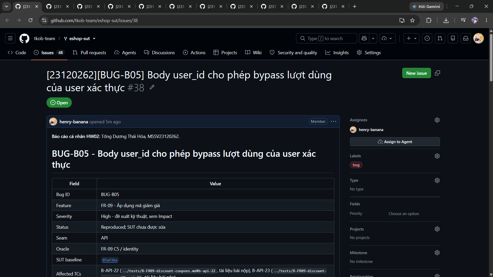

# BUG-B05 - Body user_id cho phép bypass lượt dùng của user xác thực

| Field | Value |
|---|---|
| Bug ID | BUG-B05 |
| Feature | FR-09 - Áp dụng mã giảm giá |
| Severity | High - đề xuất kỹ thuật, xem Impact |
| Status | Reproduced; SUT chưa được sửa |
| Seam | API |
| Oracle | FR-09 C5 / identity |
| SUT baseline | 85af3ba875c88283615e22cb108f13e2fccaf0e9 |
| Affected TCs | [B-API-22](../tests/B-FR09-discount-coupons.md#b-api-22), [B-API-23](../tests/B-FR09-discount-coupons.md#b-api-23) |
| GitHub Issue | [#38](https://github.com/tkob-team/eshop-sut/issues/38) - OPEN |
| Screenshot coverage | Có raw API trace; còn thiếu ảnh terminal/API cho Issue |

## 1. Mô tả và điều kiện kích hoạt

Body user_id cho phép bypass lượt dùng của user xác thực. Server đếm usage theo body.user_id; khi thiếu user_id thì bỏ kiểm tra usage; không dùng JWT identity.

Lỗi được nhóm theo behavior; các giá trị biên/biến thể cùng nguyên nhân không tạo một bug mới cho mỗi TC FAIL.

## 2. Environment và preconditions

- Reset tám coupon; user2/VIP100 used=2, limit=2; user3 used=0. Coupon trong request phải có đúng type/value/minimum của fixture.
- Authentication request mục tiêu: `user`.

Run xác nhận: Windows, Node v24.16.0; backend copy tại `http://127.0.0.1:3100`; SUT clock cố định `2026-10-19T08:00:00.000Z`. Timestamp actual dùng UTC thật. Source/database gốc được đối chiếu SHA-256 trước/sau suite và không thay đổi. Header `Content-Type: application/json`; `Authorization: Bearer <JWT đúng role>` trừ missing/invalid/expired case. Demo login và dữ liệu nominal đầy đủ có trong [fixture của test report](../tests/B-FR09-discount-coupons.md#1-phạm-vi-quy-ước-và-fixture).

User2 có đúng hai row usage của VIP100 (limit2), user3 có0. Cả hai user vẫn có token hợp lệ; thay body user_id không thay JWT user2. Fixture SQL dựng trạng thái completed usage, không giả rằng bấm Apply tạo usage.

## 3. Steps to Reproduce

1. Chuẩn bị isolated fixture và lấy JWT đúng role như Preconditions; xác minh nominal trước khi thay điều kiện mục tiêu.
2. Gửi `POST /api/apply-coupon` với authentication `user` và JSON Input bên dưới.
3. Đối chiếu response và hậu điều kiện với Expected; chỉ GET/readback là quan sát, fixture SQL không được dùng làm oracle.

### Request mục tiêu đầy đủ của representative

`POST /api/apply-coupon`; authentication `user`.

```json
{
  "code": "VIP100",
  "total_amount": 400000,
  "user_id": 3
}
```

Tái hiện qua HTTP theo request, authentication và preconditions nêu trên. Full raw record giữ nguyên kết quả thực thi; script hỗ trợ chạy được quản lý ngoài repository nộp bài.

## 4. Expected Result

Reject: user 2 already used limit; client user_id is not identity.

Expected bắt buộc ở mức hành vi của SRS/mapping. HTTP status hoặc câu chữ error chỉ là contract bắt buộc khi có nguồn; không tự yêu cầu một error string cụ thể nếu SRS không quy định. Với request bị reject, dữ liệu phải giữ nguyên theo hậu điều kiện.

## 5. Actual Result và hậu điều kiện

Timestamp UTC: `2026-10-19T19:50:59.342Z`. Trace sau giữ nguyên request/status/field values; danh sách dài chỉ giữ row liên quan và row_count, full record được liên kết.

```json
[
  {
    "method": "POST",
    "url": "/api/apply-coupon",
    "authentication": "user",
    "input": {
      "code": "VIP100",
      "total_amount": 400000,
      "user_id": 3
    },
    "status": 200,
    "body": {
      "success": true,
      "coupon_id": 175,
      "discount_amount": 100000,
      "final_amount": 300000,
      "message": "Áp dụng thành công! Giảm 100,000 ₫"
    }
  }
]
```

[Full record B-API-22](../evidence/execution/B-api.md#b-api-22).

## 6. Các biến thể và traceability

| TC | Input | Status | Evidence |
|---|---|---|---|
| B-API-22 | {"code": "VIP100", "total_amount": 400000, "user_id": 3} | FAIL | [raw](../evidence/execution/B-api.md#b-api-22) |
| B-API-23 | {"code": "VIP100", "total_amount": 400000} | FAIL | [raw](../evidence/execution/B-api.md#b-api-23) |

## 7. Impact và severity rationale

User 2 đã dùng hết VIP100 vẫn nhận discount khi giả user3 hoặc bỏ user_id. Chưa chứng minh checkout thực tế được hoàn tất với lượt bypass.

Severity High được đề xuất theo ảnh hưởng tới tính đúng đắn dữ liệu, quyền truy cập hoặc phép tính tiền của behavior này; chưa phải mức do giảng viên duyệt. Bug không đồng nghĩa một sự cố production đã xảy ra.

## 8. Root Cause và hướng khắc phục đề xuất

Server đếm usage theo body.user_id; khi thiếu user_id thì bỏ kiểm tra usage; không dùng JWT identity.

[Source baseline](https://github.com/ttbhanh/eshop-sut/blob/85af3ba875c88283615e22cb108f13e2fccaf0e9/backend/server.js). Source giải thích cơ chế; xác nhận runtime dựa trên evidence ở trên.

Sau authentication, lấy ID từ JWT; không tin client user_id; dùng fixture completed usage=2 để regression.

Đây là đề xuất, chưa sửa SUT và chưa chạy retest sau fix.

## 9. Screenshots và GitHub Issue

Raw HTTP record là evidence của run đã thực hiện. Chưa có screenshot API thật cho bug này; không dùng ảnh một UI khác làm chứng cứ thay thế.

Issue URL/number: [#38](https://github.com/tkob-team/eshop-sut/issues/38). Đã đăng và đọc lại bằng GitHub CLI. Đã có ảnh phần đầu trang Issue; ảnh bug đính kèm và phần nội dung phía dưới chưa được xác minh lại; [trạng thái evidence](../evidence/github-issues/README.md). Không coi việc tạo Issue là đã có screenshot.

### Ảnh trang Issue



## 10. Regression checklist

- Chạy lại representative và các lân cận/biến thể liên quan trong bảng TC.
- Kiểm valid nominal vẫn thành công, invalid không làm đổi state.
- Với auth/role: kiểm riêng none/invalid/user/admin; với API+UI: retest cả hai lớp.
- Ghi run mới sau fix riêng; giữ evidence baseline hiện tại để đối chiếu.
