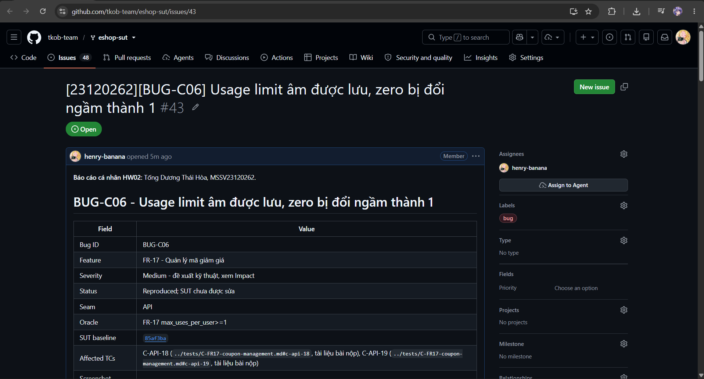

# BUG-C06 - Usage limit âm được lưu, zero bị đổi ngầm thành 1

| Field | Value |
|---|---|
| Bug ID | BUG-C06 |
| Feature | FR-17 - Quản lý mã giảm giá |
| Severity | Medium - đề xuất kỹ thuật, xem Impact |
| Status | Reproduced; SUT chưa được sửa |
| Seam | API |
| Oracle | FR-17 max_uses_per_user>=1 |
| SUT baseline | 85af3ba875c88283615e22cb108f13e2fccaf0e9 |
| Affected TCs | [C-API-18](../tests/C-FR17-coupon-management.md#c-api-18), [C-API-19](../tests/C-FR17-coupon-management.md#c-api-19) |
| GitHub Issue | [#43](https://github.com/tkob-team/eshop-sut/issues/43) - OPEN |
| Screenshot coverage | Có raw API trace; còn thiếu ảnh terminal/API cho Issue |

## 1. Mô tả và điều kiện kích hoạt

Usage limit âm được lưu, zero bị đổi ngầm thành 1. Source dùng max_uses_per_user || 1: 0 trở thành1, -1 truthy nên giữ nguyên. Không phải Math.max.

Lỗi được nhóm theo behavior; các giá trị biên/biến thể cùng nguyên nhân không tạo một bug mới cho mỗi TC FAIL.

## 2. Environment và preconditions

- Reset coupon list có SAVE10 và DELETE_ME. Admin token dùng cho GET trước/sau; token của request mục tiêu theo bảng dưới. Chỉ thay field/role được nêu.
- Authentication request mục tiêu: `admin`.

Run xác nhận: Windows, Node v24.16.0; backend copy tại `http://127.0.0.1:3100`; SUT clock cố định `2026-10-19T08:00:00.000Z`. Timestamp actual dùng UTC thật. Source/database gốc được đối chiếu SHA-256 trước/sau suite và không thay đổi. Header `Content-Type: application/json`; `Authorization: Bearer <JWT đúng role>` trừ missing/invalid/expired case. Demo login và dữ liệu nominal đầy đủ có trong [fixture của test report](../tests/C-FR17-coupon-management.md#1-phạm-vi-quy-ước-và-fixture).

## 3. Steps to Reproduce

1. Chuẩn bị isolated fixture và lấy JWT đúng role như Preconditions; xác minh nominal trước khi thay điều kiện mục tiêu.
2. Gửi `GET /api/coupons` với authentication `admin`; không có request body.
3. Gửi `POST /api/admin/coupons` với authentication `admin` và JSON Input bên dưới.
4. Gửi `GET /api/coupons` với authentication `admin`; không có request body.
5. Đối chiếu response và hậu điều kiện với Expected; chỉ GET/readback là quan sát, fixture SQL không được dùng làm oracle.

### Request mục tiêu đầy đủ của representative

`POST /api/admin/coupons`; authentication `admin`.

```json
{
  "code": "HW02_NEW",
  "type": "fixed",
  "discount_value": 1,
  "min_order_amount": 0,
  "expired_at": "2099-12-31",
  "max_uses_per_user": 0
}
```

Tái hiện qua HTTP theo request, authentication và preconditions nêu trên. Full raw record giữ nguyên kết quả thực thi; script hỗ trợ chạy được quản lý ngoài repository nộp bài.

## 4. Expected Result

Reject invalid coupon; list has no newly created record.

Expected bắt buộc ở mức hành vi của SRS/mapping. HTTP status hoặc câu chữ error chỉ là contract bắt buộc khi có nguồn; không tự yêu cầu một error string cụ thể nếu SRS không quy định. Với request bị reject, dữ liệu phải giữ nguyên theo hậu điều kiện.

## 5. Actual Result và hậu điều kiện

Timestamp UTC: `2026-10-19T20:08:01.248Z`. Trace sau giữ nguyên request/status/field values; danh sách dài chỉ giữ row liên quan và row_count, full record được liên kết.

```json
[
  {
    "method": "GET",
    "url": "/api/coupons",
    "authentication": "admin",
    "input": null,
    "status": 200,
    "body": {
      "row_count": 8,
      "relevant_rows": [
        {
          "id": 166,
          "code": "SAVE10",
          "type": "percent",
          "discount_value": 10,
          "min_order_amount": 300000,
          "expired_at": "2099-12-31",
          "is_active": 1,
          "max_uses_per_user": 1
        },
        {
          "id": 173,
          "code": "DELETE_ME",
          "type": "fixed",
          "discount_value": 1,
          "min_order_amount": 0,
          "expired_at": "2099-12-31",
          "is_active": 1,
          "max_uses_per_user": 1
        }
      ]
    }
  },
  {
    "method": "POST",
    "url": "/api/admin/coupons",
    "authentication": "admin",
    "input": {
      "code": "HW02_NEW",
      "type": "fixed",
      "discount_value": 1,
      "min_order_amount": 0,
      "expired_at": "2099-12-31",
      "max_uses_per_user": 0
    },
    "status": 200,
    "body": {
      "message": "Coupon created",
      "id": 174
    }
  },
  {
    "method": "GET",
    "url": "/api/coupons",
    "authentication": "admin",
    "input": null,
    "status": 200,
    "body": {
      "row_count": 9,
      "relevant_rows": [
        {
          "id": 166,
          "code": "SAVE10",
          "type": "percent",
          "discount_value": 10,
          "min_order_amount": 300000,
          "expired_at": "2099-12-31",
          "is_active": 1,
          "max_uses_per_user": 1
        },
        {
          "id": 173,
          "code": "DELETE_ME",
          "type": "fixed",
          "discount_value": 1,
          "min_order_amount": 0,
          "expired_at": "2099-12-31",
          "is_active": 1,
          "max_uses_per_user": 1
        },
        {
          "id": 174,
          "code": "HW02_NEW",
          "type": "fixed",
          "discount_value": 1,
          "min_order_amount": 0,
          "expired_at": "2099-12-31",
          "is_active": 1,
          "max_uses_per_user": 1
        }
      ]
    }
  }
]
```

[Full record C-API-19](../evidence/execution/C-api.md#c-api-19).

C-API-18 gửi -1 và lưu -1; C-API-19 gửi0 nhưng lưu1. Đây là hai biến thể không đáp ứng reject input invalid; không đảo TC-ID.

## 6. Các biến thể và traceability

| TC | Input | Status | Evidence |
|---|---|---|---|
| C-API-18 | {"code": "HW02_NEW", "type": "fixed", "discount_value": 1, "min_order_amount": 0, "expired_at": "2099-12-31", "max_uses_per_user": -1} | FAIL | [raw](../evidence/execution/C-api.md#c-api-18) |
| C-API-19 | {"code": "HW02_NEW", "type": "fixed", "discount_value": 1, "min_order_amount": 0, "expired_at": "2099-12-31", "max_uses_per_user": 0} | FAIL | [raw](../evidence/execution/C-api.md#c-api-19) |

## 7. Impact và severity rationale

API trả thành công cho input invalid; zero bị đổi ngầm. C-UI-04 chỉ chặn ở browser và không sửa được API.

Severity Medium được đề xuất theo ảnh hưởng tới tính đúng đắn dữ liệu, quyền truy cập hoặc phép tính tiền của behavior này; chưa phải mức do giảng viên duyệt. Bug không đồng nghĩa một sự cố production đã xảy ra.

## 8. Root Cause và hướng khắc phục đề xuất

Source dùng max_uses_per_user || 1: 0 trở thành1, -1 truthy nên giữ nguyên. Không phải Math.max.

[Source baseline](https://github.com/ttbhanh/eshop-sut/blob/85af3ba875c88283615e22cb108f13e2fccaf0e9/backend/server.js). Source giải thích cơ chế; xác nhận runtime dựa trên evidence ở trên.

Validate số lượt >=1 trước default/INSERT; chỉ default khi spec cho phép missing, không dùng truthiness thay validation.

Đây là đề xuất, chưa sửa SUT và chưa chạy retest sau fix.

## 9. Screenshots và GitHub Issue

Raw HTTP record là evidence của run đã thực hiện. Chưa có screenshot API thật cho bug này; không dùng ảnh một UI khác làm chứng cứ thay thế.

Issue URL/number: [#43](https://github.com/tkob-team/eshop-sut/issues/43). Đã đăng và đọc lại bằng GitHub CLI. Đã có ảnh phần đầu trang Issue; ảnh bug đính kèm và phần nội dung phía dưới chưa được xác minh lại; [trạng thái evidence](../evidence/github-issues/README.md). Không coi việc tạo Issue là đã có screenshot.

### Ảnh trang Issue



## 10. Regression checklist

- Chạy lại representative và các lân cận/biến thể liên quan trong bảng TC.
- Kiểm valid nominal vẫn thành công, invalid không làm đổi state.
- Với auth/role: kiểm riêng none/invalid/user/admin; với API+UI: retest cả hai lớp.
- Ghi run mới sau fix riêng; giữ evidence baseline hiện tại để đối chiếu.
