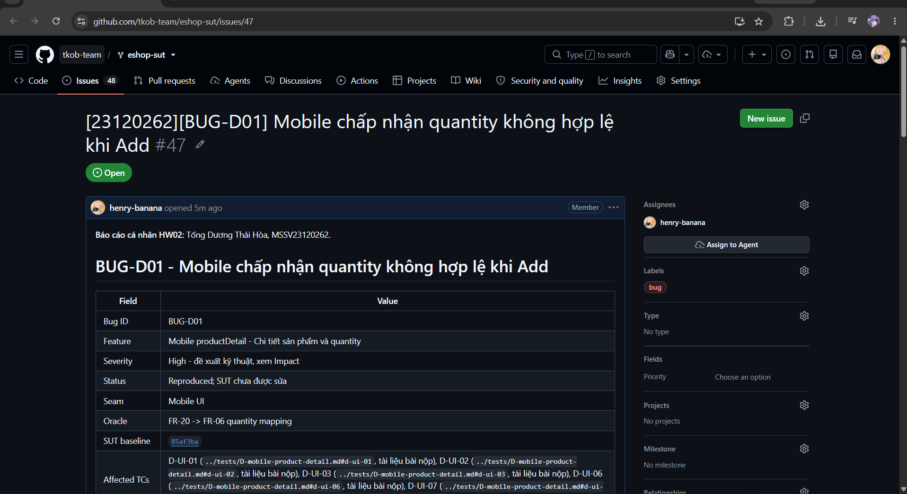

# BUG-D01 - Mobile chấp nhận quantity không hợp lệ khi Add

| Field | Value |
|---|---|
| Bug ID | BUG-D01 |
| Feature | Mobile productDetail - Chi tiết sản phẩm và quantity |
| Severity | High - đề xuất kỹ thuật, xem Impact |
| Status | Reproduced; SUT chưa được sửa |
| Seam | Mobile UI |
| Oracle | FR-20 -> FR-06 quantity mapping |
| SUT baseline | 85af3ba875c88283615e22cb108f13e2fccaf0e9 |
| Affected TCs | [D-UI-01](../tests/D-mobile-product-detail.md#d-ui-01), [D-UI-02](../tests/D-mobile-product-detail.md#d-ui-02), [D-UI-03](../tests/D-mobile-product-detail.md#d-ui-03), [D-UI-06](../tests/D-mobile-product-detail.md#d-ui-06), [D-UI-07](../tests/D-mobile-product-detail.md#d-ui-07), [D-UI-08](../tests/D-mobile-product-detail.md#d-ui-08) |
| GitHub Issue | [#47](https://github.com/tkob-team/eshop-sut/issues/47) - OPEN |
| Screenshot coverage | Có ảnh UI cụ thể dưới đây |

## 1. Mô tả và điều kiện kích hoạt

Mobile chấp nhận quantity không hợp lệ khi Add. normalizeQuantity dùng parseInt(value,10); invalid/không dương default1, fraction/mixed text bị truncate rồi nhận như số nguyên.

Lỗi được nhóm theo behavior; các giá trị biên/biến thể cùng nguyên nhân không tạo một bug mới cho mỗi TC FAIL.

## 2. Environment và preconditions

Ảnh thực tế từ Expo Go/Android; account D-UI-01, không suy phiên bản Android/Expo khi chưa có log. Dùng baseline và mapping đã ghi. Giữ nguyên bytes ảnh; không có video/HTTP trace UI tự động của lượt chụp.

## 3. Steps to Reproduce

1. Mở Expo Go/Android, ghi account thực tế; xóa giỏ trước TC làm thay đổi giỏ. Mở detail đúng product ID; ghi đơn giá.
2. Thay toàn bộ quantity bằng literal thiết kế; không để ký tự cũ; chụp màn hình trước Add.
3. Bấm Thêm vào giỏ hàng; chụp alert/feedback.
4. Mở cart, không chỉnh quantity trong cart; chụp cùng product và tính đơn giáxquantity. Với invalid, expected là cart không thay đổi.

### Input thiết kế

```json
{
  "product": 1,
  "quantity": ""
}
```

**Variant thực tế:** Không đổi dữ liệu thiết kế.

## 4. Expected Result

Reject empty quantity; no new cart item.

Expected bắt buộc ở mức hành vi của SRS/mapping. HTTP status hoặc câu chữ error chỉ là contract bắt buộc khi có nguồn; không tự yêu cầu một error string cụ thể nếu SRS không quy định. Với request bị reject, dữ liệu phải giữ nguyên theo hậu điều kiện.

## 5. Actual Result và hậu điều kiện

Nhập quantity="" vẫn nhận alert thêm thành công; ảnh cart cho thấy sản phẩm có quantity=1.

## 6. Các biến thể và traceability

| TC | Input | Status | Evidence |
|---|---|---|---|
| D-UI-01 | {"product": 1, "quantity": ""} | FAIL | [UI case](../tests/D-mobile-product-detail.md#d-ui-01) |
| D-UI-02 | {"product": 1, "quantity": "-1"} | FAIL | [UI case](../tests/D-mobile-product-detail.md#d-ui-02) |
| D-UI-03 | {"product": 1, "quantity": "0"} | FAIL | [UI case](../tests/D-mobile-product-detail.md#d-ui-03) |
| D-UI-06 | {"product": 1, "quantity": "1.5"} | FAIL | [UI case](../tests/D-mobile-product-detail.md#d-ui-06) |
| D-UI-07 | {"product": 1, "quantity": "abc"} | FAIL | [UI case](../tests/D-mobile-product-detail.md#d-ui-07) |
| D-UI-08 | {"product": 1, "quantity": "1abc"} | FAIL | [UI case](../tests/D-mobile-product-detail.md#d-ui-08) |

## 7. Impact và severity rationale

Có ảnh cart=1 cho empty/-1/0/1.5/abc. Riêng 1abc chỉ xác nhận alert thêm thành công; không có ảnh cart riêng.

Severity High được đề xuất theo ảnh hưởng tới tính đúng đắn dữ liệu, quyền truy cập hoặc phép tính tiền của behavior này; chưa phải mức do giảng viên duyệt. Bug không đồng nghĩa một sự cố production đã xảy ra.

## 8. Root Cause và hướng khắc phục đề xuất

normalizeQuantity dùng parseInt(value,10); invalid/không dương default1, fraction/mixed text bị truncate rồi nhận như số nguyên.

[Source baseline](https://github.com/ttbhanh/eshop-sut/blob/85af3ba875c88283615e22cb108f13e2fccaf0e9/frontend-mobile/App.js). Source giải thích cơ chế; xác nhận runtime dựa trên evidence ở trên.

Validate toàn bộ input là số nguyên dương trước Add; invalid không thay cart và có thông báo rõ ràng.

Đây là đề xuất, chưa sửa SUT và chưa chạy retest sau fix.

## 9. Screenshots và GitHub Issue


Issue URL/number: [#47](https://github.com/tkob-team/eshop-sut/issues/47). Đã đăng và đọc lại bằng GitHub CLI. Đã có ảnh phần đầu trang Issue; ảnh bug đính kèm và phần nội dung phía dưới chưa được xác minh lại; [trạng thái evidence](../evidence/github-issues/README.md). Không coi việc tạo Issue là đã có screenshot.

### Ảnh trang Issue



## 10. Regression checklist

- Chạy lại representative và các lân cận/biến thể liên quan trong bảng TC.
- Kiểm valid nominal vẫn thành công, invalid không làm đổi state.
- Với auth/role: kiểm riêng none/invalid/user/admin; với API+UI: retest cả hai lớp.
- Ghi run mới sau fix riêng; giữ evidence baseline hiện tại để đối chiếu.
