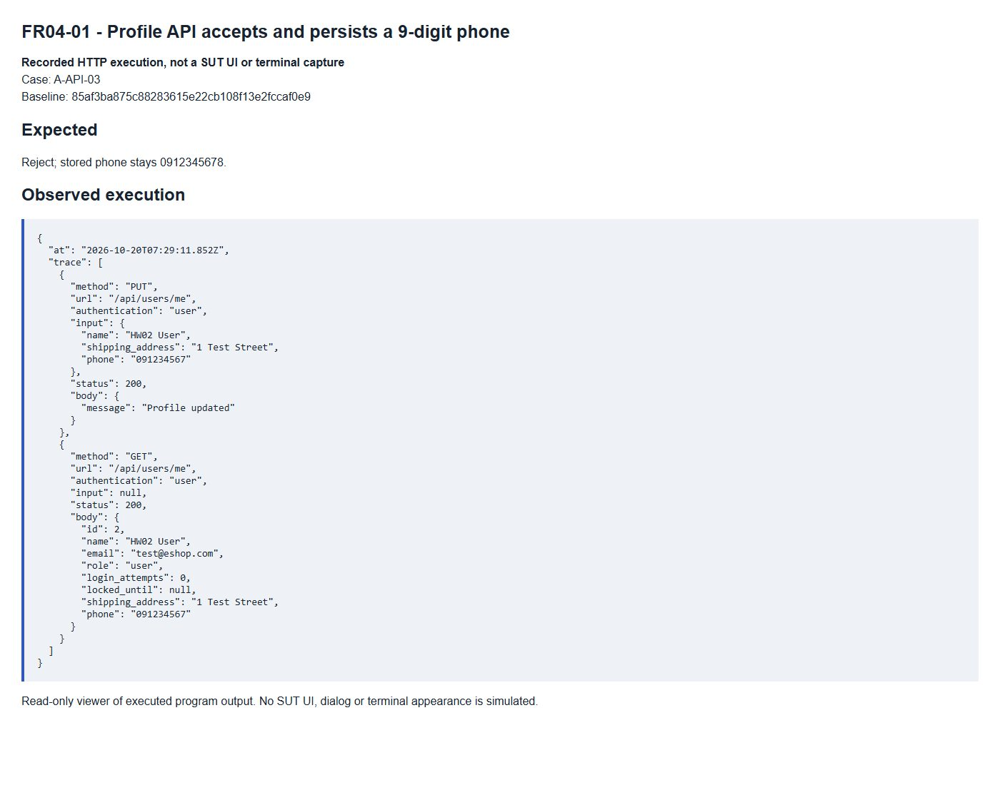

# FR04-01 - Profile API accepts and persists a 9-digit phone

| Field | Value |
|---|---|
| Finding | FR04-01 |
| Requirement | FR04 |
| Severity | High |
| Test cases | A-API-03 |
| GitHub Issue | https://github.com/tkob-team/eshop-sut/issues/97 |

## Summary

Profile API accepts and persists a 9-digit phone. This issue covers the specific condition represented by A-API-03.

## Environment

- Baseline: `85af3ba875c88283615e22cb108f13e2fccaf0e9`.
- Selected requirement: FR04; oracle: FR-04; phone starts with 0 and has 10-11 digits.
- Interface: API.
- Severity: High.
- Isolated demo source/database; no fix applied to the original SUT.

## Preconditions

Start a disposable copy of the fixed baseline. For API calls obtain a JWT through `POST /api/login`: regular user `test@eshop.com` / `Test1234!`, admin `admin@eshop.com` / `Admin123!`. These are public demo fixtures, not personal credentials. Use JSON requests and the role shown in the captured request. The server clock for API cases is fixed at `2026-10-19T08:00:00.000Z`.

Restore the target account to role=user, name=Test User, phone=0912345678 and shipping_address=1 Test Street. Keep fields other than the target condition nominal. Do not restore the fixture between the write and its readback.

## Steps to reproduce

1. Send `PUT /api/users/me` with authentication `user` and the exact input shown in the captured request/result below.
2. Send `GET /api/users/me` with authentication `user` and the exact input shown in the captured request/result below.
3. Compare the response and persisted/readback state with the expected criterion. Numeric IDs are run-specific: resolve the fixture record by code/identity when reproducing.

## Expected result

Reject; stored phone stays 0912345678.

## Actual result

```json
{
  "at": "2026-10-20T07:29:11.852Z",
  "trace": [
    {
      "method": "PUT",
      "url": "/api/users/me",
      "authentication": "user",
      "input": {
        "name": "HW02 User",
        "shipping_address": "1 Test Street",
        "phone": "091234567"
      },
      "status": 200,
      "body": {
        "message": "Profile updated"
      }
    },
    {
      "method": "GET",
      "url": "/api/users/me",
      "authentication": "user",
      "input": null,
      "status": 200,
      "body": {
        "id": 2,
        "name": "HW02 User",
        "email": "test@eshop.com",
        "role": "user",
        "login_attempts": 0,
        "locked_until": null,
        "shipping_address": "1 Test Street",
        "phone": "091234567"
      }
    }
  ]
}
```

## Impact

An invalid phone is stored as account contact data, bypassing the required format and making downstream contact data unreliable.

## Root cause

The update route writes phone directly without validating its prefix, length or character set.

[Affected source at the fixed baseline](https://github.com/tkob-team/eshop-sut/blob/85af3ba875c88283615e22cb108f13e2fccaf0e9/backend/server.js).

## Suggested correction

Validate the canonical phone contract on the server before updating any profile fields.

## Evidence



## Regression checks

- Repeat the documented trigger and verify the expected criterion.
- Check valid nominal and neighboring inputs with the other constraints held valid.
- Check persistence or readback where applicable.
- Record a separate post-fix run; no fix or passing post-fix result is claimed here.

## Traceability

- [A-API-03](../tests/A-FR04-profile.md#a-api-03).

[Execution records](../evidence/execution/A-execution.md); [GitHub page evidence](../evidence/github-issues/README.md).
