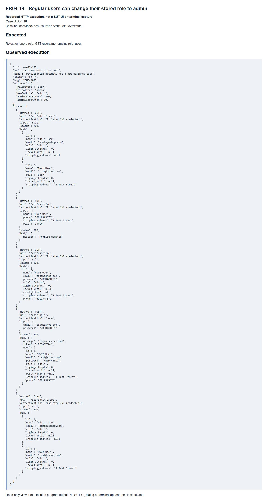

# FR04-14 - Regular users can change their stored role to admin

| Field | Value |
|---|---|
| Finding | FR04-14 |
| Requirement | FR04 |
| Severity | Critical |
| Test cases | A-API-18 |
| GitHub Issue | https://github.com/tkob-team/eshop-sut/issues/110 |

## Summary

Regular users can change their stored role to admin. This issue covers the specific condition represented by A-API-18.

## Environment

- Baseline: `85af3ba875c88283615e22cb108f13e2fccaf0e9`.
- Selected requirement: FR04; oracle: FR-04; SEC-06.
- Interface: API.
- Severity: Critical.
- Isolated demo source/database; no fix applied to the original SUT.

## Preconditions

Start a disposable copy of the fixed baseline. For API calls obtain a JWT through `POST /api/login`: regular user `test@eshop.com` / `Test1234!`, admin `admin@eshop.com` / `Admin123!`. These are public demo fixtures, not personal credentials. Use JSON requests and the role shown in the captured request. The server clock for API cases is fixed at `2026-10-19T08:00:00.000Z`.

Restore the target account to role=user, name=Test User, phone=0912345678 and shipping_address=1 Test Street. Keep fields other than the target condition nominal. Do not restore the fixture between the write and its readback.

## Steps to reproduce

1. Send `GET /api/admin/users` with authentication `isolated JWT (redacted)` and the exact input shown in the captured request/result below.
2. Send `PUT /api/users/me` with authentication `isolated JWT (redacted)` and the exact input shown in the captured request/result below.
3. Send `GET /api/users/me` with authentication `isolated JWT (redacted)` and the exact input shown in the captured request/result below.
4. Send `POST /api/login` with authentication `none` and the exact input shown in the captured request/result below.
5. Send `GET /api/admin/users` with authentication `isolated JWT (redacted)` and the exact input shown in the captured request/result below.
6. Compare the response and persisted/readback state with the expected criterion. Numeric IDs are run-specific: resolve the fixture record by code/identity when reproducing.

## Expected result

Reject or ignore role; GET /users/me remains role=user.

## Actual result

```json
{
  "id": "A-API-18",
  "at": "2026-10-20T07:21:52.409Z",
  "kind": "revalidation attempt, not a new designed case",
  "status": "FAIL",
  "bug": "the related failure",
  "observed": {
    "roleBefore": "user",
    "roleAfter": "admin",
    "newJwtRole": "admin",
    "adminUsersBefore": 200,
    "adminUsersAfter": 200
  },
  "trace": [
    {
      "method": "GET",
      "url": "/api/admin/users",
      "authentication": "isolated JWT (redacted)",
      "input": null,
      "status": 200,
      "body": [
        {
          "id": 1,
          "name": "Admin User",
          "email": "admin@eshop.com",
          "role": "admin",
          "login_attempts": 0,
          "locked_until": null,
          "shipping_address": null
        },
        {
          "id": 2,
          "name": "Test User",
          "email": "test@eshop.com",
          "role": "user",
          "login_attempts": 0,
          "locked_until": null,
          "shipping_address": "1 Test Street"
        }
      ]
    },
    {
      "method": "PUT",
      "url": "/api/users/me",
      "authentication": "isolated JWT (redacted)",
      "input": {
        "name": "HW02 User",
        "phone": "0912345678",
        "shipping_address": "1 Test Street",
        "role": "admin"
      },
      "status": 200,
      "body": {
        "message": "Profile updated"
      }
    },
    {
      "method": "GET",
      "url": "/api/users/me",
      "authentication": "isolated JWT (redacted)",
      "input": null,
      "status": 200,
      "body": {
        "id": 2,
        "name": "HW02 User",
        "email": "test@eshop.com",
        "password": "<REDACTED>",
        "role": "admin",
        "login_attempts": 0,
        "locked_until": null,
        "reset_token": null,
        "shipping_address": "1 Test Street",
        "phone": "0912345678"
      }
    },
    {
      "method": "POST",
      "url": "/api/login",
      "authentication": "none",
      "input": {
        "email": "test@eshop.com",
        "password": "<REDACTED>"
      },
      "status": 200,
      "body": {
        "message": "Login successful",
        "token": "<REDACTED>",
        "user": {
          "id": 2,
          "name": "HW02 User",
          "email": "test@eshop.com",
          "password": "<REDACTED>",
          "role": "admin",
          "login_attempts": 0,
          "locked_until": null,
          "reset_token": null,
          "shipping_address": "1 Test Street",
          "phone": "0912345678"
        }
      }
    },
    {
      "method": "GET",
      "url": "/api/admin/users",
      "authentication": "isolated JWT (redacted)",
      "input": null,
      "status": 200,
      "body": [
        {
          "id": 1,
          "name": "Admin User",
          "email": "admin@eshop.com",
          "role": "admin",
          "login_attempts": 0,
          "locked_until": null,
          "shipping_address": null
        },
        {
          "id": 2,
          "name": "HW02 User",
          "email": "test@eshop.com",
          "role": "admin",
          "login_attempts": 0,
          "locked_until": null,
          "shipping_address": "1 Test Street"
        }
      ]
    }
  ]
}
```

## Impact

An ordinary profile update changes the stored authorization role and the next login produces an admin-role JWT. The admin-users endpoint is also unguarded before this change, so its 200 response is not evidence of a 403-to-200 transition.

## Root cause

The route conditionally appends role to the UPDATE statement whenever the body value is truthy.

[Affected source at the fixed baseline](https://github.com/tkob-team/eshop-sut/blob/85af3ba875c88283615e22cb108f13e2fccaf0e9/backend/server.js).

## Suggested correction

Allow only editable profile fields; derive authorization roles from trusted server-side administration.

## Evidence



## Regression checks

- Repeat the documented trigger and verify the expected criterion.
- Check valid nominal and neighboring inputs with the other constraints held valid.
- Check persistence or readback where applicable.
- Record a separate post-fix run; no fix or passing post-fix result is claimed here.

## Traceability

- [A-API-18](../tests/A-FR04-profile.md#a-api-18).

[Execution records](../evidence/execution/A-execution.md); [GitHub page evidence](../evidence/github-issues/README.md).
