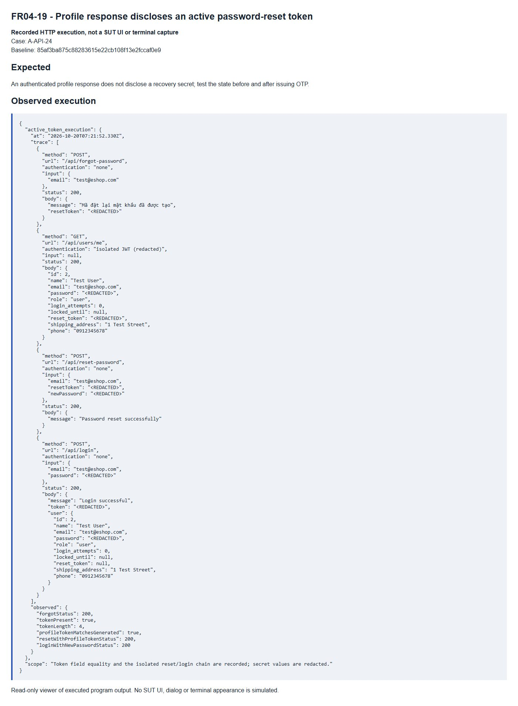

# FR04-19 - Profile response discloses an active password-reset token

| Field | Value |
|---|---|
| Finding | FR04-19 |
| Requirement | FR04 |
| Severity | Critical |
| Test cases | A-API-24 |
| GitHub Issue | https://github.com/tkob-team/eshop-sut/issues/115 |

## Summary

Profile response discloses an active password-reset token. This issue covers the specific condition represented by A-API-24.

## Environment

- Baseline: `85af3ba875c88283615e22cb108f13e2fccaf0e9`.
- Selected requirement: FR04; oracle: SEC-01 storage rule; supplementary OWASP API3 response minimization.
- Interface: API.
- Severity: Critical.
- Isolated demo source/database; no fix applied to the original SUT.

## Preconditions

Start a disposable copy of the fixed baseline. For API calls obtain a JWT through `POST /api/login`: regular user `test@eshop.com` / `Test1234!`, admin `admin@eshop.com` / `Admin123!`. These are public demo fixtures, not personal credentials. Use JSON requests and the role shown in the captured request. The server clock for API cases is fixed at `2026-10-19T08:00:00.000Z`.

Restore the target account to role=user, name=Test User, phone=0912345678 and shipping_address=1 Test Street. Keep fields other than the target condition nominal. Do not restore the fixture between the write and its readback.

## Steps to reproduce

1. Send `POST /api/forgot-password` with authentication `none` and the exact input shown in the captured request/result below.
2. Send `GET /api/users/me` with authentication `isolated JWT (redacted)` and the exact input shown in the captured request/result below.
3. Send `POST /api/reset-password` with authentication `none` and the exact input shown in the captured request/result below.
4. Send `POST /api/login` with authentication `none` and the exact input shown in the captured request/result below.
5. Compare the response and persisted/readback state with the expected criterion. Numeric IDs are run-specific: resolve the fixture record by code/identity when reproducing.

## Expected result

An authenticated profile response does not disclose a recovery secret; test the state before and after issuing OTP.

## Actual result

```json
{
  "active_token_execution": {
    "at": "2026-10-20T07:21:52.330Z",
    "trace": [
      {
        "method": "POST",
        "url": "/api/forgot-password",
        "authentication": "none",
        "input": {
          "email": "test@eshop.com"
        },
        "status": 200,
        "body": {
          "message": "Mã đặt lại mật khẩu đã được tạo",
          "resetToken": "<REDACTED>"
        }
      },
      {
        "method": "GET",
        "url": "/api/users/me",
        "authentication": "isolated JWT (redacted)",
        "input": null,
        "status": 200,
        "body": {
          "id": 2,
          "name": "Test User",
          "email": "test@eshop.com",
          "password": "<REDACTED>",
          "role": "user",
          "login_attempts": 0,
          "locked_until": null,
          "reset_token": "<REDACTED>",
          "shipping_address": "1 Test Street",
          "phone": "0912345678"
        }
      },
      {
        "method": "POST",
        "url": "/api/reset-password",
        "authentication": "none",
        "input": {
          "email": "test@eshop.com",
          "resetToken": "<REDACTED>",
          "newPassword": "<REDACTED>"
        },
        "status": 200,
        "body": {
          "message": "Password reset successfully"
        }
      },
      {
        "method": "POST",
        "url": "/api/login",
        "authentication": "none",
        "input": {
          "email": "test@eshop.com",
          "password": "<REDACTED>"
        },
        "status": 200,
        "body": {
          "message": "Login successful",
          "token": "<REDACTED>",
          "user": {
            "id": 2,
            "name": "Test User",
            "email": "test@eshop.com",
            "password": "<REDACTED>",
            "role": "user",
            "login_attempts": 0,
            "locked_until": null,
            "reset_token": null,
            "shipping_address": "1 Test Street",
            "phone": "0912345678"
          }
        }
      }
    ],
    "observed": {
      "forgotStatus": 200,
      "tokenPresent": true,
      "tokenLength": 4,
      "profileTokenMatchesGenerated": true,
      "resetWithProfileTokenStatus": 200,
      "loginWithNewPasswordStatus": 200
    }
  },
  "scope": "Token field equality and the isolated reset/login chain are recorded; secret values are redacted."
}
```

## Impact

A caller holding a user JWT can retrieve that account's plaintext password and active recovery token. The isolated recovery chain accepted the leaked token and the replacement password worked. Credential reuse elsewhere is a plausible additional risk, not an executed attack.

## Root cause

Profile uses SELECT * and serializes the complete row; login serializes the complete user object. Plaintext password storage is separately evidenced as a contributing security weakness.

[Affected source at the fixed baseline](https://github.com/tkob-team/eshop-sut/blob/85af3ba875c88283615e22cb108f13e2fccaf0e9/backend/server.js).

## Suggested correction

Project allowed response fields, exclude recovery secrets, and use a proper password hash. SEC-02 alone is not claimed to define a response schema.

## Evidence



## Regression checks

- Repeat the documented trigger and verify the expected criterion.
- Check valid nominal and neighboring inputs with the other constraints held valid.
- Check persistence or readback where applicable.
- Record a separate post-fix run; no fix or passing post-fix result is claimed here.

## Traceability

- [A-API-24](../tests/A-FR04-profile.md#a-api-24).

[Execution records](../evidence/execution/A-execution.md); [GitHub page evidence](../evidence/github-issues/README.md).
