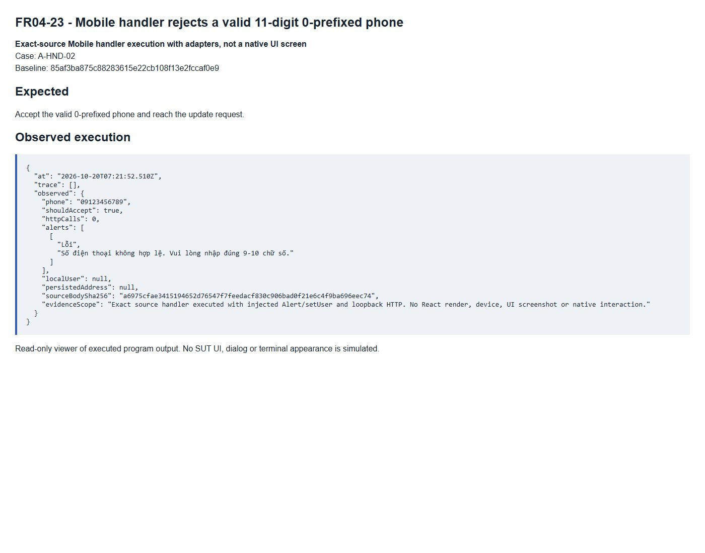

# FR04-23 - Mobile handler rejects a valid 11-digit 0-prefixed phone

| Field | Value |
|---|---|
| Finding | FR04-23 |
| Requirement | FR04 |
| Severity | High |
| Test cases | A-HND-02 |
| GitHub Issue | https://github.com/tkob-team/eshop-sut/issues/119 |

## Summary

Mobile handler rejects a valid 11-digit 0-prefixed phone. This issue covers the specific condition represented by A-HND-02.

## Environment

- Baseline: `85af3ba875c88283615e22cb108f13e2fccaf0e9`.
- Selected requirement: FR04; oracle: FR-04 phone rule.
- Interface: Source handler + HTTP adapter.
- Severity: High.
- Isolated demo source/database; no fix applied to the original SUT.

## Preconditions

Start a disposable copy of the fixed baseline. For API calls obtain a JWT through `POST /api/login`: regular user `test@eshop.com` / `Test1234!`, admin `admin@eshop.com` / `Admin123!`. These are public demo fixtures, not personal credentials. Use JSON requests and the role shown in the captured request. The server clock for API cases is fixed at `2026-10-19T08:00:00.000Z`.

Restore the target account to role=user, name=Test User, phone=0912345678 and shipping_address=1 Test Street. Keep fields other than the target condition nominal. Do not restore the fixture between the write and its readback.

Execute the exact Mobile update handler with the documented Alert/setUser adapters and real loopback HTTP. This is a source-handler execution, not a native-device test.

## Steps to reproduce

1. Execute the unchanged Mobile update handler with captured Alert/setUser and loopback HTTP adapters for the five documented phone representatives.
2. Record the actual DOM, handler output or state transition.
3. Compare the observation and its scope with the expected criterion below.

## Expected result

Accept the valid 0-prefixed phone and reach the update request.

## Actual result

```json
{
  "at": "2026-10-20T07:21:52.510Z",
  "trace": [],
  "observed": {
    "phone": "09123456789",
    "shouldAccept": true,
    "httpCalls": 0,
    "alerts": [
      [
        "Lỗi",
        "Số điện thoại không hợp lệ. Vui lòng nhập đúng 9-10 chữ số."
      ]
    ],
    "localUser": null,
    "persistedAddress": null,
    "sourceBodySha256": "a6975cfae3415194652d76547f7feedacf830c906bad0f21e6c4f9ba696eec74",
    "evidenceScope": "Exact source handler executed with injected Alert/setUser and loopback HTTP. No React render, device, UI screenshot or native interaction."
  }
}
```

## Impact

A required validation, security boundary or core feature behavior is violated on the reproduced path.

The reproduced effect is limited to the observations above. Unexecuted downstream attacks, production incidents and unobserved native interactions are not claimed.

## Root cause

The Mobile handler uses /^[1-9][0-9]{8,9}$/ independently of the Web component.

[Affected source at the fixed baseline](https://github.com/tkob-team/eshop-sut/blob/85af3ba875c88283615e22cb108f13e2fccaf0e9/frontend-mobile/App.js).

## Suggested correction

Use the specified shared phone rule; retain backend validation. Evidence is source-handler execution, not a native UI capture.

## Evidence



Scope: exact-source handler execution with adapters, not native UI.

## Regression checks

- Repeat the documented trigger and verify the expected criterion.
- Check valid nominal and neighboring inputs with the other constraints held valid.
- Check persistence or readback where applicable.
- Record a separate post-fix run; no fix or passing post-fix result is claimed here.

## Traceability

- [A-HND-02](../tests/A-FR04-profile.md#a-hnd-02).

[Execution records](../evidence/execution/A-execution.md); [GitHub page evidence](../evidence/github-issues/README.md).
