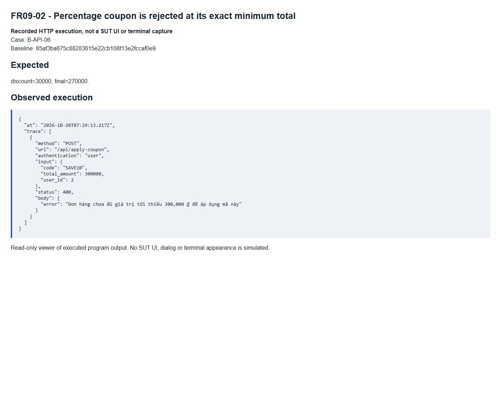

# FR09-02 - Percentage coupon is rejected at its exact minimum total

| Field | Value |
|---|---|
| Finding | FR09-02 |
| Requirement | FR09 |
| Severity | High |
| Test cases | B-API-06 |
| GitHub Issue | https://github.com/tkob-team/eshop-sut/issues/125 |

## Summary

Percentage coupon is rejected at its exact minimum total. This issue covers the specific condition represented by B-API-06.

## Environment

- Baseline: `85af3ba875c88283615e22cb108f13e2fccaf0e9`.
- Selected requirement: FR09; oracle: FR-09 C3.
- Interface: API.
- Severity: High.
- Isolated demo source/database; no fix applied to the original SUT.

## Preconditions

Start a disposable copy of the fixed baseline. For API calls obtain a JWT through `POST /api/login`: regular user `test@eshop.com` / `Test1234!`, admin `admin@eshop.com` / `Admin123!`. These are public demo fixtures, not personal credentials. Use JSON requests and the role shown in the captured request. The server clock for API cases is fixed at `2026-10-19T08:00:00.000Z`.

Use active coupons SAVE10 (percent=10, minimum=300000, limit=1), BIGBUY (fixed=50000, minimum=500000, limit=1), VIP100 (fixed=100000, minimum=300000, limit=2); expiry=2099-12-31. Clear usage unless the condition below specifies otherwise. The JWT user is 2 in the recorded fixture.

### Controlled fixture

Use seeded BIGBUY: type=fixed, discount_value=50000, min_order_amount=500000, expired_at=2099-12-31, max_uses_per_user=1, active=1; user 2 has zero usage.

## Steps to reproduce

1. Send `POST /api/apply-coupon` with authentication `user` and the exact input shown in the captured request/result below.
2. Compare the response and persisted/readback state with the expected criterion. Numeric IDs are run-specific: resolve the fixture record by code/identity when reproducing.

## Expected result

discount=30000; final=270000.

## Actual result

```json
{
  "at": "2026-10-20T07:29:13.217Z",
  "trace": [
    {
      "method": "POST",
      "url": "/api/apply-coupon",
      "authentication": "user",
      "input": {
        "code": "SAVE10",
        "total_amount": 300000,
        "user_id": 2
      },
      "status": 400,
      "body": {
        "error": "Đơn hàng chưa đủ giá trị tối thiểu 300,000 ₫ để áp dụng mã này"
      }
    }
  ]
}
```

## Impact

The coupon eligibility or monetary result is incorrect for the documented condition.

## Root cause

The handler checks total_amount > coupon.min_order_amount.

[Affected source at the fixed baseline](https://github.com/tkob-team/eshop-sut/blob/85af3ba875c88283615e22cb108f13e2fccaf0e9/backend/server.js).

## Suggested correction

Use the inclusive comparison and preserve controls for expiry, identity and usage.

## Evidence



## Regression checks

- Repeat the documented trigger and verify the expected criterion.
- Check valid nominal and neighboring inputs with the other constraints held valid.
- Check persistence or readback where applicable.
- Record a separate post-fix run; no fix or passing post-fix result is claimed here.

## Traceability

- [B-API-06](../tests/B-FR09-discount-coupons.md#b-api-06).

[Execution records](../evidence/execution/B-execution.md); [GitHub page evidence](../evidence/github-issues/README.md).
