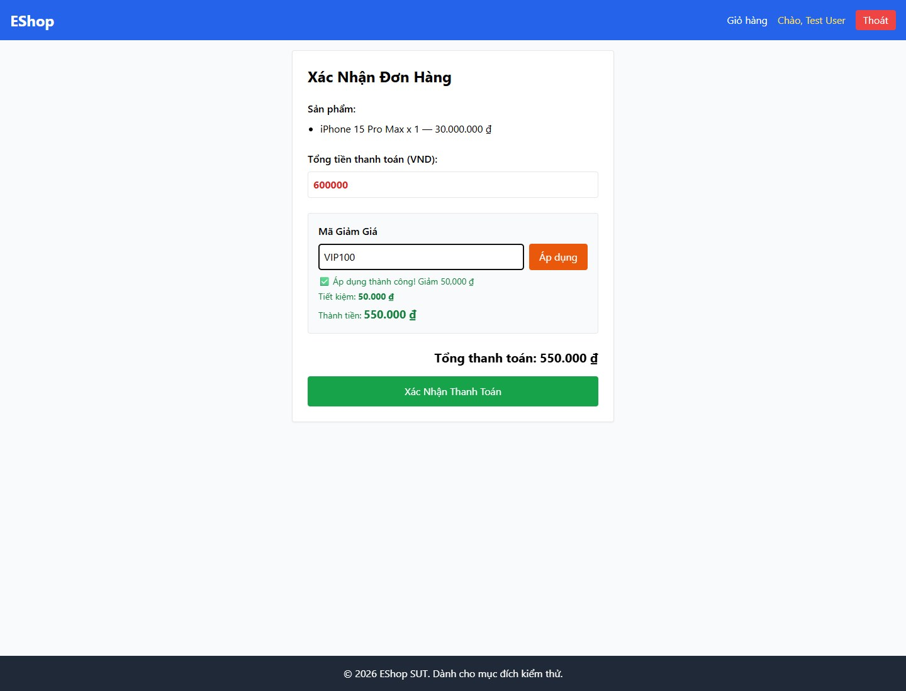

# FR09-12 - Late coupon response applies a discount after the input code changes

| Field | Value |
|---|---|
| Finding | FR09-12 |
| Requirement | FR09 |
| Severity | Medium |
| Test cases | B-UI-07 |
| GitHub Issue | https://github.com/tkob-team/eshop-sut/issues/135 |

## Summary

Late coupon response applies a discount after the input code changes. This issue covers the specific condition represented by B-UI-07.

## Environment

- Baseline: `85af3ba875c88283615e22cb108f13e2fccaf0e9`.
- Selected requirement: FR09; oracle: FR-09 current coupon eligibility and UI/result consistency.
- Interface: Browser UI via Playwright.
- Severity: Medium.
- Isolated demo source/database; no fix applied to the original SUT.

## Preconditions

Start a disposable copy of the fixed baseline. For API calls obtain a JWT through `POST /api/login`: regular user `test@eshop.com` / `Test1234!`, admin `admin@eshop.com` / `Admin123!`. These are public demo fixtures, not personal credentials. Use JSON requests and the role shown in the captured request. The server clock for API cases is fixed at `2026-10-19T08:00:00.000Z`.

Use active coupons SAVE10 (percent=10, minimum=300000, limit=1), BIGBUY (fixed=50000, minimum=500000, limit=1), VIP100 (fixed=100000, minimum=300000, limit=2); expiry=2099-12-31. Clear usage unless the condition below specifies otherwise. The JWT user is 2 in the recorded fixture.

## Steps to reproduce

1. At total 600000, apply BIGBUY; hold only its network delivery, edit the field to VIP100, then release the unmodified BIGBUY response.
2. Record the actual DOM, handler output or state transition.
3. Compare the observation and its scope with the expected criterion below.

## Expected result

Editing the coupon code invalidates pending results; a response for BIGBUY must not be displayed for VIP100.

## Actual result

```json
{
  "at": "2026-10-20T07:43:54.337567+00:00",
  "observed": {
    "current_code": "VIP100",
    "main_text": "Xác Nhận Đơn Hàng\nSản phẩm:\niPhone 15 Pro Max x 1 - 30.000.000 ₫\nTổng tiền thanh toán (VND):\nMã Giảm Giá\nÁp dụng\n\n✅ Áp dụng thành công! Giảm 50,000 ₫\n\nTiết kiệm: 50.000 ₫\n\nThành tiền: 550.000 ₫\n\nTổng thanh toán: 550.000 ₫\nXác Nhận Thanh Toán",
    "stale_bigbuy_result": true,
    "network": "Real BIGBUY request; edit to VIP100 before completion; no response body modified."
  },
  "expected": "Editing the coupon code invalidates pending results; a response for BIGBUY must not be displayed for VIP100.",
  "precondition": "Authenticated user, fixed total 600000, active BIGBUY and VIP100, zero prior usage."
}
```

## Impact

The displayed coupon code and applied discount can refer to different requests, leaving a checkout amount inconsistent with the current input.

## Root cause

handleApplyCoupon unconditionally writes its response with no request/input revision guard.

[Affected source at the fixed baseline](https://github.com/tkob-team/eshop-sut/blob/85af3ba875c88283615e22cb108f13e2fccaf0e9/frontend-web/src/pages/Checkout.jsx).

## Suggested correction

Correlate responses with the current coupon/total revision or cancel obsolete requests.

## Evidence



## Regression checks

- Repeat the documented trigger and verify the expected criterion.
- Check valid nominal and neighboring inputs with the other constraints held valid.
- Check persistence or readback where applicable.
- Record a separate post-fix run; no fix or passing post-fix result is claimed here.

## Traceability

- [B-UI-07](../tests/B-FR09-discount-coupons.md#b-ui-07).

[Execution records](../evidence/execution/B-execution.md); [GitHub page evidence](../evidence/github-issues/README.md).
