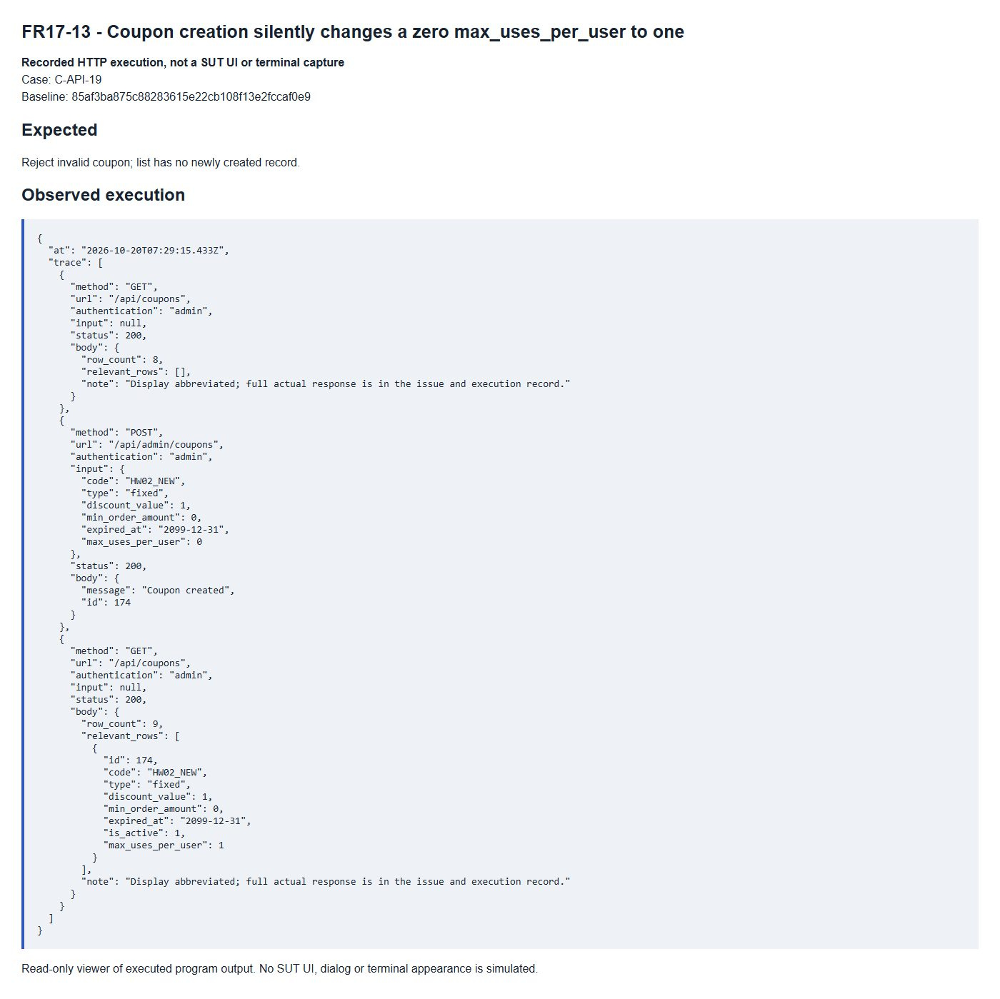

# FR17-13 - Coupon creation silently changes a zero max_uses_per_user to one

| Field | Value |
|---|---|
| Finding | FR17-13 |
| Requirement | FR17 |
| Severity | Medium |
| Test cases | C-API-19 |
| GitHub Issue | https://github.com/tkob-team/eshop-sut/issues/148 |

## Summary

Coupon creation silently changes a zero max_uses_per_user to one. This issue covers the specific condition represented by C-API-19.

## Environment

- Baseline: `85af3ba875c88283615e22cb108f13e2fccaf0e9`.
- Selected requirement: FR17; oracle: FR-17 max_uses_per_user >= 1.
- Interface: API.
- Severity: Medium.
- Isolated demo source/database; no fix applied to the original SUT.

## Preconditions

Start a disposable copy of the fixed baseline. For API calls obtain a JWT through `POST /api/login`: regular user `test@eshop.com` / `Test1234!`, admin `admin@eshop.com` / `Admin123!`. These are public demo fixtures, not personal credentials. Use JSON requests and the role shown in the captured request. The server clock for API cases is fixed at `2026-10-19T08:00:00.000Z`.

For invalid-field cases log in as admin, start with a unique coupon code and change only the stated field. Nominal values: type=fixed, discount_value=1, min_order_amount=0, expired_at=2099-12-31, max_uses_per_user=1. For authorization cases keep the body valid and use a regular-user JWT.

## Steps to reproduce

1. Send `GET /api/coupons` with authentication `admin` and the exact input shown in the captured request/result below.
2. Send `POST /api/admin/coupons` with authentication `admin` and the exact input shown in the captured request/result below.
3. Send `GET /api/coupons` with authentication `admin` and the exact input shown in the captured request/result below.
4. Compare the response and persisted/readback state with the expected criterion. Numeric IDs are run-specific: resolve the fixture record by code/identity when reproducing.

## Expected result

Reject invalid coupon; list has no newly created record.

## Actual result

```json
{
  "at": "2026-10-20T07:29:15.433Z",
  "trace": [
    {
      "method": "GET",
      "url": "/api/coupons",
      "authentication": "admin",
      "input": null,
      "status": 200,
      "body": [
        {
          "id": 166,
          "code": "SAVE10",
          "type": "percent",
          "discount_value": 10,
          "min_order_amount": 300000,
          "expired_at": "2099-12-31",
          "is_active": 1,
          "max_uses_per_user": 1
        },
        {
          "id": 167,
          "code": "BIGBUY",
          "type": "fixed",
          "discount_value": 50000,
          "min_order_amount": 500000,
          "expired_at": "2099-12-31",
          "is_active": 1,
          "max_uses_per_user": 1
        },
        {
          "id": 168,
          "code": "VIP100",
          "type": "fixed",
          "discount_value": 100000,
          "min_order_amount": 300000,
          "expired_at": "2099-12-31",
          "is_active": 1,
          "max_uses_per_user": 2
        },
        {
          "id": 169,
          "code": "EXPIRED",
          "type": "percent",
          "discount_value": 20,
          "min_order_amount": 100000,
          "expired_at": "2020-01-01",
          "is_active": 1,
          "max_uses_per_user": 1
        },
        {
          "id": 170,
          "code": "OFF",
          "type": "fixed",
          "discount_value": 10000,
          "min_order_amount": 0,
          "expired_at": "2099-12-31",
          "is_active": 0,
          "max_uses_per_user": 1
        },
        {
          "id": 171,
          "code": "TIME",
          "type": "fixed",
          "discount_value": 10000,
          "min_order_amount": 0,
          "expired_at": "2026-10-19T08:00:01.000Z",
          "is_active": 1,
          "max_uses_per_user": 1
        },
        {
          "id": 172,
          "code": "P100",
          "type": "percent",
          "discount_value": 100,
          "min_order_amount": 0,
          "expired_at": "2099-12-31",
          "is_active": 1,
          "max_uses_per_user": 1
        },
        {
          "id": 173,
          "code": "DELETE_ME",
          "type": "fixed",
          "discount_value": 1,
          "min_order_amount": 0,
          "expired_at": "2099-12-31",
          "is_active": 1,
          "max_uses_per_user": 1
        }
      ]
    },
    {
      "method": "POST",
      "url": "/api/admin/coupons",
      "authentication": "admin",
      "input": {
        "code": "HW02_NEW",
        "type": "fixed",
        "discount_value": 1,
        "min_order_amount": 0,
        "expired_at": "2099-12-31",
        "max_uses_per_user": 0
      },
      "status": 200,
      "body": {
        "message": "Coupon created",
        "id": 174
      }
    },
    {
      "method": "GET",
      "url": "/api/coupons",
      "authentication": "admin",
      "input": null,
      "status": 200,
      "body": [
        {
          "id": 166,
          "code": "SAVE10",
          "type": "percent",
          "discount_value": 10,
          "min_order_amount": 300000,
          "expired_at": "2099-12-31",
          "is_active": 1,
          "max_uses_per_user": 1
        },
        {
          "id": 167,
          "code": "BIGBUY",
          "type": "fixed",
          "discount_value": 50000,
          "min_order_amount": 500000,
          "expired_at": "2099-12-31",
          "is_active": 1,
          "max_uses_per_user": 1
        },
        {
          "id": 168,
          "code": "VIP100",
          "type": "fixed",
          "discount_value": 100000,
          "min_order_amount": 300000,
          "expired_at": "2099-12-31",
          "is_active": 1,
          "max_uses_per_user": 2
        },
        {
          "id": 169,
          "code": "EXPIRED",
          "type": "percent",
          "discount_value": 20,
          "min_order_amount": 100000,
          "expired_at": "2020-01-01",
          "is_active": 1,
          "max_uses_per_user": 1
        },
        {
          "id": 170,
          "code": "OFF",
          "type": "fixed",
          "discount_value": 10000,
          "min_order_amount": 0,
          "expired_at": "2099-12-31",
          "is_active": 0,
          "max_uses_per_user": 1
        },
        {
          "id": 171,
          "code": "TIME",
          "type": "fixed",
          "discount_value": 10000,
          "min_order_amount": 0,
          "expired_at": "2026-10-19T08:00:01.000Z",
          "is_active": 1,
          "max_uses_per_user": 1
        },
        {
          "id": 172,
          "code": "P100",
          "type": "percent",
          "discount_value": 100,
          "min_order_amount": 0,
          "expired_at": "2099-12-31",
          "is_active": 1,
          "max_uses_per_user": 1
        },
        {
          "id": 173,
          "code": "DELETE_ME",
          "type": "fixed",
          "discount_value": 1,
          "min_order_amount": 0,
          "expired_at": "2099-12-31",
          "is_active": 1,
          "max_uses_per_user": 1
        },
        {
          "id": 174,
          "code": "HW02_NEW",
          "type": "fixed",
          "discount_value": 1,
          "min_order_amount": 0,
          "expired_at": "2099-12-31",
          "is_active": 1,
          "max_uses_per_user": 1
        }
      ]
    }
  ]
}
```

## Impact

Invalid coupon data or an unauthorized coupon operation is accepted and changes or reveals administrator-managed state.

## Root cause

The expression max_uses_per_user || 1 substitutes only falsy input and does not validate the range.

[Affected source at the fixed baseline](https://github.com/tkob-team/eshop-sut/blob/85af3ba875c88283615e22cb108f13e2fccaf0e9/backend/server.js).

## Suggested correction

Validate the supplied limit explicitly; apply defaults only where the contract permits omission.

## Evidence



## Regression checks

- Repeat the documented trigger and verify the expected criterion.
- Check valid nominal and neighboring inputs with the other constraints held valid.
- Check persistence or readback where applicable.
- Record a separate post-fix run; no fix or passing post-fix result is claimed here.

## Traceability

- [C-API-19](../tests/C-FR17-coupon-management.md#c-api-19).

[Execution records](../evidence/execution/C-execution.md); [GitHub page evidence](../evidence/github-issues/README.md).
