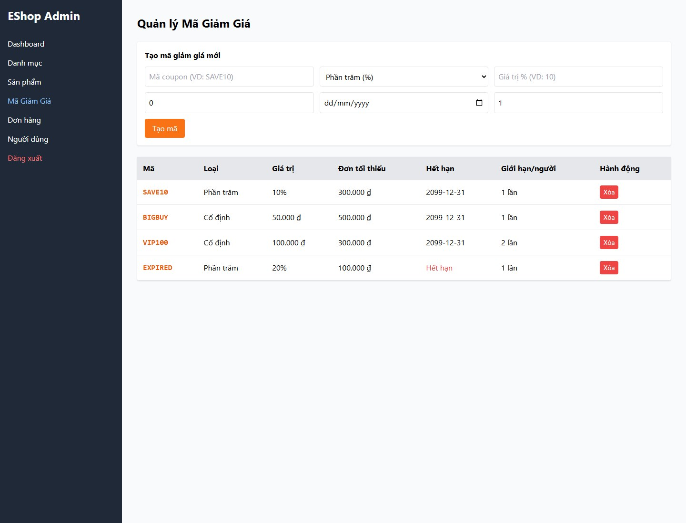

# FR17-17 - Coupon form omits required-field markers

| Field | Value |
|---|---|
| Finding | FR17-17 |
| Requirement | FR17 |
| Severity | Low |
| Test cases | C-UI-07 |
| GitHub Issue | https://github.com/tkob-team/eshop-sut/issues/152 |

## Summary

Coupon form omits required-field markers. This issue covers the specific condition represented by C-UI-07.

## Environment

- Baseline: `85af3ba875c88283615e22cb108f13e2fccaf0e9`.
- Selected requirement: FR17; oracle: FR-22 required markers; FR-17 required fields.
- Interface: Browser UI via Playwright.
- Severity: Low.
- Isolated demo source/database; no fix applied to the original SUT.

## Preconditions

Start a disposable copy of the fixed baseline. For API calls obtain a JWT through `POST /api/login`: regular user `test@eshop.com` / `Test1234!`, admin `admin@eshop.com` / `Admin123!`. These are public demo fixtures, not personal credentials. Use JSON requests and the role shown in the captured request. The server clock for API cases is fixed at `2026-10-19T08:00:00.000Z`.

For invalid-field cases log in as admin, start with a unique coupon code and change only the stated field. Nominal values: type=fixed, discount_value=1, min_order_amount=0, expired_at=2099-12-31, max_uses_per_user=1. For authorization cases keep the body valid and use a regular-user JWT.

## Steps to reproduce

1. Open Admin coupon management and inspect all six creation inputs and their visible labels/markers.
2. Record the actual DOM, handler output or state transition.
3. Compare the observation and its scope with the expected criterion below.

## Expected result

FR-22 requires an asterisk next to required-field labels; FR-17 identifies all six required fields.

## Actual result

```json
{
  "at": "2026-10-20T07:43:54.893794+00:00",
  "observed": {
    "visible_form_text": "Tạo mã giảm giá mới\nPhần trăm (%)\nSố tiền cố định (₫)\nTạo mã",
    "fields": [
      {
        "tag": "INPUT",
        "type": "text",
        "placeholder": "Mã coupon (VD: SAVE10)",
        "required": true
      },
      {
        "tag": "SELECT",
        "type": "select-one",
        "placeholder": null,
        "required": false
      },
      {
        "tag": "INPUT",
        "type": "number",
        "placeholder": "Giá trị % (VD: 10)",
        "required": true
      },
      {
        "tag": "INPUT",
        "type": "number",
        "placeholder": "Đơn tối thiểu (₫)",
        "required": false
      },
      {
        "tag": "INPUT",
        "type": "date",
        "placeholder": "Ngày hết hạn",
        "required": true
      },
      {
        "tag": "INPUT",
        "type": "number",
        "placeholder": "Số lần dùng tối đa/người",
        "required": false
      }
    ],
    "has_required_marker": false
  },
  "expected": "FR-22 requires an asterisk next to required-field labels; FR-17 identifies all six required fields.",
  "precondition": ""
}
```

## Impact

An explicit interface requirement is violated; the observed impact is limited to the documented presentation/semantic issue.

The reproduced effect is limited to the observations above. Unexecuted downstream attacks, production incidents and unobserved native interactions are not claimed.

## Root cause

The form uses placeholders and bare controls without required-field labels/markers.

[Affected source at the fixed baseline](https://github.com/tkob-team/eshop-sut/blob/85af3ba875c88283615e22cb108f13e2fccaf0e9/frontend-admin/src/App.jsx).

## Suggested correction

Provide visible labels and required markers consistently with the specification.

## Evidence



## Regression checks

- Repeat the documented trigger and verify the expected criterion.
- Check valid nominal and neighboring inputs with the other constraints held valid.
- Check persistence or readback where applicable.
- Record a separate post-fix run; no fix or passing post-fix result is claimed here.

## Traceability

- [C-UI-07](../tests/C-FR17-coupon-management.md#c-ui-07).

[Execution records](../evidence/execution/C-execution.md); [GitHub page evidence](../evidence/github-issues/README.md).
