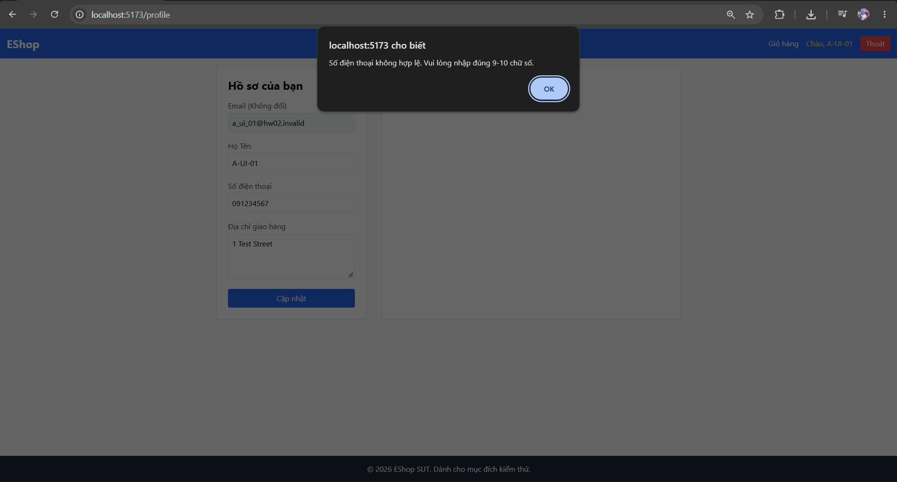
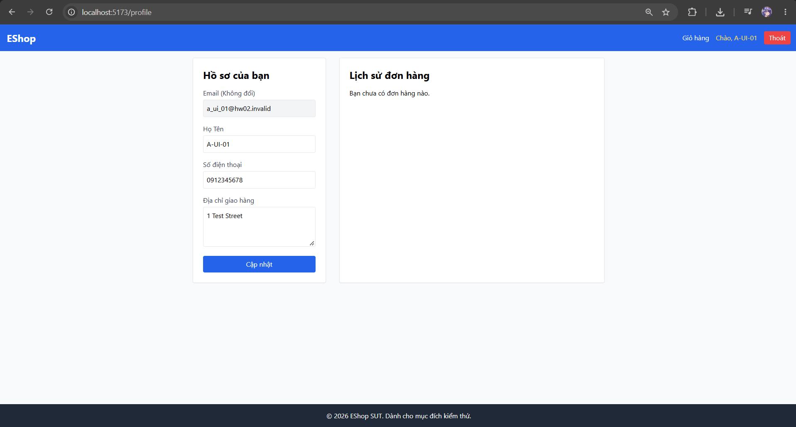
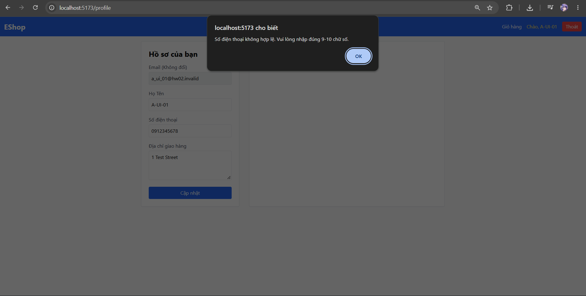
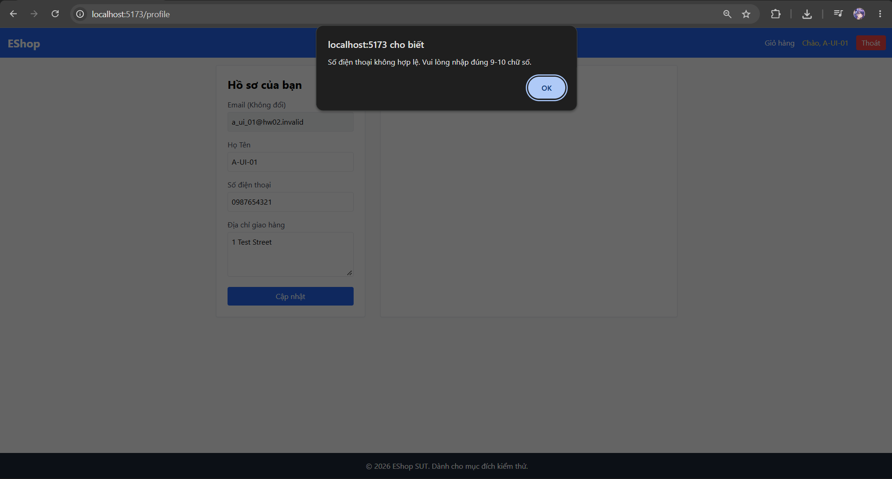
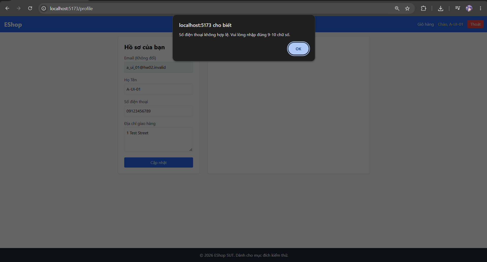
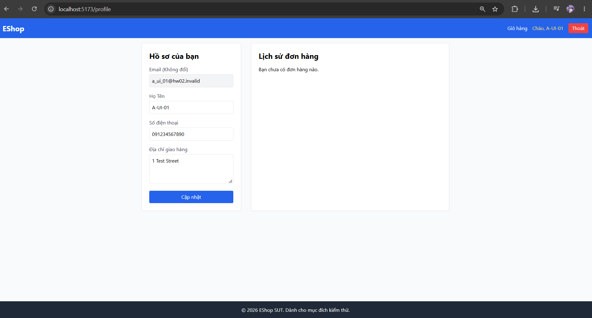
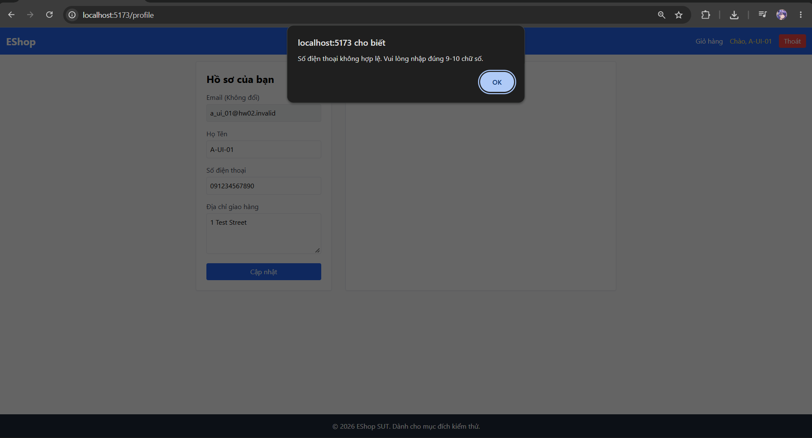
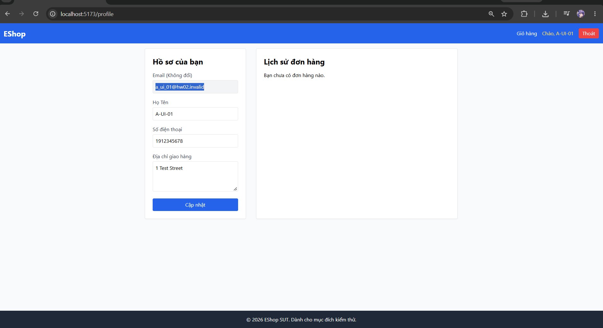
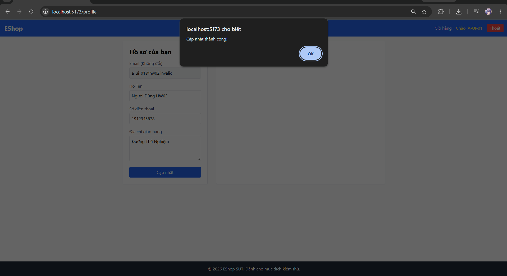

# A — Test Case Report: FR-04 — Quản lý hồ sơ cá nhân

**Sinh viên:** Tống Dương Thái Hòa — 23120262.

## 1. Phạm vi, quy ước và fixture

Chúng tôi lấy SRS làm oracle, sau đó dùng source để xây dựng giả thuyết và giải thích nguyên nhân. Source không thay thế yêu cầu. Mỗi TC có ID ổn định; một TC có thể phủ cả Domain Testing và BVA nhưng chỉ được tính một lần. Chúng tôi tách API với Web/Admin/Mobile UI vì validation ở một lớp không chứng minh lớp còn lại đạt.

Với từng input/state, chúng tôi xác định miền hợp lệ, phần bù không hợp lệ, precision và các ràng buộc giữa các chiều. Các lớp trong cùng một chiều được chọn để phân biệt hành vi; bảng nhiều chiều không có nghĩa mọi hàng đều là các tập rời nhau của toàn bộ vector. Test invalid giữ các chiều khác nominal; interaction nhiều lỗi có chủ đích được ghi riêng. Chúng tôi dùng readback public HTTP sau thay đổi để kiểm tra hậu điều kiện.

BVA được áp dụng cho miền có thứ tự, kể cả độ dài chuỗi và số lượt nguyên. Điểm ON nằm trên mặt biên; giá trị ON có thể hợp lệ hoặc không tùy dấu ≥ hay >. Các điểm lân cận được ghi bằng số và trạng thái valid/invalid để tránh nhập nhằng thuật ngữ. Các label OFF/IN không thay thế tập giá trị cụ thể. Rỗng, enum, charset và identity là Domain classes; không tự đặt một maximum mà SRS không quy định.

API execution dùng backend copy, clock cố định và fixture reset mỗi TC. UI evidence là ảnh thật đã cung cấp; không suy timestamp chạy từ ngày sửa file, không dùng ảnh vẽ hoặc build output làm bằng chứng UI. PASS/FAIL chỉ kết luận theo criterion có evidence; OBSERVATION dành cho oracle chưa quy định; INCOMPLETE dành cho TC còn thiếu bước/precondition/evidence. Một TC INCOMPLETE có thể đã được thao tác một phần, nhưng không được cộng vào executed đủ bằng chứng.

Chúng tôi kiểm tra kỹ thuật theo Domain/Boundary đã nêu; chưa có bản lecture của môn trong workspace để xác nhận đã đối chiếu mọi quy ước của giảng viên. Nguồn phương pháp bổ trợ là ISTQB CTFL §4.2.1–4.2.2. Các giới hạn này được giữ rõ trong phần coverage, không tuyên bố exhaustive coverage toàn hệ thống.

### API fixture và môi trường tái hiện

- SUT baseline: `85af3ba875c88283615e22cb108f13e2fccaf0e9`; Node thực thi kiểm chứng lại: `v24.16.0`, Windows. Backend copy tại port `3100`; source SUT và database gốc được SHA-256 trước/sau mỗi suite.
- Checkout HEAD lúc kiểm chứng là `de0f48f5b40939692e7029943295d44788f617ea`; commit sau baseline chỉ thêm root .gitignore. Diff các source/SRS kiểm thử so với baseline85af3ba rỗng; không coi .gitignore là thay đổi logic SUT.
- Clock của SUT cố định: `2026-10-19T08:00:00.000Z`; timestamp UTC trong raw record là thời gian thật của lượt chạy, khác clock mô phỏng.
- Login fixture: `POST /api/login`. Admin: `admin@eshop.com` / `Admin123!`; user 2: `test@eshop.com` / `Test1234!`; user 3: `other@hw02.invalid` / `Test1234!`. Đây là tài khoản demo trong DB isolated. Không lưu JWT thật trong tài liệu.
- Profile trước mỗi TC: user2 `name=Test User`, `phone=0912345678`, `shipping_address=1 Test Street`, `role=user`; user3 `Other User`, `0987654321`, `Other Street`, `role=user`.
- Coupon reset trước mỗi TC: SAVE10 `(percent,10,min300000,limit1)`; BIGBUY `(fixed,50000,min500000,limit1)`; VIP100 `(fixed,100000,min300000,limit2)`; EXPIRED hết hạn năm2020; OFF inactive; TIME fixed10000, minimum0, expiry theo TC; P100 percent100; DELETE_ME fixed1. Coupon còn lại có expiry2099 và active1.
- Usage mặc định user2/VIP100=0; với TC có `used`, harness tạo đúng số row `coupon_usage`. Apply không tự tạo usage; checkout mới ghi usage theo source. User3 không có usage. Mỗi TC reset state, nên kết quả không phụ thuộc TC trước.
- API headers: `Content-Type: application/json`; `Authorization: Bearer <JWT đúng role>` trừ lớp missing/invalid/expired. Invalid là chuỗi `not-a-valid-jwt`; expired là token fixture ký bằng test secret của baseline với `exp` trước clock cố định, không phải credential production.
- `scripts/runtime.cjs` copy source bytes, thay listen port qua adapter và cố định global Date; `database.js` gốc drop/seed khi import nên không chạy runner trực tiếp trên DB gốc. Dependencies lấy từ `eshop-sut/backend/node_modules`.

### UI fixture và bằng chứng

Ảnh ghi Web ở `localhost:5173`, Admin ở `localhost:5174`, và Expo Go/Android trên Samsung. Account hiển thị trong ảnh có thể được tái sử dụng (A-UI-01, B-UI-01, D-UI-01); tên file TC không chứng minh đã login account cùng tên. Chúng tôi ghi rõ variant và trạng thái dữ liệu có thể chứng minh. Không có nhật ký runtime UI đầy đủ về phiên bản OS/Expo hoặc timestamp từng lượt; không tự bổ sung các thông số đó. UI clock dùng thời gian thật của lần chụp, khác clock API.

Các ảnh trong bộ cung cấp thuộc ngày chụp được đặt tên 2026-10-19; trường timestamp thực thi UI không đủ log để khẳng định chính xác. File raw API giữ timestamp thật độc lập. Ảnh vẫn giữ nguyên bytes; đổi tên ảnh không tạo lần thực thi mới.

## 2. Danh mục test cases

| TC-ID | Technique | Mục tiêu | Status | Domain | Bug |
|---|---|---|---|---|---|
| [A-API-01](#a-api-01) | Domain+BVA | 10 digits: lower ON boundary | PASS | A-D1 | — |
| [A-API-02](#a-api-02) | Domain+BVA | 11 digits: upper ON boundary | PASS | A-D1 | — |
| [A-API-03](#a-api-03) | Domain+BVA | 9 digits: lower OFF boundary | FAIL | A-D2 | BUG-A01 |
| [A-API-04](#a-api-04) | Domain+BVA | 12 digits: upper OFF boundary | FAIL | A-D3 | BUG-A01 |
| [A-API-05](#a-api-05) | Domain | Empty phone | FAIL | A-D2 | BUG-A01 |
| [A-API-06](#a-api-06) | Domain | One digit | FAIL | A-D2 | BUG-A01 |
| [A-API-07](#a-api-07) | Domain | 8 digits: invalid IN point | FAIL | A-D2 | BUG-A01 |
| [A-API-08](#a-api-08) | Domain | 13 digits: invalid IN point | FAIL | A-D3 | BUG-A01 |
| [A-API-09](#a-api-09) | Domain | Wrong leading digit, length 10 | FAIL | A-D4 | BUG-A01 |
| [A-API-10](#a-api-10) | Domain | Wrong leading digit, length 11 | FAIL | A-D4 | BUG-A01 |
| [A-API-11](#a-api-11) | Domain | Alphabetic character | FAIL | A-D5 | BUG-A01 |
| [A-API-12](#a-api-12) | Domain | Embedded space | FAIL | A-D5 | BUG-A01 |
| [A-API-13](#a-api-13) | Domain | Country prefix instead of 0 | FAIL | A-D5 | BUG-A01 |
| [A-API-14](#a-api-14) | Domain | Hyphenated digits | FAIL | A-D5 | BUG-A01 |
| [A-API-15](#a-api-15) | Domain | Unicode fullwidth digits | OBSERVATION | A-D6 | — |
| [A-API-16](#a-api-16) | Domain | Null phone | FAIL | A-D5 | BUG-A01 |
| [A-API-17](#a-api-17) | Domain | Unicode name and address | PASS | A-D7 | — |
| [A-API-18](#a-api-18) | Domain | Client role escalation | FAIL | A-D8 | BUG-A02 |
| [A-API-19](#a-api-19) | Domain | Body user id cannot redirect update | PASS | A-D9 | — |
| [A-API-20](#a-api-20) | Domain | Profile update: none token | PASS | A-D10 | — |
| [A-API-21](#a-api-21) | Domain | Profile update: invalid token | PASS | A-D10 | — |
| [A-API-22](#a-api-22) | Domain | Profile read needs authentication | PASS | A-D10 | — |
| [A-UI-01](#a-ui-01) | Domain+BVA | Profile phone 091234567 | PASS | A-D2 | — |
| [A-UI-02](#a-ui-02) | Domain+BVA | Profile phone 0912345678 | FAIL | A-D1 | BUG-A03 |
| [A-UI-03](#a-ui-03) | Domain+BVA | Profile phone 09123456789 | FAIL | A-D1 | BUG-A03 |
| [A-UI-04](#a-ui-04) | Domain+BVA | Profile phone 091234567890 | PASS | A-D3 | — |
| [A-UI-05](#a-ui-05) | Domain | Profile phone 1912345678 | FAIL | A-D4 | BUG-A03 |
| [A-UI-06](#a-ui-06) | Domain | Email field cannot be changed | PASS | A-D11 | — |
| [A-UI-07](#a-ui-07) | Domain | Unicode editable profile fields | INCOMPLETE | A-D7 | — |

<a id="a-api-01"></a>

## A-API-01

**Mục tiêu:** 10 digits: lower ON boundary.

| Thuộc tính | Giá trị |
|---|---|
| Technique | Domain+BVA |
| Oracle | FR-04 phone: starts 0, 10–11 digits; numeral encoding unspecified |
| Domains | A-D1 |
| Seam | HTTP API |
| Status | PASS |
| Bug | — |

### Preconditions

- Khôi phục profile user2/user3 như fixture chung; JWT user2 trừ TC auth. Giữ name/address và các field không phải mục tiêu hợp lệ.
- Authentication request mục tiêu: `user`.

### Input — thiết kế

```json
{
  "name": "HW02 User",
  "shipping_address": "1 Test Street",
  "phone": "0912345678"
}
```

### Steps

1. Gửi `PUT /api/users/me` với authentication `user` và JSON Input bên dưới.
2. Gửi `GET /api/users/me` với authentication `user`; không có request body.
3. Đối chiếu response và hậu điều kiện với Expected; chỉ GET/readback là quan sát, fixture SQL không được dùng làm oracle.

### Expected

Accept and persist the exact valid phone.

### Actual và Evidence

Timestamp UTC thực tế: `2026-10-19T19:50:57.739Z`. Với list dài, phần dưới giữ row_count và relevant_rows; mọi trường của row liên quan giữ nguyên, full list nằm trong raw link.

```json
[
  {
    "method": "PUT",
    "url": "/api/users/me",
    "authentication": "user",
    "input": {
      "name": "HW02 User",
      "shipping_address": "1 Test Street",
      "phone": "0912345678"
    },
    "status": 200,
    "body": {
      "message": "Profile updated"
    }
  },
  {
    "method": "GET",
    "url": "/api/users/me",
    "authentication": "user",
    "input": null,
    "status": 200,
    "body": {
      "id": 2,
      "name": "HW02 User",
      "email": "test@eshop.com",
      "role": "user",
      "login_attempts": 0,
      "locked_until": null,
      "shipping_address": "1 Test Street",
      "phone": "0912345678"
    }
  }
]
```

[Full raw record](../evidence/execution/A-api.md#a-api-01). Source hashes trước/sau nằm trong raw report.

### Verdict và rationale

**PASS** — Tiêu chí thuộc phạm vi đã ghi khớp expected với evidence nêu trên.

<a id="a-api-02"></a>

## A-API-02

**Mục tiêu:** 11 digits: upper ON boundary.

| Thuộc tính | Giá trị |
|---|---|
| Technique | Domain+BVA |
| Oracle | FR-04 phone: starts 0, 10–11 digits; numeral encoding unspecified |
| Domains | A-D1 |
| Seam | HTTP API |
| Status | PASS |
| Bug | — |

### Preconditions

- Khôi phục profile user2/user3 như fixture chung; JWT user2 trừ TC auth. Giữ name/address và các field không phải mục tiêu hợp lệ.
- Authentication request mục tiêu: `user`.

### Input — thiết kế

```json
{
  "name": "HW02 User",
  "shipping_address": "1 Test Street",
  "phone": "09123456789"
}
```

### Steps

1. Gửi `PUT /api/users/me` với authentication `user` và JSON Input bên dưới.
2. Gửi `GET /api/users/me` với authentication `user`; không có request body.
3. Đối chiếu response và hậu điều kiện với Expected; chỉ GET/readback là quan sát, fixture SQL không được dùng làm oracle.

### Expected

Accept and persist the exact valid phone.

### Actual và Evidence

Timestamp UTC thực tế: `2026-10-19T19:50:57.771Z`. Với list dài, phần dưới giữ row_count và relevant_rows; mọi trường của row liên quan giữ nguyên, full list nằm trong raw link.

```json
[
  {
    "method": "PUT",
    "url": "/api/users/me",
    "authentication": "user",
    "input": {
      "name": "HW02 User",
      "shipping_address": "1 Test Street",
      "phone": "09123456789"
    },
    "status": 200,
    "body": {
      "message": "Profile updated"
    }
  },
  {
    "method": "GET",
    "url": "/api/users/me",
    "authentication": "user",
    "input": null,
    "status": 200,
    "body": {
      "id": 2,
      "name": "HW02 User",
      "email": "test@eshop.com",
      "role": "user",
      "login_attempts": 0,
      "locked_until": null,
      "shipping_address": "1 Test Street",
      "phone": "09123456789"
    }
  }
]
```

[Full raw record](../evidence/execution/A-api.md#a-api-02). Source hashes trước/sau nằm trong raw report.

### Verdict và rationale

**PASS** — Tiêu chí thuộc phạm vi đã ghi khớp expected với evidence nêu trên.

<a id="a-api-03"></a>

## A-API-03

**Mục tiêu:** 9 digits: lower OFF boundary.

| Thuộc tính | Giá trị |
|---|---|
| Technique | Domain+BVA |
| Oracle | FR-04 phone: starts 0, 10–11 digits; numeral encoding unspecified |
| Domains | A-D2 |
| Seam | HTTP API |
| Status | FAIL |
| Bug | BUG-A01 |

### Preconditions

- Khôi phục profile user2/user3 như fixture chung; JWT user2 trừ TC auth. Giữ name/address và các field không phải mục tiêu hợp lệ.
- Authentication request mục tiêu: `user`.

### Input — thiết kế

```json
{
  "name": "HW02 User",
  "shipping_address": "1 Test Street",
  "phone": "091234567"
}
```

### Steps

1. Gửi `PUT /api/users/me` với authentication `user` và JSON Input bên dưới.
2. Gửi `GET /api/users/me` với authentication `user`; không có request body.
3. Đối chiếu response và hậu điều kiện với Expected; chỉ GET/readback là quan sát, fixture SQL không được dùng làm oracle.

### Expected

Reject; stored phone stays 0912345678.

### Actual và Evidence

Timestamp UTC thực tế: `2026-10-19T19:50:57.797Z`. Với list dài, phần dưới giữ row_count và relevant_rows; mọi trường của row liên quan giữ nguyên, full list nằm trong raw link.

```json
[
  {
    "method": "PUT",
    "url": "/api/users/me",
    "authentication": "user",
    "input": {
      "name": "HW02 User",
      "shipping_address": "1 Test Street",
      "phone": "091234567"
    },
    "status": 200,
    "body": {
      "message": "Profile updated"
    }
  },
  {
    "method": "GET",
    "url": "/api/users/me",
    "authentication": "user",
    "input": null,
    "status": 200,
    "body": {
      "id": 2,
      "name": "HW02 User",
      "email": "test@eshop.com",
      "role": "user",
      "login_attempts": 0,
      "locked_until": null,
      "shipping_address": "1 Test Street",
      "phone": "091234567"
    }
  }
]
```

[Full raw record](../evidence/execution/A-api.md#a-api-03). Source hashes trước/sau nằm trong raw report.

### Verdict và rationale

**FAIL** — Có ít nhất một hành vi quan sát trái oracle; bug được nhóm theo behavior, không nhân số bug theo số TC.

<a id="a-api-04"></a>

## A-API-04

**Mục tiêu:** 12 digits: upper OFF boundary.

| Thuộc tính | Giá trị |
|---|---|
| Technique | Domain+BVA |
| Oracle | FR-04 phone: starts 0, 10–11 digits; numeral encoding unspecified |
| Domains | A-D3 |
| Seam | HTTP API |
| Status | FAIL |
| Bug | BUG-A01 |

### Preconditions

- Khôi phục profile user2/user3 như fixture chung; JWT user2 trừ TC auth. Giữ name/address và các field không phải mục tiêu hợp lệ.
- Authentication request mục tiêu: `user`.

### Input — thiết kế

```json
{
  "name": "HW02 User",
  "shipping_address": "1 Test Street",
  "phone": "091234567890"
}
```

### Steps

1. Gửi `PUT /api/users/me` với authentication `user` và JSON Input bên dưới.
2. Gửi `GET /api/users/me` với authentication `user`; không có request body.
3. Đối chiếu response và hậu điều kiện với Expected; chỉ GET/readback là quan sát, fixture SQL không được dùng làm oracle.

### Expected

Reject; stored phone stays 0912345678.

### Actual và Evidence

Timestamp UTC thực tế: `2026-10-19T19:50:57.825Z`. Với list dài, phần dưới giữ row_count và relevant_rows; mọi trường của row liên quan giữ nguyên, full list nằm trong raw link.

```json
[
  {
    "method": "PUT",
    "url": "/api/users/me",
    "authentication": "user",
    "input": {
      "name": "HW02 User",
      "shipping_address": "1 Test Street",
      "phone": "091234567890"
    },
    "status": 200,
    "body": {
      "message": "Profile updated"
    }
  },
  {
    "method": "GET",
    "url": "/api/users/me",
    "authentication": "user",
    "input": null,
    "status": 200,
    "body": {
      "id": 2,
      "name": "HW02 User",
      "email": "test@eshop.com",
      "role": "user",
      "login_attempts": 0,
      "locked_until": null,
      "shipping_address": "1 Test Street",
      "phone": "091234567890"
    }
  }
]
```

[Full raw record](../evidence/execution/A-api.md#a-api-04). Source hashes trước/sau nằm trong raw report.

### Verdict và rationale

**FAIL** — Có ít nhất một hành vi quan sát trái oracle; bug được nhóm theo behavior, không nhân số bug theo số TC.

<a id="a-api-05"></a>

## A-API-05

**Mục tiêu:** Empty phone.

| Thuộc tính | Giá trị |
|---|---|
| Technique | Domain |
| Oracle | FR-04 phone: starts 0, 10–11 digits; numeral encoding unspecified |
| Domains | A-D2 |
| Seam | HTTP API |
| Status | FAIL |
| Bug | BUG-A01 |

### Preconditions

- Khôi phục profile user2/user3 như fixture chung; JWT user2 trừ TC auth. Giữ name/address và các field không phải mục tiêu hợp lệ.
- Authentication request mục tiêu: `user`.

### Input — thiết kế

```json
{
  "name": "HW02 User",
  "shipping_address": "1 Test Street",
  "phone": ""
}
```

### Steps

1. Gửi `PUT /api/users/me` với authentication `user` và JSON Input bên dưới.
2. Gửi `GET /api/users/me` với authentication `user`; không có request body.
3. Đối chiếu response và hậu điều kiện với Expected; chỉ GET/readback là quan sát, fixture SQL không được dùng làm oracle.

### Expected

Reject; stored phone stays 0912345678.

### Actual và Evidence

Timestamp UTC thực tế: `2026-10-19T19:50:57.860Z`. Với list dài, phần dưới giữ row_count và relevant_rows; mọi trường của row liên quan giữ nguyên, full list nằm trong raw link.

```json
[
  {
    "method": "PUT",
    "url": "/api/users/me",
    "authentication": "user",
    "input": {
      "name": "HW02 User",
      "shipping_address": "1 Test Street",
      "phone": ""
    },
    "status": 200,
    "body": {
      "message": "Profile updated"
    }
  },
  {
    "method": "GET",
    "url": "/api/users/me",
    "authentication": "user",
    "input": null,
    "status": 200,
    "body": {
      "id": 2,
      "name": "HW02 User",
      "email": "test@eshop.com",
      "role": "user",
      "login_attempts": 0,
      "locked_until": null,
      "shipping_address": "1 Test Street",
      "phone": ""
    }
  }
]
```

[Full raw record](../evidence/execution/A-api.md#a-api-05). Source hashes trước/sau nằm trong raw report.

### Verdict và rationale

**FAIL** — Có ít nhất một hành vi quan sát trái oracle; bug được nhóm theo behavior, không nhân số bug theo số TC.

<a id="a-api-06"></a>

## A-API-06

**Mục tiêu:** One digit.

| Thuộc tính | Giá trị |
|---|---|
| Technique | Domain |
| Oracle | FR-04 phone: starts 0, 10–11 digits; numeral encoding unspecified |
| Domains | A-D2 |
| Seam | HTTP API |
| Status | FAIL |
| Bug | BUG-A01 |

### Preconditions

- Khôi phục profile user2/user3 như fixture chung; JWT user2 trừ TC auth. Giữ name/address và các field không phải mục tiêu hợp lệ.
- Authentication request mục tiêu: `user`.

### Input — thiết kế

```json
{
  "name": "HW02 User",
  "shipping_address": "1 Test Street",
  "phone": "0"
}
```

### Steps

1. Gửi `PUT /api/users/me` với authentication `user` và JSON Input bên dưới.
2. Gửi `GET /api/users/me` với authentication `user`; không có request body.
3. Đối chiếu response và hậu điều kiện với Expected; chỉ GET/readback là quan sát, fixture SQL không được dùng làm oracle.

### Expected

Reject; stored phone stays 0912345678.

### Actual và Evidence

Timestamp UTC thực tế: `2026-10-19T19:50:57.895Z`. Với list dài, phần dưới giữ row_count và relevant_rows; mọi trường của row liên quan giữ nguyên, full list nằm trong raw link.

```json
[
  {
    "method": "PUT",
    "url": "/api/users/me",
    "authentication": "user",
    "input": {
      "name": "HW02 User",
      "shipping_address": "1 Test Street",
      "phone": "0"
    },
    "status": 200,
    "body": {
      "message": "Profile updated"
    }
  },
  {
    "method": "GET",
    "url": "/api/users/me",
    "authentication": "user",
    "input": null,
    "status": 200,
    "body": {
      "id": 2,
      "name": "HW02 User",
      "email": "test@eshop.com",
      "role": "user",
      "login_attempts": 0,
      "locked_until": null,
      "shipping_address": "1 Test Street",
      "phone": "0"
    }
  }
]
```

[Full raw record](../evidence/execution/A-api.md#a-api-06). Source hashes trước/sau nằm trong raw report.

### Verdict và rationale

**FAIL** — Có ít nhất một hành vi quan sát trái oracle; bug được nhóm theo behavior, không nhân số bug theo số TC.

<a id="a-api-07"></a>

## A-API-07

**Mục tiêu:** 8 digits: invalid IN point.

| Thuộc tính | Giá trị |
|---|---|
| Technique | Domain |
| Oracle | FR-04 phone: starts 0, 10–11 digits; numeral encoding unspecified |
| Domains | A-D2 |
| Seam | HTTP API |
| Status | FAIL |
| Bug | BUG-A01 |

### Preconditions

- Khôi phục profile user2/user3 như fixture chung; JWT user2 trừ TC auth. Giữ name/address và các field không phải mục tiêu hợp lệ.
- Authentication request mục tiêu: `user`.

### Input — thiết kế

```json
{
  "name": "HW02 User",
  "shipping_address": "1 Test Street",
  "phone": "09123456"
}
```

### Steps

1. Gửi `PUT /api/users/me` với authentication `user` và JSON Input bên dưới.
2. Gửi `GET /api/users/me` với authentication `user`; không có request body.
3. Đối chiếu response và hậu điều kiện với Expected; chỉ GET/readback là quan sát, fixture SQL không được dùng làm oracle.

### Expected

Reject; stored phone stays 0912345678.

### Actual và Evidence

Timestamp UTC thực tế: `2026-10-19T19:50:57.922Z`. Với list dài, phần dưới giữ row_count và relevant_rows; mọi trường của row liên quan giữ nguyên, full list nằm trong raw link.

```json
[
  {
    "method": "PUT",
    "url": "/api/users/me",
    "authentication": "user",
    "input": {
      "name": "HW02 User",
      "shipping_address": "1 Test Street",
      "phone": "09123456"
    },
    "status": 200,
    "body": {
      "message": "Profile updated"
    }
  },
  {
    "method": "GET",
    "url": "/api/users/me",
    "authentication": "user",
    "input": null,
    "status": 200,
    "body": {
      "id": 2,
      "name": "HW02 User",
      "email": "test@eshop.com",
      "role": "user",
      "login_attempts": 0,
      "locked_until": null,
      "shipping_address": "1 Test Street",
      "phone": "09123456"
    }
  }
]
```

[Full raw record](../evidence/execution/A-api.md#a-api-07). Source hashes trước/sau nằm trong raw report.

### Verdict và rationale

**FAIL** — Có ít nhất một hành vi quan sát trái oracle; bug được nhóm theo behavior, không nhân số bug theo số TC.

<a id="a-api-08"></a>

## A-API-08

**Mục tiêu:** 13 digits: invalid IN point.

| Thuộc tính | Giá trị |
|---|---|
| Technique | Domain |
| Oracle | FR-04 phone: starts 0, 10–11 digits; numeral encoding unspecified |
| Domains | A-D3 |
| Seam | HTTP API |
| Status | FAIL |
| Bug | BUG-A01 |

### Preconditions

- Khôi phục profile user2/user3 như fixture chung; JWT user2 trừ TC auth. Giữ name/address và các field không phải mục tiêu hợp lệ.
- Authentication request mục tiêu: `user`.

### Input — thiết kế

```json
{
  "name": "HW02 User",
  "shipping_address": "1 Test Street",
  "phone": "0912345678901"
}
```

### Steps

1. Gửi `PUT /api/users/me` với authentication `user` và JSON Input bên dưới.
2. Gửi `GET /api/users/me` với authentication `user`; không có request body.
3. Đối chiếu response và hậu điều kiện với Expected; chỉ GET/readback là quan sát, fixture SQL không được dùng làm oracle.

### Expected

Reject; stored phone stays 0912345678.

### Actual và Evidence

Timestamp UTC thực tế: `2026-10-19T19:50:57.955Z`. Với list dài, phần dưới giữ row_count và relevant_rows; mọi trường của row liên quan giữ nguyên, full list nằm trong raw link.

```json
[
  {
    "method": "PUT",
    "url": "/api/users/me",
    "authentication": "user",
    "input": {
      "name": "HW02 User",
      "shipping_address": "1 Test Street",
      "phone": "0912345678901"
    },
    "status": 200,
    "body": {
      "message": "Profile updated"
    }
  },
  {
    "method": "GET",
    "url": "/api/users/me",
    "authentication": "user",
    "input": null,
    "status": 200,
    "body": {
      "id": 2,
      "name": "HW02 User",
      "email": "test@eshop.com",
      "role": "user",
      "login_attempts": 0,
      "locked_until": null,
      "shipping_address": "1 Test Street",
      "phone": "0912345678901"
    }
  }
]
```

[Full raw record](../evidence/execution/A-api.md#a-api-08). Source hashes trước/sau nằm trong raw report.

### Verdict và rationale

**FAIL** — Có ít nhất một hành vi quan sát trái oracle; bug được nhóm theo behavior, không nhân số bug theo số TC.

<a id="a-api-09"></a>

## A-API-09

**Mục tiêu:** Wrong leading digit, length 10.

| Thuộc tính | Giá trị |
|---|---|
| Technique | Domain |
| Oracle | FR-04 phone: starts 0, 10–11 digits; numeral encoding unspecified |
| Domains | A-D4 |
| Seam | HTTP API |
| Status | FAIL |
| Bug | BUG-A01 |

### Preconditions

- Khôi phục profile user2/user3 như fixture chung; JWT user2 trừ TC auth. Giữ name/address và các field không phải mục tiêu hợp lệ.
- Authentication request mục tiêu: `user`.

### Input — thiết kế

```json
{
  "name": "HW02 User",
  "shipping_address": "1 Test Street",
  "phone": "1912345678"
}
```

### Steps

1. Gửi `PUT /api/users/me` với authentication `user` và JSON Input bên dưới.
2. Gửi `GET /api/users/me` với authentication `user`; không có request body.
3. Đối chiếu response và hậu điều kiện với Expected; chỉ GET/readback là quan sát, fixture SQL không được dùng làm oracle.

### Expected

Reject; stored phone stays 0912345678.

### Actual và Evidence

Timestamp UTC thực tế: `2026-10-19T19:50:57.984Z`. Với list dài, phần dưới giữ row_count và relevant_rows; mọi trường của row liên quan giữ nguyên, full list nằm trong raw link.

```json
[
  {
    "method": "PUT",
    "url": "/api/users/me",
    "authentication": "user",
    "input": {
      "name": "HW02 User",
      "shipping_address": "1 Test Street",
      "phone": "1912345678"
    },
    "status": 200,
    "body": {
      "message": "Profile updated"
    }
  },
  {
    "method": "GET",
    "url": "/api/users/me",
    "authentication": "user",
    "input": null,
    "status": 200,
    "body": {
      "id": 2,
      "name": "HW02 User",
      "email": "test@eshop.com",
      "role": "user",
      "login_attempts": 0,
      "locked_until": null,
      "shipping_address": "1 Test Street",
      "phone": "1912345678"
    }
  }
]
```

[Full raw record](../evidence/execution/A-api.md#a-api-09). Source hashes trước/sau nằm trong raw report.

### Verdict và rationale

**FAIL** — Có ít nhất một hành vi quan sát trái oracle; bug được nhóm theo behavior, không nhân số bug theo số TC.

<a id="a-api-10"></a>

## A-API-10

**Mục tiêu:** Wrong leading digit, length 11.

| Thuộc tính | Giá trị |
|---|---|
| Technique | Domain |
| Oracle | FR-04 phone: starts 0, 10–11 digits; numeral encoding unspecified |
| Domains | A-D4 |
| Seam | HTTP API |
| Status | FAIL |
| Bug | BUG-A01 |

### Preconditions

- Khôi phục profile user2/user3 như fixture chung; JWT user2 trừ TC auth. Giữ name/address và các field không phải mục tiêu hợp lệ.
- Authentication request mục tiêu: `user`.

### Input — thiết kế

```json
{
  "name": "HW02 User",
  "shipping_address": "1 Test Street",
  "phone": "19123456789"
}
```

### Steps

1. Gửi `PUT /api/users/me` với authentication `user` và JSON Input bên dưới.
2. Gửi `GET /api/users/me` với authentication `user`; không có request body.
3. Đối chiếu response và hậu điều kiện với Expected; chỉ GET/readback là quan sát, fixture SQL không được dùng làm oracle.

### Expected

Reject; stored phone stays 0912345678.

### Actual và Evidence

Timestamp UTC thực tế: `2026-10-19T19:50:58.013Z`. Với list dài, phần dưới giữ row_count và relevant_rows; mọi trường của row liên quan giữ nguyên, full list nằm trong raw link.

```json
[
  {
    "method": "PUT",
    "url": "/api/users/me",
    "authentication": "user",
    "input": {
      "name": "HW02 User",
      "shipping_address": "1 Test Street",
      "phone": "19123456789"
    },
    "status": 200,
    "body": {
      "message": "Profile updated"
    }
  },
  {
    "method": "GET",
    "url": "/api/users/me",
    "authentication": "user",
    "input": null,
    "status": 200,
    "body": {
      "id": 2,
      "name": "HW02 User",
      "email": "test@eshop.com",
      "role": "user",
      "login_attempts": 0,
      "locked_until": null,
      "shipping_address": "1 Test Street",
      "phone": "19123456789"
    }
  }
]
```

[Full raw record](../evidence/execution/A-api.md#a-api-10). Source hashes trước/sau nằm trong raw report.

### Verdict và rationale

**FAIL** — Có ít nhất một hành vi quan sát trái oracle; bug được nhóm theo behavior, không nhân số bug theo số TC.

<a id="a-api-11"></a>

## A-API-11

**Mục tiêu:** Alphabetic character.

| Thuộc tính | Giá trị |
|---|---|
| Technique | Domain |
| Oracle | FR-04 phone: starts 0, 10–11 digits; numeral encoding unspecified |
| Domains | A-D5 |
| Seam | HTTP API |
| Status | FAIL |
| Bug | BUG-A01 |

### Preconditions

- Khôi phục profile user2/user3 như fixture chung; JWT user2 trừ TC auth. Giữ name/address và các field không phải mục tiêu hợp lệ.
- Authentication request mục tiêu: `user`.

### Input — thiết kế

```json
{
  "name": "HW02 User",
  "shipping_address": "1 Test Street",
  "phone": "091234567a"
}
```

### Steps

1. Gửi `PUT /api/users/me` với authentication `user` và JSON Input bên dưới.
2. Gửi `GET /api/users/me` với authentication `user`; không có request body.
3. Đối chiếu response và hậu điều kiện với Expected; chỉ GET/readback là quan sát, fixture SQL không được dùng làm oracle.

### Expected

Reject; stored phone stays 0912345678.

### Actual và Evidence

Timestamp UTC thực tế: `2026-10-19T19:50:58.041Z`. Với list dài, phần dưới giữ row_count và relevant_rows; mọi trường của row liên quan giữ nguyên, full list nằm trong raw link.

```json
[
  {
    "method": "PUT",
    "url": "/api/users/me",
    "authentication": "user",
    "input": {
      "name": "HW02 User",
      "shipping_address": "1 Test Street",
      "phone": "091234567a"
    },
    "status": 200,
    "body": {
      "message": "Profile updated"
    }
  },
  {
    "method": "GET",
    "url": "/api/users/me",
    "authentication": "user",
    "input": null,
    "status": 200,
    "body": {
      "id": 2,
      "name": "HW02 User",
      "email": "test@eshop.com",
      "role": "user",
      "login_attempts": 0,
      "locked_until": null,
      "shipping_address": "1 Test Street",
      "phone": "091234567a"
    }
  }
]
```

[Full raw record](../evidence/execution/A-api.md#a-api-11). Source hashes trước/sau nằm trong raw report.

### Verdict và rationale

**FAIL** — Có ít nhất một hành vi quan sát trái oracle; bug được nhóm theo behavior, không nhân số bug theo số TC.

<a id="a-api-12"></a>

## A-API-12

**Mục tiêu:** Embedded space.

| Thuộc tính | Giá trị |
|---|---|
| Technique | Domain |
| Oracle | FR-04 phone: starts 0, 10–11 digits; numeral encoding unspecified |
| Domains | A-D5 |
| Seam | HTTP API |
| Status | FAIL |
| Bug | BUG-A01 |

### Preconditions

- Khôi phục profile user2/user3 như fixture chung; JWT user2 trừ TC auth. Giữ name/address và các field không phải mục tiêu hợp lệ.
- Authentication request mục tiêu: `user`.

### Input — thiết kế

```json
{
  "name": "HW02 User",
  "shipping_address": "1 Test Street",
  "phone": "09123 5678"
}
```

### Steps

1. Gửi `PUT /api/users/me` với authentication `user` và JSON Input bên dưới.
2. Gửi `GET /api/users/me` với authentication `user`; không có request body.
3. Đối chiếu response và hậu điều kiện với Expected; chỉ GET/readback là quan sát, fixture SQL không được dùng làm oracle.

### Expected

Reject; stored phone stays 0912345678.

### Actual và Evidence

Timestamp UTC thực tế: `2026-10-19T19:50:58.073Z`. Với list dài, phần dưới giữ row_count và relevant_rows; mọi trường của row liên quan giữ nguyên, full list nằm trong raw link.

```json
[
  {
    "method": "PUT",
    "url": "/api/users/me",
    "authentication": "user",
    "input": {
      "name": "HW02 User",
      "shipping_address": "1 Test Street",
      "phone": "09123 5678"
    },
    "status": 200,
    "body": {
      "message": "Profile updated"
    }
  },
  {
    "method": "GET",
    "url": "/api/users/me",
    "authentication": "user",
    "input": null,
    "status": 200,
    "body": {
      "id": 2,
      "name": "HW02 User",
      "email": "test@eshop.com",
      "role": "user",
      "login_attempts": 0,
      "locked_until": null,
      "shipping_address": "1 Test Street",
      "phone": "09123 5678"
    }
  }
]
```

[Full raw record](../evidence/execution/A-api.md#a-api-12). Source hashes trước/sau nằm trong raw report.

### Verdict và rationale

**FAIL** — Có ít nhất một hành vi quan sát trái oracle; bug được nhóm theo behavior, không nhân số bug theo số TC.

<a id="a-api-13"></a>

## A-API-13

**Mục tiêu:** Country prefix instead of 0.

| Thuộc tính | Giá trị |
|---|---|
| Technique | Domain |
| Oracle | FR-04 phone: starts 0, 10–11 digits; numeral encoding unspecified |
| Domains | A-D5 |
| Seam | HTTP API |
| Status | FAIL |
| Bug | BUG-A01 |

### Preconditions

- Khôi phục profile user2/user3 như fixture chung; JWT user2 trừ TC auth. Giữ name/address và các field không phải mục tiêu hợp lệ.
- Biến thể +84 cố ý kiểm format quốc tế; nó đồng thời khác prefix và charset. A-API-09/10 cô lập prefix, A-API-11/12/14 cô lập charset; không dùng riêng +84 để kết luận điều kiện nào bị thiếu.
- Authentication request mục tiêu: `user`.

### Input — thiết kế

```json
{
  "name": "HW02 User",
  "shipping_address": "1 Test Street",
  "phone": "+84912345678"
}
```

### Steps

1. Gửi `PUT /api/users/me` với authentication `user` và JSON Input bên dưới.
2. Gửi `GET /api/users/me` với authentication `user`; không có request body.
3. Đối chiếu response và hậu điều kiện với Expected; chỉ GET/readback là quan sát, fixture SQL không được dùng làm oracle.

### Expected

Reject; stored phone stays 0912345678.

### Actual và Evidence

Timestamp UTC thực tế: `2026-10-19T19:50:58.103Z`. Với list dài, phần dưới giữ row_count và relevant_rows; mọi trường của row liên quan giữ nguyên, full list nằm trong raw link.

```json
[
  {
    "method": "PUT",
    "url": "/api/users/me",
    "authentication": "user",
    "input": {
      "name": "HW02 User",
      "shipping_address": "1 Test Street",
      "phone": "+84912345678"
    },
    "status": 200,
    "body": {
      "message": "Profile updated"
    }
  },
  {
    "method": "GET",
    "url": "/api/users/me",
    "authentication": "user",
    "input": null,
    "status": 200,
    "body": {
      "id": 2,
      "name": "HW02 User",
      "email": "test@eshop.com",
      "role": "user",
      "login_attempts": 0,
      "locked_until": null,
      "shipping_address": "1 Test Street",
      "phone": "+84912345678"
    }
  }
]
```

[Full raw record](../evidence/execution/A-api.md#a-api-13). Source hashes trước/sau nằm trong raw report.

### Verdict và rationale

**FAIL** — Có ít nhất một hành vi quan sát trái oracle; bug được nhóm theo behavior, không nhân số bug theo số TC.

<a id="a-api-14"></a>

## A-API-14

**Mục tiêu:** Hyphenated digits.

| Thuộc tính | Giá trị |
|---|---|
| Technique | Domain |
| Oracle | FR-04 phone: starts 0, 10–11 digits; numeral encoding unspecified |
| Domains | A-D5 |
| Seam | HTTP API |
| Status | FAIL |
| Bug | BUG-A01 |

### Preconditions

- Khôi phục profile user2/user3 như fixture chung; JWT user2 trừ TC auth. Giữ name/address và các field không phải mục tiêu hợp lệ.
- Authentication request mục tiêu: `user`.

### Input — thiết kế

```json
{
  "name": "HW02 User",
  "shipping_address": "1 Test Street",
  "phone": "09123-5678"
}
```

### Steps

1. Gửi `PUT /api/users/me` với authentication `user` và JSON Input bên dưới.
2. Gửi `GET /api/users/me` với authentication `user`; không có request body.
3. Đối chiếu response và hậu điều kiện với Expected; chỉ GET/readback là quan sát, fixture SQL không được dùng làm oracle.

### Expected

Reject; stored phone stays 0912345678.

### Actual và Evidence

Timestamp UTC thực tế: `2026-10-19T19:50:58.132Z`. Với list dài, phần dưới giữ row_count và relevant_rows; mọi trường của row liên quan giữ nguyên, full list nằm trong raw link.

```json
[
  {
    "method": "PUT",
    "url": "/api/users/me",
    "authentication": "user",
    "input": {
      "name": "HW02 User",
      "shipping_address": "1 Test Street",
      "phone": "09123-5678"
    },
    "status": 200,
    "body": {
      "message": "Profile updated"
    }
  },
  {
    "method": "GET",
    "url": "/api/users/me",
    "authentication": "user",
    "input": null,
    "status": 200,
    "body": {
      "id": 2,
      "name": "HW02 User",
      "email": "test@eshop.com",
      "role": "user",
      "login_attempts": 0,
      "locked_until": null,
      "shipping_address": "1 Test Street",
      "phone": "09123-5678"
    }
  }
]
```

[Full raw record](../evidence/execution/A-api.md#a-api-14). Source hashes trước/sau nằm trong raw report.

### Verdict và rationale

**FAIL** — Có ít nhất một hành vi quan sát trái oracle; bug được nhóm theo behavior, không nhân số bug theo số TC.

<a id="a-api-15"></a>

## A-API-15

**Mục tiêu:** Unicode fullwidth digits.

| Thuộc tính | Giá trị |
|---|---|
| Technique | Domain |
| Oracle | FR-04 phone: starts 0, 10–11 digits; numeral encoding unspecified |
| Domains | A-D6 |
| Seam | HTTP API |
| Status | OBSERVATION |
| Bug | — |

### Preconditions

- Khôi phục profile user2/user3 như fixture chung; JWT user2 trừ TC auth. Giữ name/address và các field không phải mục tiêu hợp lệ.
- Authentication request mục tiêu: `user`.

### Input — thiết kế

```json
{
  "name": "HW02 User",
  "shipping_address": "1 Test Street",
  "phone": "０９１２３４５６７８"
}
```

### Steps

1. Gửi `PUT /api/users/me` với authentication `user` và JSON Input bên dưới.
2. Gửi `GET /api/users/me` với authentication `user`; không có request body.
3. Đối chiếu response và hậu điều kiện với Expected; chỉ GET/readback là quan sát, fixture SQL không được dùng làm oracle.

### Expected

Record Unicode numeral acceptance; SRS does not explicitly specify numeral encoding.

### Actual và Evidence

Timestamp UTC thực tế: `2026-10-19T19:50:58.161Z`. Với list dài, phần dưới giữ row_count và relevant_rows; mọi trường của row liên quan giữ nguyên, full list nằm trong raw link.

```json
[
  {
    "method": "PUT",
    "url": "/api/users/me",
    "authentication": "user",
    "input": {
      "name": "HW02 User",
      "shipping_address": "1 Test Street",
      "phone": "０９１２３４５６７８"
    },
    "status": 200,
    "body": {
      "message": "Profile updated"
    }
  },
  {
    "method": "GET",
    "url": "/api/users/me",
    "authentication": "user",
    "input": null,
    "status": 200,
    "body": {
      "id": 2,
      "name": "HW02 User",
      "email": "test@eshop.com",
      "role": "user",
      "login_attempts": 0,
      "locked_until": null,
      "shipping_address": "1 Test Street",
      "phone": "０９１２３４５６７８"
    }
  }
]
```

[Full raw record](../evidence/execution/A-api.md#a-api-15). Source hashes trước/sau nằm trong raw report.

### Verdict và rationale

**OBSERVATION** — Ghi nhận hành vi trong vùng SRS chưa có oracle chi tiết; không cộng vào PASS/FAIL hoặc bug.

<a id="a-api-16"></a>

## A-API-16

**Mục tiêu:** Null phone.

| Thuộc tính | Giá trị |
|---|---|
| Technique | Domain |
| Oracle | FR-04 phone: starts 0, 10–11 digits; numeral encoding unspecified |
| Domains | A-D5 |
| Seam | HTTP API |
| Status | FAIL |
| Bug | BUG-A01 |

### Preconditions

- Khôi phục profile user2/user3 như fixture chung; JWT user2 trừ TC auth. Giữ name/address và các field không phải mục tiêu hợp lệ.
- Authentication request mục tiêu: `user`.

### Input — thiết kế

```json
{
  "name": "HW02 User",
  "shipping_address": "1 Test Street",
  "phone": null
}
```

### Steps

1. Gửi `PUT /api/users/me` với authentication `user` và JSON Input bên dưới.
2. Gửi `GET /api/users/me` với authentication `user`; không có request body.
3. Đối chiếu response và hậu điều kiện với Expected; chỉ GET/readback là quan sát, fixture SQL không được dùng làm oracle.

### Expected

Reject; stored phone stays 0912345678.

### Actual và Evidence

Timestamp UTC thực tế: `2026-10-19T19:50:58.195Z`. Với list dài, phần dưới giữ row_count và relevant_rows; mọi trường của row liên quan giữ nguyên, full list nằm trong raw link.

```json
[
  {
    "method": "PUT",
    "url": "/api/users/me",
    "authentication": "user",
    "input": {
      "name": "HW02 User",
      "shipping_address": "1 Test Street",
      "phone": null
    },
    "status": 200,
    "body": {
      "message": "Profile updated"
    }
  },
  {
    "method": "GET",
    "url": "/api/users/me",
    "authentication": "user",
    "input": null,
    "status": 200,
    "body": {
      "id": 2,
      "name": "HW02 User",
      "email": "test@eshop.com",
      "role": "user",
      "login_attempts": 0,
      "locked_until": null,
      "shipping_address": "1 Test Street",
      "phone": null
    }
  }
]
```

[Full raw record](../evidence/execution/A-api.md#a-api-16). Source hashes trước/sau nằm trong raw report.

### Verdict và rationale

**FAIL** — Có ít nhất một hành vi quan sát trái oracle; bug được nhóm theo behavior, không nhân số bug theo số TC.

<a id="a-api-17"></a>

## A-API-17

**Mục tiêu:** Unicode name and address.

| Thuộc tính | Giá trị |
|---|---|
| Technique | Domain |
| Oracle | FR-04 editable fields |
| Domains | A-D7 |
| Seam | HTTP API |
| Status | PASS |
| Bug | — |

### Preconditions

- Khôi phục profile user2/user3 như fixture chung; JWT user2 trừ TC auth. Giữ name/address và các field không phải mục tiêu hợp lệ.
- Authentication request mục tiêu: `user`.

### Input — thiết kế

```json
{
  "name": "Người Dùng HW02",
  "phone": "0912345678",
  "shipping_address": "Đường Thử Nghiệm"
}
```

### Steps

1. Gửi `PUT /api/users/me` với authentication `user` và JSON Input bên dưới.
2. Gửi `GET /api/users/me` với authentication `user`; không có request body.
3. Đối chiếu response và hậu điều kiện với Expected; chỉ GET/readback là quan sát, fixture SQL không được dùng làm oracle.

### Expected

Persist Unicode name and address exactly.

### Actual và Evidence

Timestamp UTC thực tế: `2026-10-19T19:50:58.231Z`. Với list dài, phần dưới giữ row_count và relevant_rows; mọi trường của row liên quan giữ nguyên, full list nằm trong raw link.

```json
[
  {
    "method": "PUT",
    "url": "/api/users/me",
    "authentication": "user",
    "input": {
      "name": "Người Dùng HW02",
      "phone": "0912345678",
      "shipping_address": "Đường Thử Nghiệm"
    },
    "status": 200,
    "body": {
      "message": "Profile updated"
    }
  },
  {
    "method": "GET",
    "url": "/api/users/me",
    "authentication": "user",
    "input": null,
    "status": 200,
    "body": {
      "id": 2,
      "name": "Người Dùng HW02",
      "email": "test@eshop.com",
      "role": "user",
      "login_attempts": 0,
      "locked_until": null,
      "shipping_address": "Đường Thử Nghiệm",
      "phone": "0912345678"
    }
  }
]
```

[Full raw record](../evidence/execution/A-api.md#a-api-17). Source hashes trước/sau nằm trong raw report.

### Verdict và rationale

**PASS** — Tiêu chí thuộc phạm vi đã ghi khớp expected với evidence nêu trên.

<a id="a-api-18"></a>

## A-API-18

**Mục tiêu:** Client role escalation.

| Thuộc tính | Giá trị |
|---|---|
| Technique | Domain |
| Oracle | FR-04 + SEC-06: cannot self-edit role |
| Domains | A-D8 |
| Seam | HTTP API |
| Status | FAIL |
| Bug | BUG-A02 |

### Preconditions

- Khôi phục profile user2/user3 như fixture chung; JWT user2 trừ TC auth. Giữ name/address và các field không phải mục tiêu hợp lệ.
- Authentication request mục tiêu: `user`.

### Input — thiết kế

```json
{
  "name": "HW02 User",
  "phone": "0912345678",
  "shipping_address": "1 Test Street",
  "role": "admin"
}
```

### Steps

1. Gửi `PUT /api/users/me` với authentication `user` và JSON Input bên dưới.
2. Gửi `GET /api/users/me` với authentication `user`; không có request body.
3. Đối chiếu response và hậu điều kiện với Expected; chỉ GET/readback là quan sát, fixture SQL không được dùng làm oracle.

### Expected

Reject or ignore role; GET /users/me remains role=user.

### Actual và Evidence

Timestamp UTC thực tế: `2026-10-19T19:50:58.262Z`. Với list dài, phần dưới giữ row_count và relevant_rows; mọi trường của row liên quan giữ nguyên, full list nằm trong raw link.

```json
[
  {
    "method": "PUT",
    "url": "/api/users/me",
    "authentication": "user",
    "input": {
      "name": "HW02 User",
      "phone": "0912345678",
      "shipping_address": "1 Test Street",
      "role": "admin"
    },
    "status": 200,
    "body": {
      "message": "Profile updated"
    }
  },
  {
    "method": "GET",
    "url": "/api/users/me",
    "authentication": "user",
    "input": null,
    "status": 200,
    "body": {
      "id": 2,
      "name": "HW02 User",
      "email": "test@eshop.com",
      "role": "admin",
      "login_attempts": 0,
      "locked_until": null,
      "shipping_address": "1 Test Street",
      "phone": "0912345678"
    }
  }
]
```

[Full raw record](../evidence/execution/A-api.md#a-api-18). Source hashes trước/sau nằm trong raw report.

### Verdict và rationale

**FAIL** — Có ít nhất một hành vi quan sát trái oracle; bug được nhóm theo behavior, không nhân số bug theo số TC.

<a id="a-api-19"></a>

## A-API-19

**Mục tiêu:** Body user id cannot redirect update.

| Thuộc tính | Giá trị |
|---|---|
| Technique | Domain |
| Oracle | FR-04 own profile only |
| Domains | A-D9 |
| Seam | HTTP API |
| Status | PASS |
| Bug | — |

### Preconditions

- Khôi phục profile user2/user3 như fixture chung; JWT user2 trừ TC auth. Giữ name/address và các field không phải mục tiêu hợp lệ.
- Authentication request mục tiêu: `user`.

### Input — thiết kế

```json
{
  "name": "Owner Only",
  "phone": "0912345678",
  "shipping_address": "1 Test Street",
  "id": 3,
  "user_id": 3
}
```

### Steps

1. Gửi `PUT /api/users/me` với authentication `user` và JSON Input bên dưới.
2. Gửi `GET /api/users/me` với authentication `user`; không có request body.
3. Gửi `GET /api/users/me` với authentication `other`; không có request body.
4. Đối chiếu response và hậu điều kiện với Expected; chỉ GET/readback là quan sát, fixture SQL không được dùng làm oracle.

### Expected

Update authenticated user 2; user 3 unchanged.

### Actual và Evidence

Timestamp UTC thực tế: `2026-10-19T19:50:58.297Z`. Với list dài, phần dưới giữ row_count và relevant_rows; mọi trường của row liên quan giữ nguyên, full list nằm trong raw link.

```json
[
  {
    "method": "PUT",
    "url": "/api/users/me",
    "authentication": "user",
    "input": {
      "name": "Owner Only",
      "phone": "0912345678",
      "shipping_address": "1 Test Street",
      "id": 3,
      "user_id": 3
    },
    "status": 200,
    "body": {
      "message": "Profile updated"
    }
  },
  {
    "method": "GET",
    "url": "/api/users/me",
    "authentication": "user",
    "input": null,
    "status": 200,
    "body": {
      "id": 2,
      "name": "Owner Only",
      "email": "test@eshop.com",
      "role": "user",
      "login_attempts": 0,
      "locked_until": null,
      "shipping_address": "1 Test Street",
      "phone": "0912345678"
    }
  },
  {
    "method": "GET",
    "url": "/api/users/me",
    "authentication": "other",
    "input": null,
    "status": 200,
    "body": {
      "id": 3,
      "name": "Other User",
      "email": "other@hw02.invalid",
      "role": "user",
      "login_attempts": 0,
      "locked_until": null,
      "shipping_address": "Other Street",
      "phone": "0987654321"
    }
  }
]
```

[Full raw record](../evidence/execution/A-api.md#a-api-19). Source hashes trước/sau nằm trong raw report.

### Verdict và rationale

**PASS** — Tiêu chí thuộc phạm vi đã ghi khớp expected với evidence nêu trên.

<a id="a-api-20"></a>

## A-API-20

**Mục tiêu:** Profile update: none token.

| Thuộc tính | Giá trị |
|---|---|
| Technique | Domain |
| Oracle | FR-04 + SEC-02 |
| Domains | A-D10 |
| Seam | HTTP API |
| Status | PASS |
| Bug | — |

### Preconditions

- Khôi phục profile user2/user3 như fixture chung; JWT user2 trừ TC auth. Giữ name/address và các field không phải mục tiêu hợp lệ.
- Authentication request mục tiêu: `none`.

### Input — thiết kế

```json
{
  "phone": "0912345678"
}
```

### Steps

1. Gửi `PUT /api/users/me` với authentication `none` và JSON Input bên dưới.
2. Gửi `GET /api/users/me` với authentication `user`; không có request body.
3. Đối chiếu response và hậu điều kiện với Expected; chỉ GET/readback là quan sát, fixture SQL không được dùng làm oracle.

### Expected

Reject unauthenticated update (401/403); profile unchanged.

### Actual và Evidence

Timestamp UTC thực tế: `2026-10-19T19:50:58.332Z`. Với list dài, phần dưới giữ row_count và relevant_rows; mọi trường của row liên quan giữ nguyên, full list nằm trong raw link.

```json
[
  {
    "method": "PUT",
    "url": "/api/users/me",
    "authentication": "none",
    "input": {
      "phone": "0912345678"
    },
    "status": 401,
    "body": {
      "error": "Unauthorized"
    }
  },
  {
    "method": "GET",
    "url": "/api/users/me",
    "authentication": "user",
    "input": null,
    "status": 200,
    "body": {
      "id": 2,
      "name": "Test User",
      "email": "test@eshop.com",
      "role": "user",
      "login_attempts": 0,
      "locked_until": null,
      "shipping_address": "1 Test Street",
      "phone": "0912345678"
    }
  }
]
```

[Full raw record](../evidence/execution/A-api.md#a-api-20). Source hashes trước/sau nằm trong raw report.

### Verdict và rationale

**PASS** — Tiêu chí thuộc phạm vi đã ghi khớp expected với evidence nêu trên.

<a id="a-api-21"></a>

## A-API-21

**Mục tiêu:** Profile update: invalid token.

| Thuộc tính | Giá trị |
|---|---|
| Technique | Domain |
| Oracle | FR-04 + SEC-02 |
| Domains | A-D10 |
| Seam | HTTP API |
| Status | PASS |
| Bug | — |

### Preconditions

- Khôi phục profile user2/user3 như fixture chung; JWT user2 trừ TC auth. Giữ name/address và các field không phải mục tiêu hợp lệ.
- Authentication request mục tiêu: `invalid`.

### Input — thiết kế

```json
{
  "phone": "0912345678"
}
```

### Steps

1. Gửi `PUT /api/users/me` với authentication `invalid` và JSON Input bên dưới.
2. Gửi `GET /api/users/me` với authentication `user`; không có request body.
3. Đối chiếu response và hậu điều kiện với Expected; chỉ GET/readback là quan sát, fixture SQL không được dùng làm oracle.

### Expected

Reject unauthenticated update (401/403); profile unchanged.

### Actual và Evidence

Timestamp UTC thực tế: `2026-10-19T19:50:58.357Z`. Với list dài, phần dưới giữ row_count và relevant_rows; mọi trường của row liên quan giữ nguyên, full list nằm trong raw link.

```json
[
  {
    "method": "PUT",
    "url": "/api/users/me",
    "authentication": "invalid",
    "input": {
      "phone": "0912345678"
    },
    "status": 403,
    "body": {
      "error": "Forbidden"
    }
  },
  {
    "method": "GET",
    "url": "/api/users/me",
    "authentication": "user",
    "input": null,
    "status": 200,
    "body": {
      "id": 2,
      "name": "Test User",
      "email": "test@eshop.com",
      "role": "user",
      "login_attempts": 0,
      "locked_until": null,
      "shipping_address": "1 Test Street",
      "phone": "0912345678"
    }
  }
]
```

[Full raw record](../evidence/execution/A-api.md#a-api-21). Source hashes trước/sau nằm trong raw report.

### Verdict và rationale

**PASS** — Tiêu chí thuộc phạm vi đã ghi khớp expected với evidence nêu trên.

<a id="a-api-22"></a>

## A-API-22

**Mục tiêu:** Profile read needs authentication.

| Thuộc tính | Giá trị |
|---|---|
| Technique | Domain |
| Oracle | SEC-02 |
| Domains | A-D10 |
| Seam | HTTP API |
| Status | PASS |
| Bug | — |

### Preconditions

- Khôi phục profile user2/user3 như fixture chung; JWT user2 trừ TC auth. Giữ name/address và các field không phải mục tiêu hợp lệ.
- Authentication request mục tiêu: `none`.

### Input — thiết kế

```json
{}
```

### Steps

1. Gửi `GET /api/users/me` với authentication `none`; không có request body.
2. Đối chiếu response và hậu điều kiện với Expected; chỉ GET/readback là quan sát, fixture SQL không được dùng làm oracle.

### Expected

GET profile without JWT returns 401/403.

### Actual và Evidence

Timestamp UTC thực tế: `2026-10-19T19:50:58.383Z`. Với list dài, phần dưới giữ row_count và relevant_rows; mọi trường của row liên quan giữ nguyên, full list nằm trong raw link.

```json
[
  {
    "method": "GET",
    "url": "/api/users/me",
    "authentication": "none",
    "input": null,
    "status": 401,
    "body": {
      "error": "Unauthorized"
    }
  }
]
```

[Full raw record](../evidence/execution/A-api.md#a-api-22). Source hashes trước/sau nằm trong raw report.

### Verdict và rationale

**PASS** — Tiêu chí thuộc phạm vi đã ghi khớp expected với evidence nêu trên.

<a id="a-ui-01"></a>

## A-UI-01

**Mục tiêu:** Profile phone 091234567.

| Thuộc tính | Giá trị |
|---|---|
| Technique | Domain+BVA |
| Oracle | UI FR-04 |
| Domains | A-D2 |
| Seam | UI thật |
| Status | PASS |
| Bug | — |

### Preconditions

Dùng môi trường UI/fixtures chung. Giữ các điều kiện không phải mục tiêu hợp lệ; các khác biệt của lượt ảnh hiện có được ghi riêng dưới Actual.

### Input — thiết kế

```json
{
  "phone": "091234567"
}
```

### Steps

1. Đăng nhập Web bằng account test có profile của chính mình; mở /profile; ghi lại email/name/phone/address trước thao tác.
2. Nhập đúng JSON thiết kế vào các field tương ứng; giữ các field không phải mục tiêu nominal.
3. Bấm Cập nhật một lần; chụp field cùng alert hoặc response.
4. Nếu thành công: đóng alert, tải lại/fresh login và kiểm tra dữ liệu lưu. Nếu validation chặn: ghi đúng bước bị chặn, không suy persistence.

### Expected

Reject; saved profile remains unchanged.

### Actual và Evidence

Phone 091234567 bị từ chối bằng cảnh báo validation. Ảnh xác nhận bước từ chối; không có GET UI readback độc lập.

**Variant / giới hạn:** Không đổi dữ liệu thiết kế.

**Timestamp UI:** không có log chính xác từng lượt; không tự dựng thời gian từ tên ảnh.



**Evidence còn thiếu:** Không có bước bổ sung bắt buộc cho verdict hiện tại.

### Verdict và rationale

**PASS** — Tiêu chí thuộc phạm vi đã ghi khớp expected với evidence nêu trên.

<a id="a-ui-02"></a>

## A-UI-02

**Mục tiêu:** Profile phone 0912345678.

| Thuộc tính | Giá trị |
|---|---|
| Technique | Domain+BVA |
| Oracle | UI FR-04 |
| Domains | A-D1 |
| Seam | UI thật |
| Status | FAIL |
| Bug | BUG-A03 |

### Preconditions

Dùng môi trường UI/fixtures chung. Giữ các điều kiện không phải mục tiêu hợp lệ; các khác biệt của lượt ảnh hiện có được ghi riêng dưới Actual.

### Input — thiết kế

```json
{
  "phone": "0912345678"
}
```

### Steps

1. Đăng nhập Web bằng account test có profile của chính mình; mở /profile; ghi lại email/name/phone/address trước thao tác.
2. Nhập đúng JSON thiết kế vào các field tương ứng; giữ các field không phải mục tiêu nominal.
3. Bấm Cập nhật một lần; chụp field cùng alert hoặc response.
4. Nếu thành công: đóng alert, tải lại/fresh login và kiểm tra dữ liệu lưu. Nếu validation chặn: ghi đúng bước bị chặn, không suy persistence.

### Expected

Update succeeds; re-login shows the exact phone.

### Actual và Evidence

Phone hợp lệ 0912345678 bị cảnh báo không hợp lệ; thao tác cập nhật bị chặn ngay ở frontend.

**Variant / giới hạn:** Có thêm lượt với 0987654321 cũng bị từ chối. Những ảnh này là biến thể cùng TC, không cộng thêm số test.

**Timestamp UI:** không có log chính xác từng lượt; không tự dựng thời gian từ tên ảnh.








**Evidence còn thiếu:** Không có bước bổ sung bắt buộc cho verdict hiện tại.

### Verdict và rationale

**FAIL** — Có ít nhất một hành vi quan sát trái oracle; bug được nhóm theo behavior, không nhân số bug theo số TC.

<a id="a-ui-03"></a>

## A-UI-03

**Mục tiêu:** Profile phone 09123456789.

| Thuộc tính | Giá trị |
|---|---|
| Technique | Domain+BVA |
| Oracle | UI FR-04 |
| Domains | A-D1 |
| Seam | UI thật |
| Status | FAIL |
| Bug | BUG-A03 |

### Preconditions

Dùng môi trường UI/fixtures chung. Giữ các điều kiện không phải mục tiêu hợp lệ; các khác biệt của lượt ảnh hiện có được ghi riêng dưới Actual.

### Input — thiết kế

```json
{
  "phone": "09123456789"
}
```

### Steps

1. Đăng nhập Web bằng account test có profile của chính mình; mở /profile; ghi lại email/name/phone/address trước thao tác.
2. Nhập đúng JSON thiết kế vào các field tương ứng; giữ các field không phải mục tiêu nominal.
3. Bấm Cập nhật một lần; chụp field cùng alert hoặc response.
4. Nếu thành công: đóng alert, tải lại/fresh login và kiểm tra dữ liệu lưu. Nếu validation chặn: ghi đúng bước bị chặn, không suy persistence.

### Expected

Update succeeds; re-login shows the exact phone.

### Actual và Evidence

Phone hợp lệ 09123456789 bị từ chối. Thông báo nói 9–10 chữ số, khác yêu cầu 10–11 chữ số bắt đầu bằng 0.

**Variant / giới hạn:** Không đổi dữ liệu thiết kế.

**Timestamp UI:** không có log chính xác từng lượt; không tự dựng thời gian từ tên ảnh.




**Evidence còn thiếu:** Không có bước bổ sung bắt buộc cho verdict hiện tại.

### Verdict và rationale

**FAIL** — Có ít nhất một hành vi quan sát trái oracle; bug được nhóm theo behavior, không nhân số bug theo số TC.

<a id="a-ui-04"></a>

## A-UI-04

**Mục tiêu:** Profile phone 091234567890.

| Thuộc tính | Giá trị |
|---|---|
| Technique | Domain+BVA |
| Oracle | UI FR-04 |
| Domains | A-D3 |
| Seam | UI thật |
| Status | PASS |
| Bug | — |

### Preconditions

Dùng môi trường UI/fixtures chung. Giữ các điều kiện không phải mục tiêu hợp lệ; các khác biệt của lượt ảnh hiện có được ghi riêng dưới Actual.

### Input — thiết kế

```json
{
  "phone": "091234567890"
}
```

### Steps

1. Đăng nhập Web bằng account test có profile của chính mình; mở /profile; ghi lại email/name/phone/address trước thao tác.
2. Nhập đúng JSON thiết kế vào các field tương ứng; giữ các field không phải mục tiêu nominal.
3. Bấm Cập nhật một lần; chụp field cùng alert hoặc response.
4. Nếu thành công: đóng alert, tải lại/fresh login và kiểm tra dữ liệu lưu. Nếu validation chặn: ghi đúng bước bị chặn, không suy persistence.

### Expected

Reject; saved profile remains unchanged.

### Actual và Evidence

Phone 091234567890 bị frontend từ chối. Kết quả từ chối đạt mục tiêu validation của UI, không chứng minh backend có validation.

**Variant / giới hạn:** Không đổi dữ liệu thiết kế.

**Timestamp UI:** không có log chính xác từng lượt; không tự dựng thời gian từ tên ảnh.





**Evidence còn thiếu:** Không có bước bổ sung bắt buộc cho verdict hiện tại.

### Verdict và rationale

**PASS** — Tiêu chí thuộc phạm vi đã ghi khớp expected với evidence nêu trên.

<a id="a-ui-05"></a>

## A-UI-05

**Mục tiêu:** Profile phone 1912345678.

| Thuộc tính | Giá trị |
|---|---|
| Technique | Domain |
| Oracle | UI FR-04 |
| Domains | A-D4 |
| Seam | UI thật |
| Status | FAIL |
| Bug | BUG-A03 |

### Preconditions

Dùng môi trường UI/fixtures chung. Giữ các điều kiện không phải mục tiêu hợp lệ; các khác biệt của lượt ảnh hiện có được ghi riêng dưới Actual.

### Input — thiết kế

```json
{
  "phone": "1912345678"
}
```

### Steps

1. Đăng nhập Web bằng account test có profile của chính mình; mở /profile; ghi lại email/name/phone/address trước thao tác.
2. Nhập đúng JSON thiết kế vào các field tương ứng; giữ các field không phải mục tiêu nominal.
3. Bấm Cập nhật một lần; chụp field cùng alert hoặc response.
4. Nếu thành công: đóng alert, tải lại/fresh login và kiểm tra dữ liệu lưu. Nếu validation chặn: ghi đúng bước bị chặn, không suy persistence.

### Expected

Reject; saved profile remains unchanged.

### Actual và Evidence

Phone 1912345678 có prefix sai nhưng UI báo cập nhật thành công. API A-API-09 xác nhận riêng việc backend có thể lưu prefix sai.

**Variant / giới hạn:** Không đổi dữ liệu thiết kế.

**Timestamp UI:** không có log chính xác từng lượt; không tự dựng thời gian từ tên ảnh.


**Evidence còn thiếu:** Không có bước bổ sung bắt buộc cho verdict hiện tại.

### Verdict và rationale

**FAIL** — Có ít nhất một hành vi quan sát trái oracle; bug được nhóm theo behavior, không nhân số bug theo số TC.

<a id="a-ui-06"></a>

## A-UI-06

**Mục tiêu:** Email field cannot be changed.

| Thuộc tính | Giá trị |
|---|---|
| Technique | Domain |
| Oracle | UI FR-04 |
| Domains | A-D11 |
| Seam | UI thật |
| Status | PASS |
| Bug | — |

### Preconditions

Dùng môi trường UI/fixtures chung. Giữ các điều kiện không phải mục tiêu hợp lệ; các khác biệt của lượt ảnh hiện có được ghi riêng dưới Actual.

### Input — thiết kế

```json
{
  "email": "other@example.invalid"
}
```

### Steps

1. Đăng nhập Web bằng account test có profile của chính mình; mở /profile; ghi lại email/name/phone/address trước thao tác.
2. Chọn field Email, thử focus/nhập một email khác; quan sát disabled/read-only; không gọi API đổi email.
3. Xác minh email hiển thị vẫn là email account.

### Expected

Email is not editable via UI; original email unchanged.

### Actual và Evidence

Email hiển thị ở field disabled. Source Profile.jsx dùng disabled cho input email; đây là kiểm tra thuộc tính không cho chỉnh sửa qua UI, không phải kiểm thử API đổi email.

**Variant / giới hạn:** Không đổi dữ liệu thiết kế.

**Timestamp UI:** không có log chính xác từng lượt; không tự dựng thời gian từ tên ảnh.



**Evidence còn thiếu:** Không có bước bổ sung bắt buộc cho verdict hiện tại.

### Verdict và rationale

**PASS** — Tiêu chí thuộc phạm vi đã ghi khớp expected với evidence nêu trên.

<a id="a-ui-07"></a>

## A-UI-07

**Mục tiêu:** Unicode editable profile fields.

| Thuộc tính | Giá trị |
|---|---|
| Technique | Domain |
| Oracle | UI FR-04 |
| Domains | A-D7 |
| Seam | UI thật |
| Status | INCOMPLETE |
| Bug | — |

### Preconditions

Dùng môi trường UI/fixtures chung. Giữ các điều kiện không phải mục tiêu hợp lệ; các khác biệt của lượt ảnh hiện có được ghi riêng dưới Actual.

### Input — thiết kế

```json
{
  "name": "Người Dùng HW02",
  "shipping_address": "Đường Thử Nghiệm",
  "phone": "0912345678"
}
```

### Steps

1. Đăng nhập Web bằng account test có profile của chính mình; mở /profile; ghi lại email/name/phone/address trước thao tác.
2. Nhập đúng JSON thiết kế vào các field tương ứng; giữ các field không phải mục tiêu nominal.
3. Bấm Cập nhật một lần; chụp field cùng alert hoặc response.
4. Nếu thành công: đóng alert, tải lại/fresh login và kiểm tra dữ liệu lưu. Nếu validation chặn: ghi đúng bước bị chặn, không suy persistence.

### Expected

Valid update accepted; name/address persist after fresh login.

### Actual và Evidence

Ảnh hiển thị name Người Dùng HW02, address Đường Thử Nghiệm và alert thành công, nhưng phone là 1912345678; chưa có ảnh sau đăng nhập lại.

**Variant / giới hạn:** Phone sai prefix thay cho fixture hợp lệ 0912345678. Không đổi mục tiêu thành test Unicode phone.

**Timestamp UI:** không có log chính xác từng lượt; không tự dựng thời gian từ tên ảnh.



**Evidence còn thiếu:** Giữ nguyên TC; bổ sung bằng chứng lưu name/address sau fresh login. Với phone hợp lệ, frontend hiện bị BUG-A03 chặn; ghi ảnh chặn nếu tái hiện, không bỏ qua bằng một phone sai rồi chấm PASS.

### Verdict và rationale

**INCOMPLETE** — Chưa đủ bằng chứng/precondition cho toàn bộ mục tiêu; không suy từ kết quả khác và không tính là executed hoàn chỉnh.

## 3. Test Summary

| Scope | Designed | Executed đủ bằng chứng | PASS | FAIL | OBSERVATION | INCOMPLETE | NOT RUN |
|---|---|---|---|---|---|---|---|
| A — API | 22 | 22 | 7 | 14 | 1 | 0 | 0 |
| A — UI | 7 | 6 | 3 | 3 | 0 | 1 | 0 |
| B — API | 26 | 26 | 14 | 12 | 0 | 0 | 0 |
| B — UI | 6 | 5 | 3 | 2 | 0 | 1 | 0 |
| C — API | 30 | 30 | 14 | 16 | 0 | 0 | 0 |
| C — UI | 6 | 4 | 2 | 2 | 0 | 2 | 0 |
| D — API | 3 | 3 | 2 | 0 | 1 | 0 | 0 |
| D — UI | 14 | 13 | 4 | 7 | 2 | 1 | 0 |
| **Tổng** | 114 | 109 | 49 | 56 | 4 | 5 | 0 |

Các số liệu toàn bài dùng chung với README/report; phần INCOMPLETE là test đã có evidence một phần, khác NOT RUN.
