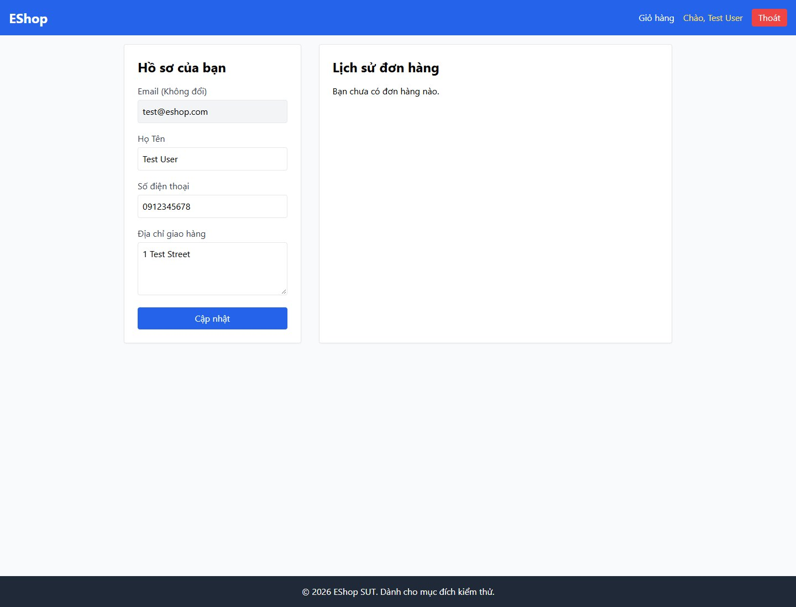
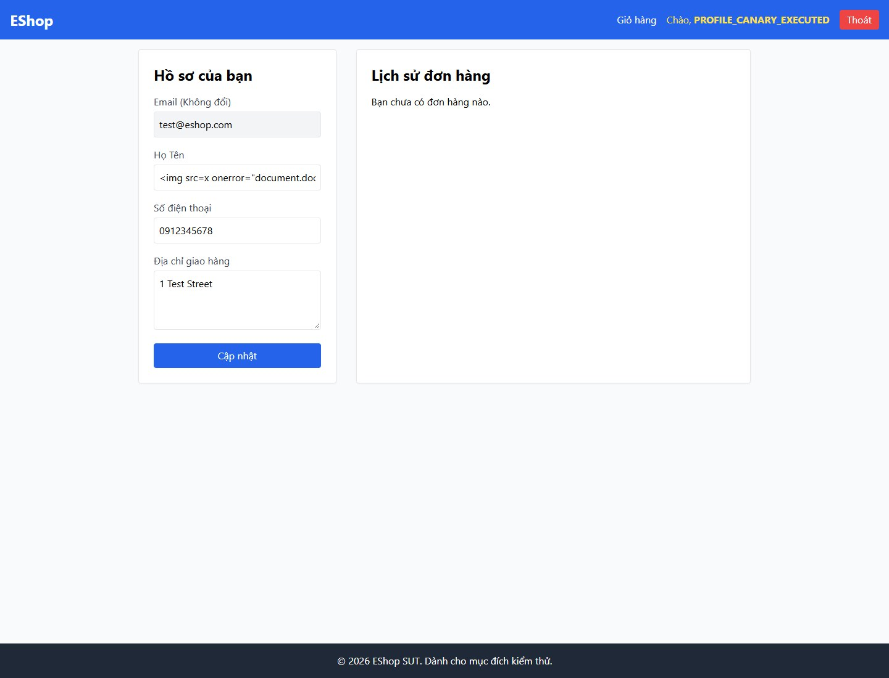
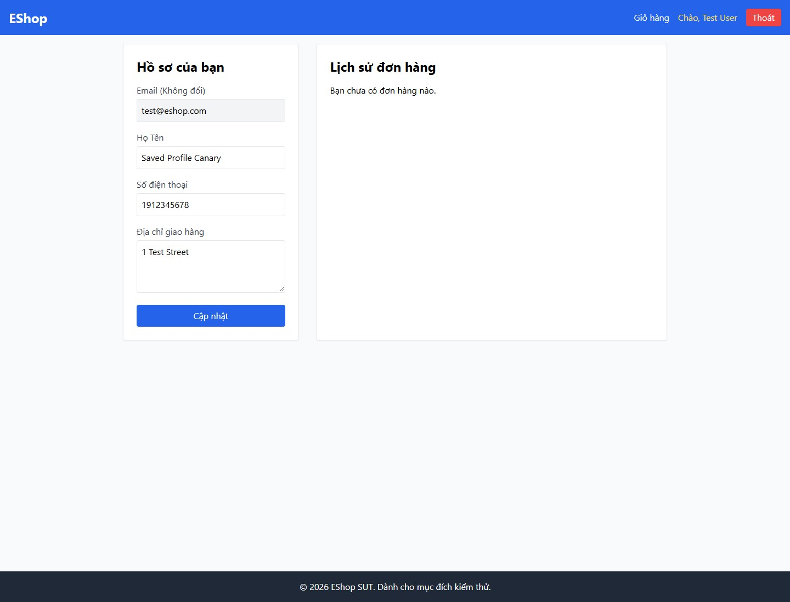

# A - Test Case Report: FR-04 - Quản lý hồ sơ cá nhân

**Sinh viên:** Tống Dương Thái Hòa - 23120262.

## 1. Phạm vi, quy ước và fixture

SRS supplies expected behavior; source inspection explains hypotheses and causes. Each ID is counted once. API, browser UI and Mobile source-handler execution are distinct evidence seams. Invalid cases hold other relevant inputs nominal unless an interaction is explicitly declared. The final extension and its evidence limits are recorded in [Execution records](../evidence/execution/A-execution.md).

### API fixture và môi trường tái hiện

- SUT baseline: `85af3ba875c88283615e22cb108f13e2fccaf0e9`; Node thực thi kiểm chứng lại: `v24.16.0`, Windows. Backend copy tại port `3100`; source SUT và database gốc được SHA-256 trước/sau mỗi suite.
- Checkout HEAD lúc kiểm chứng là `de0f48f5b40939692e7029943295d44788f617ea`; commit sau baseline chỉ thêm root .gitignore. Diff các source/SRS kiểm thử so với baseline85af3ba rỗng; không coi .gitignore là thay đổi logic SUT.
- Clock của SUT cố định: `2026-10-19T08:00:00.000Z`; timestamp UTC trong raw record là thời gian thật của lượt chạy, khác clock mô phỏng.
- Login fixture: `POST /api/login`. Admin: `admin@eshop.com` / `Admin123!`; user 2: `test@eshop.com` / `Test1234!`; user 3: `other@hw02.invalid` / `Test1234!`. Đây là tài khoản demo trong DB isolated. Không lưu JWT thật trong tài liệu.
- Profile trước mỗi TC: user2 `name=Test User`, `phone=0912345678`, `shipping_address=1 Test Street`, `role=user`; user3 `Other User`, `0987654321`, `Other Street`, `role=user`.
- Coupon reset trước mỗi TC: SAVE10 `(percent,10,min300000,limit1)`; BIGBUY `(fixed,50000,min500000,limit1)`; VIP100 `(fixed,100000,min300000,limit2)`; EXPIRED hết hạn năm2020; OFF inactive; TIME fixed10000, minimum0, expiry theo TC; P100 percent100; DELETE_ME fixed1. Coupon còn lại có expiry2099 và active1.
- Usage mặc định user2/VIP100=0; với TC có `used`, harness tạo đúng số row `coupon_usage`. Apply không tự tạo usage; checkout mới ghi usage theo source. User3 không có usage. Mỗi TC reset state, nên kết quả không phụ thuộc TC trước.
- API headers: `Content-Type: application/json`; `Authorization: Bearer <JWT đúng role>` trừ lớp missing/invalid/expired. Invalid là chuỗi `not-a-valid-jwt`; expired là token fixture ký bằng test secret của baseline với `exp` trước clock cố định, không phải credential production.
- Harness API được quản lý ngoài repository nộp bài; khi thực thi, nó copy source bytes, thay listen port qua adapter và cố định global Date; `database.js` gốc drop/seed khi import nên không chạy runner trực tiếp trên DB gốc. Dependencies lấy từ `eshop-sut/backend/node_modules`.

### UI fixture và bằng chứng

Ảnh ghi Web ở `localhost:5173`, Admin ở `localhost:5174`, và Expo Go/Android trên Samsung. Account hiển thị trong ảnh có thể được tái sử dụng (A-UI-01, B-UI-01, D-UI-01); tên file TC không chứng minh đã login account cùng tên. Quy trình ghi rõ variant và trạng thái dữ liệu có thể chứng minh. Không có nhật ký runtime UI đầy đủ về phiên bản OS/Expo hoặc timestamp từng lượt; không tự bổ sung các thông số đó. UI clock dùng thời gian thật của lần chụp, khác clock API.

Các ảnh trong bộ cung cấp thuộc ngày chụp được đặt tên 2026-10-19; trường timestamp thực thi UI không đủ log để khẳng định chính xác. File raw API giữ timestamp thật độc lập. Ảnh vẫn giữ nguyên bytes; đổi tên ảnh không tạo lần thực thi mới.

## 2. Danh mục test cases

| TC-ID | Technique | Mục tiêu | Status | Domain | Bug |
|---|---|---|---|---|---|
| [A-API-01](#a-api-01) | Domain+BVA | 10 digits: lower ON boundary | PASS | A-D1 | - |
| [A-API-02](#a-api-02) | Domain+BVA | 11 digits: upper ON boundary | PASS | A-D1 | - |
| [A-API-03](#a-api-03) | Domain+BVA | 9 digits: lower OFF boundary | FAIL | A-D2 | FR04-01, FR04-02, FR04-03, FR04-04, FR04-05, FR04-06, FR04-07, FR04-08, FR04-09, FR04-10, FR04-11, FR04-12, FR04-13 |
| [A-API-04](#a-api-04) | Domain+BVA | 12 digits: upper OFF boundary | FAIL | A-D3 | FR04-01, FR04-02, FR04-03, FR04-04, FR04-05, FR04-06, FR04-07, FR04-08, FR04-09, FR04-10, FR04-11, FR04-12, FR04-13 |
| [A-API-05](#a-api-05) | Domain | Empty phone | FAIL | A-D2 | FR04-01, FR04-02, FR04-03, FR04-04, FR04-05, FR04-06, FR04-07, FR04-08, FR04-09, FR04-10, FR04-11, FR04-12, FR04-13 |
| [A-API-06](#a-api-06) | Domain | One digit | FAIL | A-D2 | FR04-01, FR04-02, FR04-03, FR04-04, FR04-05, FR04-06, FR04-07, FR04-08, FR04-09, FR04-10, FR04-11, FR04-12, FR04-13 |
| [A-API-07](#a-api-07) | Domain | 8 digits: invalid IN point | FAIL | A-D2 | FR04-01, FR04-02, FR04-03, FR04-04, FR04-05, FR04-06, FR04-07, FR04-08, FR04-09, FR04-10, FR04-11, FR04-12, FR04-13 |
| [A-API-08](#a-api-08) | Domain | 13 digits: invalid IN point | FAIL | A-D3 | FR04-01, FR04-02, FR04-03, FR04-04, FR04-05, FR04-06, FR04-07, FR04-08, FR04-09, FR04-10, FR04-11, FR04-12, FR04-13 |
| [A-API-09](#a-api-09) | Domain | Wrong leading digit, length 10 | FAIL | A-D4 | FR04-01, FR04-02, FR04-03, FR04-04, FR04-05, FR04-06, FR04-07, FR04-08, FR04-09, FR04-10, FR04-11, FR04-12, FR04-13 |
| [A-API-10](#a-api-10) | Domain | Wrong leading digit, length 11 | FAIL | A-D4 | FR04-01, FR04-02, FR04-03, FR04-04, FR04-05, FR04-06, FR04-07, FR04-08, FR04-09, FR04-10, FR04-11, FR04-12, FR04-13 |
| [A-API-11](#a-api-11) | Domain | Alphabetic character | FAIL | A-D5 | FR04-01, FR04-02, FR04-03, FR04-04, FR04-05, FR04-06, FR04-07, FR04-08, FR04-09, FR04-10, FR04-11, FR04-12, FR04-13 |
| [A-API-12](#a-api-12) | Domain | Embedded space | FAIL | A-D5 | FR04-01, FR04-02, FR04-03, FR04-04, FR04-05, FR04-06, FR04-07, FR04-08, FR04-09, FR04-10, FR04-11, FR04-12, FR04-13 |
| [A-API-13](#a-api-13) | Domain | Country prefix instead of 0 | FAIL | A-D5 | FR04-01, FR04-02, FR04-03, FR04-04, FR04-05, FR04-06, FR04-07, FR04-08, FR04-09, FR04-10, FR04-11, FR04-12, FR04-13 |
| [A-API-14](#a-api-14) | Domain | Hyphenated digits | FAIL | A-D5 | FR04-01, FR04-02, FR04-03, FR04-04, FR04-05, FR04-06, FR04-07, FR04-08, FR04-09, FR04-10, FR04-11, FR04-12, FR04-13 |
| [A-API-15](#a-api-15) | Domain | Unicode fullwidth digits | OBSERVATION | A-D6 | - |
| [A-API-16](#a-api-16) | Domain | Null phone | FAIL | A-D5 | FR04-01, FR04-02, FR04-03, FR04-04, FR04-05, FR04-06, FR04-07, FR04-08, FR04-09, FR04-10, FR04-11, FR04-12, FR04-13 |
| [A-API-17](#a-api-17) | Domain | Unicode name and address | PASS | A-D7 | - |
| [A-API-18](#a-api-18) | Domain | Client role escalation | FAIL | A-D8 | FR04-14 |
| [A-API-19](#a-api-19) | Domain | Body user id cannot redirect update | PASS | A-D9 | - |
| [A-API-20](#a-api-20) | Domain | Profile update: none token | PASS | A-D10 | - |
| [A-API-21](#a-api-21) | Domain | Profile update: invalid token | PASS | A-D10 | - |
| [A-API-22](#a-api-22) | Domain | Profile read needs authentication | PASS | A-D10 | - |
| [A-UI-01](#a-ui-01) | Domain+BVA | Profile phone 091234567 | PASS | A-D2 | - |
| [A-UI-02](#a-ui-02) | Domain+BVA | Profile phone 0912345678 | FAIL | A-D1 | FR04-15, FR04-16, FR04-17 |
| [A-UI-03](#a-ui-03) | Domain+BVA | Profile phone 09123456789 | FAIL | A-D1 | FR04-15, FR04-16, FR04-17 |
| [A-UI-04](#a-ui-04) | Domain+BVA | Profile phone 091234567890 | PASS | A-D3 | - |
| [A-UI-05](#a-ui-05) | Domain | Profile phone 1912345678 | FAIL | A-D4 | FR04-15, FR04-16, FR04-17 |
| [A-UI-06](#a-ui-06) | Domain | Email field cannot be changed | PASS | A-D11 | - |
| [A-UI-07](#a-ui-07) | Domain | Unicode editable profile fields | FAIL | A-D7 | FR04-15, FR04-16, FR04-17 |

<a id="a-api-01"></a>

## A-API-01

**Mục tiêu:** 10 digits: lower ON boundary.

| Thuộc tính | Giá trị |
|---|---|
| Technique | Domain+BVA |
| Oracle | FR-04 phone: starts 0, 10-11 digits; numeral encoding unspecified |
| Domains | A-D1 |
| Seam | HTTP API |
| Status | PASS |
| Bug | - |

### Preconditions

- Khôi phục profile user2/user3 như fixture chung; JWT user2 trừ TC auth. Giữ name/address và các field không phải mục tiêu hợp lệ.
- Authentication request mục tiêu: `user`.

### Input - thiết kế

```json
{
  "name": "HW02 User",
  "shipping_address": "1 Test Street",
  "phone": "0912345678"
}
```

### Steps

1. Gửi `PUT /api/users/me` với authentication `user` và JSON Input bên dưới.
2. Gửi `GET /api/users/me` với authentication `user`; không có request body.
3. Đối chiếu response và hậu điều kiện với Expected; chỉ GET/readback là quan sát, fixture SQL không được dùng làm oracle.

### Expected

Accept and persist the exact valid phone.

### Actual và Evidence

Timestamp UTC thực tế: `2026-10-19T19:50:57.739Z`. Với list dài, phần dưới giữ row_count và relevant_rows; mọi trường của row liên quan giữ nguyên, full list nằm trong raw link.

```json
[
  {
    "method": "PUT",
    "url": "/api/users/me",
    "authentication": "user",
    "input": {
      "name": "HW02 User",
      "shipping_address": "1 Test Street",
      "phone": "0912345678"
    },
    "status": 200,
    "body": {
      "message": "Profile updated"
    }
  },
  {
    "method": "GET",
    "url": "/api/users/me",
    "authentication": "user",
    "input": null,
    "status": 200,
    "body": {
      "id": 2,
      "name": "HW02 User",
      "email": "test@eshop.com",
      "role": "user",
      "login_attempts": 0,
      "locked_until": null,
      "shipping_address": "1 Test Street",
      "phone": "0912345678"
    }
  }
]
```

[Full raw record](../evidence/execution/A-api.md#a-api-01). Source hashes trước/sau nằm trong raw report.

### Verdict và rationale

**PASS** - Tiêu chí thuộc phạm vi đã ghi khớp expected với evidence nêu trên.

<a id="a-api-02"></a>

## A-API-02

**Mục tiêu:** 11 digits: upper ON boundary.

| Thuộc tính | Giá trị |
|---|---|
| Technique | Domain+BVA |
| Oracle | FR-04 phone: starts 0, 10-11 digits; numeral encoding unspecified |
| Domains | A-D1 |
| Seam | HTTP API |
| Status | PASS |
| Bug | - |

### Preconditions

- Khôi phục profile user2/user3 như fixture chung; JWT user2 trừ TC auth. Giữ name/address và các field không phải mục tiêu hợp lệ.
- Authentication request mục tiêu: `user`.

### Input - thiết kế

```json
{
  "name": "HW02 User",
  "shipping_address": "1 Test Street",
  "phone": "09123456789"
}
```

### Steps

1. Gửi `PUT /api/users/me` với authentication `user` và JSON Input bên dưới.
2. Gửi `GET /api/users/me` với authentication `user`; không có request body.
3. Đối chiếu response và hậu điều kiện với Expected; chỉ GET/readback là quan sát, fixture SQL không được dùng làm oracle.

### Expected

Accept and persist the exact valid phone.

### Actual và Evidence

Timestamp UTC thực tế: `2026-10-19T19:50:57.771Z`. Với list dài, phần dưới giữ row_count và relevant_rows; mọi trường của row liên quan giữ nguyên, full list nằm trong raw link.

```json
[
  {
    "method": "PUT",
    "url": "/api/users/me",
    "authentication": "user",
    "input": {
      "name": "HW02 User",
      "shipping_address": "1 Test Street",
      "phone": "09123456789"
    },
    "status": 200,
    "body": {
      "message": "Profile updated"
    }
  },
  {
    "method": "GET",
    "url": "/api/users/me",
    "authentication": "user",
    "input": null,
    "status": 200,
    "body": {
      "id": 2,
      "name": "HW02 User",
      "email": "test@eshop.com",
      "role": "user",
      "login_attempts": 0,
      "locked_until": null,
      "shipping_address": "1 Test Street",
      "phone": "09123456789"
    }
  }
]
```

[Full raw record](../evidence/execution/A-api.md#a-api-02). Source hashes trước/sau nằm trong raw report.

### Verdict và rationale

**PASS** - Tiêu chí thuộc phạm vi đã ghi khớp expected với evidence nêu trên.

<a id="a-api-03"></a>

## A-API-03

**Mục tiêu:** 9 digits: lower OFF boundary.

| Thuộc tính | Giá trị |
|---|---|
| Technique | Domain+BVA |
| Oracle | FR-04 phone: starts 0, 10-11 digits; numeral encoding unspecified |
| Domains | A-D2 |
| Seam | HTTP API |
| Status | FAIL |
| Bug | FR04-01 |

### Preconditions

- Khôi phục profile user2/user3 như fixture chung; JWT user2 trừ TC auth. Giữ name/address và các field không phải mục tiêu hợp lệ.
- Authentication request mục tiêu: `user`.

### Input - thiết kế

```json
{
  "name": "HW02 User",
  "shipping_address": "1 Test Street",
  "phone": "091234567"
}
```

### Steps

1. Gửi `PUT /api/users/me` với authentication `user` và JSON Input bên dưới.
2. Gửi `GET /api/users/me` với authentication `user`; không có request body.
3. Đối chiếu response và hậu điều kiện với Expected; chỉ GET/readback là quan sát, fixture SQL không được dùng làm oracle.

### Expected

Reject; stored phone stays 0912345678.

### Actual và Evidence

Timestamp UTC thực tế: `2026-10-19T19:50:57.797Z`. Với list dài, phần dưới giữ row_count và relevant_rows; mọi trường của row liên quan giữ nguyên, full list nằm trong raw link.

```json
[
  {
    "method": "PUT",
    "url": "/api/users/me",
    "authentication": "user",
    "input": {
      "name": "HW02 User",
      "shipping_address": "1 Test Street",
      "phone": "091234567"
    },
    "status": 200,
    "body": {
      "message": "Profile updated"
    }
  },
  {
    "method": "GET",
    "url": "/api/users/me",
    "authentication": "user",
    "input": null,
    "status": 200,
    "body": {
      "id": 2,
      "name": "HW02 User",
      "email": "test@eshop.com",
      "role": "user",
      "login_attempts": 0,
      "locked_until": null,
      "shipping_address": "1 Test Street",
      "phone": "091234567"
    }
  }
]
```

[Full raw record](../evidence/execution/A-api.md#a-api-03). Source hashes trước/sau nằm trong raw report.

### Verdict và rationale

**FAIL** - Có ít nhất một hành vi quan sát trái oracle; bug được nhóm theo behavior, không nhân số bug theo số TC.

<a id="a-api-04"></a>

## A-API-04

**Mục tiêu:** 12 digits: upper OFF boundary.

| Thuộc tính | Giá trị |
|---|---|
| Technique | Domain+BVA |
| Oracle | FR-04 phone: starts 0, 10-11 digits; numeral encoding unspecified |
| Domains | A-D3 |
| Seam | HTTP API |
| Status | FAIL |
| Bug | FR04-02 |

### Preconditions

- Khôi phục profile user2/user3 như fixture chung; JWT user2 trừ TC auth. Giữ name/address và các field không phải mục tiêu hợp lệ.
- Authentication request mục tiêu: `user`.

### Input - thiết kế

```json
{
  "name": "HW02 User",
  "shipping_address": "1 Test Street",
  "phone": "091234567890"
}
```

### Steps

1. Gửi `PUT /api/users/me` với authentication `user` và JSON Input bên dưới.
2. Gửi `GET /api/users/me` với authentication `user`; không có request body.
3. Đối chiếu response và hậu điều kiện với Expected; chỉ GET/readback là quan sát, fixture SQL không được dùng làm oracle.

### Expected

Reject; stored phone stays 0912345678.

### Actual và Evidence

Timestamp UTC thực tế: `2026-10-19T19:50:57.825Z`. Với list dài, phần dưới giữ row_count và relevant_rows; mọi trường của row liên quan giữ nguyên, full list nằm trong raw link.

```json
[
  {
    "method": "PUT",
    "url": "/api/users/me",
    "authentication": "user",
    "input": {
      "name": "HW02 User",
      "shipping_address": "1 Test Street",
      "phone": "091234567890"
    },
    "status": 200,
    "body": {
      "message": "Profile updated"
    }
  },
  {
    "method": "GET",
    "url": "/api/users/me",
    "authentication": "user",
    "input": null,
    "status": 200,
    "body": {
      "id": 2,
      "name": "HW02 User",
      "email": "test@eshop.com",
      "role": "user",
      "login_attempts": 0,
      "locked_until": null,
      "shipping_address": "1 Test Street",
      "phone": "091234567890"
    }
  }
]
```

[Full raw record](../evidence/execution/A-api.md#a-api-04). Source hashes trước/sau nằm trong raw report.

### Verdict và rationale

**FAIL** - Có ít nhất một hành vi quan sát trái oracle; bug được nhóm theo behavior, không nhân số bug theo số TC.

<a id="a-api-05"></a>

## A-API-05

**Mục tiêu:** Empty phone.

| Thuộc tính | Giá trị |
|---|---|
| Technique | Domain |
| Oracle | FR-04 phone: starts 0, 10-11 digits; numeral encoding unspecified |
| Domains | A-D2 |
| Seam | HTTP API |
| Status | FAIL |
| Bug | FR04-03 |

### Preconditions

- Khôi phục profile user2/user3 như fixture chung; JWT user2 trừ TC auth. Giữ name/address và các field không phải mục tiêu hợp lệ.
- Authentication request mục tiêu: `user`.

### Input - thiết kế

```json
{
  "name": "HW02 User",
  "shipping_address": "1 Test Street",
  "phone": ""
}
```

### Steps

1. Gửi `PUT /api/users/me` với authentication `user` và JSON Input bên dưới.
2. Gửi `GET /api/users/me` với authentication `user`; không có request body.
3. Đối chiếu response và hậu điều kiện với Expected; chỉ GET/readback là quan sát, fixture SQL không được dùng làm oracle.

### Expected

Reject; stored phone stays 0912345678.

### Actual và Evidence

Timestamp UTC thực tế: `2026-10-19T19:50:57.860Z`. Với list dài, phần dưới giữ row_count và relevant_rows; mọi trường của row liên quan giữ nguyên, full list nằm trong raw link.

```json
[
  {
    "method": "PUT",
    "url": "/api/users/me",
    "authentication": "user",
    "input": {
      "name": "HW02 User",
      "shipping_address": "1 Test Street",
      "phone": ""
    },
    "status": 200,
    "body": {
      "message": "Profile updated"
    }
  },
  {
    "method": "GET",
    "url": "/api/users/me",
    "authentication": "user",
    "input": null,
    "status": 200,
    "body": {
      "id": 2,
      "name": "HW02 User",
      "email": "test@eshop.com",
      "role": "user",
      "login_attempts": 0,
      "locked_until": null,
      "shipping_address": "1 Test Street",
      "phone": ""
    }
  }
]
```

[Full raw record](../evidence/execution/A-api.md#a-api-05). Source hashes trước/sau nằm trong raw report.

### Verdict và rationale

**FAIL** - Có ít nhất một hành vi quan sát trái oracle; bug được nhóm theo behavior, không nhân số bug theo số TC.

<a id="a-api-06"></a>

## A-API-06

**Mục tiêu:** One digit.

| Thuộc tính | Giá trị |
|---|---|
| Technique | Domain |
| Oracle | FR-04 phone: starts 0, 10-11 digits; numeral encoding unspecified |
| Domains | A-D2 |
| Seam | HTTP API |
| Status | FAIL |
| Bug | FR04-04 |

### Preconditions

- Khôi phục profile user2/user3 như fixture chung; JWT user2 trừ TC auth. Giữ name/address và các field không phải mục tiêu hợp lệ.
- Authentication request mục tiêu: `user`.

### Input - thiết kế

```json
{
  "name": "HW02 User",
  "shipping_address": "1 Test Street",
  "phone": "0"
}
```

### Steps

1. Gửi `PUT /api/users/me` với authentication `user` và JSON Input bên dưới.
2. Gửi `GET /api/users/me` với authentication `user`; không có request body.
3. Đối chiếu response và hậu điều kiện với Expected; chỉ GET/readback là quan sát, fixture SQL không được dùng làm oracle.

### Expected

Reject; stored phone stays 0912345678.

### Actual và Evidence

Timestamp UTC thực tế: `2026-10-19T19:50:57.895Z`. Với list dài, phần dưới giữ row_count và relevant_rows; mọi trường của row liên quan giữ nguyên, full list nằm trong raw link.

```json
[
  {
    "method": "PUT",
    "url": "/api/users/me",
    "authentication": "user",
    "input": {
      "name": "HW02 User",
      "shipping_address": "1 Test Street",
      "phone": "0"
    },
    "status": 200,
    "body": {
      "message": "Profile updated"
    }
  },
  {
    "method": "GET",
    "url": "/api/users/me",
    "authentication": "user",
    "input": null,
    "status": 200,
    "body": {
      "id": 2,
      "name": "HW02 User",
      "email": "test@eshop.com",
      "role": "user",
      "login_attempts": 0,
      "locked_until": null,
      "shipping_address": "1 Test Street",
      "phone": "0"
    }
  }
]
```

[Full raw record](../evidence/execution/A-api.md#a-api-06). Source hashes trước/sau nằm trong raw report.

### Verdict và rationale

**FAIL** - Có ít nhất một hành vi quan sát trái oracle; bug được nhóm theo behavior, không nhân số bug theo số TC.

<a id="a-api-07"></a>

## A-API-07

**Mục tiêu:** 8 digits: invalid IN point.

| Thuộc tính | Giá trị |
|---|---|
| Technique | Domain |
| Oracle | FR-04 phone: starts 0, 10-11 digits; numeral encoding unspecified |
| Domains | A-D2 |
| Seam | HTTP API |
| Status | FAIL |
| Bug | FR04-05 |

### Preconditions

- Khôi phục profile user2/user3 như fixture chung; JWT user2 trừ TC auth. Giữ name/address và các field không phải mục tiêu hợp lệ.
- Authentication request mục tiêu: `user`.

### Input - thiết kế

```json
{
  "name": "HW02 User",
  "shipping_address": "1 Test Street",
  "phone": "09123456"
}
```

### Steps

1. Gửi `PUT /api/users/me` với authentication `user` và JSON Input bên dưới.
2. Gửi `GET /api/users/me` với authentication `user`; không có request body.
3. Đối chiếu response và hậu điều kiện với Expected; chỉ GET/readback là quan sát, fixture SQL không được dùng làm oracle.

### Expected

Reject; stored phone stays 0912345678.

### Actual và Evidence

Timestamp UTC thực tế: `2026-10-19T19:50:57.922Z`. Với list dài, phần dưới giữ row_count và relevant_rows; mọi trường của row liên quan giữ nguyên, full list nằm trong raw link.

```json
[
  {
    "method": "PUT",
    "url": "/api/users/me",
    "authentication": "user",
    "input": {
      "name": "HW02 User",
      "shipping_address": "1 Test Street",
      "phone": "09123456"
    },
    "status": 200,
    "body": {
      "message": "Profile updated"
    }
  },
  {
    "method": "GET",
    "url": "/api/users/me",
    "authentication": "user",
    "input": null,
    "status": 200,
    "body": {
      "id": 2,
      "name": "HW02 User",
      "email": "test@eshop.com",
      "role": "user",
      "login_attempts": 0,
      "locked_until": null,
      "shipping_address": "1 Test Street",
      "phone": "09123456"
    }
  }
]
```

[Full raw record](../evidence/execution/A-api.md#a-api-07). Source hashes trước/sau nằm trong raw report.

### Verdict và rationale

**FAIL** - Có ít nhất một hành vi quan sát trái oracle; bug được nhóm theo behavior, không nhân số bug theo số TC.

<a id="a-api-08"></a>

## A-API-08

**Mục tiêu:** 13 digits: invalid IN point.

| Thuộc tính | Giá trị |
|---|---|
| Technique | Domain |
| Oracle | FR-04 phone: starts 0, 10-11 digits; numeral encoding unspecified |
| Domains | A-D3 |
| Seam | HTTP API |
| Status | FAIL |
| Bug | FR04-06 |

### Preconditions

- Khôi phục profile user2/user3 như fixture chung; JWT user2 trừ TC auth. Giữ name/address và các field không phải mục tiêu hợp lệ.
- Authentication request mục tiêu: `user`.

### Input - thiết kế

```json
{
  "name": "HW02 User",
  "shipping_address": "1 Test Street",
  "phone": "0912345678901"
}
```

### Steps

1. Gửi `PUT /api/users/me` với authentication `user` và JSON Input bên dưới.
2. Gửi `GET /api/users/me` với authentication `user`; không có request body.
3. Đối chiếu response và hậu điều kiện với Expected; chỉ GET/readback là quan sát, fixture SQL không được dùng làm oracle.

### Expected

Reject; stored phone stays 0912345678.

### Actual và Evidence

Timestamp UTC thực tế: `2026-10-19T19:50:57.955Z`. Với list dài, phần dưới giữ row_count và relevant_rows; mọi trường của row liên quan giữ nguyên, full list nằm trong raw link.

```json
[
  {
    "method": "PUT",
    "url": "/api/users/me",
    "authentication": "user",
    "input": {
      "name": "HW02 User",
      "shipping_address": "1 Test Street",
      "phone": "0912345678901"
    },
    "status": 200,
    "body": {
      "message": "Profile updated"
    }
  },
  {
    "method": "GET",
    "url": "/api/users/me",
    "authentication": "user",
    "input": null,
    "status": 200,
    "body": {
      "id": 2,
      "name": "HW02 User",
      "email": "test@eshop.com",
      "role": "user",
      "login_attempts": 0,
      "locked_until": null,
      "shipping_address": "1 Test Street",
      "phone": "0912345678901"
    }
  }
]
```

[Full raw record](../evidence/execution/A-api.md#a-api-08). Source hashes trước/sau nằm trong raw report.

### Verdict và rationale

**FAIL** - Có ít nhất một hành vi quan sát trái oracle; bug được nhóm theo behavior, không nhân số bug theo số TC.

<a id="a-api-09"></a>

## A-API-09

**Mục tiêu:** Wrong leading digit, length 10.

| Thuộc tính | Giá trị |
|---|---|
| Technique | Domain |
| Oracle | FR-04 phone: starts 0, 10-11 digits; numeral encoding unspecified |
| Domains | A-D4 |
| Seam | HTTP API |
| Status | FAIL |
| Bug | FR04-07 |

### Preconditions

- Khôi phục profile user2/user3 như fixture chung; JWT user2 trừ TC auth. Giữ name/address và các field không phải mục tiêu hợp lệ.
- Authentication request mục tiêu: `user`.

### Input - thiết kế

```json
{
  "name": "HW02 User",
  "shipping_address": "1 Test Street",
  "phone": "1912345678"
}
```

### Steps

1. Gửi `PUT /api/users/me` với authentication `user` và JSON Input bên dưới.
2. Gửi `GET /api/users/me` với authentication `user`; không có request body.
3. Đối chiếu response và hậu điều kiện với Expected; chỉ GET/readback là quan sát, fixture SQL không được dùng làm oracle.

### Expected

Reject; stored phone stays 0912345678.

### Actual và Evidence

Timestamp UTC thực tế: `2026-10-19T19:50:57.984Z`. Với list dài, phần dưới giữ row_count và relevant_rows; mọi trường của row liên quan giữ nguyên, full list nằm trong raw link.

```json
[
  {
    "method": "PUT",
    "url": "/api/users/me",
    "authentication": "user",
    "input": {
      "name": "HW02 User",
      "shipping_address": "1 Test Street",
      "phone": "1912345678"
    },
    "status": 200,
    "body": {
      "message": "Profile updated"
    }
  },
  {
    "method": "GET",
    "url": "/api/users/me",
    "authentication": "user",
    "input": null,
    "status": 200,
    "body": {
      "id": 2,
      "name": "HW02 User",
      "email": "test@eshop.com",
      "role": "user",
      "login_attempts": 0,
      "locked_until": null,
      "shipping_address": "1 Test Street",
      "phone": "1912345678"
    }
  }
]
```

[Full raw record](../evidence/execution/A-api.md#a-api-09). Source hashes trước/sau nằm trong raw report.

### Verdict và rationale

**FAIL** - Có ít nhất một hành vi quan sát trái oracle; bug được nhóm theo behavior, không nhân số bug theo số TC.

<a id="a-api-10"></a>

## A-API-10

**Mục tiêu:** Wrong leading digit, length 11.

| Thuộc tính | Giá trị |
|---|---|
| Technique | Domain |
| Oracle | FR-04 phone: starts 0, 10-11 digits; numeral encoding unspecified |
| Domains | A-D4 |
| Seam | HTTP API |
| Status | FAIL |
| Bug | FR04-08 |

### Preconditions

- Khôi phục profile user2/user3 như fixture chung; JWT user2 trừ TC auth. Giữ name/address và các field không phải mục tiêu hợp lệ.
- Authentication request mục tiêu: `user`.

### Input - thiết kế

```json
{
  "name": "HW02 User",
  "shipping_address": "1 Test Street",
  "phone": "19123456789"
}
```

### Steps

1. Gửi `PUT /api/users/me` với authentication `user` và JSON Input bên dưới.
2. Gửi `GET /api/users/me` với authentication `user`; không có request body.
3. Đối chiếu response và hậu điều kiện với Expected; chỉ GET/readback là quan sát, fixture SQL không được dùng làm oracle.

### Expected

Reject; stored phone stays 0912345678.

### Actual và Evidence

Timestamp UTC thực tế: `2026-10-19T19:50:58.013Z`. Với list dài, phần dưới giữ row_count và relevant_rows; mọi trường của row liên quan giữ nguyên, full list nằm trong raw link.

```json
[
  {
    "method": "PUT",
    "url": "/api/users/me",
    "authentication": "user",
    "input": {
      "name": "HW02 User",
      "shipping_address": "1 Test Street",
      "phone": "19123456789"
    },
    "status": 200,
    "body": {
      "message": "Profile updated"
    }
  },
  {
    "method": "GET",
    "url": "/api/users/me",
    "authentication": "user",
    "input": null,
    "status": 200,
    "body": {
      "id": 2,
      "name": "HW02 User",
      "email": "test@eshop.com",
      "role": "user",
      "login_attempts": 0,
      "locked_until": null,
      "shipping_address": "1 Test Street",
      "phone": "19123456789"
    }
  }
]
```

[Full raw record](../evidence/execution/A-api.md#a-api-10). Source hashes trước/sau nằm trong raw report.

### Verdict và rationale

**FAIL** - Có ít nhất một hành vi quan sát trái oracle; bug được nhóm theo behavior, không nhân số bug theo số TC.

<a id="a-api-11"></a>

## A-API-11

**Mục tiêu:** Alphabetic character.

| Thuộc tính | Giá trị |
|---|---|
| Technique | Domain |
| Oracle | FR-04 phone: starts 0, 10-11 digits; numeral encoding unspecified |
| Domains | A-D5 |
| Seam | HTTP API |
| Status | FAIL |
| Bug | FR04-09 |

### Preconditions

- Khôi phục profile user2/user3 như fixture chung; JWT user2 trừ TC auth. Giữ name/address và các field không phải mục tiêu hợp lệ.
- Authentication request mục tiêu: `user`.

### Input - thiết kế

```json
{
  "name": "HW02 User",
  "shipping_address": "1 Test Street",
  "phone": "091234567a"
}
```

### Steps

1. Gửi `PUT /api/users/me` với authentication `user` và JSON Input bên dưới.
2. Gửi `GET /api/users/me` với authentication `user`; không có request body.
3. Đối chiếu response và hậu điều kiện với Expected; chỉ GET/readback là quan sát, fixture SQL không được dùng làm oracle.

### Expected

Reject; stored phone stays 0912345678.

### Actual và Evidence

Timestamp UTC thực tế: `2026-10-19T19:50:58.041Z`. Với list dài, phần dưới giữ row_count và relevant_rows; mọi trường của row liên quan giữ nguyên, full list nằm trong raw link.

```json
[
  {
    "method": "PUT",
    "url": "/api/users/me",
    "authentication": "user",
    "input": {
      "name": "HW02 User",
      "shipping_address": "1 Test Street",
      "phone": "091234567a"
    },
    "status": 200,
    "body": {
      "message": "Profile updated"
    }
  },
  {
    "method": "GET",
    "url": "/api/users/me",
    "authentication": "user",
    "input": null,
    "status": 200,
    "body": {
      "id": 2,
      "name": "HW02 User",
      "email": "test@eshop.com",
      "role": "user",
      "login_attempts": 0,
      "locked_until": null,
      "shipping_address": "1 Test Street",
      "phone": "091234567a"
    }
  }
]
```

[Full raw record](../evidence/execution/A-api.md#a-api-11). Source hashes trước/sau nằm trong raw report.

### Verdict và rationale

**FAIL** - Có ít nhất một hành vi quan sát trái oracle; bug được nhóm theo behavior, không nhân số bug theo số TC.

<a id="a-api-12"></a>

## A-API-12

**Mục tiêu:** Embedded space.

| Thuộc tính | Giá trị |
|---|---|
| Technique | Domain |
| Oracle | FR-04 phone: starts 0, 10-11 digits; numeral encoding unspecified |
| Domains | A-D5 |
| Seam | HTTP API |
| Status | FAIL |
| Bug | FR04-10 |

### Preconditions

- Khôi phục profile user2/user3 như fixture chung; JWT user2 trừ TC auth. Giữ name/address và các field không phải mục tiêu hợp lệ.
- Authentication request mục tiêu: `user`.

### Input - thiết kế

```json
{
  "name": "HW02 User",
  "shipping_address": "1 Test Street",
  "phone": "09123 5678"
}
```

### Steps

1. Gửi `PUT /api/users/me` với authentication `user` và JSON Input bên dưới.
2. Gửi `GET /api/users/me` với authentication `user`; không có request body.
3. Đối chiếu response và hậu điều kiện với Expected; chỉ GET/readback là quan sát, fixture SQL không được dùng làm oracle.

### Expected

Reject; stored phone stays 0912345678.

### Actual và Evidence

Timestamp UTC thực tế: `2026-10-19T19:50:58.073Z`. Với list dài, phần dưới giữ row_count và relevant_rows; mọi trường của row liên quan giữ nguyên, full list nằm trong raw link.

```json
[
  {
    "method": "PUT",
    "url": "/api/users/me",
    "authentication": "user",
    "input": {
      "name": "HW02 User",
      "shipping_address": "1 Test Street",
      "phone": "09123 5678"
    },
    "status": 200,
    "body": {
      "message": "Profile updated"
    }
  },
  {
    "method": "GET",
    "url": "/api/users/me",
    "authentication": "user",
    "input": null,
    "status": 200,
    "body": {
      "id": 2,
      "name": "HW02 User",
      "email": "test@eshop.com",
      "role": "user",
      "login_attempts": 0,
      "locked_until": null,
      "shipping_address": "1 Test Street",
      "phone": "09123 5678"
    }
  }
]
```

[Full raw record](../evidence/execution/A-api.md#a-api-12). Source hashes trước/sau nằm trong raw report.

### Verdict và rationale

**FAIL** - Có ít nhất một hành vi quan sát trái oracle; bug được nhóm theo behavior, không nhân số bug theo số TC.

<a id="a-api-13"></a>

## A-API-13

**Mục tiêu:** Country prefix instead of 0.

| Thuộc tính | Giá trị |
|---|---|
| Technique | Domain |
| Oracle | FR-04 phone: starts 0, 10-11 digits; numeral encoding unspecified |
| Domains | A-D5 |
| Seam | HTTP API |
| Status | FAIL |
| Bug | FR04-11 |

### Preconditions

- Khôi phục profile user2/user3 như fixture chung; JWT user2 trừ TC auth. Giữ name/address và các field không phải mục tiêu hợp lệ.
- Biến thể +84 cố ý kiểm format quốc tế; nó đồng thời khác prefix và charset. A-API-09/10 cô lập prefix, A-API-11/12/14 cô lập charset; không dùng riêng +84 để kết luận điều kiện nào bị thiếu.
- Authentication request mục tiêu: `user`.

### Input - thiết kế

```json
{
  "name": "HW02 User",
  "shipping_address": "1 Test Street",
  "phone": "+84912345678"
}
```

### Steps

1. Gửi `PUT /api/users/me` với authentication `user` và JSON Input bên dưới.
2. Gửi `GET /api/users/me` với authentication `user`; không có request body.
3. Đối chiếu response và hậu điều kiện với Expected; chỉ GET/readback là quan sát, fixture SQL không được dùng làm oracle.

### Expected

Reject; stored phone stays 0912345678.

### Actual và Evidence

Timestamp UTC thực tế: `2026-10-19T19:50:58.103Z`. Với list dài, phần dưới giữ row_count và relevant_rows; mọi trường của row liên quan giữ nguyên, full list nằm trong raw link.

```json
[
  {
    "method": "PUT",
    "url": "/api/users/me",
    "authentication": "user",
    "input": {
      "name": "HW02 User",
      "shipping_address": "1 Test Street",
      "phone": "+84912345678"
    },
    "status": 200,
    "body": {
      "message": "Profile updated"
    }
  },
  {
    "method": "GET",
    "url": "/api/users/me",
    "authentication": "user",
    "input": null,
    "status": 200,
    "body": {
      "id": 2,
      "name": "HW02 User",
      "email": "test@eshop.com",
      "role": "user",
      "login_attempts": 0,
      "locked_until": null,
      "shipping_address": "1 Test Street",
      "phone": "+84912345678"
    }
  }
]
```

[Full raw record](../evidence/execution/A-api.md#a-api-13). Source hashes trước/sau nằm trong raw report.

### Verdict và rationale

**FAIL** - Có ít nhất một hành vi quan sát trái oracle; bug được nhóm theo behavior, không nhân số bug theo số TC.

<a id="a-api-14"></a>

## A-API-14

**Mục tiêu:** Hyphenated digits.

| Thuộc tính | Giá trị |
|---|---|
| Technique | Domain |
| Oracle | FR-04 phone: starts 0, 10-11 digits; numeral encoding unspecified |
| Domains | A-D5 |
| Seam | HTTP API |
| Status | FAIL |
| Bug | FR04-12 |

### Preconditions

- Khôi phục profile user2/user3 như fixture chung; JWT user2 trừ TC auth. Giữ name/address và các field không phải mục tiêu hợp lệ.
- Authentication request mục tiêu: `user`.

### Input - thiết kế

```json
{
  "name": "HW02 User",
  "shipping_address": "1 Test Street",
  "phone": "09123-5678"
}
```

### Steps

1. Gửi `PUT /api/users/me` với authentication `user` và JSON Input bên dưới.
2. Gửi `GET /api/users/me` với authentication `user`; không có request body.
3. Đối chiếu response và hậu điều kiện với Expected; chỉ GET/readback là quan sát, fixture SQL không được dùng làm oracle.

### Expected

Reject; stored phone stays 0912345678.

### Actual và Evidence

Timestamp UTC thực tế: `2026-10-19T19:50:58.132Z`. Với list dài, phần dưới giữ row_count và relevant_rows; mọi trường của row liên quan giữ nguyên, full list nằm trong raw link.

```json
[
  {
    "method": "PUT",
    "url": "/api/users/me",
    "authentication": "user",
    "input": {
      "name": "HW02 User",
      "shipping_address": "1 Test Street",
      "phone": "09123-5678"
    },
    "status": 200,
    "body": {
      "message": "Profile updated"
    }
  },
  {
    "method": "GET",
    "url": "/api/users/me",
    "authentication": "user",
    "input": null,
    "status": 200,
    "body": {
      "id": 2,
      "name": "HW02 User",
      "email": "test@eshop.com",
      "role": "user",
      "login_attempts": 0,
      "locked_until": null,
      "shipping_address": "1 Test Street",
      "phone": "09123-5678"
    }
  }
]
```

[Full raw record](../evidence/execution/A-api.md#a-api-14). Source hashes trước/sau nằm trong raw report.

### Verdict và rationale

**FAIL** - Có ít nhất một hành vi quan sát trái oracle; bug được nhóm theo behavior, không nhân số bug theo số TC.

<a id="a-api-15"></a>

## A-API-15

**Mục tiêu:** Unicode fullwidth digits.

| Thuộc tính | Giá trị |
|---|---|
| Technique | Domain |
| Oracle | FR-04 phone: starts 0, 10-11 digits; numeral encoding unspecified |
| Domains | A-D6 |
| Seam | HTTP API |
| Status | OBSERVATION |
| Bug | - |

### Preconditions

- Khôi phục profile user2/user3 như fixture chung; JWT user2 trừ TC auth. Giữ name/address và các field không phải mục tiêu hợp lệ.
- Authentication request mục tiêu: `user`.

### Input - thiết kế

```json
{
  "name": "HW02 User",
  "shipping_address": "1 Test Street",
  "phone": "０９１２３４５６７８"
}
```

### Steps

1. Gửi `PUT /api/users/me` với authentication `user` và JSON Input bên dưới.
2. Gửi `GET /api/users/me` với authentication `user`; không có request body.
3. Đối chiếu response và hậu điều kiện với Expected; chỉ GET/readback là quan sát, fixture SQL không được dùng làm oracle.

### Expected

Record Unicode numeral acceptance; SRS does not explicitly specify numeral encoding.

### Actual và Evidence

Timestamp UTC thực tế: `2026-10-19T19:50:58.161Z`. Với list dài, phần dưới giữ row_count và relevant_rows; mọi trường của row liên quan giữ nguyên, full list nằm trong raw link.

```json
[
  {
    "method": "PUT",
    "url": "/api/users/me",
    "authentication": "user",
    "input": {
      "name": "HW02 User",
      "shipping_address": "1 Test Street",
      "phone": "０９１２３４５６７８"
    },
    "status": 200,
    "body": {
      "message": "Profile updated"
    }
  },
  {
    "method": "GET",
    "url": "/api/users/me",
    "authentication": "user",
    "input": null,
    "status": 200,
    "body": {
      "id": 2,
      "name": "HW02 User",
      "email": "test@eshop.com",
      "role": "user",
      "login_attempts": 0,
      "locked_until": null,
      "shipping_address": "1 Test Street",
      "phone": "０９１２３４５６７８"
    }
  }
]
```

[Full raw record](../evidence/execution/A-api.md#a-api-15). Source hashes trước/sau nằm trong raw report.

### Verdict và rationale

**OBSERVATION** - Ghi nhận hành vi trong vùng SRS chưa có oracle chi tiết; không cộng vào PASS/FAIL hoặc bug.

<a id="a-api-16"></a>

## A-API-16

**Mục tiêu:** Null phone.

| Thuộc tính | Giá trị |
|---|---|
| Technique | Domain |
| Oracle | FR-04 phone: starts 0, 10-11 digits; numeral encoding unspecified |
| Domains | A-D5 |
| Seam | HTTP API |
| Status | FAIL |
| Bug | FR04-13 |

### Preconditions

- Khôi phục profile user2/user3 như fixture chung; JWT user2 trừ TC auth. Giữ name/address và các field không phải mục tiêu hợp lệ.
- Authentication request mục tiêu: `user`.

### Input - thiết kế

```json
{
  "name": "HW02 User",
  "shipping_address": "1 Test Street",
  "phone": null
}
```

### Steps

1. Gửi `PUT /api/users/me` với authentication `user` và JSON Input bên dưới.
2. Gửi `GET /api/users/me` với authentication `user`; không có request body.
3. Đối chiếu response và hậu điều kiện với Expected; chỉ GET/readback là quan sát, fixture SQL không được dùng làm oracle.

### Expected

Reject; stored phone stays 0912345678.

### Actual và Evidence

Timestamp UTC thực tế: `2026-10-19T19:50:58.195Z`. Với list dài, phần dưới giữ row_count và relevant_rows; mọi trường của row liên quan giữ nguyên, full list nằm trong raw link.

```json
[
  {
    "method": "PUT",
    "url": "/api/users/me",
    "authentication": "user",
    "input": {
      "name": "HW02 User",
      "shipping_address": "1 Test Street",
      "phone": null
    },
    "status": 200,
    "body": {
      "message": "Profile updated"
    }
  },
  {
    "method": "GET",
    "url": "/api/users/me",
    "authentication": "user",
    "input": null,
    "status": 200,
    "body": {
      "id": 2,
      "name": "HW02 User",
      "email": "test@eshop.com",
      "role": "user",
      "login_attempts": 0,
      "locked_until": null,
      "shipping_address": "1 Test Street",
      "phone": null
    }
  }
]
```

[Full raw record](../evidence/execution/A-api.md#a-api-16). Source hashes trước/sau nằm trong raw report.

### Verdict và rationale

**FAIL** - Có ít nhất một hành vi quan sát trái oracle; bug được nhóm theo behavior, không nhân số bug theo số TC.

<a id="a-api-17"></a>

## A-API-17

**Mục tiêu:** Unicode name and address.

| Thuộc tính | Giá trị |
|---|---|
| Technique | Domain |
| Oracle | FR-04 editable fields |
| Domains | A-D7 |
| Seam | HTTP API |
| Status | PASS |
| Bug | - |

### Preconditions

- Khôi phục profile user2/user3 như fixture chung; JWT user2 trừ TC auth. Giữ name/address và các field không phải mục tiêu hợp lệ.
- Authentication request mục tiêu: `user`.

### Input - thiết kế

```json
{
  "name": "Người Dùng HW02",
  "phone": "0912345678",
  "shipping_address": "Đường Thử Nghiệm"
}
```

### Steps

1. Gửi `PUT /api/users/me` với authentication `user` và JSON Input bên dưới.
2. Gửi `GET /api/users/me` với authentication `user`; không có request body.
3. Đối chiếu response và hậu điều kiện với Expected; chỉ GET/readback là quan sát, fixture SQL không được dùng làm oracle.

### Expected

Persist Unicode name and address exactly.

### Actual và Evidence

Timestamp UTC thực tế: `2026-10-19T19:50:58.231Z`. Với list dài, phần dưới giữ row_count và relevant_rows; mọi trường của row liên quan giữ nguyên, full list nằm trong raw link.

```json
[
  {
    "method": "PUT",
    "url": "/api/users/me",
    "authentication": "user",
    "input": {
      "name": "Người Dùng HW02",
      "phone": "0912345678",
      "shipping_address": "Đường Thử Nghiệm"
    },
    "status": 200,
    "body": {
      "message": "Profile updated"
    }
  },
  {
    "method": "GET",
    "url": "/api/users/me",
    "authentication": "user",
    "input": null,
    "status": 200,
    "body": {
      "id": 2,
      "name": "Người Dùng HW02",
      "email": "test@eshop.com",
      "role": "user",
      "login_attempts": 0,
      "locked_until": null,
      "shipping_address": "Đường Thử Nghiệm",
      "phone": "0912345678"
    }
  }
]
```

[Full raw record](../evidence/execution/A-api.md#a-api-17). Source hashes trước/sau nằm trong raw report.

### Verdict và rationale

**PASS** - Tiêu chí thuộc phạm vi đã ghi khớp expected với evidence nêu trên.

<a id="a-api-18"></a>

## A-API-18

**Mục tiêu:** Client role escalation.

| Thuộc tính | Giá trị |
|---|---|
| Technique | Domain |
| Oracle | FR-04 + SEC-06: cannot self-edit role |
| Domains | A-D8 |
| Seam | HTTP API |
| Status | FAIL |
| Bug | FR04-14 |

### Preconditions

- Khôi phục profile user2/user3 như fixture chung; JWT user2 trừ TC auth. Giữ name/address và các field không phải mục tiêu hợp lệ.
- Authentication request mục tiêu: `user`.

### Input - thiết kế

```json
{
  "name": "HW02 User",
  "phone": "0912345678",
  "shipping_address": "1 Test Street",
  "role": "admin"
}
```

### Steps

1. Gửi `PUT /api/users/me` với authentication `user` và JSON Input bên dưới.
2. Gửi `GET /api/users/me` với authentication `user`; không có request body.
3. Đối chiếu response và hậu điều kiện với Expected; chỉ GET/readback là quan sát, fixture SQL không được dùng làm oracle.

### Expected

Reject or ignore role; GET /users/me remains role=user.

### Actual và Evidence

Timestamp UTC thực tế: `2026-10-19T19:50:58.262Z`. Với list dài, phần dưới giữ row_count và relevant_rows; mọi trường của row liên quan giữ nguyên, full list nằm trong raw link.

```json
[
  {
    "method": "PUT",
    "url": "/api/users/me",
    "authentication": "user",
    "input": {
      "name": "HW02 User",
      "phone": "0912345678",
      "shipping_address": "1 Test Street",
      "role": "admin"
    },
    "status": 200,
    "body": {
      "message": "Profile updated"
    }
  },
  {
    "method": "GET",
    "url": "/api/users/me",
    "authentication": "user",
    "input": null,
    "status": 200,
    "body": {
      "id": 2,
      "name": "HW02 User",
      "email": "test@eshop.com",
      "role": "admin",
      "login_attempts": 0,
      "locked_until": null,
      "shipping_address": "1 Test Street",
      "phone": "0912345678"
    }
  }
]
```

[Full raw record](../evidence/execution/A-api.md#a-api-18). Source hashes trước/sau nằm trong raw report.

### Verdict và rationale

**FAIL** - Có ít nhất một hành vi quan sát trái oracle; bug được nhóm theo behavior, không nhân số bug theo số TC.

<a id="a-api-19"></a>

## A-API-19

**Mục tiêu:** Body user id cannot redirect update.

| Thuộc tính | Giá trị |
|---|---|
| Technique | Domain |
| Oracle | FR-04 own profile only |
| Domains | A-D9 |
| Seam | HTTP API |
| Status | PASS |
| Bug | - |

### Preconditions

- Khôi phục profile user2/user3 như fixture chung; JWT user2 trừ TC auth. Giữ name/address và các field không phải mục tiêu hợp lệ.
- Authentication request mục tiêu: `user`.

### Input - thiết kế

```json
{
  "name": "Owner Only",
  "phone": "0912345678",
  "shipping_address": "1 Test Street",
  "id": 3,
  "user_id": 3
}
```

### Steps

1. Gửi `PUT /api/users/me` với authentication `user` và JSON Input bên dưới.
2. Gửi `GET /api/users/me` với authentication `user`; không có request body.
3. Gửi `GET /api/users/me` với authentication `other`; không có request body.
4. Đối chiếu response và hậu điều kiện với Expected; chỉ GET/readback là quan sát, fixture SQL không được dùng làm oracle.

### Expected

Update authenticated user 2; user 3 unchanged.

### Actual và Evidence

Timestamp UTC thực tế: `2026-10-19T19:50:58.297Z`. Với list dài, phần dưới giữ row_count và relevant_rows; mọi trường của row liên quan giữ nguyên, full list nằm trong raw link.

```json
[
  {
    "method": "PUT",
    "url": "/api/users/me",
    "authentication": "user",
    "input": {
      "name": "Owner Only",
      "phone": "0912345678",
      "shipping_address": "1 Test Street",
      "id": 3,
      "user_id": 3
    },
    "status": 200,
    "body": {
      "message": "Profile updated"
    }
  },
  {
    "method": "GET",
    "url": "/api/users/me",
    "authentication": "user",
    "input": null,
    "status": 200,
    "body": {
      "id": 2,
      "name": "Owner Only",
      "email": "test@eshop.com",
      "role": "user",
      "login_attempts": 0,
      "locked_until": null,
      "shipping_address": "1 Test Street",
      "phone": "0912345678"
    }
  },
  {
    "method": "GET",
    "url": "/api/users/me",
    "authentication": "other",
    "input": null,
    "status": 200,
    "body": {
      "id": 3,
      "name": "Other User",
      "email": "other@hw02.invalid",
      "role": "user",
      "login_attempts": 0,
      "locked_until": null,
      "shipping_address": "Other Street",
      "phone": "0987654321"
    }
  }
]
```

[Full raw record](../evidence/execution/A-api.md#a-api-19). Source hashes trước/sau nằm trong raw report.

### Verdict và rationale

**PASS** - Tiêu chí thuộc phạm vi đã ghi khớp expected với evidence nêu trên.

<a id="a-api-20"></a>

## A-API-20

**Mục tiêu:** Profile update: none token.

| Thuộc tính | Giá trị |
|---|---|
| Technique | Domain |
| Oracle | FR-04 + SEC-02 |
| Domains | A-D10 |
| Seam | HTTP API |
| Status | PASS |
| Bug | - |

### Preconditions

- Khôi phục profile user2/user3 như fixture chung; JWT user2 trừ TC auth. Giữ name/address và các field không phải mục tiêu hợp lệ.
- Authentication request mục tiêu: `none`.

### Input - thiết kế

```json
{
  "phone": "0912345678"
}
```

### Steps

1. Gửi `PUT /api/users/me` với authentication `none` và JSON Input bên dưới.
2. Gửi `GET /api/users/me` với authentication `user`; không có request body.
3. Đối chiếu response và hậu điều kiện với Expected; chỉ GET/readback là quan sát, fixture SQL không được dùng làm oracle.

### Expected

Reject unauthenticated update (401/403); profile unchanged.

### Actual và Evidence

Timestamp UTC thực tế: `2026-10-19T19:50:58.332Z`. Với list dài, phần dưới giữ row_count và relevant_rows; mọi trường của row liên quan giữ nguyên, full list nằm trong raw link.

```json
[
  {
    "method": "PUT",
    "url": "/api/users/me",
    "authentication": "none",
    "input": {
      "phone": "0912345678"
    },
    "status": 401,
    "body": {
      "error": "Unauthorized"
    }
  },
  {
    "method": "GET",
    "url": "/api/users/me",
    "authentication": "user",
    "input": null,
    "status": 200,
    "body": {
      "id": 2,
      "name": "Test User",
      "email": "test@eshop.com",
      "role": "user",
      "login_attempts": 0,
      "locked_until": null,
      "shipping_address": "1 Test Street",
      "phone": "0912345678"
    }
  }
]
```

[Full raw record](../evidence/execution/A-api.md#a-api-20). Source hashes trước/sau nằm trong raw report.

### Verdict và rationale

**PASS** - Tiêu chí thuộc phạm vi đã ghi khớp expected với evidence nêu trên.

<a id="a-api-21"></a>

## A-API-21

**Mục tiêu:** Profile update: invalid token.

| Thuộc tính | Giá trị |
|---|---|
| Technique | Domain |
| Oracle | FR-04 + SEC-02 |
| Domains | A-D10 |
| Seam | HTTP API |
| Status | PASS |
| Bug | - |

### Preconditions

- Khôi phục profile user2/user3 như fixture chung; JWT user2 trừ TC auth. Giữ name/address và các field không phải mục tiêu hợp lệ.
- Authentication request mục tiêu: `invalid`.

### Input - thiết kế

```json
{
  "phone": "0912345678"
}
```

### Steps

1. Gửi `PUT /api/users/me` với authentication `invalid` và JSON Input bên dưới.
2. Gửi `GET /api/users/me` với authentication `user`; không có request body.
3. Đối chiếu response và hậu điều kiện với Expected; chỉ GET/readback là quan sát, fixture SQL không được dùng làm oracle.

### Expected

Reject unauthenticated update (401/403); profile unchanged.

### Actual và Evidence

Timestamp UTC thực tế: `2026-10-19T19:50:58.357Z`. Với list dài, phần dưới giữ row_count và relevant_rows; mọi trường của row liên quan giữ nguyên, full list nằm trong raw link.

```json
[
  {
    "method": "PUT",
    "url": "/api/users/me",
    "authentication": "invalid",
    "input": {
      "phone": "0912345678"
    },
    "status": 403,
    "body": {
      "error": "Forbidden"
    }
  },
  {
    "method": "GET",
    "url": "/api/users/me",
    "authentication": "user",
    "input": null,
    "status": 200,
    "body": {
      "id": 2,
      "name": "Test User",
      "email": "test@eshop.com",
      "role": "user",
      "login_attempts": 0,
      "locked_until": null,
      "shipping_address": "1 Test Street",
      "phone": "0912345678"
    }
  }
]
```

[Full raw record](../evidence/execution/A-api.md#a-api-21). Source hashes trước/sau nằm trong raw report.

### Verdict và rationale

**PASS** - Tiêu chí thuộc phạm vi đã ghi khớp expected với evidence nêu trên.

<a id="a-api-22"></a>

## A-API-22

**Mục tiêu:** Profile read needs authentication.

| Thuộc tính | Giá trị |
|---|---|
| Technique | Domain |
| Oracle | SEC-02 |
| Domains | A-D10 |
| Seam | HTTP API |
| Status | PASS |
| Bug | - |

### Preconditions

- Khôi phục profile user2/user3 như fixture chung; JWT user2 trừ TC auth. Giữ name/address và các field không phải mục tiêu hợp lệ.
- Authentication request mục tiêu: `none`.

### Input - thiết kế

```json
{}
```

### Steps

1. Gửi `GET /api/users/me` với authentication `none`; không có request body.
2. Đối chiếu response và hậu điều kiện với Expected; chỉ GET/readback là quan sát, fixture SQL không được dùng làm oracle.

### Expected

GET profile without JWT returns 401/403.

### Actual và Evidence

Timestamp UTC thực tế: `2026-10-19T19:50:58.383Z`. Với list dài, phần dưới giữ row_count và relevant_rows; mọi trường của row liên quan giữ nguyên, full list nằm trong raw link.

```json
[
  {
    "method": "GET",
    "url": "/api/users/me",
    "authentication": "none",
    "input": null,
    "status": 401,
    "body": {
      "error": "Unauthorized"
    }
  }
]
```

[Full raw record](../evidence/execution/A-api.md#a-api-22). Source hashes trước/sau nằm trong raw report.

### Verdict và rationale

**PASS** - Tiêu chí thuộc phạm vi đã ghi khớp expected với evidence nêu trên.

<a id="a-ui-01"></a>

## A-UI-01

**Mục tiêu:** Profile phone 091234567.

| Thuộc tính | Giá trị |
|---|---|
| Technique | Domain+BVA |
| Oracle | UI FR-04 |
| Domains | A-D2 |
| Seam | UI thật |
| Status | PASS |
| Bug | - |

### Preconditions

Dùng môi trường UI/fixtures chung. Giữ các điều kiện không phải mục tiêu hợp lệ; các khác biệt của lượt ảnh hiện có được ghi riêng dưới Actual.

### Input - thiết kế

```json
{
  "phone": "091234567"
}
```

### Steps

1. Đăng nhập Web bằng account test có profile của chính mình; mở /profile; ghi lại email/name/phone/address trước thao tác.
2. Nhập đúng JSON thiết kế vào các field tương ứng; giữ các field không phải mục tiêu nominal.
3. Bấm Cập nhật một lần; chụp field cùng alert hoặc response.
4. Nếu thành công: đóng alert, tải lại/fresh login và kiểm tra dữ liệu lưu. Nếu validation chặn: ghi đúng bước bị chặn, không suy persistence.

### Expected

Reject; saved profile remains unchanged.

### Actual và Evidence

Phone 091234567 bị từ chối bằng cảnh báo validation. Ảnh xác nhận bước từ chối; không có GET UI readback độc lập.

**Variant / giới hạn:** Không đổi dữ liệu thiết kế.

**Timestamp UI:** không có log chính xác từng lượt; không tự dựng thời gian từ tên ảnh.


### Verdict và rationale

**PASS** - Tiêu chí thuộc phạm vi đã ghi khớp expected với evidence nêu trên.

<a id="a-ui-02"></a>

## A-UI-02

**Mục tiêu:** Profile phone 0912345678.

| Thuộc tính | Giá trị |
|---|---|
| Technique | Domain+BVA |
| Oracle | UI FR-04 |
| Domains | A-D1 |
| Seam | UI thật |
| Status | FAIL |
| Bug | FR04-15 |

### Preconditions

Dùng môi trường UI/fixtures chung. Giữ các điều kiện không phải mục tiêu hợp lệ; các khác biệt của lượt ảnh hiện có được ghi riêng dưới Actual.

### Input - thiết kế

```json
{
  "phone": "0912345678"
}
```

### Steps

1. Đăng nhập Web bằng account test có profile của chính mình; mở /profile; ghi lại email/name/phone/address trước thao tác.
2. Nhập đúng JSON thiết kế vào các field tương ứng; giữ các field không phải mục tiêu nominal.
3. Bấm Cập nhật một lần; chụp field cùng alert hoặc response.
4. Nếu thành công: đóng alert, tải lại/fresh login và kiểm tra dữ liệu lưu. Nếu validation chặn: ghi đúng bước bị chặn, không suy persistence.

### Expected

Update succeeds; re-login shows the exact phone.

### Actual và Evidence

Phone hợp lệ 0912345678 bị cảnh báo không hợp lệ; thao tác cập nhật bị chặn ngay ở frontend.

**Variant / giới hạn:** Có thêm lượt với 0987654321 cũng bị từ chối. Những ảnh này là biến thể cùng TC, không cộng thêm số test.

**Timestamp UI:** không có log chính xác từng lượt; không tự dựng thời gian từ tên ảnh.


### Verdict và rationale

**FAIL** - Có ít nhất một hành vi quan sát trái oracle; bug được nhóm theo behavior, không nhân số bug theo số TC.

<a id="a-ui-03"></a>

## A-UI-03

**Mục tiêu:** Profile phone 09123456789.

| Thuộc tính | Giá trị |
|---|---|
| Technique | Domain+BVA |
| Oracle | UI FR-04 |
| Domains | A-D1 |
| Seam | UI thật |
| Status | FAIL |
| Bug | FR04-16 |

### Preconditions

Dùng môi trường UI/fixtures chung. Giữ các điều kiện không phải mục tiêu hợp lệ; các khác biệt của lượt ảnh hiện có được ghi riêng dưới Actual.

### Input - thiết kế

```json
{
  "phone": "09123456789"
}
```

### Steps

1. Đăng nhập Web bằng account test có profile của chính mình; mở /profile; ghi lại email/name/phone/address trước thao tác.
2. Nhập đúng JSON thiết kế vào các field tương ứng; giữ các field không phải mục tiêu nominal.
3. Bấm Cập nhật một lần; chụp field cùng alert hoặc response.
4. Nếu thành công: đóng alert, tải lại/fresh login và kiểm tra dữ liệu lưu. Nếu validation chặn: ghi đúng bước bị chặn, không suy persistence.

### Expected

Update succeeds; re-login shows the exact phone.

### Actual và Evidence

Phone hợp lệ 09123456789 bị từ chối. Thông báo nói 9-10 chữ số, khác yêu cầu 10-11 chữ số bắt đầu bằng 0.

**Variant / giới hạn:** Không đổi dữ liệu thiết kế.

**Timestamp UI:** không có log chính xác từng lượt; không tự dựng thời gian từ tên ảnh.


### Verdict và rationale

**FAIL** - Có ít nhất một hành vi quan sát trái oracle; bug được nhóm theo behavior, không nhân số bug theo số TC.

<a id="a-ui-04"></a>

## A-UI-04

**Mục tiêu:** Profile phone 091234567890.

| Thuộc tính | Giá trị |
|---|---|
| Technique | Domain+BVA |
| Oracle | UI FR-04 |
| Domains | A-D3 |
| Seam | UI thật |
| Status | PASS |
| Bug | - |

### Preconditions

Dùng môi trường UI/fixtures chung. Giữ các điều kiện không phải mục tiêu hợp lệ; các khác biệt của lượt ảnh hiện có được ghi riêng dưới Actual.

### Input - thiết kế

```json
{
  "phone": "091234567890"
}
```

### Steps

1. Đăng nhập Web bằng account test có profile của chính mình; mở /profile; ghi lại email/name/phone/address trước thao tác.
2. Nhập đúng JSON thiết kế vào các field tương ứng; giữ các field không phải mục tiêu nominal.
3. Bấm Cập nhật một lần; chụp field cùng alert hoặc response.
4. Nếu thành công: đóng alert, tải lại/fresh login và kiểm tra dữ liệu lưu. Nếu validation chặn: ghi đúng bước bị chặn, không suy persistence.

### Expected

Reject; saved profile remains unchanged.

### Actual và Evidence

Phone 091234567890 bị frontend từ chối. Kết quả từ chối đạt mục tiêu validation của UI, không chứng minh backend có validation.

**Variant / giới hạn:** Không đổi dữ liệu thiết kế.

**Timestamp UI:** không có log chính xác từng lượt; không tự dựng thời gian từ tên ảnh.


### Verdict và rationale

**PASS** - Tiêu chí thuộc phạm vi đã ghi khớp expected với evidence nêu trên.

<a id="a-ui-05"></a>

## A-UI-05

**Mục tiêu:** Profile phone 1912345678.

| Thuộc tính | Giá trị |
|---|---|
| Technique | Domain |
| Oracle | UI FR-04 |
| Domains | A-D4 |
| Seam | UI thật |
| Status | FAIL |
| Bug | FR04-17 |

### Preconditions

Dùng môi trường UI/fixtures chung. Giữ các điều kiện không phải mục tiêu hợp lệ; các khác biệt của lượt ảnh hiện có được ghi riêng dưới Actual.

### Input - thiết kế

```json
{
  "phone": "1912345678"
}
```

### Steps

1. Đăng nhập Web bằng account test có profile của chính mình; mở /profile; ghi lại email/name/phone/address trước thao tác.
2. Nhập đúng JSON thiết kế vào các field tương ứng; giữ các field không phải mục tiêu nominal.
3. Bấm Cập nhật một lần; chụp field cùng alert hoặc response.
4. Nếu thành công: đóng alert, tải lại/fresh login và kiểm tra dữ liệu lưu. Nếu validation chặn: ghi đúng bước bị chặn, không suy persistence.

### Expected

Reject; saved profile remains unchanged.

### Actual và Evidence

Phone 1912345678 có prefix sai nhưng UI báo cập nhật thành công. API A-API-09 xác nhận riêng việc backend có thể lưu prefix sai.

**Variant / giới hạn:** Không đổi dữ liệu thiết kế.

**Timestamp UI:** không có log chính xác từng lượt; không tự dựng thời gian từ tên ảnh.


### Verdict và rationale

**FAIL** - Có ít nhất một hành vi quan sát trái oracle; bug được nhóm theo behavior, không nhân số bug theo số TC.

<a id="a-ui-06"></a>

## A-UI-06

**Mục tiêu:** Email field cannot be changed.

| Thuộc tính | Giá trị |
|---|---|
| Technique | Domain |
| Oracle | UI FR-04 |
| Domains | A-D11 |
| Seam | UI thật |
| Status | PASS |
| Bug | - |

### Preconditions

Dùng môi trường UI/fixtures chung. Giữ các điều kiện không phải mục tiêu hợp lệ; các khác biệt của lượt ảnh hiện có được ghi riêng dưới Actual.

### Input - thiết kế

```json
{
  "email": "other@example.invalid"
}
```

### Steps

1. Đăng nhập Web bằng account test có profile của chính mình; mở /profile; ghi lại email/name/phone/address trước thao tác.
2. Chọn field Email, thử focus/nhập một email khác; quan sát disabled/read-only; không gọi API đổi email.
3. Xác minh email hiển thị vẫn là email account.

### Expected

Email is not editable via UI; original email unchanged.

### Actual và Evidence

Email hiển thị ở field disabled. Source Profile.jsx dùng disabled cho input email; đây là kiểm tra thuộc tính không cho chỉnh sửa qua UI, không phải kiểm thử API đổi email.

**Variant / giới hạn:** Không đổi dữ liệu thiết kế.

**Timestamp UI:** không có log chính xác từng lượt; không tự dựng thời gian từ tên ảnh.


### Verdict và rationale

**PASS** - Tiêu chí thuộc phạm vi đã ghi khớp expected với evidence nêu trên.

<a id="a-ui-07"></a>

## A-UI-07

**Mục tiêu:** Unicode editable profile fields.

| Thuộc tính | Giá trị |
|---|---|
| Technique | Domain |
| Oracle | UI FR-04 |
| Domains | A-D7 |
| Seam | UI thật |
| Status | FAIL |
| Bug | FR04-15 |

### Preconditions

Web runtime riêng tại 127.0.0.1:5173, account A-UI-07 (a_ui_07@hw02.invalid), mở /profile. Name/address có dấu và phone 0912345678 đều hợp lệ theo thiết kế; SUT chưa sửa FR04-15, FR04-16, FR04-17.

### Input - thiết kế

```json
{
  "name": "Người Dùng HW02",
  "shipping_address": "Đường Thử Nghiệm",
  "phone": "0912345678"
}
```

### Steps

1. Đăng nhập Web bằng account test có profile của chính mình; mở /profile; ghi lại email/name/phone/address trước thao tác.
2. Nhập đúng JSON thiết kế vào các field tương ứng; giữ các field không phải mục tiêu nominal.
3. Bấm Cập nhật một lần; chụp field cùng alert hoặc response.
4. Nếu thành công: đóng alert, tải lại/fresh login và kiểm tra dữ liệu lưu. Nếu validation chặn: ghi đúng bước bị chặn, không suy persistence.

### Expected

Valid update accepted; name/address persist after fresh login.

### Actual và Evidence

Ảnh input hiển thị account A-UI-07, email a_ui_07@hw02.invalid, name `Người Dùng HW02`, address `Đường Thử Nghiệm` và phone `0912345678`. Sau bấm Cập nhật, alert báo `Số điện thoại không hợp lệ. Vui lòng nhập đúng 9-10 chữ số.` trong khi input hợp lệ vẫn hiện phía sau.


**Variant / giới hạn:** Ảnh cũ dưới đây dùng phone sai prefix 1912345678 và chỉ có alert thành công; giữ để truy vết lịch sử, không dùng để chứng minh persistence hay PASS. Ảnh mới đủ chứng minh valid update bị chặn bởi FR04-15, FR04-16, FR04-17. Bước fresh login/readback chưa đạt tới do validation chặn; không kết luận dữ liệu Unicode bị hỏng hoặc lưu thành công.


**Timestamp UI:** không có timestamp chụp chính xác được cung cấp; ba ảnh mới được nhận trong hội thoại cập nhật ngày2026-10-20, không suy giờ thực thi từ file metadata.

### Verdict và rationale

**FAIL** - Criterion đầu tiên là chấp nhận cập nhật hợp lệ đã bị vi phạm. Gắn vào FR04-15, FR04-16, FR04-17 vì cùng lỗi frontend từ chối phone đúng SRS; không tạo bug Unicode mới. Persistence sau sửa vẫn cần regression riêng.

## 3. Test Summary

| Scope | Designed | Executed đủ bằng chứng | PASS | FAIL | OBSERVATION | INCOMPLETE | NOT RUN |
|---|---|---|---|---|---|---|---|
| A - API | 29 | 29 | 8 | 18 | 3 | 0 | 0 |
| A - UI | 10 | 10 | 3 | 7 | 0 | 0 | 0 |
| A - HND | 5 | 5 | 2 | 3 | 0 | 0 | 0 |
| **Tổng feature A** | 44 | 44 | 13 | 28 | 3 | 0 | 0 |

Tổng hợp riêng feature; số liệu toàn bài nằm trong README/report. Handler và native-image review được khai rõ ở từng case.

## Additional case index

| Case | Seam | Status | Bug |
|---|---|---|---|
| [A-API-23](#a-api-23) | API | FAIL | FR04-18, FR04-19, FR04-20 |
| [A-API-24](#a-api-24) | API | FAIL | FR04-18, FR04-19, FR04-20 |
| [A-API-25](#a-api-25) | API | PASS | - |
| [A-API-26](#a-api-26) | API | FAIL | FR04-21 |
| [A-API-27](#a-api-27) | API | OBSERVATION | - |
| [A-API-28](#a-api-28) | API | OBSERVATION | - |
| [A-API-29](#a-api-29) | API | FAIL | FR04-18, FR04-19, FR04-20 |
| [A-HND-01](#a-hnd-01) | Source handler + HTTP adapter | FAIL | FR04-22, FR04-23, FR04-24 |
| [A-HND-02](#a-hnd-02) | Source handler + HTTP adapter | FAIL | FR04-22, FR04-23, FR04-24 |
| [A-HND-03](#a-hnd-03) | Source handler + HTTP adapter | FAIL | FR04-22, FR04-23, FR04-24 |
| [A-HND-04](#a-hnd-04) | Source handler + HTTP adapter | PASS | - |
| [A-HND-05](#a-hnd-05) | Source handler + HTTP adapter | PASS | - |
| [A-UI-08](#a-ui-08) | Browser UI via Playwright | FAIL | FR04-25 |
| [A-UI-09](#a-ui-09) | Browser UI via Playwright | FAIL | FR04-26 |
| [A-UI-10](#a-ui-10) | Browser UI via Playwright | FAIL | FR04-27 |


<a id="a-api-23"></a>

## A-API-23

**Objective:** Profile response excludes credentials and reset state

| Property | Value |
|---|---|
| Technique | Domain / contract or state constraint |
| Oracle | SEC-01 storage rule; supplementary OWASP API3 response minimization |
| Domains | A-D12 |
| Seam | API |
| Status | FAIL |
| Bug | FR04-18 |

### Preconditions

Fresh isolated baseline state; public demo identity and valid controls are established before the target action.

### Input

```json
[
  {
    "method": "GET",
    "url": "/api/users/me",
    "input": null
  }
]
```

### Steps

1. Send `GET /api/users/me` using the isolated identity shown in the execution record.

### Expected

Password is not stored as plaintext (SEC-01); profile excludes password/reset_token (supplementary response-minimization oracle).

### Actual and postcondition

```json
{
  "at": "2026-10-20T07:21:52.318Z",
  "trace": [
    {
      "method": "GET",
      "url": "/api/users/me",
      "authentication": "isolated JWT (redacted)",
      "input": null,
      "status": 200,
      "body": {
        "id": 2,
        "name": "Test User",
        "email": "test@eshop.com",
        "password": "<REDACTED>",
        "role": "user",
        "login_attempts": 0,
        "locked_until": null,
        "reset_token": null,
        "shipping_address": "1 Test Street",
        "phone": "0912345678"
      }
    }
  ],
  "observed": {
    "profileStatus": 200,
    "passwordFieldPresent": true,
    "passwordMatchesFixture": true,
    "resetTokenFieldPresent": true,
    "storageMatchesPlaintextFixture": true
  }
}
```

### Evidence

[Execution record](../evidence/execution/A-execution.md#a-api-23).


<a id="a-api-24"></a>

## A-API-24

**Objective:** Active recovery token is not disclosed by profile

| Property | Value |
|---|---|
| Technique | Domain / contract or state constraint |
| Oracle | SEC-01 storage rule; supplementary OWASP API3 response minimization |
| Domains | A-D12 |
| Seam | API |
| Status | FAIL |
| Bug | FR04-19 |

### Preconditions

Fresh isolated baseline state; public demo identity and valid controls are established before the target action.

### Input

```json
[
  {
    "method": "POST",
    "url": "/api/forgot-password",
    "input": {
      "email": "test@eshop.com"
    }
  },
  {
    "method": "GET",
    "url": "/api/users/me",
    "input": null
  },
  {
    "method": "POST",
    "url": "/api/reset-password",
    "input": {
      "email": "test@eshop.com",
      "resetToken": "<REDACTED>",
      "newPassword": "<REDACTED>"
    }
  },
  {
    "method": "POST",
    "url": "/api/login",
    "input": {
      "email": "test@eshop.com",
      "password": "<REDACTED>"
    }
  }
]
```

### Steps

1. Send `POST /api/forgot-password` using the isolated identity shown in the execution record.
2. Send `GET /api/users/me` using the isolated identity shown in the execution record.
3. Send `POST /api/reset-password` using the isolated identity shown in the execution record.
4. Send `POST /api/login` using the isolated identity shown in the execution record.

### Expected

An authenticated profile response does not disclose a recovery secret; test the state before and after issuing OTP.

### Actual and postcondition

```json
{
  "at": "2026-10-20T07:21:52.330Z",
  "trace": [
    {
      "method": "POST",
      "url": "/api/forgot-password",
      "authentication": "none",
      "input": {
        "email": "test@eshop.com"
      },
      "status": 200,
      "body": {
        "message": "Mã đặt lại mật khẩu đã được tạo",
        "resetToken": "<REDACTED>"
      }
    },
    {
      "method": "GET",
      "url": "/api/users/me",
      "authentication": "isolated JWT (redacted)",
      "input": null,
      "status": 200,
      "body": {
        "id": 2,
        "name": "Test User",
        "email": "test@eshop.com",
        "password": "<REDACTED>",
        "role": "user",
        "login_attempts": 0,
        "locked_until": null,
        "reset_token": "<REDACTED>",
        "shipping_address": "1 Test Street",
        "phone": "0912345678"
      }
    },
    {
      "method": "POST",
      "url": "/api/reset-password",
      "authentication": "none",
      "input": {
        "email": "test@eshop.com",
        "resetToken": "<REDACTED>",
        "newPassword": "<REDACTED>"
      },
      "status": 200,
      "body": {
        "message": "Password reset successfully"
      }
    },
    {
      "method": "POST",
      "url": "/api/login",
      "authentication": "none",
      "input": {
        "email": "test@eshop.com",
        "password": "<REDACTED>"
      },
      "status": 200,
      "body": {
        "message": "Login successful",
        "token": "<REDACTED>",
        "user": {
          "id": 2,
          "name": "Test User",
          "email": "test@eshop.com",
          "password": "<REDACTED>",
          "role": "user",
          "login_attempts": 0,
          "locked_until": null,
          "reset_token": null,
          "shipping_address": "1 Test Street",
          "phone": "0912345678"
        }
      }
    }
  ],
  "observed": {
    "forgotStatus": 200,
    "tokenPresent": true,
    "tokenLength": 4,
    "profileTokenMatchesGenerated": true,
    "resetWithProfileTokenStatus": 200,
    "loginWithNewPasswordStatus": 200
  }
}
```

### Evidence

[Execution record](../evidence/execution/A-execution.md#a-api-24).


<a id="a-api-25"></a>

## A-API-25

**Objective:** Canonical profile payload persists address (control)

| Property | Value |
|---|---|
| Technique | Domain / contract or state constraint |
| Oracle | The canonical snake_case request persists name, phone and shipping_address. |
| Domains | A-D13 |
| Seam | API |
| Status | PASS |
| Bug | - |

### Preconditions

Fresh isolated baseline state; public demo identity and valid controls are established before the target action.

### Input

```json
[
  {
    "method": "PUT",
    "url": "/api/users/me",
    "input": {
      "name": "Mobile User",
      "phone": "0912345678",
      "shipping_address": "Mobile Address"
    }
  },
  {
    "method": "GET",
    "url": "/api/users/me",
    "input": null
  }
]
```

### Steps

1. Send `PUT /api/users/me` using the isolated identity shown in the execution record.
2. Send `GET /api/users/me` using the isolated identity shown in the execution record.

### Expected

The canonical snake_case request persists name, phone and shipping_address.

### Actual and postcondition

```json
{
  "at": "2026-10-20T07:21:52.354Z",
  "trace": [
    {
      "method": "PUT",
      "url": "/api/users/me",
      "authentication": "isolated JWT (redacted)",
      "input": {
        "name": "Mobile User",
        "phone": "0912345678",
        "shipping_address": "Mobile Address"
      },
      "status": 200,
      "body": {
        "message": "Profile updated"
      }
    },
    {
      "method": "GET",
      "url": "/api/users/me",
      "authentication": "isolated JWT (redacted)",
      "input": null,
      "status": 200,
      "body": {
        "id": 2,
        "name": "Mobile User",
        "email": "test@eshop.com",
        "password": "<REDACTED>",
        "role": "user",
        "login_attempts": 0,
        "locked_until": null,
        "reset_token": null,
        "shipping_address": "Mobile Address",
        "phone": "0912345678"
      }
    }
  ]
}
```

### Evidence

[Execution record](../evidence/execution/A-execution.md#a-api-25).


<a id="a-api-26"></a>

## A-API-26

**Objective:** Mobile-shaped payload loses address at API boundary

| Property | Value |
|---|---|
| Technique | Domain / contract or state constraint |
| Oracle | FR-04 default shipping-address update |
| Domains | A-D13 |
| Seam | API |
| Status | FAIL |
| Bug | FR04-21 |

### Preconditions

Fresh isolated baseline state; public demo identity and valid controls are established before the target action.

### Input

```json
[
  {
    "method": "PUT",
    "url": "/api/users/me",
    "input": {
      "name": "Mobile User",
      "phone": "0912345678",
      "shippingAddress": "Mobile Address"
    }
  },
  {
    "method": "GET",
    "url": "/api/users/me",
    "input": null
  }
]
```

### Steps

1. Send `PUT /api/users/me` using the isolated identity shown in the execution record.
2. Send `GET /api/users/me` using the isolated identity shown in the execution record.

### Expected

The Mobile profile operation maps its address to shipping_address and persists it; this API replay isolates serialization, not native UI execution.

### Actual and postcondition

```json
{
  "at": "2026-10-20T07:21:52.367Z",
  "trace": [
    {
      "method": "PUT",
      "url": "/api/users/me",
      "authentication": "isolated JWT (redacted)",
      "input": {
        "name": "Mobile User",
        "phone": "0912345678",
        "shippingAddress": "Mobile Address"
      },
      "status": 200,
      "body": {
        "message": "Profile updated"
      }
    },
    {
      "method": "GET",
      "url": "/api/users/me",
      "authentication": "isolated JWT (redacted)",
      "input": null,
      "status": 200,
      "body": {
        "id": 2,
        "name": "Mobile User",
        "email": "test@eshop.com",
        "password": "<REDACTED>",
        "role": "user",
        "login_attempts": 0,
        "locked_until": null,
        "reset_token": null,
        "shipping_address": null,
        "phone": "0912345678"
      }
    }
  ],
  "observed": {
    "accepted": true,
    "persistedAddress": null,
    "masking": "The real Mobile handler rejects this valid 0-prefixed phone before HTTP; see A-HND-01/02."
  }
}
```

### Evidence

[Execution record](../evidence/execution/A-execution.md#a-api-26).


<a id="a-api-27"></a>

## A-API-27

**Objective:** O1: missing profile fields become null

| Property | Value |
|---|---|
| Technique | Domain / contract or state constraint |
| Oracle | Observe behavior only: the specification does not define partial update versus full replacement. |
| Domains | A-D14 |
| Seam | API |
| Status | OBSERVATION |
| Bug | - |

### Preconditions

Fresh isolated baseline state; public demo identity and valid controls are established before the target action.

### Input

```json
[
  {
    "method": "PUT",
    "url": "/api/users/me",
    "input": {
      "name": "Only Name"
    }
  },
  {
    "method": "GET",
    "url": "/api/users/me",
    "input": null
  }
]
```

### Steps

1. Send `PUT /api/users/me` using the isolated identity shown in the execution record.
2. Send `GET /api/users/me` using the isolated identity shown in the execution record.

### Expected

Observe behavior only: the specification does not define partial update versus full replacement.

### Actual and postcondition

```json
{
  "at": "2026-10-20T07:21:52.381Z",
  "trace": [
    {
      "method": "PUT",
      "url": "/api/users/me",
      "authentication": "isolated JWT (redacted)",
      "input": {
        "name": "Only Name"
      },
      "status": 200,
      "body": {
        "message": "Profile updated"
      }
    },
    {
      "method": "GET",
      "url": "/api/users/me",
      "authentication": "isolated JWT (redacted)",
      "input": null,
      "status": 200,
      "body": {
        "id": 2,
        "name": "Only Name",
        "email": "test@eshop.com",
        "password": "<REDACTED>",
        "role": "user",
        "login_attempts": 0,
        "locked_until": null,
        "reset_token": null,
        "shipping_address": null,
        "phone": null
      }
    }
  ],
  "observed": {
    "status": 200,
    "phone": null,
    "address": null
  }
}
```

### Evidence

[Execution record](../evidence/execution/A-execution.md#a-api-27).


<a id="a-api-28"></a>

## A-API-28

**Objective:** O2: checkout without shipping_address

| Property | Value |
|---|---|
| Technique | Domain / contract or state constraint |
| Oracle | Observe cross-feature default-address behavior; FR-08 does not expressly require copying the profile address. |
| Domains | A-D14 |
| Seam | API |
| Status | OBSERVATION |
| Bug | - |

### Preconditions

Fresh isolated baseline state; public demo identity and valid controls are established before the target action.

### Input

```json
[
  {
    "method": "POST",
    "url": "/api/checkout",
    "input": {
      "items": [
        {
          "id": 1,
          "quantity": 1
        }
      ],
      "total_amount": 30000000,
      "coupon_id": null
    }
  },
  {
    "method": "GET",
    "url": "/api/orders/my-orders",
    "input": null
  }
]
```

### Steps

1. Send `POST /api/checkout` using the isolated identity shown in the execution record.
2. Send `GET /api/orders/my-orders` using the isolated identity shown in the execution record.

### Expected

Observe cross-feature default-address behavior; FR-08 does not expressly require copying the profile address.

### Actual and postcondition

```json
{
  "at": "2026-10-20T07:21:52.394Z",
  "trace": [
    {
      "method": "POST",
      "url": "/api/checkout",
      "authentication": "isolated JWT (redacted)",
      "input": {
        "items": [
          {
            "id": 1,
            "quantity": 1
          }
        ],
        "total_amount": 30000000,
        "coupon_id": null
      },
      "status": 200,
      "body": {
        "message": "Checkout successful",
        "orderId": 1
      }
    },
    {
      "method": "GET",
      "url": "/api/orders/my-orders",
      "authentication": "isolated JWT (redacted)",
      "input": null,
      "status": 200,
      "body": [
        {
          "id": 1,
          "user_id": 2,
          "total_amount": 30000000,
          "status": "pending",
          "shipping_address": null,
          "created_at": "2026-10-20 07:21:52"
        }
      ]
    }
  ],
  "observed": {
    "checkoutStatus": 200,
    "orderShippingAddress": null
  }
}
```

### Evidence

[Execution record](../evidence/execution/A-execution.md#a-api-28).


<a id="a-api-29"></a>

## A-API-29

**Objective:** Related login response excludes user secrets

| Property | Value |
|---|---|
| Technique | Domain / contract or state constraint |
| Oracle | SEC-01 storage rule; supplementary OWASP API3 response minimization |
| Domains | A-D12 |
| Seam | API |
| Status | FAIL |
| Bug | FR04-20 |

### Preconditions

Fresh isolated baseline state; public demo identity and valid controls are established before the target action.

### Input

```json
[
  {
    "method": "POST",
    "url": "/api/login",
    "input": {
      "email": "test@eshop.com",
      "password": "<REDACTED>"
    }
  }
]
```

### Steps

1. Send `POST /api/login` using the isolated identity shown in the execution record.

### Expected

JWT remains a legitimate login output; nested user must exclude password/reset_token under the supplementary response-minimization oracle.

### Actual and postcondition

```json
{
  "at": "2026-10-20T07:21:52.404Z",
  "trace": [
    {
      "method": "POST",
      "url": "/api/login",
      "authentication": "none",
      "input": {
        "email": "test@eshop.com",
        "password": "<REDACTED>"
      },
      "status": 200,
      "body": {
        "message": "Login successful",
        "token": "<REDACTED>",
        "user": {
          "id": 2,
          "name": "Test User",
          "email": "test@eshop.com",
          "password": "<REDACTED>",
          "role": "user",
          "login_attempts": 0,
          "locked_until": null,
          "reset_token": null,
          "shipping_address": "1 Test Street",
          "phone": "0912345678"
        }
      }
    }
  ],
  "observed": {
    "passwordMatchesFixture": true,
    "nestedKeys": [
      "id",
      "name",
      "email",
      "password",
      "role",
      "login_attempts",
      "locked_until",
      "reset_token",
      "shipping_address",
      "phone"
    ]
  }
}
```

### Evidence

[Execution record](../evidence/execution/A-execution.md#a-api-29).


<a id="a-hnd-01"></a>

## A-HND-01

**Objective:** Mobile profile handler phone 0912345678

| Property | Value |
|---|---|
| Technique | Domain / contract or state constraint |
| Oracle | FR-04 phone rule |
| Domains | A-D15 |
| Seam | Source handler + HTTP adapter |
| Status | FAIL |
| Bug | FR04-22 |

### Preconditions

Fresh isolated baseline state; public demo identity and valid controls are established before the target action.

### Input

```json
{
  "phone": "0912345678",
  "shouldAccept": true,
  "httpCalls": 0,
  "alerts": [
    [
      "Lỗi",
      "Số điện thoại không hợp lệ. Vui lòng nhập đúng 9-10 chữ số."
    ]
  ],
  "localUser": null,
  "persistedAddress": null,
  "sourceBodySha256": "a6975cfae3415194652d76547f7feedacf830c906bad0f21e6c4f9ba696eec74",
  "evidenceScope": "Exact source handler executed with injected Alert/setUser and loopback HTTP. No React render, device, UI screenshot or native interaction."
}
```

### Steps

1. Establish the documented isolated fixture and target evidence seam.
2. Execute the unchanged Mobile update handler with captured Alert/setUser and loopback HTTP adapters for the five documented phone representatives.
3. Compare the observed response/state with the sourced expected criterion.

### Expected

Accept the valid 0-prefixed phone and reach the update request.

### Actual and postcondition

```json
{
  "at": "2026-10-20T07:21:52.507Z",
  "trace": [],
  "observed": {
    "phone": "0912345678",
    "shouldAccept": true,
    "httpCalls": 0,
    "alerts": [
      [
        "Lỗi",
        "Số điện thoại không hợp lệ. Vui lòng nhập đúng 9-10 chữ số."
      ]
    ],
    "localUser": null,
    "persistedAddress": null,
    "sourceBodySha256": "a6975cfae3415194652d76547f7feedacf830c906bad0f21e6c4f9ba696eec74",
    "evidenceScope": "Exact source handler executed with injected Alert/setUser and loopback HTTP. No React render, device, UI screenshot or native interaction."
  }
}
```

### Evidence

[Execution record](../evidence/execution/A-execution.md#a-hnd-01).


<a id="a-hnd-02"></a>

## A-HND-02

**Objective:** Mobile profile handler phone 09123456789

| Property | Value |
|---|---|
| Technique | Domain / contract or state constraint |
| Oracle | FR-04 phone rule |
| Domains | A-D15 |
| Seam | Source handler + HTTP adapter |
| Status | FAIL |
| Bug | FR04-23 |

### Preconditions

Fresh isolated baseline state; public demo identity and valid controls are established before the target action.

### Input

```json
{
  "phone": "09123456789",
  "shouldAccept": true,
  "httpCalls": 0,
  "alerts": [
    [
      "Lỗi",
      "Số điện thoại không hợp lệ. Vui lòng nhập đúng 9-10 chữ số."
    ]
  ],
  "localUser": null,
  "persistedAddress": null,
  "sourceBodySha256": "a6975cfae3415194652d76547f7feedacf830c906bad0f21e6c4f9ba696eec74",
  "evidenceScope": "Exact source handler executed with injected Alert/setUser and loopback HTTP. No React render, device, UI screenshot or native interaction."
}
```

### Steps

1. Establish the documented isolated fixture and target evidence seam.
2. Execute the unchanged Mobile update handler with captured Alert/setUser and loopback HTTP adapters for the five documented phone representatives.
3. Compare the observed response/state with the sourced expected criterion.

### Expected

Accept the valid 0-prefixed phone and reach the update request.

### Actual and postcondition

```json
{
  "at": "2026-10-20T07:21:52.510Z",
  "trace": [],
  "observed": {
    "phone": "09123456789",
    "shouldAccept": true,
    "httpCalls": 0,
    "alerts": [
      [
        "Lỗi",
        "Số điện thoại không hợp lệ. Vui lòng nhập đúng 9-10 chữ số."
      ]
    ],
    "localUser": null,
    "persistedAddress": null,
    "sourceBodySha256": "a6975cfae3415194652d76547f7feedacf830c906bad0f21e6c4f9ba696eec74",
    "evidenceScope": "Exact source handler executed with injected Alert/setUser and loopback HTTP. No React render, device, UI screenshot or native interaction."
  }
}
```

### Evidence

[Execution record](../evidence/execution/A-execution.md#a-hnd-02).


<a id="a-hnd-03"></a>

## A-HND-03

**Objective:** Mobile profile handler phone 1912345678

| Property | Value |
|---|---|
| Technique | Domain / contract or state constraint |
| Oracle | FR-04 phone rule |
| Domains | A-D15 |
| Seam | Source handler + HTTP adapter |
| Status | FAIL |
| Bug | FR04-24 |

### Preconditions

Fresh isolated baseline state; public demo identity and valid controls are established before the target action.

### Input

```json
[
  {
    "method": "PUT",
    "url": "/api/users/me",
    "input": {
      "name": "Mobile User",
      "phone": "1912345678",
      "shippingAddress": "Mobile Address"
    }
  },
  {
    "method": "GET",
    "url": "/api/users/me",
    "input": null
  }
]
```

### Steps

1. Send `PUT /api/users/me` using the isolated identity shown in the execution record.
2. Send `GET /api/users/me` using the isolated identity shown in the execution record.

### Expected

Reject invalid phone before any HTTP mutation.

### Actual and postcondition

```json
{
  "at": "2026-10-20T07:21:52.512Z",
  "trace": [
    {
      "method": "PUT",
      "url": "/api/users/me",
      "authentication": "isolated JWT (redacted)",
      "input": {
        "name": "Mobile User",
        "phone": "1912345678",
        "shippingAddress": "Mobile Address"
      },
      "status": 200,
      "body": {
        "message": "Profile updated"
      }
    },
    {
      "method": "GET",
      "url": "/api/users/me",
      "authentication": "isolated JWT (redacted)",
      "input": null,
      "status": 200,
      "body": {
        "id": 2,
        "name": "Mobile User",
        "email": "test@eshop.com",
        "password": "<REDACTED>",
        "role": "user",
        "login_attempts": 0,
        "locked_until": null,
        "reset_token": null,
        "shipping_address": null,
        "phone": "1912345678"
      }
    }
  ],
  "observed": {
    "phone": "1912345678",
    "shouldAccept": false,
    "httpCalls": 1,
    "alerts": [
      [
        "Thành công",
        "Cập nhật thành công!"
      ]
    ],
    "localUser": {
      "id": 2,
      "name": "Mobile User",
      "shipping_address": "Mobile Address",
      "phone": "1912345678"
    },
    "persistedAddress": null,
    "sourceBodySha256": "a6975cfae3415194652d76547f7feedacf830c906bad0f21e6c4f9ba696eec74",
    "evidenceScope": "Exact source handler executed with injected Alert/setUser and loopback HTTP. No React render, device, UI screenshot or native interaction."
  }
}
```

### Evidence

[Execution record](../evidence/execution/A-execution.md#a-hnd-03).


<a id="a-hnd-04"></a>

## A-HND-04

**Objective:** Mobile profile handler phone 091234567

| Property | Value |
|---|---|
| Technique | Domain / contract or state constraint |
| Oracle | Reject invalid phone before any HTTP mutation. |
| Domains | A-D15 |
| Seam | Source handler + HTTP adapter |
| Status | PASS |
| Bug | - |

### Preconditions

Fresh isolated baseline state; public demo identity and valid controls are established before the target action.

### Input

```json
{
  "phone": "091234567",
  "shouldAccept": false,
  "httpCalls": 0,
  "alerts": [
    [
      "Lỗi",
      "Số điện thoại không hợp lệ. Vui lòng nhập đúng 9-10 chữ số."
    ]
  ],
  "localUser": null,
  "persistedAddress": null,
  "sourceBodySha256": "a6975cfae3415194652d76547f7feedacf830c906bad0f21e6c4f9ba696eec74",
  "evidenceScope": "Exact source handler executed with injected Alert/setUser and loopback HTTP. No React render, device, UI screenshot or native interaction."
}
```

### Steps

1. Execute the documented observation against an isolated fixture.
2. Record the observed state without inventing an unspecified oracle.

### Expected

Reject invalid phone before any HTTP mutation.

### Actual and postcondition

```json
{
  "at": "2026-10-20T07:21:52.525Z",
  "trace": [],
  "observed": {
    "phone": "091234567",
    "shouldAccept": false,
    "httpCalls": 0,
    "alerts": [
      [
        "Lỗi",
        "Số điện thoại không hợp lệ. Vui lòng nhập đúng 9-10 chữ số."
      ]
    ],
    "localUser": null,
    "persistedAddress": null,
    "sourceBodySha256": "a6975cfae3415194652d76547f7feedacf830c906bad0f21e6c4f9ba696eec74",
    "evidenceScope": "Exact source handler executed with injected Alert/setUser and loopback HTTP. No React render, device, UI screenshot or native interaction."
  }
}
```

### Evidence

[Execution record](../evidence/execution/A-execution.md#a-hnd-04).


<a id="a-hnd-05"></a>

## A-HND-05

**Objective:** Mobile profile handler phone 091234567890

| Property | Value |
|---|---|
| Technique | Domain / contract or state constraint |
| Oracle | Reject invalid phone before any HTTP mutation. |
| Domains | A-D15 |
| Seam | Source handler + HTTP adapter |
| Status | PASS |
| Bug | - |

### Preconditions

Fresh isolated baseline state; public demo identity and valid controls are established before the target action.

### Input

```json
{
  "phone": "091234567890",
  "shouldAccept": false,
  "httpCalls": 0,
  "alerts": [
    [
      "Lỗi",
      "Số điện thoại không hợp lệ. Vui lòng nhập đúng 9-10 chữ số."
    ]
  ],
  "localUser": null,
  "persistedAddress": null,
  "sourceBodySha256": "a6975cfae3415194652d76547f7feedacf830c906bad0f21e6c4f9ba696eec74",
  "evidenceScope": "Exact source handler executed with injected Alert/setUser and loopback HTTP. No React render, device, UI screenshot or native interaction."
}
```

### Steps

1. Execute the documented observation against an isolated fixture.
2. Record the observed state without inventing an unspecified oracle.

### Expected

Reject invalid phone before any HTTP mutation.

### Actual and postcondition

```json
{
  "at": "2026-10-20T07:21:52.527Z",
  "trace": [],
  "observed": {
    "phone": "091234567890",
    "shouldAccept": false,
    "httpCalls": 0,
    "alerts": [
      [
        "Lỗi",
        "Số điện thoại không hợp lệ. Vui lòng nhập đúng 9-10 chữ số."
      ]
    ],
    "localUser": null,
    "persistedAddress": null,
    "sourceBodySha256": "a6975cfae3415194652d76547f7feedacf830c906bad0f21e6c4f9ba696eec74",
    "evidenceScope": "Exact source handler executed with injected Alert/setUser and loopback HTTP. No React render, device, UI screenshot or native interaction."
  }
}
```

### Evidence

[Execution record](../evidence/execution/A-execution.md#a-hnd-05).


<a id="a-ui-08"></a>

## A-UI-08

**Objective:** Disabled profile email uses the semantic email input type

| Property | Value |
|---|---|
| Technique | Domain / contract or state constraint |
| Oracle | FR-22 email input type |
| Domains | A-D16 |
| Seam | Browser UI via Playwright |
| Status | FAIL |
| Bug | FR04-25 |

### Preconditions

Fresh isolated baseline state; public demo identity and valid controls are established before the target action.

### Input

```json
{
  "type": "text",
  "disabled": true,
  "outerHTML": "<input disabled=\"\" class=\"w-full border p-2 rounded bg-gray-100\" type=\"text\" value=\"test@eshop.com\">"
}
```

### Steps

1. Establish the documented isolated fixture and target evidence seam.
2. Open Web /profile and inspect the disabled email input in the live DOM.
3. Compare the observed response/state with the sourced expected criterion.

### Expected

FR-22: email fields use type=email, including a disabled field.

### Actual and postcondition

```json
{
  "at": "2026-10-20T07:43:51.616313+00:00",
  "observed": {
    "type": "text",
    "disabled": true,
    "outerHTML": "<input disabled=\"\" class=\"w-full border p-2 rounded bg-gray-100\" type=\"text\" value=\"test@eshop.com\">"
  },
  "expected": "FR-22: email fields use type=email, including a disabled field.",
  "precondition": ""
}
```

### Evidence

[Execution record](../evidence/execution/A-execution.md#a-ui-08).




<a id="a-ui-09"></a>

## A-UI-09

**Objective:** Profile name is rendered as inert text in the greeting

| Property | Value |
|---|---|
| Technique | Domain / contract or state constraint |
| Oracle | SEC-04 user input must be escaped |
| Domains | A-D17 |
| Seam | Browser UI via Playwright |
| Status | FAIL |
| Bug | FR04-26 |

### Preconditions

Fresh isolated baseline state; public demo identity and valid controls are established before the target action.

### Input

```json
{
  "stored_name": "PROFILE_CANARY_EXECUTED</b>'\">",
  "canary_executed": true,
  "persisted_via": "Authenticated PUT /api/users/me",
  "update_response": {
    "message": "Profile updated"
  },
  "greeting": "EShop\nGiỏ hàng\nChào, PROFILE_CANARY_EXECUTED\nThoát",
  "scope": "Harmless DOM canary only; no token theft tested."
}
```

### Steps

1. Establish the documented isolated fixture and target evidence seam.
2. Store the documented harmless img/onerror canary as the demo profile name; open Web /profile with that user and observe the header DOM.
3. Compare the observed response/state with the sourced expected criterion.

### Expected

SEC-04: user-controlled name is escaped; an HTML event handler cannot execute.

### Actual and postcondition

```json
{
  "at": "2026-10-20T07:43:52.151983+00:00",
  "observed": {
    "stored_name": "PROFILE_CANARY_EXECUTED</b>'\">",
    "canary_executed": true,
    "persisted_via": "Authenticated PUT /api/users/me",
    "update_response": {
      "message": "Profile updated"
    },
    "greeting": "EShop\nGiỏ hàng\nChào, PROFILE_CANARY_EXECUTED\nThoát",
    "scope": "Harmless DOM canary only; no token theft tested."
  },
  "expected": "SEC-04: user-controlled name is escaped; an HTML event handler cannot execute.",
  "precondition": ""
}
```

### Evidence

[Execution record](../evidence/execution/A-execution.md#a-ui-09).




<a id="a-ui-10"></a>

## A-UI-10

**Objective:** SPA profile re-entry displays the successfully saved name

| Property | Value |
|---|---|
| Technique | Domain / contract or state constraint |
| Oracle | FR-04 successful profile update and displayed persisted state |
| Domains | A-D18 |
| Seam | Browser UI via Playwright |
| Status | FAIL |
| Bug | FR04-27 |

### Preconditions

Controlled interaction: the pre-existing phone 1912345678 is accepted by the faulty UI guard. Normal valid 0-prefixed saves are masked by FR04-15, FR04-16, FR04-17; no claim that this fixture is SRS-valid.

### Input

```json
{
  "save_dialogs": [
    "Cập nhật thành công!"
  ],
  "persisted_name": "Saved Profile Canary",
  "shown_after_navigation": "Test User",
  "hard_reload_would_refetch": true,
  "phone": "1912345678"
}
```

### Steps

1. Establish the documented isolated fixture and target evidence seam.
2. Using the explicitly documented UI-accepted phone fixture, save a new name, confirm it via GET, navigate home with the SPA link and return to profile without reload.
3. Compare the observed response/state with the sourced expected criterion.

### Expected

After a successful profile save, returning via SPA navigation displays the persisted fields.

### Actual and postcondition

```json
{
  "at": "2026-10-20T07:43:53.025509+00:00",
  "observed": {
    "save_dialogs": [
      "Cập nhật thành công!"
    ],
    "persisted_name": "Saved Profile Canary",
    "shown_after_navigation": "Test User",
    "hard_reload_would_refetch": true,
    "phone": "1912345678"
  },
  "expected": "After a successful profile save, returning via SPA navigation displays the persisted fields.",
  "precondition": "Controlled interaction: the pre-existing phone 1912345678 is accepted by the faulty UI guard. Normal valid 0-prefixed saves are masked by BUG-A03; no claim that this fixture is SRS-valid."
}
```

### Evidence

[Execution record](../evidence/execution/A-execution.md#a-ui-10).




