# B — Test Case Report: FR-09 — Áp dụng mã giảm giá

**Sinh viên:** Tống Dương Thái Hòa — 23120262.

## 1. Phạm vi, quy ước và fixture

Chúng tôi lấy SRS làm oracle, sau đó dùng source để xây dựng giả thuyết và giải thích nguyên nhân. Source không thay thế yêu cầu. Mỗi TC có ID ổn định; một TC có thể phủ cả Domain Testing và BVA nhưng chỉ được tính một lần. Chúng tôi tách API với Web/Admin/Mobile UI vì validation ở một lớp không chứng minh lớp còn lại đạt.

Với từng input/state, chúng tôi xác định miền hợp lệ, phần bù không hợp lệ, precision và các ràng buộc giữa các chiều. Các lớp trong cùng một chiều được chọn để phân biệt hành vi; bảng nhiều chiều không có nghĩa mọi hàng đều là các tập rời nhau của toàn bộ vector. Test invalid giữ các chiều khác nominal; interaction nhiều lỗi có chủ đích được ghi riêng. Chúng tôi dùng readback public HTTP sau thay đổi để kiểm tra hậu điều kiện.

BVA được áp dụng cho miền có thứ tự, kể cả độ dài chuỗi và số lượt nguyên. Điểm ON nằm trên mặt biên; giá trị ON có thể hợp lệ hoặc không tùy dấu ≥ hay >. Các điểm lân cận được ghi bằng số và trạng thái valid/invalid để tránh nhập nhằng thuật ngữ. Các label OFF/IN không thay thế tập giá trị cụ thể. Rỗng, enum, charset và identity là Domain classes; không tự đặt một maximum mà SRS không quy định.

API execution dùng backend copy, clock cố định và fixture reset mỗi TC. UI evidence là ảnh thật đã cung cấp; không suy timestamp chạy từ ngày sửa file, không dùng ảnh vẽ hoặc build output làm bằng chứng UI. PASS/FAIL chỉ kết luận theo criterion có evidence; OBSERVATION dành cho oracle chưa quy định; INCOMPLETE dành cho TC còn thiếu bước/precondition/evidence. Một TC INCOMPLETE có thể đã được thao tác một phần, nhưng không được cộng vào executed đủ bằng chứng.

Chúng tôi kiểm tra kỹ thuật theo Domain/Boundary đã nêu; chưa có bản lecture của môn trong workspace để xác nhận đã đối chiếu mọi quy ước của giảng viên. Nguồn phương pháp bổ trợ là ISTQB CTFL §4.2.1–4.2.2. Các giới hạn này được giữ rõ trong phần coverage, không tuyên bố exhaustive coverage toàn hệ thống.

### API fixture và môi trường tái hiện

- SUT baseline: `85af3ba875c88283615e22cb108f13e2fccaf0e9`; Node thực thi kiểm chứng lại: `v24.16.0`, Windows. Backend copy tại port `3100`; source SUT và database gốc được SHA-256 trước/sau mỗi suite.
- Checkout HEAD lúc kiểm chứng là `de0f48f5b40939692e7029943295d44788f617ea`; commit sau baseline chỉ thêm root .gitignore. Diff các source/SRS kiểm thử so với baseline85af3ba rỗng; không coi .gitignore là thay đổi logic SUT.
- Clock của SUT cố định: `2026-10-19T08:00:00.000Z`; timestamp UTC trong raw record là thời gian thật của lượt chạy, khác clock mô phỏng.
- Login fixture: `POST /api/login`. Admin: `admin@eshop.com` / `Admin123!`; user 2: `test@eshop.com` / `Test1234!`; user 3: `other@hw02.invalid` / `Test1234!`. Đây là tài khoản demo trong DB isolated. Không lưu JWT thật trong tài liệu.
- Profile trước mỗi TC: user2 `name=Test User`, `phone=0912345678`, `shipping_address=1 Test Street`, `role=user`; user3 `Other User`, `0987654321`, `Other Street`, `role=user`.
- Coupon reset trước mỗi TC: SAVE10 `(percent,10,min300000,limit1)`; BIGBUY `(fixed,50000,min500000,limit1)`; VIP100 `(fixed,100000,min300000,limit2)`; EXPIRED hết hạn năm2020; OFF inactive; TIME fixed10000, minimum0, expiry theo TC; P100 percent100; DELETE_ME fixed1. Coupon còn lại có expiry2099 và active1.
- Usage mặc định user2/VIP100=0; với TC có `used`, harness tạo đúng số row `coupon_usage`. Apply không tự tạo usage; checkout mới ghi usage theo source. User3 không có usage. Mỗi TC reset state, nên kết quả không phụ thuộc TC trước.
- API headers: `Content-Type: application/json`; `Authorization: Bearer <JWT đúng role>` trừ lớp missing/invalid/expired. Invalid là chuỗi `not-a-valid-jwt`; expired là token fixture ký bằng test secret của baseline với `exp` trước clock cố định, không phải credential production.
- Harness API được quản lý ngoài repository nộp bài; khi thực thi, nó copy source bytes, thay listen port qua adapter và cố định global Date; `database.js` gốc drop/seed khi import nên không chạy runner trực tiếp trên DB gốc. Dependencies lấy từ `eshop-sut/backend/node_modules`.

### UI fixture và bằng chứng

Ảnh ghi Web ở `localhost:5173`, Admin ở `localhost:5174`, và Expo Go/Android trên Samsung. Account hiển thị trong ảnh có thể được tái sử dụng (A-UI-01, B-UI-01, D-UI-01); tên file TC không chứng minh đã login account cùng tên. Chúng tôi ghi rõ variant và trạng thái dữ liệu có thể chứng minh. Không có nhật ký runtime UI đầy đủ về phiên bản OS/Expo hoặc timestamp từng lượt; không tự bổ sung các thông số đó. UI clock dùng thời gian thật của lần chụp, khác clock API.

Các ảnh trong bộ cung cấp thuộc ngày chụp được đặt tên 2026-10-19; trường timestamp thực thi UI không đủ log để khẳng định chính xác. File raw API giữ timestamp thật độc lập. Ảnh vẫn giữ nguyên bytes; đổi tên ảnh không tạo lần thực thi mới.

## 2. Danh mục test cases

| TC-ID | Technique | Mục tiêu | Status | Domain | Bug |
|---|---|---|---|---|---|
| [B-API-01](#b-api-01) | Domain | Fixed discount nominal | PASS | B-D1 | — |
| [B-API-02](#b-api-02) | Domain+BVA | Below fixed minimum | PASS | B-D2 | — |
| [B-API-03](#b-api-03) | Domain+BVA | Exactly fixed minimum | FAIL | B-D2 | BUG-B01 |
| [B-API-04](#b-api-04) | Domain+BVA | Above fixed minimum | PASS | B-D2 | — |
| [B-API-05](#b-api-05) | Domain+BVA | Below percent minimum | PASS | B-D2 | — |
| [B-API-06](#b-api-06) | Domain+BVA | Exactly percent minimum | FAIL | B-D2 | BUG-B01 |
| [B-API-07](#b-api-07) | Domain+BVA | Above percent minimum | FAIL | B-D2 | BUG-B02 |
| [B-API-08](#b-api-08) | Domain | Percent formula with integer result | FAIL | B-D3 | BUG-B02 |
| [B-API-09](#b-api-09) | Domain | Nonexistent code | PASS | B-D4 | — |
| [B-API-10](#b-api-10) | Domain | Inactive code | PASS | B-D4 | — |
| [B-API-11](#b-api-11) | Domain | Missing code | PASS | B-D4 | — |
| [B-API-12](#b-api-12) | Domain+BVA | Expired before current time by 1 ms | PASS | B-D5 | — |
| [B-API-13](#b-api-13) | Domain+BVA | Expiry exactly equals current time | FAIL | B-D5 | BUG-B03 |
| [B-API-14](#b-api-14) | Domain+BVA | Expiry after current time by 1 ms | PASS | B-D5 | — |
| [B-API-15](#b-api-15) | Domain+BVA | VIP100 used=0, limit=2 | PASS | B-D6 | — |
| [B-API-16](#b-api-16) | Domain+BVA | VIP100 used=1, limit=2 | PASS | B-D6 | — |
| [B-API-17](#b-api-17) | Domain+BVA | VIP100 used=2, limit=2 | PASS | B-D6 | — |
| [B-API-18](#b-api-18) | Domain+BVA | VIP100 used=3, limit=2 | PASS | B-D6 | — |
| [B-API-19](#b-api-19) | Domain | Coupon with none JWT | FAIL | B-D7 | BUG-B04 |
| [B-API-20](#b-api-20) | Domain | Coupon with invalid JWT | FAIL | B-D7 | BUG-B04 |
| [B-API-21](#b-api-21) | Domain | Coupon with expired JWT | FAIL | B-D7 | BUG-B04 |
| [B-API-22](#b-api-22) | Domain | Exhausted authenticated user spoofs user_id=3 | FAIL | B-D8 | BUG-B05 |
| [B-API-23](#b-api-23) | Domain | Exhausted authenticated user omits user_id | FAIL | B-D8 | BUG-B05 |
| [B-API-24](#b-api-24) | Domain+BVA | Intersection: minimum equality and last eligible use | FAIL | B-D9 | BUG-B01 |
| [B-API-25](#b-api-25) | Domain | Multiple invalid conditions | PASS | B-D10 | — |
| [B-API-26](#b-api-26) | Domain | Percent 100 formula | FAIL | B-D3 | BUG-B02 |
| [B-UI-01](#b-ui-01) | Domain+BVA | Checkout BIGBUY / 499999 | PASS | B-D2 | — |
| [B-UI-02](#b-ui-02) | Domain+BVA | Checkout BIGBUY / 500000 | FAIL | B-D2 | BUG-B01 |
| [B-UI-03](#b-ui-03) | Domain+BVA | Checkout BIGBUY / 500001 | PASS | B-D2 | — |
| [B-UI-04](#b-ui-04) | Domain | Checkout SAVE10 / 400000 | FAIL | B-D3 | BUG-B02 |
| [B-UI-05](#b-ui-05) | Domain | Checkout EXPIRED / 400000 | PASS | B-D5 | — |
| [B-UI-06](#b-ui-06) | Domain | Checkout VIP100 / 400000 | PASS | B-D6 | — |

<a id="b-api-01"></a>

## B-API-01

**Mục tiêu:** Fixed discount nominal.

| Thuộc tính | Giá trị |
|---|---|
| Technique | Domain |
| Oracle | FR-09 C1–C5 + discount formula |
| Domains | B-D1 |
| Seam | HTTP API |
| Status | PASS |
| Bug | — |

### Preconditions

- Reset tám coupon; user2/VIP100 used=0, limit=2; user3 used=0. Coupon trong request phải có đúng type/value/minimum của fixture.
- Authentication request mục tiêu: `user`.

### Input — thiết kế

```json
{
  "code": "BIGBUY",
  "total_amount": 600000,
  "user_id": 2
}
```

### Steps

1. Gửi `POST /api/apply-coupon` với authentication `user` và JSON Input bên dưới.
2. Đối chiếu response và hậu điều kiện với Expected; chỉ GET/readback là quan sát, fixture SQL không được dùng làm oracle.

### Expected

discount=50000; final=550000.

### Actual và Evidence

Timestamp UTC thực tế: `2026-10-19T19:50:58.838Z`. Với list dài, phần dưới giữ row_count và relevant_rows; mọi trường của row liên quan giữ nguyên, full list nằm trong raw link.

```json
[
  {
    "method": "POST",
    "url": "/api/apply-coupon",
    "authentication": "user",
    "input": {
      "code": "BIGBUY",
      "total_amount": 600000,
      "user_id": 2
    },
    "status": 200,
    "body": {
      "success": true,
      "coupon_id": 6,
      "discount_amount": 50000,
      "final_amount": 550000,
      "message": "Áp dụng thành công! Giảm 50,000 ₫"
    }
  }
]
```

[Full raw record](../evidence/execution/B-api.md#b-api-01). Source hashes trước/sau nằm trong raw report.

### Verdict và rationale

**PASS** — Tiêu chí thuộc phạm vi đã ghi khớp expected với evidence nêu trên.

<a id="b-api-02"></a>

## B-API-02

**Mục tiêu:** Below fixed minimum.

| Thuộc tính | Giá trị |
|---|---|
| Technique | Domain+BVA |
| Oracle | FR-09 C1–C5 + discount formula |
| Domains | B-D2 |
| Seam | HTTP API |
| Status | PASS |
| Bug | — |

### Preconditions

- Reset tám coupon; user2/VIP100 used=0, limit=2; user3 used=0. Coupon trong request phải có đúng type/value/minimum của fixture.
- Authentication request mục tiêu: `user`.

### Input — thiết kế

```json
{
  "code": "BIGBUY",
  "total_amount": 499999,
  "user_id": 2
}
```

### Steps

1. Gửi `POST /api/apply-coupon` với authentication `user` và JSON Input bên dưới.
2. Đối chiếu response và hậu điều kiện với Expected; chỉ GET/readback là quan sát, fixture SQL không được dùng làm oracle.

### Expected

Reject insufficient total.

### Actual và Evidence

Timestamp UTC thực tế: `2026-10-19T19:50:58.875Z`. Với list dài, phần dưới giữ row_count và relevant_rows; mọi trường của row liên quan giữ nguyên, full list nằm trong raw link.

```json
[
  {
    "method": "POST",
    "url": "/api/apply-coupon",
    "authentication": "user",
    "input": {
      "code": "BIGBUY",
      "total_amount": 499999,
      "user_id": 2
    },
    "status": 400,
    "body": {
      "error": "Đơn hàng chưa đủ giá trị tối thiểu 500,000 ₫ để áp dụng mã này"
    }
  }
]
```

[Full raw record](../evidence/execution/B-api.md#b-api-02). Source hashes trước/sau nằm trong raw report.

### Verdict và rationale

**PASS** — Tiêu chí thuộc phạm vi đã ghi khớp expected với evidence nêu trên.

<a id="b-api-03"></a>

## B-API-03

**Mục tiêu:** Exactly fixed minimum.

| Thuộc tính | Giá trị |
|---|---|
| Technique | Domain+BVA |
| Oracle | FR-09 C1–C5 + discount formula |
| Domains | B-D2 |
| Seam | HTTP API |
| Status | FAIL |
| Bug | BUG-B01 |

### Preconditions

- Reset tám coupon; user2/VIP100 used=0, limit=2; user3 used=0. Coupon trong request phải có đúng type/value/minimum của fixture.
- Authentication request mục tiêu: `user`.

### Input — thiết kế

```json
{
  "code": "BIGBUY",
  "total_amount": 500000,
  "user_id": 2
}
```

### Steps

1. Gửi `POST /api/apply-coupon` với authentication `user` và JSON Input bên dưới.
2. Đối chiếu response và hậu điều kiện với Expected; chỉ GET/readback là quan sát, fixture SQL không được dùng làm oracle.

### Expected

discount=50000; final=450000.

### Actual và Evidence

Timestamp UTC thực tế: `2026-10-19T19:50:58.904Z`. Với list dài, phần dưới giữ row_count và relevant_rows; mọi trường của row liên quan giữ nguyên, full list nằm trong raw link.

```json
[
  {
    "method": "POST",
    "url": "/api/apply-coupon",
    "authentication": "user",
    "input": {
      "code": "BIGBUY",
      "total_amount": 500000,
      "user_id": 2
    },
    "status": 400,
    "body": {
      "error": "Đơn hàng chưa đủ giá trị tối thiểu 500,000 ₫ để áp dụng mã này"
    }
  }
]
```

[Full raw record](../evidence/execution/B-api.md#b-api-03). Source hashes trước/sau nằm trong raw report.

### Verdict và rationale

**FAIL** — Có ít nhất một hành vi quan sát trái oracle; bug được nhóm theo behavior, không nhân số bug theo số TC.

<a id="b-api-04"></a>

## B-API-04

**Mục tiêu:** Above fixed minimum.

| Thuộc tính | Giá trị |
|---|---|
| Technique | Domain+BVA |
| Oracle | FR-09 C1–C5 + discount formula |
| Domains | B-D2 |
| Seam | HTTP API |
| Status | PASS |
| Bug | — |

### Preconditions

- Reset tám coupon; user2/VIP100 used=0, limit=2; user3 used=0. Coupon trong request phải có đúng type/value/minimum của fixture.
- Authentication request mục tiêu: `user`.

### Input — thiết kế

```json
{
  "code": "BIGBUY",
  "total_amount": 500001,
  "user_id": 2
}
```

### Steps

1. Gửi `POST /api/apply-coupon` với authentication `user` và JSON Input bên dưới.
2. Đối chiếu response và hậu điều kiện với Expected; chỉ GET/readback là quan sát, fixture SQL không được dùng làm oracle.

### Expected

discount=50000; final=450001.

### Actual và Evidence

Timestamp UTC thực tế: `2026-10-19T19:50:58.931Z`. Với list dài, phần dưới giữ row_count và relevant_rows; mọi trường của row liên quan giữ nguyên, full list nằm trong raw link.

```json
[
  {
    "method": "POST",
    "url": "/api/apply-coupon",
    "authentication": "user",
    "input": {
      "code": "BIGBUY",
      "total_amount": 500001,
      "user_id": 2
    },
    "status": 200,
    "body": {
      "success": true,
      "coupon_id": 30,
      "discount_amount": 50000,
      "final_amount": 450001,
      "message": "Áp dụng thành công! Giảm 50,000 ₫"
    }
  }
]
```

[Full raw record](../evidence/execution/B-api.md#b-api-04). Source hashes trước/sau nằm trong raw report.

### Verdict và rationale

**PASS** — Tiêu chí thuộc phạm vi đã ghi khớp expected với evidence nêu trên.

<a id="b-api-05"></a>

## B-API-05

**Mục tiêu:** Below percent minimum.

| Thuộc tính | Giá trị |
|---|---|
| Technique | Domain+BVA |
| Oracle | FR-09 C1–C5 + discount formula |
| Domains | B-D2 |
| Seam | HTTP API |
| Status | PASS |
| Bug | — |

### Preconditions

- Reset tám coupon; user2/VIP100 used=0, limit=2; user3 used=0. Coupon trong request phải có đúng type/value/minimum của fixture.
- Authentication request mục tiêu: `user`.

### Input — thiết kế

```json
{
  "code": "SAVE10",
  "total_amount": 299999,
  "user_id": 2
}
```

### Steps

1. Gửi `POST /api/apply-coupon` với authentication `user` và JSON Input bên dưới.
2. Đối chiếu response và hậu điều kiện với Expected; chỉ GET/readback là quan sát, fixture SQL không được dùng làm oracle.

### Expected

Reject insufficient total.

### Actual và Evidence

Timestamp UTC thực tế: `2026-10-19T19:50:58.958Z`. Với list dài, phần dưới giữ row_count và relevant_rows; mọi trường của row liên quan giữ nguyên, full list nằm trong raw link.

```json
[
  {
    "method": "POST",
    "url": "/api/apply-coupon",
    "authentication": "user",
    "input": {
      "code": "SAVE10",
      "total_amount": 299999,
      "user_id": 2
    },
    "status": 400,
    "body": {
      "error": "Đơn hàng chưa đủ giá trị tối thiểu 300,000 ₫ để áp dụng mã này"
    }
  }
]
```

[Full raw record](../evidence/execution/B-api.md#b-api-05). Source hashes trước/sau nằm trong raw report.

### Verdict và rationale

**PASS** — Tiêu chí thuộc phạm vi đã ghi khớp expected với evidence nêu trên.

<a id="b-api-06"></a>

## B-API-06

**Mục tiêu:** Exactly percent minimum.

| Thuộc tính | Giá trị |
|---|---|
| Technique | Domain+BVA |
| Oracle | FR-09 C1–C5 + discount formula |
| Domains | B-D2 |
| Seam | HTTP API |
| Status | FAIL |
| Bug | BUG-B01 |

### Preconditions

- Reset tám coupon; user2/VIP100 used=0, limit=2; user3 used=0. Coupon trong request phải có đúng type/value/minimum của fixture.
- Authentication request mục tiêu: `user`.

### Input — thiết kế

```json
{
  "code": "SAVE10",
  "total_amount": 300000,
  "user_id": 2
}
```

### Steps

1. Gửi `POST /api/apply-coupon` với authentication `user` và JSON Input bên dưới.
2. Đối chiếu response và hậu điều kiện với Expected; chỉ GET/readback là quan sát, fixture SQL không được dùng làm oracle.

### Expected

discount=30000; final=270000.

### Actual và Evidence

Timestamp UTC thực tế: `2026-10-19T19:50:58.983Z`. Với list dài, phần dưới giữ row_count và relevant_rows; mọi trường của row liên quan giữ nguyên, full list nằm trong raw link.

```json
[
  {
    "method": "POST",
    "url": "/api/apply-coupon",
    "authentication": "user",
    "input": {
      "code": "SAVE10",
      "total_amount": 300000,
      "user_id": 2
    },
    "status": 400,
    "body": {
      "error": "Đơn hàng chưa đủ giá trị tối thiểu 300,000 ₫ để áp dụng mã này"
    }
  }
]
```

[Full raw record](../evidence/execution/B-api.md#b-api-06). Source hashes trước/sau nằm trong raw report.

### Verdict và rationale

**FAIL** — Có ít nhất một hành vi quan sát trái oracle; bug được nhóm theo behavior, không nhân số bug theo số TC.

<a id="b-api-07"></a>

## B-API-07

**Mục tiêu:** Above percent minimum.

| Thuộc tính | Giá trị |
|---|---|
| Technique | Domain+BVA |
| Oracle | FR-09 C1–C5 + discount formula |
| Domains | B-D2 |
| Seam | HTTP API |
| Status | FAIL |
| Bug | BUG-B02 |

### Preconditions

- Reset tám coupon; user2/VIP100 used=0, limit=2; user3 used=0. Coupon trong request phải có đúng type/value/minimum của fixture.
- Authentication request mục tiêu: `user`.

### Input — thiết kế

```json
{
  "code": "SAVE10",
  "total_amount": 300001,
  "user_id": 2
}
```

### Steps

1. Gửi `POST /api/apply-coupon` với authentication `user` và JSON Input bên dưới.
2. Đối chiếu response và hậu điều kiện với Expected; chỉ GET/readback là quan sát, fixture SQL không được dùng làm oracle.

### Expected

discount=30000.1; final=270000.9 (SRS has no rounding rule).

SRS chưa quy định rounding. Dùng B-API-08 để kết luận bug formula độc lập với phần lẻ.

### Actual và Evidence

Timestamp UTC thực tế: `2026-10-19T19:50:59.010Z`. Với list dài, phần dưới giữ row_count và relevant_rows; mọi trường của row liên quan giữ nguyên, full list nằm trong raw link.

```json
[
  {
    "method": "POST",
    "url": "/api/apply-coupon",
    "authentication": "user",
    "input": {
      "code": "SAVE10",
      "total_amount": 300001,
      "user_id": 2
    },
    "status": 200,
    "body": {
      "success": true,
      "coupon_id": 53,
      "discount_amount": -2700009,
      "final_amount": 3000010,
      "message": "Áp dụng thành công! Giảm 10%"
    }
  }
]
```

[Full raw record](../evidence/execution/B-api.md#b-api-07). Source hashes trước/sau nằm trong raw report.

### Verdict và rationale

**FAIL** — Có ít nhất một hành vi quan sát trái oracle; bug được nhóm theo behavior, không nhân số bug theo số TC.

<a id="b-api-08"></a>

## B-API-08

**Mục tiêu:** Percent formula with integer result.

| Thuộc tính | Giá trị |
|---|---|
| Technique | Domain |
| Oracle | FR-09 C1–C5 + discount formula |
| Domains | B-D3 |
| Seam | HTTP API |
| Status | FAIL |
| Bug | BUG-B02 |

### Preconditions

- Reset tám coupon; user2/VIP100 used=0, limit=2; user3 used=0. Coupon trong request phải có đúng type/value/minimum của fixture.
- Authentication request mục tiêu: `user`.

### Input — thiết kế

```json
{
  "code": "SAVE10",
  "total_amount": 400000,
  "user_id": 2
}
```

### Steps

1. Gửi `POST /api/apply-coupon` với authentication `user` và JSON Input bên dưới.
2. Đối chiếu response và hậu điều kiện với Expected; chỉ GET/readback là quan sát, fixture SQL không được dùng làm oracle.

### Expected

discount=40000; final=360000.

### Actual và Evidence

Timestamp UTC thực tế: `2026-10-19T19:50:59.040Z`. Với list dài, phần dưới giữ row_count và relevant_rows; mọi trường của row liên quan giữ nguyên, full list nằm trong raw link.

```json
[
  {
    "method": "POST",
    "url": "/api/apply-coupon",
    "authentication": "user",
    "input": {
      "code": "SAVE10",
      "total_amount": 400000,
      "user_id": 2
    },
    "status": 200,
    "body": {
      "success": true,
      "coupon_id": 61,
      "discount_amount": -3600000,
      "final_amount": 4000000,
      "message": "Áp dụng thành công! Giảm 10%"
    }
  }
]
```

[Full raw record](../evidence/execution/B-api.md#b-api-08). Source hashes trước/sau nằm trong raw report.

### Verdict và rationale

**FAIL** — Có ít nhất một hành vi quan sát trái oracle; bug được nhóm theo behavior, không nhân số bug theo số TC.

<a id="b-api-09"></a>

## B-API-09

**Mục tiêu:** Nonexistent code.

| Thuộc tính | Giá trị |
|---|---|
| Technique | Domain |
| Oracle | FR-09 C1–C5 + discount formula |
| Domains | B-D4 |
| Seam | HTTP API |
| Status | PASS |
| Bug | — |

### Preconditions

- Reset tám coupon; user2/VIP100 used=0, limit=2; user3 used=0. Coupon trong request phải có đúng type/value/minimum của fixture.
- Authentication request mục tiêu: `user`.

### Input — thiết kế

```json
{
  "code": "NO_SUCH_CODE",
  "total_amount": 600000,
  "user_id": 2
}
```

### Steps

1. Gửi `POST /api/apply-coupon` với authentication `user` và JSON Input bên dưới.
2. Đối chiếu response và hậu điều kiện với Expected; chỉ GET/readback là quan sát, fixture SQL không được dùng làm oracle.

### Expected

Reject nonexistent code.

### Actual và Evidence

Timestamp UTC thực tế: `2026-10-19T19:50:59.064Z`. Với list dài, phần dưới giữ row_count và relevant_rows; mọi trường của row liên quan giữ nguyên, full list nằm trong raw link.

```json
[
  {
    "method": "POST",
    "url": "/api/apply-coupon",
    "authentication": "user",
    "input": {
      "code": "NO_SUCH_CODE",
      "total_amount": 600000,
      "user_id": 2
    },
    "status": 404,
    "body": {
      "error": "Mã giảm giá không tồn tại hoặc đã bị vô hiệu hóa"
    }
  }
]
```

[Full raw record](../evidence/execution/B-api.md#b-api-09). Source hashes trước/sau nằm trong raw report.

### Verdict và rationale

**PASS** — Tiêu chí thuộc phạm vi đã ghi khớp expected với evidence nêu trên.

<a id="b-api-10"></a>

## B-API-10

**Mục tiêu:** Inactive code.

| Thuộc tính | Giá trị |
|---|---|
| Technique | Domain |
| Oracle | FR-09 C1–C5 + discount formula |
| Domains | B-D4 |
| Seam | HTTP API |
| Status | PASS |
| Bug | — |

### Preconditions

- Reset tám coupon; user2/VIP100 used=0, limit=2; user3 used=0. Coupon trong request phải có đúng type/value/minimum của fixture.
- Authentication request mục tiêu: `user`.

### Input — thiết kế

```json
{
  "code": "OFF",
  "total_amount": 600000,
  "user_id": 2
}
```

### Steps

1. Gửi `POST /api/apply-coupon` với authentication `user` và JSON Input bên dưới.
2. Đối chiếu response và hậu điều kiện với Expected; chỉ GET/readback là quan sát, fixture SQL không được dùng làm oracle.

### Expected

Reject inactive code.

### Actual và Evidence

Timestamp UTC thực tế: `2026-10-19T19:50:59.090Z`. Với list dài, phần dưới giữ row_count và relevant_rows; mọi trường của row liên quan giữ nguyên, full list nằm trong raw link.

```json
[
  {
    "method": "POST",
    "url": "/api/apply-coupon",
    "authentication": "user",
    "input": {
      "code": "OFF",
      "total_amount": 600000,
      "user_id": 2
    },
    "status": 404,
    "body": {
      "error": "Mã giảm giá không tồn tại hoặc đã bị vô hiệu hóa"
    }
  }
]
```

[Full raw record](../evidence/execution/B-api.md#b-api-10). Source hashes trước/sau nằm trong raw report.

### Verdict và rationale

**PASS** — Tiêu chí thuộc phạm vi đã ghi khớp expected với evidence nêu trên.

<a id="b-api-11"></a>

## B-API-11

**Mục tiêu:** Missing code.

| Thuộc tính | Giá trị |
|---|---|
| Technique | Domain |
| Oracle | FR-09 C1–C5 + discount formula |
| Domains | B-D4 |
| Seam | HTTP API |
| Status | PASS |
| Bug | — |

### Preconditions

- Reset tám coupon; user2/VIP100 used=0, limit=2; user3 used=0. Coupon trong request phải có đúng type/value/minimum của fixture.
- Authentication request mục tiêu: `user`.

### Input — thiết kế

```json
{
  "total_amount": 600000,
  "user_id": 2
}
```

### Steps

1. Gửi `POST /api/apply-coupon` với authentication `user` và JSON Input bên dưới.
2. Đối chiếu response và hậu điều kiện với Expected; chỉ GET/readback là quan sát, fixture SQL không được dùng làm oracle.

### Expected

Reject missing code.

### Actual và Evidence

Timestamp UTC thực tế: `2026-10-19T19:50:59.111Z`. Với list dài, phần dưới giữ row_count và relevant_rows; mọi trường của row liên quan giữ nguyên, full list nằm trong raw link.

```json
[
  {
    "method": "POST",
    "url": "/api/apply-coupon",
    "authentication": "user",
    "input": {
      "total_amount": 600000,
      "user_id": 2
    },
    "status": 400,
    "body": {
      "error": "Vui lòng nhập mã giảm giá"
    }
  }
]
```

[Full raw record](../evidence/execution/B-api.md#b-api-11). Source hashes trước/sau nằm trong raw report.

### Verdict và rationale

**PASS** — Tiêu chí thuộc phạm vi đã ghi khớp expected với evidence nêu trên.

<a id="b-api-12"></a>

## B-API-12

**Mục tiêu:** Expired before current time by 1 ms.

| Thuộc tính | Giá trị |
|---|---|
| Technique | Domain+BVA |
| Oracle | FR-09 C1–C5 + discount formula |
| Domains | B-D5 |
| Seam | HTTP API |
| Status | PASS |
| Bug | — |

### Preconditions

- Reset tám coupon; user2/VIP100 used=0, limit=2; user3 used=0. Coupon trong request phải có đúng type/value/minimum của fixture.
- TIME.expired_at = clock + (-1) ms; clock=2026-10-19T08:00:00+00:00. Giữ total=400000, fixed discount10000 và JWT hợp lệ để cô lập expiry.
- Authentication request mục tiêu: `user`.

### Input — thiết kế

```json
{
  "code": "TIME",
  "total_amount": 400000,
  "user_id": 2
}
```

### Steps

1. Gửi `POST /api/apply-coupon` với authentication `user` và JSON Input bên dưới.
2. Đối chiếu response và hậu điều kiện với Expected; chỉ GET/readback là quan sát, fixture SQL không được dùng làm oracle.

### Expected

Reject expired coupon.

### Actual và Evidence

Timestamp UTC thực tế: `2026-10-19T19:50:59.130Z`. Với list dài, phần dưới giữ row_count và relevant_rows; mọi trường của row liên quan giữ nguyên, full list nằm trong raw link.

```json
[
  {
    "method": "POST",
    "url": "/api/apply-coupon",
    "authentication": "user",
    "input": {
      "code": "TIME",
      "total_amount": 400000,
      "user_id": 2
    },
    "status": 400,
    "body": {
      "error": "Mã giảm giá đã hết hạn"
    }
  }
]
```

[Full raw record](../evidence/execution/B-api.md#b-api-12). Source hashes trước/sau nằm trong raw report.

### Verdict và rationale

**PASS** — Tiêu chí thuộc phạm vi đã ghi khớp expected với evidence nêu trên.

<a id="b-api-13"></a>

## B-API-13

**Mục tiêu:** Expiry exactly equals current time.

| Thuộc tính | Giá trị |
|---|---|
| Technique | Domain+BVA |
| Oracle | FR-09 C1–C5 + discount formula |
| Domains | B-D5 |
| Seam | HTTP API |
| Status | FAIL |
| Bug | BUG-B03 |

### Preconditions

- Reset tám coupon; user2/VIP100 used=0, limit=2; user3 used=0. Coupon trong request phải có đúng type/value/minimum của fixture.
- TIME.expired_at = clock + (0) ms; clock=2026-10-19T08:00:00+00:00. Giữ total=400000, fixed discount10000 và JWT hợp lệ để cô lập expiry.
- Authentication request mục tiêu: `user`.

### Input — thiết kế

```json
{
  "code": "TIME",
  "total_amount": 400000,
  "user_id": 2
}
```

### Steps

1. Gửi `POST /api/apply-coupon` với authentication `user` và JSON Input bên dưới.
2. Đối chiếu response và hậu điều kiện với Expected; chỉ GET/readback là quan sát, fixture SQL không được dùng làm oracle.

### Expected

Reject: current time must be strictly before expiry.

### Actual và Evidence

Timestamp UTC thực tế: `2026-10-19T19:50:59.150Z`. Với list dài, phần dưới giữ row_count và relevant_rows; mọi trường của row liên quan giữ nguyên, full list nằm trong raw link.

```json
[
  {
    "method": "POST",
    "url": "/api/apply-coupon",
    "authentication": "user",
    "input": {
      "code": "TIME",
      "total_amount": 400000,
      "user_id": 2
    },
    "status": 200,
    "body": {
      "success": true,
      "coupon_id": 106,
      "discount_amount": 10000,
      "final_amount": 390000,
      "message": "Áp dụng thành công! Giảm 10,000 ₫"
    }
  }
]
```

[Full raw record](../evidence/execution/B-api.md#b-api-13). Source hashes trước/sau nằm trong raw report.

### Verdict và rationale

**FAIL** — Có ít nhất một hành vi quan sát trái oracle; bug được nhóm theo behavior, không nhân số bug theo số TC.

<a id="b-api-14"></a>

## B-API-14

**Mục tiêu:** Expiry after current time by 1 ms.

| Thuộc tính | Giá trị |
|---|---|
| Technique | Domain+BVA |
| Oracle | FR-09 C1–C5 + discount formula |
| Domains | B-D5 |
| Seam | HTTP API |
| Status | PASS |
| Bug | — |

### Preconditions

- Reset tám coupon; user2/VIP100 used=0, limit=2; user3 used=0. Coupon trong request phải có đúng type/value/minimum của fixture.
- TIME.expired_at = clock + (1) ms; clock=2026-10-19T08:00:00+00:00. Giữ total=400000, fixed discount10000 và JWT hợp lệ để cô lập expiry.
- Authentication request mục tiêu: `user`.

### Input — thiết kế

```json
{
  "code": "TIME",
  "total_amount": 400000,
  "user_id": 2
}
```

### Steps

1. Gửi `POST /api/apply-coupon` với authentication `user` và JSON Input bên dưới.
2. Đối chiếu response và hậu điều kiện với Expected; chỉ GET/readback là quan sát, fixture SQL không được dùng làm oracle.

### Expected

discount=10000; final=390000.

### Actual và Evidence

Timestamp UTC thực tế: `2026-10-19T19:50:59.170Z`. Với list dài, phần dưới giữ row_count và relevant_rows; mọi trường của row liên quan giữ nguyên, full list nằm trong raw link.

```json
[
  {
    "method": "POST",
    "url": "/api/apply-coupon",
    "authentication": "user",
    "input": {
      "code": "TIME",
      "total_amount": 400000,
      "user_id": 2
    },
    "status": 200,
    "body": {
      "success": true,
      "coupon_id": 114,
      "discount_amount": 10000,
      "final_amount": 390000,
      "message": "Áp dụng thành công! Giảm 10,000 ₫"
    }
  }
]
```

[Full raw record](../evidence/execution/B-api.md#b-api-14). Source hashes trước/sau nằm trong raw report.

### Verdict và rationale

**PASS** — Tiêu chí thuộc phạm vi đã ghi khớp expected với evidence nêu trên.

<a id="b-api-15"></a>

## B-API-15

**Mục tiêu:** VIP100 used=0, limit=2.

| Thuộc tính | Giá trị |
|---|---|
| Technique | Domain+BVA |
| Oracle | FR-09 C1–C5 + discount formula |
| Domains | B-D6 |
| Seam | HTTP API |
| Status | PASS |
| Bug | — |

### Preconditions

- Reset tám coupon; user2/VIP100 used=0, limit=2; user3 used=0. Coupon trong request phải có đúng type/value/minimum của fixture.
- Authentication request mục tiêu: `user`.

### Input — thiết kế

```json
{
  "code": "VIP100",
  "total_amount": 400000,
  "user_id": 2
}
```

### Steps

1. Gửi `POST /api/apply-coupon` với authentication `user` và JSON Input bên dưới.
2. Đối chiếu response và hậu điều kiện với Expected; chỉ GET/readback là quan sát, fixture SQL không được dùng làm oracle.

### Expected

discount=100000; final=300000.

### Actual và Evidence

Timestamp UTC thực tế: `2026-10-19T19:50:59.189Z`. Với list dài, phần dưới giữ row_count và relevant_rows; mọi trường của row liên quan giữ nguyên, full list nằm trong raw link.

```json
[
  {
    "method": "POST",
    "url": "/api/apply-coupon",
    "authentication": "user",
    "input": {
      "code": "VIP100",
      "total_amount": 400000,
      "user_id": 2
    },
    "status": 200,
    "body": {
      "success": true,
      "coupon_id": 119,
      "discount_amount": 100000,
      "final_amount": 300000,
      "message": "Áp dụng thành công! Giảm 100,000 ₫"
    }
  }
]
```

[Full raw record](../evidence/execution/B-api.md#b-api-15). Source hashes trước/sau nằm trong raw report.

### Verdict và rationale

**PASS** — Tiêu chí thuộc phạm vi đã ghi khớp expected với evidence nêu trên.

<a id="b-api-16"></a>

## B-API-16

**Mục tiêu:** VIP100 used=1, limit=2.

| Thuộc tính | Giá trị |
|---|---|
| Technique | Domain+BVA |
| Oracle | FR-09 C1–C5 + discount formula |
| Domains | B-D6 |
| Seam | HTTP API |
| Status | PASS |
| Bug | — |

### Preconditions

- Reset tám coupon; user2/VIP100 used=1, limit=2; user3 used=0. Coupon trong request phải có đúng type/value/minimum của fixture.
- Authentication request mục tiêu: `user`.

### Input — thiết kế

```json
{
  "code": "VIP100",
  "total_amount": 400000,
  "user_id": 2
}
```

### Steps

1. Gửi `POST /api/apply-coupon` với authentication `user` và JSON Input bên dưới.
2. Đối chiếu response và hậu điều kiện với Expected; chỉ GET/readback là quan sát, fixture SQL không được dùng làm oracle.

### Expected

discount=100000; final=300000.

### Actual và Evidence

Timestamp UTC thực tế: `2026-10-19T19:50:59.208Z`. Với list dài, phần dưới giữ row_count và relevant_rows; mọi trường của row liên quan giữ nguyên, full list nằm trong raw link.

```json
[
  {
    "method": "POST",
    "url": "/api/apply-coupon",
    "authentication": "user",
    "input": {
      "code": "VIP100",
      "total_amount": 400000,
      "user_id": 2
    },
    "status": 200,
    "body": {
      "success": true,
      "coupon_id": 127,
      "discount_amount": 100000,
      "final_amount": 300000,
      "message": "Áp dụng thành công! Giảm 100,000 ₫"
    }
  }
]
```

[Full raw record](../evidence/execution/B-api.md#b-api-16). Source hashes trước/sau nằm trong raw report.

### Verdict và rationale

**PASS** — Tiêu chí thuộc phạm vi đã ghi khớp expected với evidence nêu trên.

<a id="b-api-17"></a>

## B-API-17

**Mục tiêu:** VIP100 used=2, limit=2.

| Thuộc tính | Giá trị |
|---|---|
| Technique | Domain+BVA |
| Oracle | FR-09 C1–C5 + discount formula |
| Domains | B-D6 |
| Seam | HTTP API |
| Status | PASS |
| Bug | — |

### Preconditions

- Reset tám coupon; user2/VIP100 used=2, limit=2; user3 used=0. Coupon trong request phải có đúng type/value/minimum của fixture.
- Authentication request mục tiêu: `user`.

### Input — thiết kế

```json
{
  "code": "VIP100",
  "total_amount": 400000,
  "user_id": 2
}
```

### Steps

1. Gửi `POST /api/apply-coupon` với authentication `user` và JSON Input bên dưới.
2. Đối chiếu response và hậu điều kiện với Expected; chỉ GET/readback là quan sát, fixture SQL không được dùng làm oracle.

### Expected

Reject exhausted coupon.

### Actual và Evidence

Timestamp UTC thực tế: `2026-10-19T19:50:59.229Z`. Với list dài, phần dưới giữ row_count và relevant_rows; mọi trường của row liên quan giữ nguyên, full list nằm trong raw link.

```json
[
  {
    "method": "POST",
    "url": "/api/apply-coupon",
    "authentication": "user",
    "input": {
      "code": "VIP100",
      "total_amount": 400000,
      "user_id": 2
    },
    "status": 400,
    "body": {
      "error": "Bạn đã sử dụng mã này 2 lần (đã đạt giới hạn)"
    }
  }
]
```

[Full raw record](../evidence/execution/B-api.md#b-api-17). Source hashes trước/sau nằm trong raw report.

### Verdict và rationale

**PASS** — Tiêu chí thuộc phạm vi đã ghi khớp expected với evidence nêu trên.

<a id="b-api-18"></a>

## B-API-18

**Mục tiêu:** VIP100 used=3, limit=2.

| Thuộc tính | Giá trị |
|---|---|
| Technique | Domain+BVA |
| Oracle | FR-09 C1–C5 + discount formula |
| Domains | B-D6 |
| Seam | HTTP API |
| Status | PASS |
| Bug | — |

### Preconditions

- Reset tám coupon; user2/VIP100 used=3, limit=2; user3 used=0. Coupon trong request phải có đúng type/value/minimum của fixture.
- Authentication request mục tiêu: `user`.

### Input — thiết kế

```json
{
  "code": "VIP100",
  "total_amount": 400000,
  "user_id": 2
}
```

### Steps

1. Gửi `POST /api/apply-coupon` với authentication `user` và JSON Input bên dưới.
2. Đối chiếu response và hậu điều kiện với Expected; chỉ GET/readback là quan sát, fixture SQL không được dùng làm oracle.

### Expected

Reject exhausted coupon.

### Actual và Evidence

Timestamp UTC thực tế: `2026-10-19T19:50:59.252Z`. Với list dài, phần dưới giữ row_count và relevant_rows; mọi trường của row liên quan giữ nguyên, full list nằm trong raw link.

```json
[
  {
    "method": "POST",
    "url": "/api/apply-coupon",
    "authentication": "user",
    "input": {
      "code": "VIP100",
      "total_amount": 400000,
      "user_id": 2
    },
    "status": 400,
    "body": {
      "error": "Bạn đã sử dụng mã này 2 lần (đã đạt giới hạn)"
    }
  }
]
```

[Full raw record](../evidence/execution/B-api.md#b-api-18). Source hashes trước/sau nằm trong raw report.

### Verdict và rationale

**PASS** — Tiêu chí thuộc phạm vi đã ghi khớp expected với evidence nêu trên.

<a id="b-api-19"></a>

## B-API-19

**Mục tiêu:** Coupon with none JWT.

| Thuộc tính | Giá trị |
|---|---|
| Technique | Domain |
| Oracle | FR-09 C1–C5 + discount formula |
| Domains | B-D7 |
| Seam | HTTP API |
| Status | FAIL |
| Bug | BUG-B04 |

### Preconditions

- Reset tám coupon; user2/VIP100 used=0, limit=2; user3 used=0. Coupon trong request phải có đúng type/value/minimum của fixture.
- Authentication request mục tiêu: `none`.

### Input — thiết kế

```json
{
  "code": "BIGBUY",
  "total_amount": 600000,
  "user_id": 2
}
```

### Steps

1. Gửi `POST /api/apply-coupon` với authentication `none` và JSON Input bên dưới.
2. Đối chiếu response và hậu điều kiện với Expected; chỉ GET/readback là quan sát, fixture SQL không được dùng làm oracle.

### Expected

Reject invalid/missing authentication (401/403).

### Actual và Evidence

Timestamp UTC thực tế: `2026-10-19T19:50:59.280Z`. Với list dài, phần dưới giữ row_count và relevant_rows; mọi trường của row liên quan giữ nguyên, full list nằm trong raw link.

```json
[
  {
    "method": "POST",
    "url": "/api/apply-coupon",
    "authentication": "none",
    "input": {
      "code": "BIGBUY",
      "total_amount": 600000,
      "user_id": 2
    },
    "status": 200,
    "body": {
      "success": true,
      "coupon_id": 150,
      "discount_amount": 50000,
      "final_amount": 550000,
      "message": "Áp dụng thành công! Giảm 50,000 ₫"
    }
  }
]
```

[Full raw record](../evidence/execution/B-api.md#b-api-19). Source hashes trước/sau nằm trong raw report.

### Verdict và rationale

**FAIL** — Có ít nhất một hành vi quan sát trái oracle; bug được nhóm theo behavior, không nhân số bug theo số TC.

<a id="b-api-20"></a>

## B-API-20

**Mục tiêu:** Coupon with invalid JWT.

| Thuộc tính | Giá trị |
|---|---|
| Technique | Domain |
| Oracle | FR-09 C1–C5 + discount formula |
| Domains | B-D7 |
| Seam | HTTP API |
| Status | FAIL |
| Bug | BUG-B04 |

### Preconditions

- Reset tám coupon; user2/VIP100 used=0, limit=2; user3 used=0. Coupon trong request phải có đúng type/value/minimum của fixture.
- Authentication request mục tiêu: `invalid`.

### Input — thiết kế

```json
{
  "code": "BIGBUY",
  "total_amount": 600000,
  "user_id": 2
}
```

### Steps

1. Gửi `POST /api/apply-coupon` với authentication `invalid` và JSON Input bên dưới.
2. Đối chiếu response và hậu điều kiện với Expected; chỉ GET/readback là quan sát, fixture SQL không được dùng làm oracle.

### Expected

Reject invalid/missing authentication (401/403).

### Actual và Evidence

Timestamp UTC thực tế: `2026-10-19T19:50:59.302Z`. Với list dài, phần dưới giữ row_count và relevant_rows; mọi trường của row liên quan giữ nguyên, full list nằm trong raw link.

```json
[
  {
    "method": "POST",
    "url": "/api/apply-coupon",
    "authentication": "invalid",
    "input": {
      "code": "BIGBUY",
      "total_amount": 600000,
      "user_id": 2
    },
    "status": 200,
    "body": {
      "success": true,
      "coupon_id": 158,
      "discount_amount": 50000,
      "final_amount": 550000,
      "message": "Áp dụng thành công! Giảm 50,000 ₫"
    }
  }
]
```

[Full raw record](../evidence/execution/B-api.md#b-api-20). Source hashes trước/sau nằm trong raw report.

### Verdict và rationale

**FAIL** — Có ít nhất một hành vi quan sát trái oracle; bug được nhóm theo behavior, không nhân số bug theo số TC.

<a id="b-api-21"></a>

## B-API-21

**Mục tiêu:** Coupon with expired JWT.

| Thuộc tính | Giá trị |
|---|---|
| Technique | Domain |
| Oracle | FR-09 C1–C5 + discount formula |
| Domains | B-D7 |
| Seam | HTTP API |
| Status | FAIL |
| Bug | BUG-B04 |

### Preconditions

- Reset tám coupon; user2/VIP100 used=0, limit=2; user3 used=0. Coupon trong request phải có đúng type/value/minimum của fixture.
- Authentication request mục tiêu: `expired`.

### Input — thiết kế

```json
{
  "code": "BIGBUY",
  "total_amount": 600000,
  "user_id": 2
}
```

### Steps

1. Gửi `POST /api/apply-coupon` với authentication `expired` và JSON Input bên dưới.
2. Đối chiếu response và hậu điều kiện với Expected; chỉ GET/readback là quan sát, fixture SQL không được dùng làm oracle.

### Expected

Reject invalid/missing authentication (401/403).

### Actual và Evidence

Timestamp UTC thực tế: `2026-10-19T19:50:59.322Z`. Với list dài, phần dưới giữ row_count và relevant_rows; mọi trường của row liên quan giữ nguyên, full list nằm trong raw link.

```json
[
  {
    "method": "POST",
    "url": "/api/apply-coupon",
    "authentication": "expired",
    "input": {
      "code": "BIGBUY",
      "total_amount": 600000,
      "user_id": 2
    },
    "status": 200,
    "body": {
      "success": true,
      "coupon_id": 166,
      "discount_amount": 50000,
      "final_amount": 550000,
      "message": "Áp dụng thành công! Giảm 50,000 ₫"
    }
  }
]
```

[Full raw record](../evidence/execution/B-api.md#b-api-21). Source hashes trước/sau nằm trong raw report.

### Verdict và rationale

**FAIL** — Có ít nhất một hành vi quan sát trái oracle; bug được nhóm theo behavior, không nhân số bug theo số TC.

<a id="b-api-22"></a>

## B-API-22

**Mục tiêu:** Exhausted authenticated user spoofs user_id=3.

| Thuộc tính | Giá trị |
|---|---|
| Technique | Domain |
| Oracle | FR-09 C1–C5 + discount formula |
| Domains | B-D8 |
| Seam | HTTP API |
| Status | FAIL |
| Bug | BUG-B05 |

### Preconditions

- Reset tám coupon; user2/VIP100 used=2, limit=2; user3 used=0. Coupon trong request phải có đúng type/value/minimum của fixture.
- Authentication request mục tiêu: `user`.

### Input — thiết kế

```json
{
  "code": "VIP100",
  "total_amount": 400000,
  "user_id": 3
}
```

### Steps

1. Gửi `POST /api/apply-coupon` với authentication `user` và JSON Input bên dưới.
2. Đối chiếu response và hậu điều kiện với Expected; chỉ GET/readback là quan sát, fixture SQL không được dùng làm oracle.

### Expected

Reject: user 2 already used limit; client user_id is not identity.

### Actual và Evidence

Timestamp UTC thực tế: `2026-10-19T19:50:59.342Z`. Với list dài, phần dưới giữ row_count và relevant_rows; mọi trường của row liên quan giữ nguyên, full list nằm trong raw link.

```json
[
  {
    "method": "POST",
    "url": "/api/apply-coupon",
    "authentication": "user",
    "input": {
      "code": "VIP100",
      "total_amount": 400000,
      "user_id": 3
    },
    "status": 200,
    "body": {
      "success": true,
      "coupon_id": 175,
      "discount_amount": 100000,
      "final_amount": 300000,
      "message": "Áp dụng thành công! Giảm 100,000 ₫"
    }
  }
]
```

[Full raw record](../evidence/execution/B-api.md#b-api-22). Source hashes trước/sau nằm trong raw report.

### Verdict và rationale

**FAIL** — Có ít nhất một hành vi quan sát trái oracle; bug được nhóm theo behavior, không nhân số bug theo số TC.

<a id="b-api-23"></a>

## B-API-23

**Mục tiêu:** Exhausted authenticated user omits user_id.

| Thuộc tính | Giá trị |
|---|---|
| Technique | Domain |
| Oracle | FR-09 C1–C5 + discount formula |
| Domains | B-D8 |
| Seam | HTTP API |
| Status | FAIL |
| Bug | BUG-B05 |

### Preconditions

- Reset tám coupon; user2/VIP100 used=2, limit=2; user3 used=0. Coupon trong request phải có đúng type/value/minimum của fixture.
- Authentication request mục tiêu: `user`.

### Input — thiết kế

```json
{
  "code": "VIP100",
  "total_amount": 400000
}
```

### Steps

1. Gửi `POST /api/apply-coupon` với authentication `user` và JSON Input bên dưới.
2. Đối chiếu response và hậu điều kiện với Expected; chỉ GET/readback là quan sát, fixture SQL không được dùng làm oracle.

### Expected

Reject: authenticated user 2 already used limit.

### Actual và Evidence

Timestamp UTC thực tế: `2026-10-19T19:50:59.365Z`. Với list dài, phần dưới giữ row_count và relevant_rows; mọi trường của row liên quan giữ nguyên, full list nằm trong raw link.

```json
[
  {
    "method": "POST",
    "url": "/api/apply-coupon",
    "authentication": "user",
    "input": {
      "code": "VIP100",
      "total_amount": 400000
    },
    "status": 200,
    "body": {
      "success": true,
      "coupon_id": 183,
      "discount_amount": 100000,
      "final_amount": 300000,
      "message": "Áp dụng thành công! Giảm 100,000 ₫"
    }
  }
]
```

[Full raw record](../evidence/execution/B-api.md#b-api-23). Source hashes trước/sau nằm trong raw report.

### Verdict và rationale

**FAIL** — Có ít nhất một hành vi quan sát trái oracle; bug được nhóm theo behavior, không nhân số bug theo số TC.

<a id="b-api-24"></a>

## B-API-24

**Mục tiêu:** Intersection: minimum equality and last eligible use.

| Thuộc tính | Giá trị |
|---|---|
| Technique | Domain+BVA |
| Oracle | FR-09 C1–C5 + discount formula |
| Domains | B-D9 |
| Seam | HTTP API |
| Status | FAIL |
| Bug | BUG-B01 |

### Preconditions

- Reset tám coupon; user2/VIP100 used=1, limit=2; user3 used=0. Coupon trong request phải có đúng type/value/minimum của fixture.
- Authentication request mục tiêu: `user`.

### Input — thiết kế

```json
{
  "code": "VIP100",
  "total_amount": 300000,
  "user_id": 2
}
```

### Steps

1. Gửi `POST /api/apply-coupon` với authentication `user` và JSON Input bên dưới.
2. Đối chiếu response và hậu điều kiện với Expected; chỉ GET/readback là quan sát, fixture SQL không được dùng làm oracle.

### Expected

discount=100000; final=200000.

### Actual và Evidence

Timestamp UTC thực tế: `2026-10-19T19:50:59.388Z`. Với list dài, phần dưới giữ row_count và relevant_rows; mọi trường của row liên quan giữ nguyên, full list nằm trong raw link.

```json
[
  {
    "method": "POST",
    "url": "/api/apply-coupon",
    "authentication": "user",
    "input": {
      "code": "VIP100",
      "total_amount": 300000,
      "user_id": 2
    },
    "status": 400,
    "body": {
      "error": "Đơn hàng chưa đủ giá trị tối thiểu 300,000 ₫ để áp dụng mã này"
    }
  }
]
```

[Full raw record](../evidence/execution/B-api.md#b-api-24). Source hashes trước/sau nằm trong raw report.

### Verdict và rationale

**FAIL** — Có ít nhất một hành vi quan sát trái oracle; bug được nhóm theo behavior, không nhân số bug theo số TC.

<a id="b-api-25"></a>

## B-API-25

**Mục tiêu:** Multiple invalid conditions.

| Thuộc tính | Giá trị |
|---|---|
| Technique | Domain |
| Oracle | FR-09 C1–C5 + discount formula |
| Domains | B-D10 |
| Seam | HTTP API |
| Status | PASS |
| Bug | — |

### Preconditions

- Reset tám coupon; user2/VIP100 used=0, limit=2; user3 used=0. Coupon trong request phải có đúng type/value/minimum của fixture.
- Authentication request mục tiêu: `none`.

### Input — thiết kế

```json
{
  "code": "OFF",
  "total_amount": 0
}
```

### Steps

1. Gửi `POST /api/apply-coupon` với authentication `none` và JSON Input bên dưới.
2. Đối chiếu response và hậu điều kiện với Expected; chỉ GET/readback là quan sát, fixture SQL không được dùng làm oracle.

### Expected

Reject; no error precedence is specified.

### Actual và Evidence

Timestamp UTC thực tế: `2026-10-19T19:50:59.414Z`. Với list dài, phần dưới giữ row_count và relevant_rows; mọi trường của row liên quan giữ nguyên, full list nằm trong raw link.

```json
[
  {
    "method": "POST",
    "url": "/api/apply-coupon",
    "authentication": "none",
    "input": {
      "code": "OFF",
      "total_amount": 0
    },
    "status": 404,
    "body": {
      "error": "Mã giảm giá không tồn tại hoặc đã bị vô hiệu hóa"
    }
  }
]
```

[Full raw record](../evidence/execution/B-api.md#b-api-25). Source hashes trước/sau nằm trong raw report.

### Verdict và rationale

**PASS** — Tiêu chí thuộc phạm vi đã ghi khớp expected với evidence nêu trên.

<a id="b-api-26"></a>

## B-API-26

**Mục tiêu:** Percent 100 formula.

| Thuộc tính | Giá trị |
|---|---|
| Technique | Domain |
| Oracle | FR-09 C1–C5 + discount formula |
| Domains | B-D3 |
| Seam | HTTP API |
| Status | FAIL |
| Bug | BUG-B02 |

### Preconditions

- Reset tám coupon; user2/VIP100 used=0, limit=2; user3 used=0. Coupon trong request phải có đúng type/value/minimum của fixture.
- Authentication request mục tiêu: `user`.

### Input — thiết kế

```json
{
  "code": "P100",
  "total_amount": 400000,
  "user_id": 2
}
```

### Steps

1. Gửi `POST /api/apply-coupon` với authentication `user` và JSON Input bên dưới.
2. Đối chiếu response và hậu điều kiện với Expected; chỉ GET/readback là quan sát, fixture SQL không được dùng làm oracle.

### Expected

discount=400000; final=0.

### Actual và Evidence

Timestamp UTC thực tế: `2026-10-19T19:50:59.437Z`. Với list dài, phần dưới giữ row_count và relevant_rows; mọi trường của row liên quan giữ nguyên, full list nằm trong raw link.

```json
[
  {
    "method": "POST",
    "url": "/api/apply-coupon",
    "authentication": "user",
    "input": {
      "code": "P100",
      "total_amount": 400000,
      "user_id": 2
    },
    "status": 200,
    "body": {
      "success": true,
      "coupon_id": 211,
      "discount_amount": -39600000,
      "final_amount": 40000000,
      "message": "Áp dụng thành công! Giảm 100%"
    }
  }
]
```

[Full raw record](../evidence/execution/B-api.md#b-api-26). Source hashes trước/sau nằm trong raw report.

### Verdict và rationale

**FAIL** — Có ít nhất một hành vi quan sát trái oracle; bug được nhóm theo behavior, không nhân số bug theo số TC.

<a id="b-ui-01"></a>

## B-UI-01

**Mục tiêu:** Checkout BIGBUY / 499999.

| Thuộc tính | Giá trị |
|---|---|
| Technique | Domain+BVA |
| Oracle | UI FR-09 |
| Domains | B-D2 |
| Seam | UI thật |
| Status | PASS |
| Bug | — |

### Preconditions

Dùng môi trường UI/fixtures chung. Giữ các điều kiện không phải mục tiêu hợp lệ; các khác biệt của lượt ảnh hiện có được ghi riêng dưới Actual.

### Input — thiết kế

```json
{
  "code": "BIGBUY",
  "total": 499999
}
```

### Steps

1. Đăng nhập Web; chuẩn bị giỏ/ô total đúng giá trị thiết kế; ghi account thực tế và coupon state.
2. Mở Checkout; nhập code và total của TC; giữ các điều kiện expiry/active/auth/usage khác đúng.
3. Bấm Áp dụng; chụp code, total và message; nếu accept, kiểm tra riêng discount và final.
4. Không bấm xác nhận thanh toán trong các TC chỉ kiểm tra apply. Ghi total editable nếu khác tổng dòng hàng.

### Expected

Reject below minimum.

### Actual và Evidence

BIGBUY với total 499999 bị từ chối vì chưa đủ ngưỡng.

**Variant / giới hạn:** Không đổi dữ liệu thiết kế.

**Timestamp UI:** không có log chính xác từng lượt; không tự dựng thời gian từ tên ảnh.

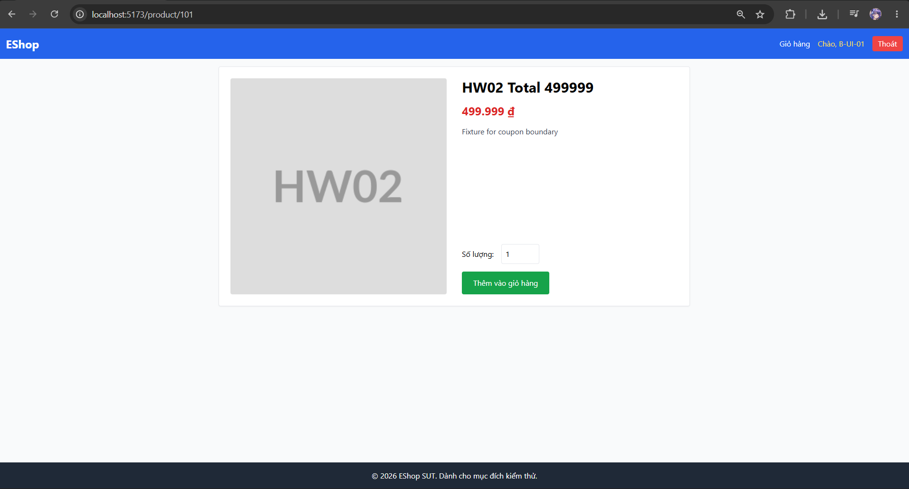

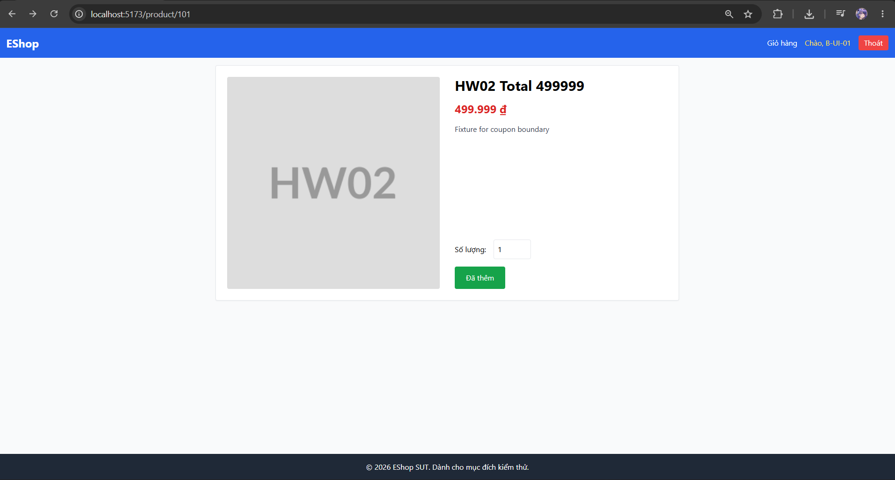

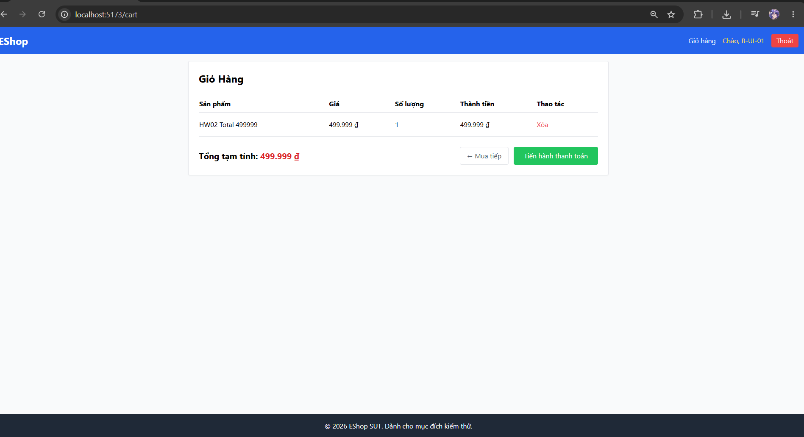

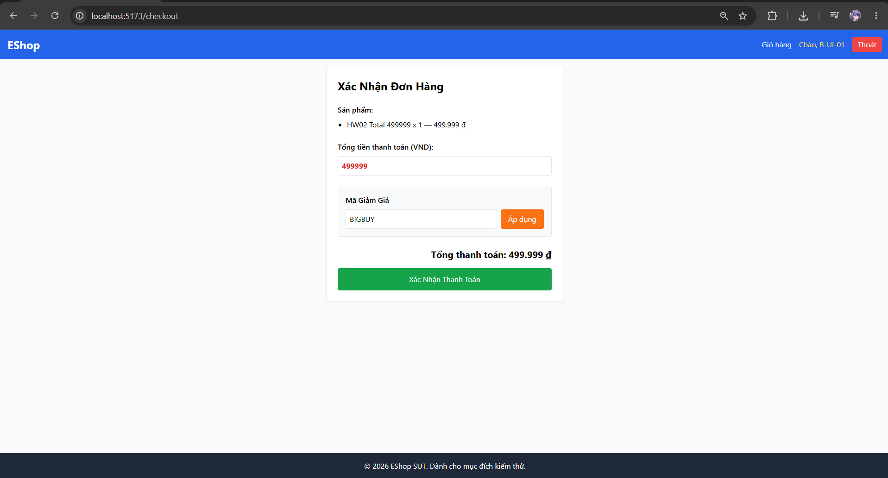

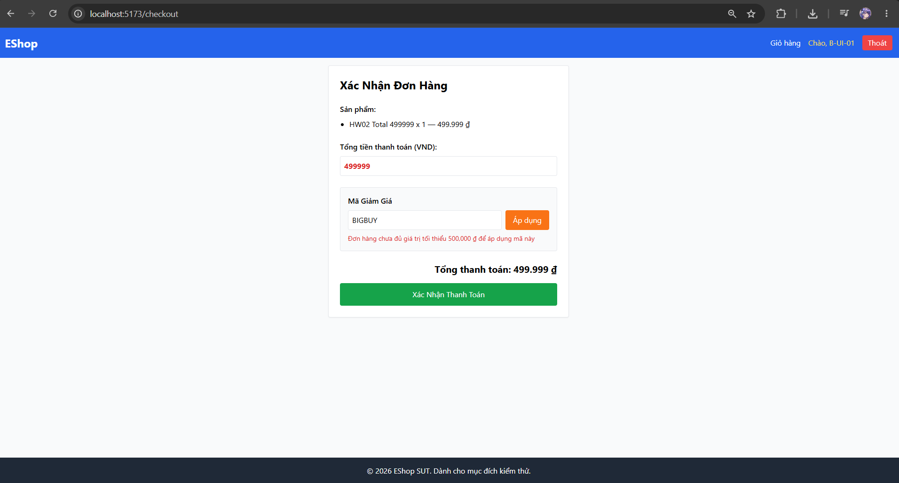

**Evidence còn thiếu:** Không có bước bổ sung bắt buộc cho verdict hiện tại.

### Verdict và rationale

**PASS** — Tiêu chí thuộc phạm vi đã ghi khớp expected với evidence nêu trên.

<a id="b-ui-02"></a>

## B-UI-02

**Mục tiêu:** Checkout BIGBUY / 500000.

| Thuộc tính | Giá trị |
|---|---|
| Technique | Domain+BVA |
| Oracle | UI FR-09 |
| Domains | B-D2 |
| Seam | UI thật |
| Status | FAIL |
| Bug | BUG-B01 |

### Preconditions

Dùng môi trường UI/fixtures chung. Giữ các điều kiện không phải mục tiêu hợp lệ; các khác biệt của lượt ảnh hiện có được ghi riêng dưới Actual.

### Input — thiết kế

```json
{
  "code": "BIGBUY",
  "total": 500000
}
```

### Steps

1. Đăng nhập Web; chuẩn bị giỏ/ô total đúng giá trị thiết kế; ghi account thực tế và coupon state.
2. Mở Checkout; nhập code và total của TC; giữ các điều kiện expiry/active/auth/usage khác đúng.
3. Bấm Áp dụng; chụp code, total và message; nếu accept, kiểm tra riêng discount và final.
4. Không bấm xác nhận thanh toán trong các TC chỉ kiểm tra apply. Ghi total editable nếu khác tổng dòng hàng.

### Expected

Discount 50000; final 450000.

### Actual và Evidence

BIGBUY tại total=500000 bị từ chối dù đạt ngưỡng inclusive.

**Variant / giới hạn:** Không đổi dữ liệu thiết kế.

**Timestamp UI:** không có log chính xác từng lượt; không tự dựng thời gian từ tên ảnh.

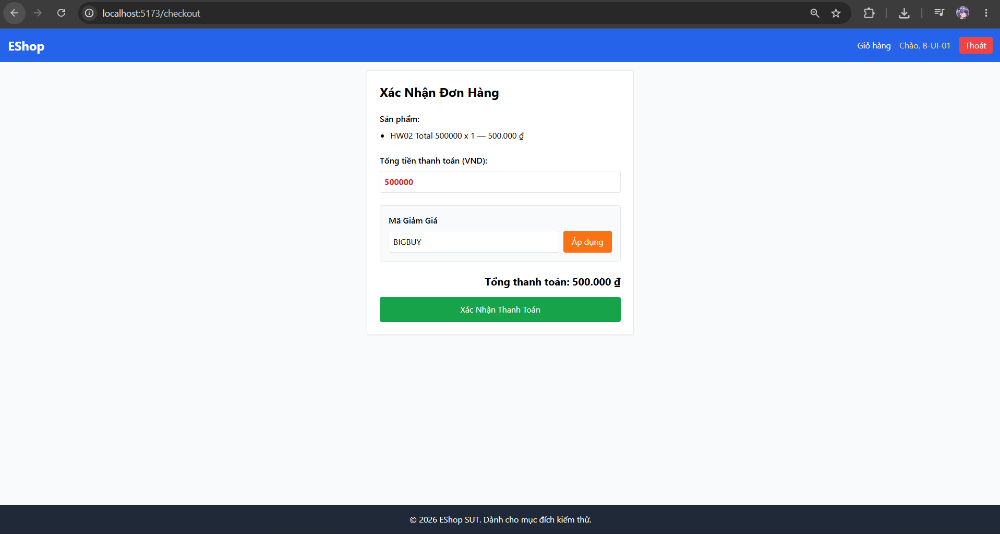

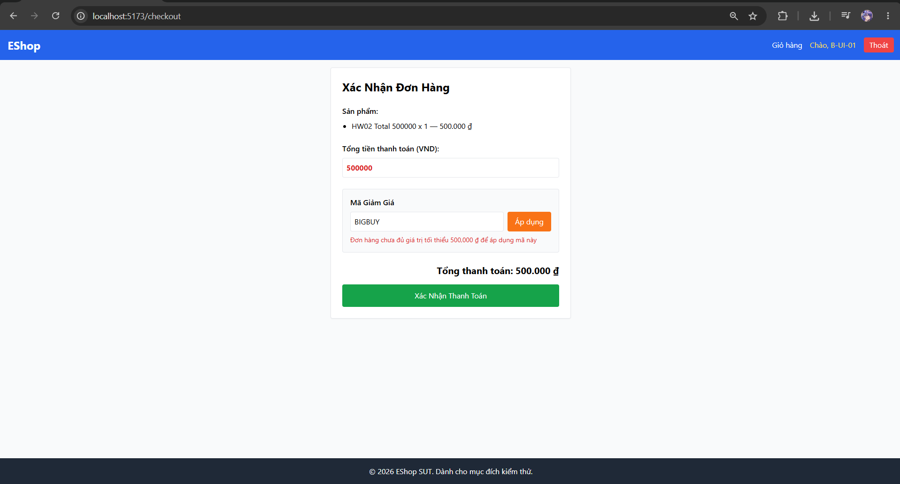

**Evidence còn thiếu:** Không có bước bổ sung bắt buộc cho verdict hiện tại.

### Verdict và rationale

**FAIL** — Có ít nhất một hành vi quan sát trái oracle; bug được nhóm theo behavior, không nhân số bug theo số TC.

<a id="b-ui-03"></a>

## B-UI-03

**Mục tiêu:** Checkout BIGBUY / 500001.

| Thuộc tính | Giá trị |
|---|---|
| Technique | Domain+BVA |
| Oracle | UI FR-09 |
| Domains | B-D2 |
| Seam | UI thật |
| Status | PASS |
| Bug | — |

### Preconditions

Dùng môi trường UI/fixtures chung. Giữ các điều kiện không phải mục tiêu hợp lệ; các khác biệt của lượt ảnh hiện có được ghi riêng dưới Actual.

### Input — thiết kế

```json
{
  "code": "BIGBUY",
  "total": 500001
}
```

### Steps

1. Đăng nhập Web; chuẩn bị giỏ/ô total đúng giá trị thiết kế; ghi account thực tế và coupon state.
2. Mở Checkout; nhập code và total của TC; giữ các điều kiện expiry/active/auth/usage khác đúng.
3. Bấm Áp dụng; chụp code, total và message; nếu accept, kiểm tra riêng discount và final.
4. Không bấm xác nhận thanh toán trong các TC chỉ kiểm tra apply. Ghi total editable nếu khác tổng dòng hàng.

### Expected

Discount 50000; final 450001.

### Actual và Evidence

Ô tổng tiền là 500001; BIGBUY giảm 50000 và thành tiền hiển thị 450001.

**Variant / giới hạn:** Dòng hàng vẫn là 500000; total được sửa trực tiếp thành 500001. PASS chỉ cho phép tính/điều kiện của FR-09 với giá trị nhập này; không chứng minh backend tính lại giỏ hoặc checkout FR-08 đạt.

**Timestamp UI:** không có log chính xác từng lượt; không tự dựng thời gian từ tên ảnh.


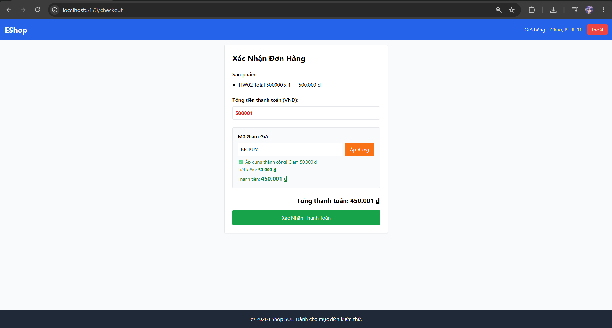

**Evidence còn thiếu:** Không có bước bổ sung bắt buộc cho verdict hiện tại.

### Verdict và rationale

**PASS** — Tiêu chí thuộc phạm vi đã ghi khớp expected với evidence nêu trên.

<a id="b-ui-04"></a>

## B-UI-04

**Mục tiêu:** Checkout SAVE10 / 400000.

| Thuộc tính | Giá trị |
|---|---|
| Technique | Domain |
| Oracle | UI FR-09 |
| Domains | B-D3 |
| Seam | UI thật |
| Status | FAIL |
| Bug | BUG-B02 |

### Preconditions

Dùng môi trường UI/fixtures chung. Giữ các điều kiện không phải mục tiêu hợp lệ; các khác biệt của lượt ảnh hiện có được ghi riêng dưới Actual.

### Input — thiết kế

```json
{
  "code": "SAVE10",
  "total": 400000
}
```

### Steps

1. Đăng nhập Web; chuẩn bị giỏ/ô total đúng giá trị thiết kế; ghi account thực tế và coupon state.
2. Mở Checkout; nhập code và total của TC; giữ các điều kiện expiry/active/auth/usage khác đúng.
3. Bấm Áp dụng; chụp code, total và message; nếu accept, kiểm tra riêng discount và final.
4. Không bấm xác nhận thanh toán trong các TC chỉ kiểm tra apply. Ghi total editable nếu khác tổng dòng hàng.

### Expected

Discount 40000; final 360000.

### Actual và Evidence

SAVE10/400000 hiển thị tiền giảm −3600000 và thành tiền 4000000, thay vì 40000/360000.

**Variant / giới hạn:** Không đổi dữ liệu thiết kế.

**Timestamp UI:** không có log chính xác từng lượt; không tự dựng thời gian từ tên ảnh.

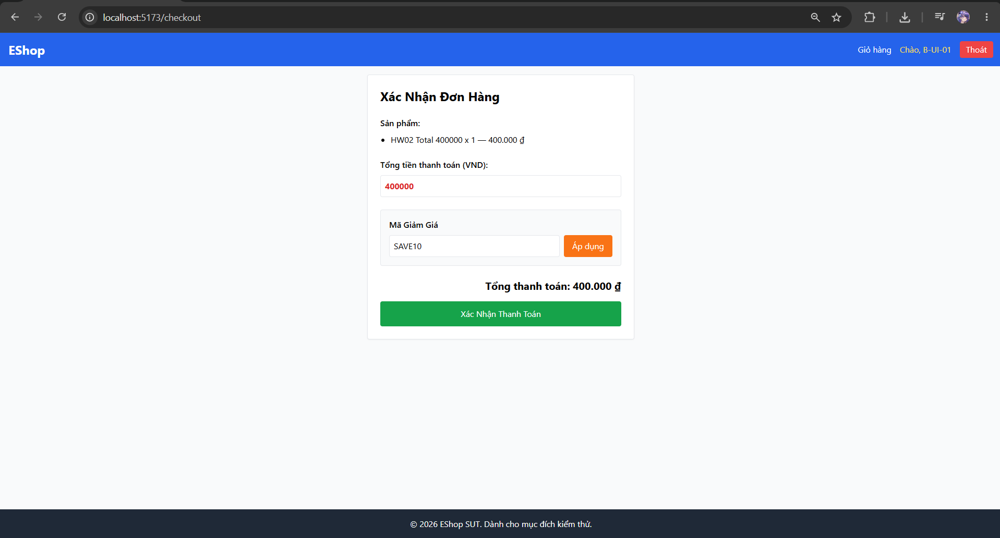

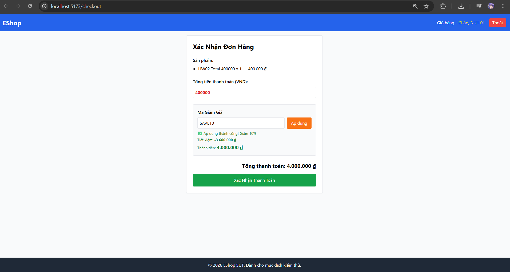

**Evidence còn thiếu:** Không có bước bổ sung bắt buộc cho verdict hiện tại.

### Verdict và rationale

**FAIL** — Có ít nhất một hành vi quan sát trái oracle; bug được nhóm theo behavior, không nhân số bug theo số TC.

<a id="b-ui-05"></a>

## B-UI-05

**Mục tiêu:** Checkout EXPIRED / 400000.

| Thuộc tính | Giá trị |
|---|---|
| Technique | Domain |
| Oracle | UI FR-09 |
| Domains | B-D5 |
| Seam | UI thật |
| Status | PASS |
| Bug | — |

### Preconditions

Dùng môi trường UI/fixtures chung. Giữ các điều kiện không phải mục tiêu hợp lệ; các khác biệt của lượt ảnh hiện có được ghi riêng dưới Actual.

### Input — thiết kế

```json
{
  "code": "EXPIRED",
  "total": 400000
}
```

### Steps

1. Đăng nhập Web; chuẩn bị giỏ/ô total đúng giá trị thiết kế; ghi account thực tế và coupon state.
2. Mở Checkout; nhập code và total của TC; giữ các điều kiện expiry/active/auth/usage khác đúng.
3. Bấm Áp dụng; chụp code, total và message; nếu accept, kiểm tra riêng discount và final.
4. Không bấm xác nhận thanh toán trong các TC chỉ kiểm tra apply. Ghi total editable nếu khác tổng dòng hàng.

### Expected

Reject expired coupon.

### Actual và Evidence

Coupon EXPIRED bị từ chối với thông báo hết hạn.

**Variant / giới hạn:** Không đổi dữ liệu thiết kế.

**Timestamp UI:** không có log chính xác từng lượt; không tự dựng thời gian từ tên ảnh.

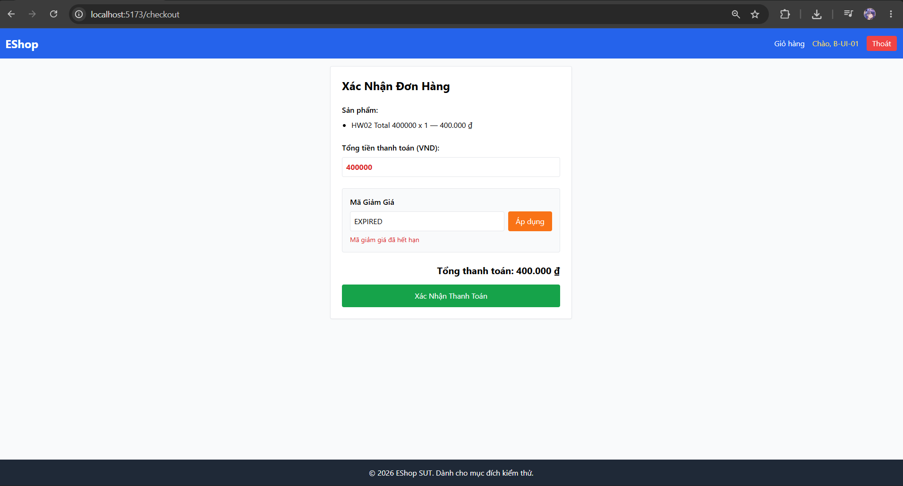

**Evidence còn thiếu:** Không có bước bổ sung bắt buộc cho verdict hiện tại.

### Verdict và rationale

**PASS** — Tiêu chí thuộc phạm vi đã ghi khớp expected với evidence nêu trên.

<a id="b-ui-06"></a>

## B-UI-06

**Mục tiêu:** Checkout VIP100 / 400000.

| Thuộc tính | Giá trị |
|---|---|
| Technique | Domain |
| Oracle | UI FR-09 |
| Domains | B-D6 |
| Seam | UI thật |
| Status | PASS |
| Bug | — |

### Preconditions

Web runtime riêng tại 127.0.0.1:5173, account B-UI-06 (b_ui_06@hw02.invalid). Fixture VIP100 có max_uses_per_user=2 và đúng hai coupon_usage cho user này; xem [read-only fixture readback](../evidence/execution/B-ui-fixture.md). Hai dòng được seed trực tiếp, không phải hai đơn mới được sinh viên thực hiện. Giỏ có HW02 Total400000, quantity1; coupon active, chưa hết hạn, minimum300000 nên total 400000 đủ ngưỡng.

### Input — thiết kế

```json
{
  "code": "VIP100",
  "total": 400000
}
```

### Steps

1. Đăng nhập Web; chuẩn bị giỏ/ô total đúng giá trị thiết kế; ghi account thực tế và coupon state.
2. Chuẩn bị state used=2/limit=2 cho VIP100 dưới đúng user: lượt này dùng hai coupon_usage fixture rows. Kiểm tra readback email/code/count/limit; không dùng hai lần bấm Apply thay usage, không tính đây là kiểm thử tạo hai đơn end-to-end.
3. Mở Checkout; nhập code và total của TC; giữ các điều kiện expiry/active/auth/usage khác đúng.
4. Bấm Áp dụng; chụp code, total và message; nếu accept, kiểm tra riêng discount và final.
5. Không bấm xác nhận thanh toán trong các TC chỉ kiểm tra apply. Ghi total editable nếu khác tổng dòng hàng.

### Expected

Với VIP100 đã có used=2 bằng max_uses_per_user=2 dưới cùng user, lần apply tiếp theo bị từ chối và tổng tiền giữ 400000. Oracle kiểm tra giới hạn sử dụng; lượt này thiết lập state bằng fixture, không kiểm quy trình hoàn tất hai đơn.

### Actual và Evidence

Ảnh mới tại /checkout hiển thị account B-UI-06, sản phẩm `HW02 Total 400000 x 1`, total 400000, code `VIP100` và thông báo `Bạn đã sử dụng mã này 2 lần (đã đạt giới hạn)`. Tổng thanh toán vẫn400000, coupon không được áp dụng. Account/code khớp fixture used2/limit2; [read-only query](../evidence/execution/B-ui-fixture.md) lưu precondition cùng giới hạn thời điểm readback.

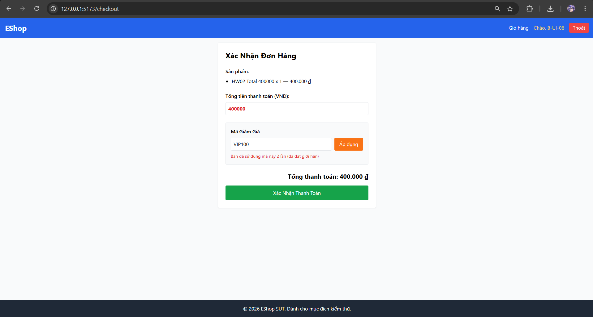

**Variant / giới hạn:** Ảnh cũ dưới đây thuộc account B-UI-01 và nominal usage; chỉ giữ lịch sử, không dùng chứng minh exhausted state. PASS của lượt mới dựa trên fixture đúng user và thông báo từ chối trên UI; không tuyên bố hai đơn thật đã được tạo.

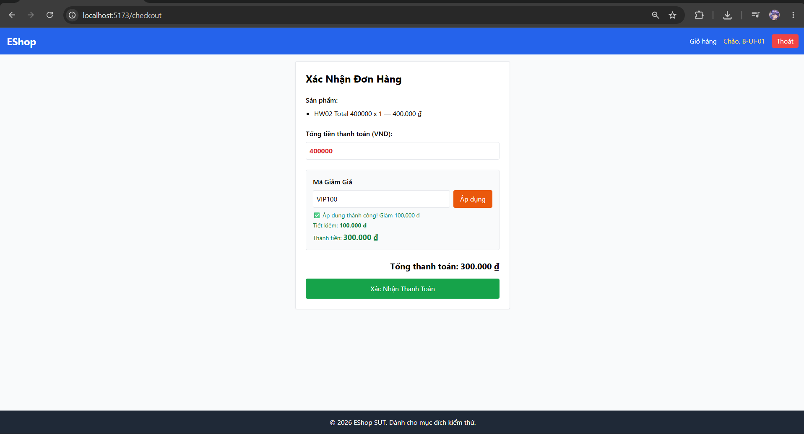

**Timestamp UI:** không có timestamp chụp chính xác được cung cấp; ảnh được nhận trong hội thoại cập nhật ngày2026-10-20, không dùng thời điểm query làm giờ chạy UI.

### Verdict và rationale

**PASS** — UI từ chối VIP100 tại used=limit=2 cho đúng account và giữ tổng 400000. Không đổi mục tiêu thành nominal apply; không gán bug hoặc suy luận về checkout tạo usage end-to-end.

## 3. Test Summary

| Scope | Designed | Executed đủ bằng chứng | PASS | FAIL | OBSERVATION | INCOMPLETE | NOT RUN |
|---|---|---|---|---|---|---|---|
| A — API | 22 | 22 | 7 | 14 | 1 | 0 | 0 |
| A — UI | 7 | 7 | 3 | 4 | 0 | 0 | 0 |
| B — API | 26 | 26 | 14 | 12 | 0 | 0 | 0 |
| B — UI | 6 | 6 | 4 | 2 | 0 | 0 | 0 |
| C — API | 30 | 30 | 14 | 16 | 0 | 0 | 0 |
| C — UI | 6 | 6 | 4 | 2 | 0 | 0 | 0 |
| D — API | 3 | 3 | 2 | 0 | 1 | 0 | 0 |
| D — UI | 14 | 14 | 5 | 7 | 2 | 0 | 0 |
| **Tổng** | 114 | 114 | 53 | 57 | 4 | 0 | 0 |

Các số liệu toàn bài dùng chung với README/report; phần INCOMPLETE là test đã có evidence một phần, khác NOT RUN.
