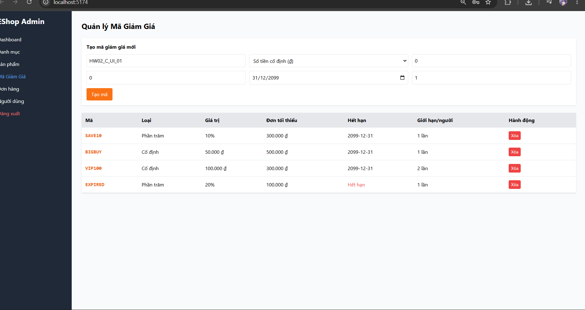
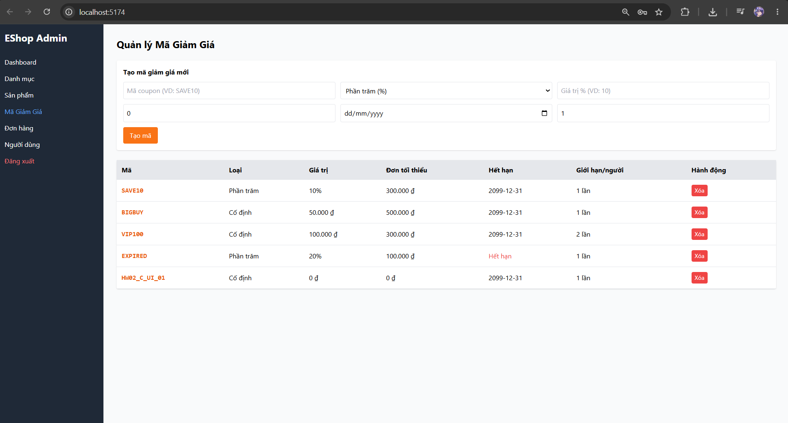
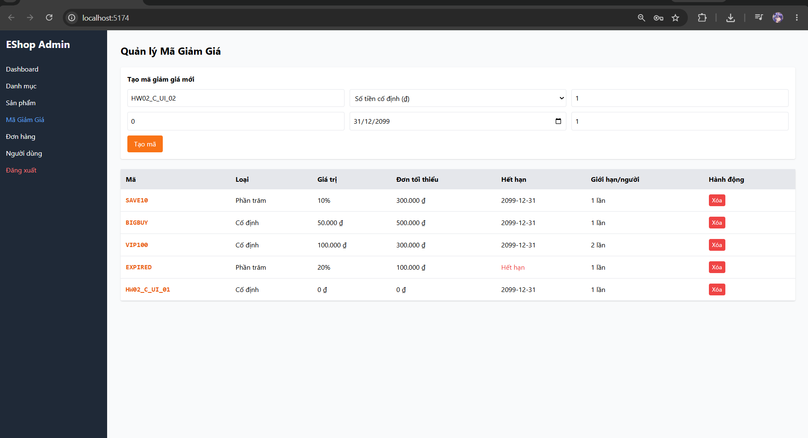
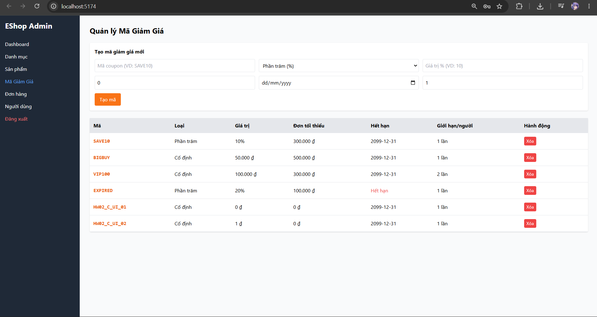
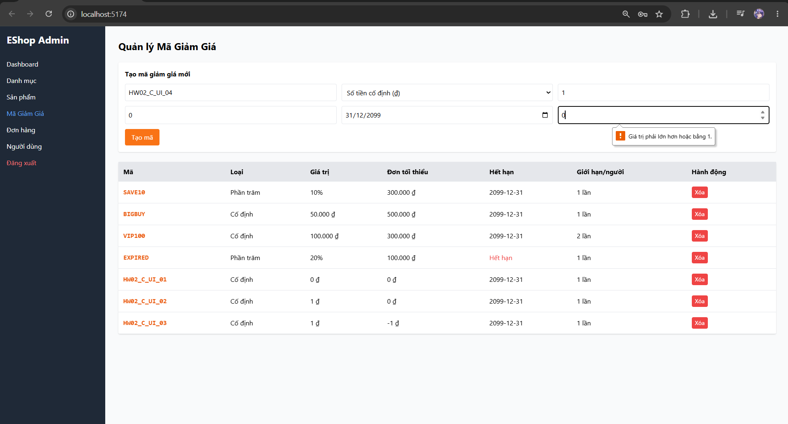
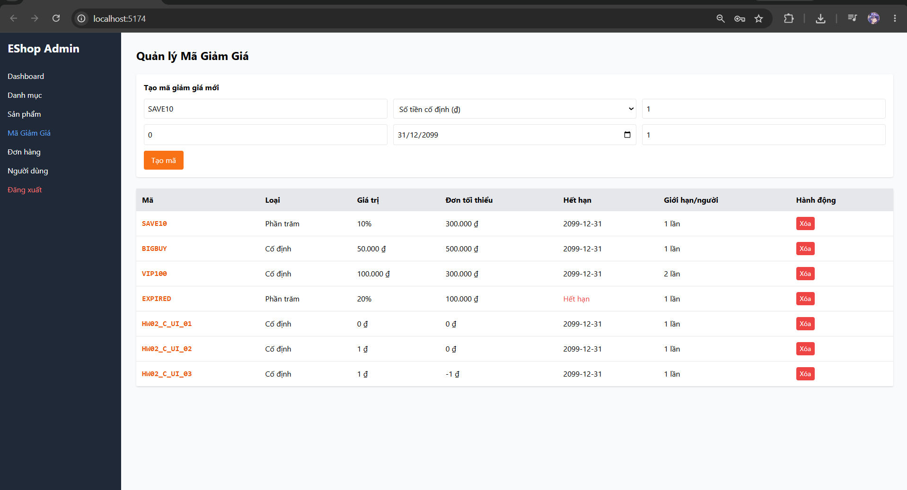
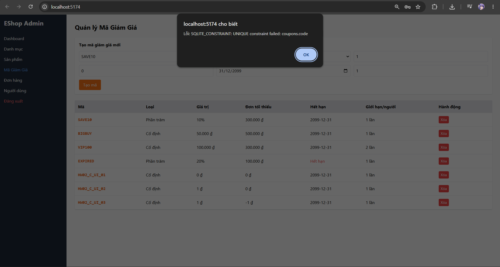
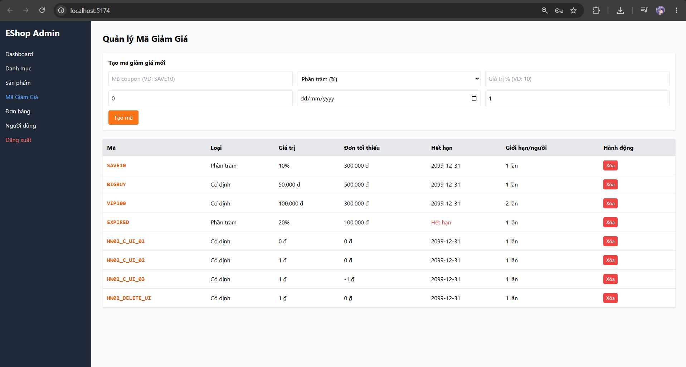

# C — Test Case Report: FR-17 — Quản lý mã giảm giá

**Sinh viên:** Tống Dương Thái Hòa — 23120262.

## 1. Phạm vi, quy ước và fixture

Chúng tôi lấy SRS làm oracle, sau đó dùng source để xây dựng giả thuyết và giải thích nguyên nhân. Source không thay thế yêu cầu. Mỗi TC có ID ổn định; một TC có thể phủ cả Domain Testing và BVA nhưng chỉ được tính một lần. Chúng tôi tách API với Web/Admin/Mobile UI vì validation ở một lớp không chứng minh lớp còn lại đạt.

Với từng input/state, chúng tôi xác định miền hợp lệ, phần bù không hợp lệ, precision và các ràng buộc giữa các chiều. Các lớp trong cùng một chiều được chọn để phân biệt hành vi; bảng nhiều chiều không có nghĩa mọi hàng đều là các tập rời nhau của toàn bộ vector. Test invalid giữ các chiều khác nominal; interaction nhiều lỗi có chủ đích được ghi riêng. Chúng tôi dùng readback public HTTP sau thay đổi để kiểm tra hậu điều kiện.

BVA được áp dụng cho miền có thứ tự, kể cả độ dài chuỗi và số lượt nguyên. Điểm ON nằm trên mặt biên; giá trị ON có thể hợp lệ hoặc không tùy dấu ≥ hay >. Các điểm lân cận được ghi bằng số và trạng thái valid/invalid để tránh nhập nhằng thuật ngữ. Các label OFF/IN không thay thế tập giá trị cụ thể. Rỗng, enum, charset và identity là Domain classes; không tự đặt một maximum mà SRS không quy định.

API execution dùng backend copy, clock cố định và fixture reset mỗi TC. UI evidence là ảnh thật đã cung cấp; không suy timestamp chạy từ ngày sửa file, không dùng ảnh vẽ hoặc build output làm bằng chứng UI. PASS/FAIL chỉ kết luận theo criterion có evidence; OBSERVATION dành cho oracle chưa quy định; INCOMPLETE dành cho TC còn thiếu bước/precondition/evidence. Một TC INCOMPLETE có thể đã được thao tác một phần, nhưng không được cộng vào executed đủ bằng chứng.

Chúng tôi kiểm tra kỹ thuật theo Domain/Boundary đã nêu; chưa có bản lecture của môn trong workspace để xác nhận đã đối chiếu mọi quy ước của giảng viên. Nguồn phương pháp bổ trợ là ISTQB CTFL §4.2.1–4.2.2. Các giới hạn này được giữ rõ trong phần coverage, không tuyên bố exhaustive coverage toàn hệ thống.

### API fixture và môi trường tái hiện

- SUT baseline: `85af3ba875c88283615e22cb108f13e2fccaf0e9`; Node thực thi kiểm chứng lại: `v24.16.0`, Windows. Backend copy tại port `3100`; source SUT và database gốc được SHA-256 trước/sau mỗi suite.
- Checkout HEAD lúc kiểm chứng là `de0f48f5b40939692e7029943295d44788f617ea`; commit sau baseline chỉ thêm root .gitignore. Diff các source/SRS kiểm thử so với baseline85af3ba rỗng; không coi .gitignore là thay đổi logic SUT.
- Clock của SUT cố định: `2026-10-19T08:00:00.000Z`; timestamp UTC trong raw record là thời gian thật của lượt chạy, khác clock mô phỏng.
- Login fixture: `POST /api/login`. Admin: `admin@eshop.com` / `Admin123!`; user 2: `test@eshop.com` / `Test1234!`; user 3: `other@hw02.invalid` / `Test1234!`. Đây là tài khoản demo trong DB isolated. Không lưu JWT thật trong tài liệu.
- Profile trước mỗi TC: user2 `name=Test User`, `phone=0912345678`, `shipping_address=1 Test Street`, `role=user`; user3 `Other User`, `0987654321`, `Other Street`, `role=user`.
- Coupon reset trước mỗi TC: SAVE10 `(percent,10,min300000,limit1)`; BIGBUY `(fixed,50000,min500000,limit1)`; VIP100 `(fixed,100000,min300000,limit2)`; EXPIRED hết hạn năm2020; OFF inactive; TIME fixed10000, minimum0, expiry theo TC; P100 percent100; DELETE_ME fixed1. Coupon còn lại có expiry2099 và active1.
- Usage mặc định user2/VIP100=0; với TC có `used`, harness tạo đúng số row `coupon_usage`. Apply không tự tạo usage; checkout mới ghi usage theo source. User3 không có usage. Mỗi TC reset state, nên kết quả không phụ thuộc TC trước.
- API headers: `Content-Type: application/json`; `Authorization: Bearer <JWT đúng role>` trừ lớp missing/invalid/expired. Invalid là chuỗi `not-a-valid-jwt`; expired là token fixture ký bằng test secret của baseline với `exp` trước clock cố định, không phải credential production.
- Harness API được quản lý ngoài repository nộp bài; khi thực thi, nó copy source bytes, thay listen port qua adapter và cố định global Date; `database.js` gốc drop/seed khi import nên không chạy runner trực tiếp trên DB gốc. Dependencies lấy từ `eshop-sut/backend/node_modules`.

### UI fixture và bằng chứng

Ảnh ghi Web ở `localhost:5173`, Admin ở `localhost:5174`, và Expo Go/Android trên Samsung. Account hiển thị trong ảnh có thể được tái sử dụng (A-UI-01, B-UI-01, D-UI-01); tên file TC không chứng minh đã login account cùng tên. Chúng tôi ghi rõ variant và trạng thái dữ liệu có thể chứng minh. Không có nhật ký runtime UI đầy đủ về phiên bản OS/Expo hoặc timestamp từng lượt; không tự bổ sung các thông số đó. UI clock dùng thời gian thật của lần chụp, khác clock API.

Các ảnh trong bộ cung cấp thuộc ngày chụp được đặt tên 2026-10-19; trường timestamp thực thi UI không đủ log để khẳng định chính xác. File raw API giữ timestamp thật độc lập. Ảnh vẫn giữ nguyên bytes; đổi tên ảnh không tạo lần thực thi mới.

## 2. Danh mục test cases

| TC-ID | Technique | Mục tiêu | Status | Domain | Bug |
|---|---|---|---|---|---|
| [C-API-01](#c-api-01) | Domain | Nominal fixed coupon | PASS | C-D1, C-D8 | — |
| [C-API-02](#c-api-02) | Domain | Nominal percent coupon | PASS | C-D1 | — |
| [C-API-03](#c-api-03) | Domain | Missing mandatory code | FAIL | C-D2 | BUG-C01 |
| [C-API-04](#c-api-04) | Domain | Missing mandatory type | FAIL | C-D2 | BUG-C01 |
| [C-API-05](#c-api-05) | Domain | Missing mandatory discount_value | FAIL | C-D2 | BUG-C01 |
| [C-API-06](#c-api-06) | Domain | Missing mandatory min_order_amount | FAIL | C-D2 | BUG-C01 |
| [C-API-07](#c-api-07) | Domain | Missing mandatory expired_at | FAIL | C-D2 | BUG-C01 |
| [C-API-08](#c-api-08) | Domain | Missing mandatory max_uses_per_user | FAIL | C-D2 | BUG-C01 |
| [C-API-09](#c-api-09) | Domain | Empty code | FAIL | C-D2 | BUG-C01 |
| [C-API-10](#c-api-10) | Domain | Duplicate code | PASS | C-D3 | — |
| [C-API-11](#c-api-11) | Domain | Unknown type | FAIL | C-D4 | BUG-C03 |
| [C-API-12](#c-api-12) | Domain+BVA | discount_value=-1 | FAIL | C-D5 | BUG-C04 |
| [C-API-13](#c-api-13) | Domain+BVA | discount_value=0 | FAIL | C-D5 | BUG-C04 |
| [C-API-14](#c-api-14) | Domain+BVA | discount_value=1 | PASS | C-D5 | — |
| [C-API-15](#c-api-15) | Domain+BVA | min_order_amount=-1 | FAIL | C-D6 | BUG-C05 |
| [C-API-16](#c-api-16) | Domain+BVA | min_order_amount=0 | PASS | C-D6 | — |
| [C-API-17](#c-api-17) | Domain+BVA | min_order_amount=1 | PASS | C-D6 | — |
| [C-API-18](#c-api-18) | Domain+BVA | max_uses_per_user=-1 | FAIL | C-D7 | BUG-C06 |
| [C-API-19](#c-api-19) | Domain+BVA | max_uses_per_user=0 | FAIL | C-D7 | BUG-C06 |
| [C-API-20](#c-api-20) | Domain+BVA | max_uses_per_user=1 | PASS | C-D7 | — |
| [C-API-21](#c-api-21) | Domain+BVA | max_uses_per_user=2 | PASS | C-D7 | — |
| [C-API-22](#c-api-22) | Domain | No JWT creates coupon | PASS | C-D8 | — |
| [C-API-23](#c-api-23) | Domain | User role creates coupon | FAIL | C-D8 | BUG-C07 |
| [C-API-24](#c-api-24) | Domain | Invalid JWT creates coupon | PASS | C-D8 | — |
| [C-API-25](#c-api-25) | Domain | List coupons as admin | PASS | C-D9 | — |
| [C-API-26](#c-api-26) | Domain | List coupons as user | FAIL | C-D9 | BUG-C08 |
| [C-API-27](#c-api-27) | Domain | List coupons as none | PASS | C-D9 | — |
| [C-API-28](#c-api-28) | Domain | Delete coupon as admin | PASS | C-D10 | — |
| [C-API-29](#c-api-29) | Domain | Delete coupon as user | FAIL | C-D10 | BUG-C09 |
| [C-API-30](#c-api-30) | Domain | Delete coupon as none | PASS | C-D10 | — |
| [C-UI-01](#c-ui-01) | Domain+BVA | Admin coupon form 1 | FAIL | C-D5 | BUG-C04 |
| [C-UI-02](#c-ui-02) | Domain | Admin coupon form 2 | INCOMPLETE | C-D1 | — |
| [C-UI-03](#c-ui-03) | Domain+BVA | Admin coupon form 3 | FAIL | C-D6 | BUG-C05 |
| [C-UI-04](#c-ui-04) | Domain+BVA | Admin coupon form 4 | PASS | C-D7 | — |
| [C-UI-05](#c-ui-05) | Domain | Admin coupon form 5 | PASS | C-D3 | — |
| [C-UI-06](#c-ui-06) | Domain | Admin delete lifecycle | INCOMPLETE | C-D10 | — |

<a id="c-api-01"></a>

## C-API-01

**Mục tiêu:** Nominal fixed coupon.

| Thuộc tính | Giá trị |
|---|---|
| Technique | Domain |
| Oracle | FR-17 required fields/constraints; FR-12 admin role |
| Domains | C-D1, C-D8 |
| Seam | HTTP API |
| Status | PASS |
| Bug | — |

### Preconditions

- Reset coupon list có SAVE10 và DELETE_ME. Admin token dùng cho GET trước/sau; token của request mục tiêu theo bảng dưới. Chỉ thay field/role được nêu.
- Authentication request mục tiêu: `admin`.

### Input — thiết kế

```json
{
  "code": "HW02_NEW",
  "type": "fixed",
  "discount_value": 1,
  "min_order_amount": 0,
  "expired_at": "2099-12-31",
  "max_uses_per_user": 1
}
```

### Steps

1. Gửi `GET /api/coupons` với authentication `admin`; không có request body.
2. Gửi `POST /api/admin/coupons` với authentication `admin` và JSON Input bên dưới.
3. Gửi `GET /api/coupons` với authentication `admin`; không có request body.
4. Đối chiếu response và hậu điều kiện với Expected; chỉ GET/readback là quan sát, fixture SQL không được dùng làm oracle.

### Expected

Admin creates coupon and list contains exact supplied values.

### Actual và Evidence

Timestamp UTC thực tế: `2026-10-19T20:08:00.809Z`. Với list dài, phần dưới giữ row_count và relevant_rows; mọi trường của row liên quan giữ nguyên, full list nằm trong raw link.

```json
[
  {
    "method": "GET",
    "url": "/api/coupons",
    "authentication": "admin",
    "input": null,
    "status": 200,
    "body": {
      "row_count": 8,
      "relevant_rows": [
        {
          "id": 5,
          "code": "SAVE10",
          "type": "percent",
          "discount_value": 10,
          "min_order_amount": 300000,
          "expired_at": "2099-12-31",
          "is_active": 1,
          "max_uses_per_user": 1
        },
        {
          "id": 12,
          "code": "DELETE_ME",
          "type": "fixed",
          "discount_value": 1,
          "min_order_amount": 0,
          "expired_at": "2099-12-31",
          "is_active": 1,
          "max_uses_per_user": 1
        }
      ]
    }
  },
  {
    "method": "POST",
    "url": "/api/admin/coupons",
    "authentication": "admin",
    "input": {
      "code": "HW02_NEW",
      "type": "fixed",
      "discount_value": 1,
      "min_order_amount": 0,
      "expired_at": "2099-12-31",
      "max_uses_per_user": 1
    },
    "status": 200,
    "body": {
      "message": "Coupon created",
      "id": 13
    }
  },
  {
    "method": "GET",
    "url": "/api/coupons",
    "authentication": "admin",
    "input": null,
    "status": 200,
    "body": {
      "row_count": 9,
      "relevant_rows": [
        {
          "id": 5,
          "code": "SAVE10",
          "type": "percent",
          "discount_value": 10,
          "min_order_amount": 300000,
          "expired_at": "2099-12-31",
          "is_active": 1,
          "max_uses_per_user": 1
        },
        {
          "id": 12,
          "code": "DELETE_ME",
          "type": "fixed",
          "discount_value": 1,
          "min_order_amount": 0,
          "expired_at": "2099-12-31",
          "is_active": 1,
          "max_uses_per_user": 1
        },
        {
          "id": 13,
          "code": "HW02_NEW",
          "type": "fixed",
          "discount_value": 1,
          "min_order_amount": 0,
          "expired_at": "2099-12-31",
          "is_active": 1,
          "max_uses_per_user": 1
        }
      ]
    }
  }
]
```

[Full raw record](../evidence/execution/C-api.md#c-api-01). Source hashes trước/sau nằm trong raw report.

### Verdict và rationale

**PASS** — Tiêu chí thuộc phạm vi đã ghi khớp expected với evidence nêu trên.

<a id="c-api-02"></a>

## C-API-02

**Mục tiêu:** Nominal percent coupon.

| Thuộc tính | Giá trị |
|---|---|
| Technique | Domain |
| Oracle | FR-17 required fields/constraints; FR-12 admin role |
| Domains | C-D1 |
| Seam | HTTP API |
| Status | PASS |
| Bug | — |

### Preconditions

- Reset coupon list có SAVE10 và DELETE_ME. Admin token dùng cho GET trước/sau; token của request mục tiêu theo bảng dưới. Chỉ thay field/role được nêu.
- Authentication request mục tiêu: `admin`.

### Input — thiết kế

```json
{
  "code": "HW02_NEW",
  "type": "percent",
  "discount_value": 10,
  "min_order_amount": 0,
  "expired_at": "2099-12-31",
  "max_uses_per_user": 1
}
```

### Steps

1. Gửi `GET /api/coupons` với authentication `admin`; không có request body.
2. Gửi `POST /api/admin/coupons` với authentication `admin` và JSON Input bên dưới.
3. Gửi `GET /api/coupons` với authentication `admin`; không có request body.
4. Đối chiếu response và hậu điều kiện với Expected; chỉ GET/readback là quan sát, fixture SQL không được dùng làm oracle.

### Expected

Admin creates coupon and list contains exact supplied values.

### Actual và Evidence

Timestamp UTC thực tế: `2026-10-19T20:08:00.838Z`. Với list dài, phần dưới giữ row_count và relevant_rows; mọi trường của row liên quan giữ nguyên, full list nằm trong raw link.

```json
[
  {
    "method": "GET",
    "url": "/api/coupons",
    "authentication": "admin",
    "input": null,
    "status": 200,
    "body": {
      "row_count": 8,
      "relevant_rows": [
        {
          "id": 14,
          "code": "SAVE10",
          "type": "percent",
          "discount_value": 10,
          "min_order_amount": 300000,
          "expired_at": "2099-12-31",
          "is_active": 1,
          "max_uses_per_user": 1
        },
        {
          "id": 21,
          "code": "DELETE_ME",
          "type": "fixed",
          "discount_value": 1,
          "min_order_amount": 0,
          "expired_at": "2099-12-31",
          "is_active": 1,
          "max_uses_per_user": 1
        }
      ]
    }
  },
  {
    "method": "POST",
    "url": "/api/admin/coupons",
    "authentication": "admin",
    "input": {
      "code": "HW02_NEW",
      "type": "percent",
      "discount_value": 10,
      "min_order_amount": 0,
      "expired_at": "2099-12-31",
      "max_uses_per_user": 1
    },
    "status": 200,
    "body": {
      "message": "Coupon created",
      "id": 22
    }
  },
  {
    "method": "GET",
    "url": "/api/coupons",
    "authentication": "admin",
    "input": null,
    "status": 200,
    "body": {
      "row_count": 9,
      "relevant_rows": [
        {
          "id": 14,
          "code": "SAVE10",
          "type": "percent",
          "discount_value": 10,
          "min_order_amount": 300000,
          "expired_at": "2099-12-31",
          "is_active": 1,
          "max_uses_per_user": 1
        },
        {
          "id": 21,
          "code": "DELETE_ME",
          "type": "fixed",
          "discount_value": 1,
          "min_order_amount": 0,
          "expired_at": "2099-12-31",
          "is_active": 1,
          "max_uses_per_user": 1
        },
        {
          "id": 22,
          "code": "HW02_NEW",
          "type": "percent",
          "discount_value": 10,
          "min_order_amount": 0,
          "expired_at": "2099-12-31",
          "is_active": 1,
          "max_uses_per_user": 1
        }
      ]
    }
  }
]
```

[Full raw record](../evidence/execution/C-api.md#c-api-02). Source hashes trước/sau nằm trong raw report.

### Verdict và rationale

**PASS** — Tiêu chí thuộc phạm vi đã ghi khớp expected với evidence nêu trên.

<a id="c-api-03"></a>

## C-API-03

**Mục tiêu:** Missing mandatory code.

| Thuộc tính | Giá trị |
|---|---|
| Technique | Domain |
| Oracle | FR-17 required fields/constraints; FR-12 admin role |
| Domains | C-D2 |
| Seam | HTTP API |
| Status | FAIL |
| Bug | BUG-C01 |

### Preconditions

- Reset coupon list có SAVE10 và DELETE_ME. Admin token dùng cho GET trước/sau; token của request mục tiêu theo bảng dưới. Chỉ thay field/role được nêu.
- Authentication request mục tiêu: `admin`.

### Input — thiết kế

```json
{
  "type": "fixed",
  "discount_value": 1,
  "min_order_amount": 0,
  "expired_at": "2099-12-31",
  "max_uses_per_user": 1
}
```

### Steps

1. Gửi `GET /api/coupons` với authentication `admin`; không có request body.
2. Gửi `POST /api/admin/coupons` với authentication `admin` và JSON Input bên dưới.
3. Gửi `GET /api/coupons` với authentication `admin`; không có request body.
4. Đối chiếu response và hậu điều kiện với Expected; chỉ GET/readback là quan sát, fixture SQL không được dùng làm oracle.

### Expected

Reject invalid coupon; list has no newly created record.

### Actual và Evidence

Timestamp UTC thực tế: `2026-10-19T20:08:00.863Z`. Với list dài, phần dưới giữ row_count và relevant_rows; mọi trường của row liên quan giữ nguyên, full list nằm trong raw link.

```json
[
  {
    "method": "GET",
    "url": "/api/coupons",
    "authentication": "admin",
    "input": null,
    "status": 200,
    "body": {
      "row_count": 8,
      "relevant_rows": [
        {
          "id": 23,
          "code": "SAVE10",
          "type": "percent",
          "discount_value": 10,
          "min_order_amount": 300000,
          "expired_at": "2099-12-31",
          "is_active": 1,
          "max_uses_per_user": 1
        },
        {
          "id": 30,
          "code": "DELETE_ME",
          "type": "fixed",
          "discount_value": 1,
          "min_order_amount": 0,
          "expired_at": "2099-12-31",
          "is_active": 1,
          "max_uses_per_user": 1
        }
      ]
    }
  },
  {
    "method": "POST",
    "url": "/api/admin/coupons",
    "authentication": "admin",
    "input": {
      "type": "fixed",
      "discount_value": 1,
      "min_order_amount": 0,
      "expired_at": "2099-12-31",
      "max_uses_per_user": 1
    },
    "status": 200,
    "body": {
      "message": "Coupon created",
      "id": 31
    }
  },
  {
    "method": "GET",
    "url": "/api/coupons",
    "authentication": "admin",
    "input": null,
    "status": 200,
    "body": {
      "row_count": 9,
      "relevant_rows": [
        {
          "id": 23,
          "code": "SAVE10",
          "type": "percent",
          "discount_value": 10,
          "min_order_amount": 300000,
          "expired_at": "2099-12-31",
          "is_active": 1,
          "max_uses_per_user": 1
        },
        {
          "id": 30,
          "code": "DELETE_ME",
          "type": "fixed",
          "discount_value": 1,
          "min_order_amount": 0,
          "expired_at": "2099-12-31",
          "is_active": 1,
          "max_uses_per_user": 1
        },
        {
          "id": 31,
          "code": null,
          "type": "fixed",
          "discount_value": 1,
          "min_order_amount": 0,
          "expired_at": "2099-12-31",
          "is_active": 1,
          "max_uses_per_user": 1
        }
      ]
    }
  }
]
```

[Full raw record](../evidence/execution/C-api.md#c-api-03). Source hashes trước/sau nằm trong raw report.

### Verdict và rationale

**FAIL** — Có ít nhất một hành vi quan sát trái oracle; bug được nhóm theo behavior, không nhân số bug theo số TC.

<a id="c-api-04"></a>

## C-API-04

**Mục tiêu:** Missing mandatory type.

| Thuộc tính | Giá trị |
|---|---|
| Technique | Domain |
| Oracle | FR-17 required fields/constraints; FR-12 admin role |
| Domains | C-D2 |
| Seam | HTTP API |
| Status | FAIL |
| Bug | BUG-C01 |

### Preconditions

- Reset coupon list có SAVE10 và DELETE_ME. Admin token dùng cho GET trước/sau; token của request mục tiêu theo bảng dưới. Chỉ thay field/role được nêu.
- Authentication request mục tiêu: `admin`.

### Input — thiết kế

```json
{
  "code": "HW02_NEW",
  "discount_value": 1,
  "min_order_amount": 0,
  "expired_at": "2099-12-31",
  "max_uses_per_user": 1
}
```

### Steps

1. Gửi `GET /api/coupons` với authentication `admin`; không có request body.
2. Gửi `POST /api/admin/coupons` với authentication `admin` và JSON Input bên dưới.
3. Gửi `GET /api/coupons` với authentication `admin`; không có request body.
4. Đối chiếu response và hậu điều kiện với Expected; chỉ GET/readback là quan sát, fixture SQL không được dùng làm oracle.

### Expected

Reject invalid coupon; list has no newly created record.

### Actual và Evidence

Timestamp UTC thực tế: `2026-10-19T20:08:00.886Z`. Với list dài, phần dưới giữ row_count và relevant_rows; mọi trường của row liên quan giữ nguyên, full list nằm trong raw link.

```json
[
  {
    "method": "GET",
    "url": "/api/coupons",
    "authentication": "admin",
    "input": null,
    "status": 200,
    "body": {
      "row_count": 8,
      "relevant_rows": [
        {
          "id": 32,
          "code": "SAVE10",
          "type": "percent",
          "discount_value": 10,
          "min_order_amount": 300000,
          "expired_at": "2099-12-31",
          "is_active": 1,
          "max_uses_per_user": 1
        },
        {
          "id": 39,
          "code": "DELETE_ME",
          "type": "fixed",
          "discount_value": 1,
          "min_order_amount": 0,
          "expired_at": "2099-12-31",
          "is_active": 1,
          "max_uses_per_user": 1
        }
      ]
    }
  },
  {
    "method": "POST",
    "url": "/api/admin/coupons",
    "authentication": "admin",
    "input": {
      "code": "HW02_NEW",
      "discount_value": 1,
      "min_order_amount": 0,
      "expired_at": "2099-12-31",
      "max_uses_per_user": 1
    },
    "status": 200,
    "body": {
      "message": "Coupon created",
      "id": 40
    }
  },
  {
    "method": "GET",
    "url": "/api/coupons",
    "authentication": "admin",
    "input": null,
    "status": 200,
    "body": {
      "row_count": 9,
      "relevant_rows": [
        {
          "id": 32,
          "code": "SAVE10",
          "type": "percent",
          "discount_value": 10,
          "min_order_amount": 300000,
          "expired_at": "2099-12-31",
          "is_active": 1,
          "max_uses_per_user": 1
        },
        {
          "id": 39,
          "code": "DELETE_ME",
          "type": "fixed",
          "discount_value": 1,
          "min_order_amount": 0,
          "expired_at": "2099-12-31",
          "is_active": 1,
          "max_uses_per_user": 1
        },
        {
          "id": 40,
          "code": "HW02_NEW",
          "type": null,
          "discount_value": 1,
          "min_order_amount": 0,
          "expired_at": "2099-12-31",
          "is_active": 1,
          "max_uses_per_user": 1
        }
      ]
    }
  }
]
```

[Full raw record](../evidence/execution/C-api.md#c-api-04). Source hashes trước/sau nằm trong raw report.

### Verdict và rationale

**FAIL** — Có ít nhất một hành vi quan sát trái oracle; bug được nhóm theo behavior, không nhân số bug theo số TC.

<a id="c-api-05"></a>

## C-API-05

**Mục tiêu:** Missing mandatory discount_value.

| Thuộc tính | Giá trị |
|---|---|
| Technique | Domain |
| Oracle | FR-17 required fields/constraints; FR-12 admin role |
| Domains | C-D2 |
| Seam | HTTP API |
| Status | FAIL |
| Bug | BUG-C01 |

### Preconditions

- Reset coupon list có SAVE10 và DELETE_ME. Admin token dùng cho GET trước/sau; token của request mục tiêu theo bảng dưới. Chỉ thay field/role được nêu.
- Authentication request mục tiêu: `admin`.

### Input — thiết kế

```json
{
  "code": "HW02_NEW",
  "type": "fixed",
  "min_order_amount": 0,
  "expired_at": "2099-12-31",
  "max_uses_per_user": 1
}
```

### Steps

1. Gửi `GET /api/coupons` với authentication `admin`; không có request body.
2. Gửi `POST /api/admin/coupons` với authentication `admin` và JSON Input bên dưới.
3. Gửi `GET /api/coupons` với authentication `admin`; không có request body.
4. Đối chiếu response và hậu điều kiện với Expected; chỉ GET/readback là quan sát, fixture SQL không được dùng làm oracle.

### Expected

Reject invalid coupon; list has no newly created record.

### Actual và Evidence

Timestamp UTC thực tế: `2026-10-19T20:08:00.910Z`. Với list dài, phần dưới giữ row_count và relevant_rows; mọi trường của row liên quan giữ nguyên, full list nằm trong raw link.

```json
[
  {
    "method": "GET",
    "url": "/api/coupons",
    "authentication": "admin",
    "input": null,
    "status": 200,
    "body": {
      "row_count": 8,
      "relevant_rows": [
        {
          "id": 41,
          "code": "SAVE10",
          "type": "percent",
          "discount_value": 10,
          "min_order_amount": 300000,
          "expired_at": "2099-12-31",
          "is_active": 1,
          "max_uses_per_user": 1
        },
        {
          "id": 48,
          "code": "DELETE_ME",
          "type": "fixed",
          "discount_value": 1,
          "min_order_amount": 0,
          "expired_at": "2099-12-31",
          "is_active": 1,
          "max_uses_per_user": 1
        }
      ]
    }
  },
  {
    "method": "POST",
    "url": "/api/admin/coupons",
    "authentication": "admin",
    "input": {
      "code": "HW02_NEW",
      "type": "fixed",
      "min_order_amount": 0,
      "expired_at": "2099-12-31",
      "max_uses_per_user": 1
    },
    "status": 200,
    "body": {
      "message": "Coupon created",
      "id": 49
    }
  },
  {
    "method": "GET",
    "url": "/api/coupons",
    "authentication": "admin",
    "input": null,
    "status": 200,
    "body": {
      "row_count": 9,
      "relevant_rows": [
        {
          "id": 41,
          "code": "SAVE10",
          "type": "percent",
          "discount_value": 10,
          "min_order_amount": 300000,
          "expired_at": "2099-12-31",
          "is_active": 1,
          "max_uses_per_user": 1
        },
        {
          "id": 48,
          "code": "DELETE_ME",
          "type": "fixed",
          "discount_value": 1,
          "min_order_amount": 0,
          "expired_at": "2099-12-31",
          "is_active": 1,
          "max_uses_per_user": 1
        },
        {
          "id": 49,
          "code": "HW02_NEW",
          "type": "fixed",
          "discount_value": null,
          "min_order_amount": 0,
          "expired_at": "2099-12-31",
          "is_active": 1,
          "max_uses_per_user": 1
        }
      ]
    }
  }
]
```

[Full raw record](../evidence/execution/C-api.md#c-api-05). Source hashes trước/sau nằm trong raw report.

### Verdict và rationale

**FAIL** — Có ít nhất một hành vi quan sát trái oracle; bug được nhóm theo behavior, không nhân số bug theo số TC.

<a id="c-api-06"></a>

## C-API-06

**Mục tiêu:** Missing mandatory min_order_amount.

| Thuộc tính | Giá trị |
|---|---|
| Technique | Domain |
| Oracle | FR-17 required fields/constraints; FR-12 admin role |
| Domains | C-D2 |
| Seam | HTTP API |
| Status | FAIL |
| Bug | BUG-C01 |

### Preconditions

- Reset coupon list có SAVE10 và DELETE_ME. Admin token dùng cho GET trước/sau; token của request mục tiêu theo bảng dưới. Chỉ thay field/role được nêu.
- Authentication request mục tiêu: `admin`.

### Input — thiết kế

```json
{
  "code": "HW02_NEW",
  "type": "fixed",
  "discount_value": 1,
  "expired_at": "2099-12-31",
  "max_uses_per_user": 1
}
```

### Steps

1. Gửi `GET /api/coupons` với authentication `admin`; không có request body.
2. Gửi `POST /api/admin/coupons` với authentication `admin` và JSON Input bên dưới.
3. Gửi `GET /api/coupons` với authentication `admin`; không có request body.
4. Đối chiếu response và hậu điều kiện với Expected; chỉ GET/readback là quan sát, fixture SQL không được dùng làm oracle.

### Expected

Reject invalid coupon; list has no newly created record.

### Actual và Evidence

Timestamp UTC thực tế: `2026-10-19T20:08:00.935Z`. Với list dài, phần dưới giữ row_count và relevant_rows; mọi trường của row liên quan giữ nguyên, full list nằm trong raw link.

```json
[
  {
    "method": "GET",
    "url": "/api/coupons",
    "authentication": "admin",
    "input": null,
    "status": 200,
    "body": {
      "row_count": 8,
      "relevant_rows": [
        {
          "id": 50,
          "code": "SAVE10",
          "type": "percent",
          "discount_value": 10,
          "min_order_amount": 300000,
          "expired_at": "2099-12-31",
          "is_active": 1,
          "max_uses_per_user": 1
        },
        {
          "id": 57,
          "code": "DELETE_ME",
          "type": "fixed",
          "discount_value": 1,
          "min_order_amount": 0,
          "expired_at": "2099-12-31",
          "is_active": 1,
          "max_uses_per_user": 1
        }
      ]
    }
  },
  {
    "method": "POST",
    "url": "/api/admin/coupons",
    "authentication": "admin",
    "input": {
      "code": "HW02_NEW",
      "type": "fixed",
      "discount_value": 1,
      "expired_at": "2099-12-31",
      "max_uses_per_user": 1
    },
    "status": 200,
    "body": {
      "message": "Coupon created",
      "id": 58
    }
  },
  {
    "method": "GET",
    "url": "/api/coupons",
    "authentication": "admin",
    "input": null,
    "status": 200,
    "body": {
      "row_count": 9,
      "relevant_rows": [
        {
          "id": 50,
          "code": "SAVE10",
          "type": "percent",
          "discount_value": 10,
          "min_order_amount": 300000,
          "expired_at": "2099-12-31",
          "is_active": 1,
          "max_uses_per_user": 1
        },
        {
          "id": 57,
          "code": "DELETE_ME",
          "type": "fixed",
          "discount_value": 1,
          "min_order_amount": 0,
          "expired_at": "2099-12-31",
          "is_active": 1,
          "max_uses_per_user": 1
        },
        {
          "id": 58,
          "code": "HW02_NEW",
          "type": "fixed",
          "discount_value": 1,
          "min_order_amount": null,
          "expired_at": "2099-12-31",
          "is_active": 1,
          "max_uses_per_user": 1
        }
      ]
    }
  }
]
```

[Full raw record](../evidence/execution/C-api.md#c-api-06). Source hashes trước/sau nằm trong raw report.

### Verdict và rationale

**FAIL** — Có ít nhất một hành vi quan sát trái oracle; bug được nhóm theo behavior, không nhân số bug theo số TC.

<a id="c-api-07"></a>

## C-API-07

**Mục tiêu:** Missing mandatory expired_at.

| Thuộc tính | Giá trị |
|---|---|
| Technique | Domain |
| Oracle | FR-17 required fields/constraints; FR-12 admin role |
| Domains | C-D2 |
| Seam | HTTP API |
| Status | FAIL |
| Bug | BUG-C01 |

### Preconditions

- Reset coupon list có SAVE10 và DELETE_ME. Admin token dùng cho GET trước/sau; token của request mục tiêu theo bảng dưới. Chỉ thay field/role được nêu.
- Authentication request mục tiêu: `admin`.

### Input — thiết kế

```json
{
  "code": "HW02_NEW",
  "type": "fixed",
  "discount_value": 1,
  "min_order_amount": 0,
  "max_uses_per_user": 1
}
```

### Steps

1. Gửi `GET /api/coupons` với authentication `admin`; không có request body.
2. Gửi `POST /api/admin/coupons` với authentication `admin` và JSON Input bên dưới.
3. Gửi `GET /api/coupons` với authentication `admin`; không có request body.
4. Đối chiếu response và hậu điều kiện với Expected; chỉ GET/readback là quan sát, fixture SQL không được dùng làm oracle.

### Expected

Reject invalid coupon; list has no newly created record.

### Actual và Evidence

Timestamp UTC thực tế: `2026-10-19T20:08:00.958Z`. Với list dài, phần dưới giữ row_count và relevant_rows; mọi trường của row liên quan giữ nguyên, full list nằm trong raw link.

```json
[
  {
    "method": "GET",
    "url": "/api/coupons",
    "authentication": "admin",
    "input": null,
    "status": 200,
    "body": {
      "row_count": 8,
      "relevant_rows": [
        {
          "id": 59,
          "code": "SAVE10",
          "type": "percent",
          "discount_value": 10,
          "min_order_amount": 300000,
          "expired_at": "2099-12-31",
          "is_active": 1,
          "max_uses_per_user": 1
        },
        {
          "id": 66,
          "code": "DELETE_ME",
          "type": "fixed",
          "discount_value": 1,
          "min_order_amount": 0,
          "expired_at": "2099-12-31",
          "is_active": 1,
          "max_uses_per_user": 1
        }
      ]
    }
  },
  {
    "method": "POST",
    "url": "/api/admin/coupons",
    "authentication": "admin",
    "input": {
      "code": "HW02_NEW",
      "type": "fixed",
      "discount_value": 1,
      "min_order_amount": 0,
      "max_uses_per_user": 1
    },
    "status": 200,
    "body": {
      "message": "Coupon created",
      "id": 67
    }
  },
  {
    "method": "GET",
    "url": "/api/coupons",
    "authentication": "admin",
    "input": null,
    "status": 200,
    "body": {
      "row_count": 9,
      "relevant_rows": [
        {
          "id": 59,
          "code": "SAVE10",
          "type": "percent",
          "discount_value": 10,
          "min_order_amount": 300000,
          "expired_at": "2099-12-31",
          "is_active": 1,
          "max_uses_per_user": 1
        },
        {
          "id": 66,
          "code": "DELETE_ME",
          "type": "fixed",
          "discount_value": 1,
          "min_order_amount": 0,
          "expired_at": "2099-12-31",
          "is_active": 1,
          "max_uses_per_user": 1
        },
        {
          "id": 67,
          "code": "HW02_NEW",
          "type": "fixed",
          "discount_value": 1,
          "min_order_amount": 0,
          "expired_at": null,
          "is_active": 1,
          "max_uses_per_user": 1
        }
      ]
    }
  }
]
```

[Full raw record](../evidence/execution/C-api.md#c-api-07). Source hashes trước/sau nằm trong raw report.

### Verdict và rationale

**FAIL** — Có ít nhất một hành vi quan sát trái oracle; bug được nhóm theo behavior, không nhân số bug theo số TC.

<a id="c-api-08"></a>

## C-API-08

**Mục tiêu:** Missing mandatory max_uses_per_user.

| Thuộc tính | Giá trị |
|---|---|
| Technique | Domain |
| Oracle | FR-17 required fields/constraints; FR-12 admin role |
| Domains | C-D2 |
| Seam | HTTP API |
| Status | FAIL |
| Bug | BUG-C01 |

### Preconditions

- Reset coupon list có SAVE10 và DELETE_ME. Admin token dùng cho GET trước/sau; token của request mục tiêu theo bảng dưới. Chỉ thay field/role được nêu.
- Authentication request mục tiêu: `admin`.

### Input — thiết kế

```json
{
  "code": "HW02_NEW",
  "type": "fixed",
  "discount_value": 1,
  "min_order_amount": 0,
  "expired_at": "2099-12-31"
}
```

### Steps

1. Gửi `GET /api/coupons` với authentication `admin`; không có request body.
2. Gửi `POST /api/admin/coupons` với authentication `admin` và JSON Input bên dưới.
3. Gửi `GET /api/coupons` với authentication `admin`; không có request body.
4. Đối chiếu response và hậu điều kiện với Expected; chỉ GET/readback là quan sát, fixture SQL không được dùng làm oracle.

### Expected

Reject invalid coupon; list has no newly created record.

### Actual và Evidence

Timestamp UTC thực tế: `2026-10-19T20:08:00.983Z`. Với list dài, phần dưới giữ row_count và relevant_rows; mọi trường của row liên quan giữ nguyên, full list nằm trong raw link.

```json
[
  {
    "method": "GET",
    "url": "/api/coupons",
    "authentication": "admin",
    "input": null,
    "status": 200,
    "body": {
      "row_count": 8,
      "relevant_rows": [
        {
          "id": 68,
          "code": "SAVE10",
          "type": "percent",
          "discount_value": 10,
          "min_order_amount": 300000,
          "expired_at": "2099-12-31",
          "is_active": 1,
          "max_uses_per_user": 1
        },
        {
          "id": 75,
          "code": "DELETE_ME",
          "type": "fixed",
          "discount_value": 1,
          "min_order_amount": 0,
          "expired_at": "2099-12-31",
          "is_active": 1,
          "max_uses_per_user": 1
        }
      ]
    }
  },
  {
    "method": "POST",
    "url": "/api/admin/coupons",
    "authentication": "admin",
    "input": {
      "code": "HW02_NEW",
      "type": "fixed",
      "discount_value": 1,
      "min_order_amount": 0,
      "expired_at": "2099-12-31"
    },
    "status": 200,
    "body": {
      "message": "Coupon created",
      "id": 76
    }
  },
  {
    "method": "GET",
    "url": "/api/coupons",
    "authentication": "admin",
    "input": null,
    "status": 200,
    "body": {
      "row_count": 9,
      "relevant_rows": [
        {
          "id": 68,
          "code": "SAVE10",
          "type": "percent",
          "discount_value": 10,
          "min_order_amount": 300000,
          "expired_at": "2099-12-31",
          "is_active": 1,
          "max_uses_per_user": 1
        },
        {
          "id": 75,
          "code": "DELETE_ME",
          "type": "fixed",
          "discount_value": 1,
          "min_order_amount": 0,
          "expired_at": "2099-12-31",
          "is_active": 1,
          "max_uses_per_user": 1
        },
        {
          "id": 76,
          "code": "HW02_NEW",
          "type": "fixed",
          "discount_value": 1,
          "min_order_amount": 0,
          "expired_at": "2099-12-31",
          "is_active": 1,
          "max_uses_per_user": 1
        }
      ]
    }
  }
]
```

[Full raw record](../evidence/execution/C-api.md#c-api-08). Source hashes trước/sau nằm trong raw report.

### Verdict và rationale

**FAIL** — Có ít nhất một hành vi quan sát trái oracle; bug được nhóm theo behavior, không nhân số bug theo số TC.

<a id="c-api-09"></a>

## C-API-09

**Mục tiêu:** Empty code.

| Thuộc tính | Giá trị |
|---|---|
| Technique | Domain |
| Oracle | FR-17 required fields/constraints; FR-12 admin role |
| Domains | C-D2 |
| Seam | HTTP API |
| Status | FAIL |
| Bug | BUG-C01 |

### Preconditions

- Reset coupon list có SAVE10 và DELETE_ME. Admin token dùng cho GET trước/sau; token của request mục tiêu theo bảng dưới. Chỉ thay field/role được nêu.
- Authentication request mục tiêu: `admin`.

### Input — thiết kế

```json
{
  "code": "",
  "type": "fixed",
  "discount_value": 1,
  "min_order_amount": 0,
  "expired_at": "2099-12-31",
  "max_uses_per_user": 1
}
```

### Steps

1. Gửi `GET /api/coupons` với authentication `admin`; không có request body.
2. Gửi `POST /api/admin/coupons` với authentication `admin` và JSON Input bên dưới.
3. Gửi `GET /api/coupons` với authentication `admin`; không có request body.
4. Đối chiếu response và hậu điều kiện với Expected; chỉ GET/readback là quan sát, fixture SQL không được dùng làm oracle.

### Expected

Reject invalid coupon; list has no newly created record.

### Actual và Evidence

Timestamp UTC thực tế: `2026-10-19T20:08:01.006Z`. Với list dài, phần dưới giữ row_count và relevant_rows; mọi trường của row liên quan giữ nguyên, full list nằm trong raw link.

```json
[
  {
    "method": "GET",
    "url": "/api/coupons",
    "authentication": "admin",
    "input": null,
    "status": 200,
    "body": {
      "row_count": 8,
      "relevant_rows": [
        {
          "id": 77,
          "code": "SAVE10",
          "type": "percent",
          "discount_value": 10,
          "min_order_amount": 300000,
          "expired_at": "2099-12-31",
          "is_active": 1,
          "max_uses_per_user": 1
        },
        {
          "id": 84,
          "code": "DELETE_ME",
          "type": "fixed",
          "discount_value": 1,
          "min_order_amount": 0,
          "expired_at": "2099-12-31",
          "is_active": 1,
          "max_uses_per_user": 1
        }
      ]
    }
  },
  {
    "method": "POST",
    "url": "/api/admin/coupons",
    "authentication": "admin",
    "input": {
      "code": "",
      "type": "fixed",
      "discount_value": 1,
      "min_order_amount": 0,
      "expired_at": "2099-12-31",
      "max_uses_per_user": 1
    },
    "status": 200,
    "body": {
      "message": "Coupon created",
      "id": 85
    }
  },
  {
    "method": "GET",
    "url": "/api/coupons",
    "authentication": "admin",
    "input": null,
    "status": 200,
    "body": {
      "row_count": 9,
      "relevant_rows": [
        {
          "id": 77,
          "code": "SAVE10",
          "type": "percent",
          "discount_value": 10,
          "min_order_amount": 300000,
          "expired_at": "2099-12-31",
          "is_active": 1,
          "max_uses_per_user": 1
        },
        {
          "id": 84,
          "code": "DELETE_ME",
          "type": "fixed",
          "discount_value": 1,
          "min_order_amount": 0,
          "expired_at": "2099-12-31",
          "is_active": 1,
          "max_uses_per_user": 1
        },
        {
          "id": 85,
          "code": "",
          "type": "fixed",
          "discount_value": 1,
          "min_order_amount": 0,
          "expired_at": "2099-12-31",
          "is_active": 1,
          "max_uses_per_user": 1
        }
      ]
    }
  }
]
```

[Full raw record](../evidence/execution/C-api.md#c-api-09). Source hashes trước/sau nằm trong raw report.

### Verdict và rationale

**FAIL** — Có ít nhất một hành vi quan sát trái oracle; bug được nhóm theo behavior, không nhân số bug theo số TC.

<a id="c-api-10"></a>

## C-API-10

**Mục tiêu:** Duplicate code.

| Thuộc tính | Giá trị |
|---|---|
| Technique | Domain |
| Oracle | FR-17 required fields/constraints; FR-12 admin role |
| Domains | C-D3 |
| Seam | HTTP API |
| Status | PASS |
| Bug | — |

### Preconditions

- Reset coupon list có SAVE10 và DELETE_ME. Admin token dùng cho GET trước/sau; token của request mục tiêu theo bảng dưới. Chỉ thay field/role được nêu.
- Authentication request mục tiêu: `admin`.

### Input — thiết kế

```json
{
  "code": "SAVE10",
  "type": "fixed",
  "discount_value": 1,
  "min_order_amount": 0,
  "expired_at": "2099-12-31",
  "max_uses_per_user": 1
}
```

### Steps

1. Gửi `GET /api/coupons` với authentication `admin`; không có request body.
2. Gửi `POST /api/admin/coupons` với authentication `admin` và JSON Input bên dưới.
3. Gửi `GET /api/coupons` với authentication `admin`; không có request body.
4. Đối chiếu response và hậu điều kiện với Expected; chỉ GET/readback là quan sát, fixture SQL không được dùng làm oracle.

### Expected

Reject invalid coupon; list has no newly created record.

Expected chỉ yêu cầu không tạo duplicate; HTTP 500 là actual cần ghi nhận, không phải status bắt buộc từ SRS.

### Actual và Evidence

Timestamp UTC thực tế: `2026-10-19T20:08:01.031Z`. Với list dài, phần dưới giữ row_count và relevant_rows; mọi trường của row liên quan giữ nguyên, full list nằm trong raw link.

```json
[
  {
    "method": "GET",
    "url": "/api/coupons",
    "authentication": "admin",
    "input": null,
    "status": 200,
    "body": {
      "row_count": 8,
      "relevant_rows": [
        {
          "id": 86,
          "code": "SAVE10",
          "type": "percent",
          "discount_value": 10,
          "min_order_amount": 300000,
          "expired_at": "2099-12-31",
          "is_active": 1,
          "max_uses_per_user": 1
        },
        {
          "id": 93,
          "code": "DELETE_ME",
          "type": "fixed",
          "discount_value": 1,
          "min_order_amount": 0,
          "expired_at": "2099-12-31",
          "is_active": 1,
          "max_uses_per_user": 1
        }
      ]
    }
  },
  {
    "method": "POST",
    "url": "/api/admin/coupons",
    "authentication": "admin",
    "input": {
      "code": "SAVE10",
      "type": "fixed",
      "discount_value": 1,
      "min_order_amount": 0,
      "expired_at": "2099-12-31",
      "max_uses_per_user": 1
    },
    "status": 500,
    "body": {
      "error": "SQLITE_CONSTRAINT: UNIQUE constraint failed: coupons.code"
    }
  },
  {
    "method": "GET",
    "url": "/api/coupons",
    "authentication": "admin",
    "input": null,
    "status": 200,
    "body": {
      "row_count": 8,
      "relevant_rows": [
        {
          "id": 86,
          "code": "SAVE10",
          "type": "percent",
          "discount_value": 10,
          "min_order_amount": 300000,
          "expired_at": "2099-12-31",
          "is_active": 1,
          "max_uses_per_user": 1
        },
        {
          "id": 93,
          "code": "DELETE_ME",
          "type": "fixed",
          "discount_value": 1,
          "min_order_amount": 0,
          "expired_at": "2099-12-31",
          "is_active": 1,
          "max_uses_per_user": 1
        }
      ]
    }
  }
]
```

[Full raw record](../evidence/execution/C-api.md#c-api-10). Source hashes trước/sau nằm trong raw report.

### Verdict và rationale

**PASS** — Tiêu chí thuộc phạm vi đã ghi khớp expected với evidence nêu trên.

<a id="c-api-11"></a>

## C-API-11

**Mục tiêu:** Unknown type.

| Thuộc tính | Giá trị |
|---|---|
| Technique | Domain |
| Oracle | FR-17 required fields/constraints; FR-12 admin role |
| Domains | C-D4 |
| Seam | HTTP API |
| Status | FAIL |
| Bug | BUG-C03 |

### Preconditions

- Reset coupon list có SAVE10 và DELETE_ME. Admin token dùng cho GET trước/sau; token của request mục tiêu theo bảng dưới. Chỉ thay field/role được nêu.
- Authentication request mục tiêu: `admin`.

### Input — thiết kế

```json
{
  "code": "HW02_NEW",
  "type": "other",
  "discount_value": 1,
  "min_order_amount": 0,
  "expired_at": "2099-12-31",
  "max_uses_per_user": 1
}
```

### Steps

1. Gửi `GET /api/coupons` với authentication `admin`; không có request body.
2. Gửi `POST /api/admin/coupons` với authentication `admin` và JSON Input bên dưới.
3. Gửi `GET /api/coupons` với authentication `admin`; không có request body.
4. Đối chiếu response và hậu điều kiện với Expected; chỉ GET/readback là quan sát, fixture SQL không được dùng làm oracle.

### Expected

Reject invalid coupon; list has no newly created record.

### Actual và Evidence

Timestamp UTC thực tế: `2026-10-19T20:08:01.055Z`. Với list dài, phần dưới giữ row_count và relevant_rows; mọi trường của row liên quan giữ nguyên, full list nằm trong raw link.

```json
[
  {
    "method": "GET",
    "url": "/api/coupons",
    "authentication": "admin",
    "input": null,
    "status": 200,
    "body": {
      "row_count": 8,
      "relevant_rows": [
        {
          "id": 94,
          "code": "SAVE10",
          "type": "percent",
          "discount_value": 10,
          "min_order_amount": 300000,
          "expired_at": "2099-12-31",
          "is_active": 1,
          "max_uses_per_user": 1
        },
        {
          "id": 101,
          "code": "DELETE_ME",
          "type": "fixed",
          "discount_value": 1,
          "min_order_amount": 0,
          "expired_at": "2099-12-31",
          "is_active": 1,
          "max_uses_per_user": 1
        }
      ]
    }
  },
  {
    "method": "POST",
    "url": "/api/admin/coupons",
    "authentication": "admin",
    "input": {
      "code": "HW02_NEW",
      "type": "other",
      "discount_value": 1,
      "min_order_amount": 0,
      "expired_at": "2099-12-31",
      "max_uses_per_user": 1
    },
    "status": 200,
    "body": {
      "message": "Coupon created",
      "id": 102
    }
  },
  {
    "method": "GET",
    "url": "/api/coupons",
    "authentication": "admin",
    "input": null,
    "status": 200,
    "body": {
      "row_count": 9,
      "relevant_rows": [
        {
          "id": 94,
          "code": "SAVE10",
          "type": "percent",
          "discount_value": 10,
          "min_order_amount": 300000,
          "expired_at": "2099-12-31",
          "is_active": 1,
          "max_uses_per_user": 1
        },
        {
          "id": 101,
          "code": "DELETE_ME",
          "type": "fixed",
          "discount_value": 1,
          "min_order_amount": 0,
          "expired_at": "2099-12-31",
          "is_active": 1,
          "max_uses_per_user": 1
        },
        {
          "id": 102,
          "code": "HW02_NEW",
          "type": "other",
          "discount_value": 1,
          "min_order_amount": 0,
          "expired_at": "2099-12-31",
          "is_active": 1,
          "max_uses_per_user": 1
        }
      ]
    }
  }
]
```

[Full raw record](../evidence/execution/C-api.md#c-api-11). Source hashes trước/sau nằm trong raw report.

### Verdict và rationale

**FAIL** — Có ít nhất một hành vi quan sát trái oracle; bug được nhóm theo behavior, không nhân số bug theo số TC.

<a id="c-api-12"></a>

## C-API-12

**Mục tiêu:** discount_value=-1.

| Thuộc tính | Giá trị |
|---|---|
| Technique | Domain+BVA |
| Oracle | FR-17 required fields/constraints; FR-12 admin role |
| Domains | C-D5 |
| Seam | HTTP API |
| Status | FAIL |
| Bug | BUG-C04 |

### Preconditions

- Reset coupon list có SAVE10 và DELETE_ME. Admin token dùng cho GET trước/sau; token của request mục tiêu theo bảng dưới. Chỉ thay field/role được nêu.
- Authentication request mục tiêu: `admin`.

### Input — thiết kế

```json
{
  "code": "HW02_NEW",
  "type": "fixed",
  "discount_value": -1,
  "min_order_amount": 0,
  "expired_at": "2099-12-31",
  "max_uses_per_user": 1
}
```

### Steps

1. Gửi `GET /api/coupons` với authentication `admin`; không có request body.
2. Gửi `POST /api/admin/coupons` với authentication `admin` và JSON Input bên dưới.
3. Gửi `GET /api/coupons` với authentication `admin`; không có request body.
4. Đối chiếu response và hậu điều kiện với Expected; chỉ GET/readback là quan sát, fixture SQL không được dùng làm oracle.

### Expected

Reject invalid coupon; list has no newly created record.

### Actual và Evidence

Timestamp UTC thực tế: `2026-10-19T20:08:01.079Z`. Với list dài, phần dưới giữ row_count và relevant_rows; mọi trường của row liên quan giữ nguyên, full list nằm trong raw link.

```json
[
  {
    "method": "GET",
    "url": "/api/coupons",
    "authentication": "admin",
    "input": null,
    "status": 200,
    "body": {
      "row_count": 8,
      "relevant_rows": [
        {
          "id": 103,
          "code": "SAVE10",
          "type": "percent",
          "discount_value": 10,
          "min_order_amount": 300000,
          "expired_at": "2099-12-31",
          "is_active": 1,
          "max_uses_per_user": 1
        },
        {
          "id": 110,
          "code": "DELETE_ME",
          "type": "fixed",
          "discount_value": 1,
          "min_order_amount": 0,
          "expired_at": "2099-12-31",
          "is_active": 1,
          "max_uses_per_user": 1
        }
      ]
    }
  },
  {
    "method": "POST",
    "url": "/api/admin/coupons",
    "authentication": "admin",
    "input": {
      "code": "HW02_NEW",
      "type": "fixed",
      "discount_value": -1,
      "min_order_amount": 0,
      "expired_at": "2099-12-31",
      "max_uses_per_user": 1
    },
    "status": 200,
    "body": {
      "message": "Coupon created",
      "id": 111
    }
  },
  {
    "method": "GET",
    "url": "/api/coupons",
    "authentication": "admin",
    "input": null,
    "status": 200,
    "body": {
      "row_count": 9,
      "relevant_rows": [
        {
          "id": 103,
          "code": "SAVE10",
          "type": "percent",
          "discount_value": 10,
          "min_order_amount": 300000,
          "expired_at": "2099-12-31",
          "is_active": 1,
          "max_uses_per_user": 1
        },
        {
          "id": 110,
          "code": "DELETE_ME",
          "type": "fixed",
          "discount_value": 1,
          "min_order_amount": 0,
          "expired_at": "2099-12-31",
          "is_active": 1,
          "max_uses_per_user": 1
        },
        {
          "id": 111,
          "code": "HW02_NEW",
          "type": "fixed",
          "discount_value": -1,
          "min_order_amount": 0,
          "expired_at": "2099-12-31",
          "is_active": 1,
          "max_uses_per_user": 1
        }
      ]
    }
  }
]
```

[Full raw record](../evidence/execution/C-api.md#c-api-12). Source hashes trước/sau nằm trong raw report.

### Verdict và rationale

**FAIL** — Có ít nhất một hành vi quan sát trái oracle; bug được nhóm theo behavior, không nhân số bug theo số TC.

<a id="c-api-13"></a>

## C-API-13

**Mục tiêu:** discount_value=0.

| Thuộc tính | Giá trị |
|---|---|
| Technique | Domain+BVA |
| Oracle | FR-17 required fields/constraints; FR-12 admin role |
| Domains | C-D5 |
| Seam | HTTP API |
| Status | FAIL |
| Bug | BUG-C04 |

### Preconditions

- Reset coupon list có SAVE10 và DELETE_ME. Admin token dùng cho GET trước/sau; token của request mục tiêu theo bảng dưới. Chỉ thay field/role được nêu.
- Authentication request mục tiêu: `admin`.

### Input — thiết kế

```json
{
  "code": "HW02_NEW",
  "type": "fixed",
  "discount_value": 0,
  "min_order_amount": 0,
  "expired_at": "2099-12-31",
  "max_uses_per_user": 1
}
```

### Steps

1. Gửi `GET /api/coupons` với authentication `admin`; không có request body.
2. Gửi `POST /api/admin/coupons` với authentication `admin` và JSON Input bên dưới.
3. Gửi `GET /api/coupons` với authentication `admin`; không có request body.
4. Đối chiếu response và hậu điều kiện với Expected; chỉ GET/readback là quan sát, fixture SQL không được dùng làm oracle.

### Expected

Reject invalid coupon; list has no newly created record.

### Actual và Evidence

Timestamp UTC thực tế: `2026-10-19T20:08:01.105Z`. Với list dài, phần dưới giữ row_count và relevant_rows; mọi trường của row liên quan giữ nguyên, full list nằm trong raw link.

```json
[
  {
    "method": "GET",
    "url": "/api/coupons",
    "authentication": "admin",
    "input": null,
    "status": 200,
    "body": {
      "row_count": 8,
      "relevant_rows": [
        {
          "id": 112,
          "code": "SAVE10",
          "type": "percent",
          "discount_value": 10,
          "min_order_amount": 300000,
          "expired_at": "2099-12-31",
          "is_active": 1,
          "max_uses_per_user": 1
        },
        {
          "id": 119,
          "code": "DELETE_ME",
          "type": "fixed",
          "discount_value": 1,
          "min_order_amount": 0,
          "expired_at": "2099-12-31",
          "is_active": 1,
          "max_uses_per_user": 1
        }
      ]
    }
  },
  {
    "method": "POST",
    "url": "/api/admin/coupons",
    "authentication": "admin",
    "input": {
      "code": "HW02_NEW",
      "type": "fixed",
      "discount_value": 0,
      "min_order_amount": 0,
      "expired_at": "2099-12-31",
      "max_uses_per_user": 1
    },
    "status": 200,
    "body": {
      "message": "Coupon created",
      "id": 120
    }
  },
  {
    "method": "GET",
    "url": "/api/coupons",
    "authentication": "admin",
    "input": null,
    "status": 200,
    "body": {
      "row_count": 9,
      "relevant_rows": [
        {
          "id": 112,
          "code": "SAVE10",
          "type": "percent",
          "discount_value": 10,
          "min_order_amount": 300000,
          "expired_at": "2099-12-31",
          "is_active": 1,
          "max_uses_per_user": 1
        },
        {
          "id": 119,
          "code": "DELETE_ME",
          "type": "fixed",
          "discount_value": 1,
          "min_order_amount": 0,
          "expired_at": "2099-12-31",
          "is_active": 1,
          "max_uses_per_user": 1
        },
        {
          "id": 120,
          "code": "HW02_NEW",
          "type": "fixed",
          "discount_value": 0,
          "min_order_amount": 0,
          "expired_at": "2099-12-31",
          "is_active": 1,
          "max_uses_per_user": 1
        }
      ]
    }
  }
]
```

[Full raw record](../evidence/execution/C-api.md#c-api-13). Source hashes trước/sau nằm trong raw report.

### Verdict và rationale

**FAIL** — Có ít nhất một hành vi quan sát trái oracle; bug được nhóm theo behavior, không nhân số bug theo số TC.

<a id="c-api-14"></a>

## C-API-14

**Mục tiêu:** discount_value=1.

| Thuộc tính | Giá trị |
|---|---|
| Technique | Domain+BVA |
| Oracle | FR-17 required fields/constraints; FR-12 admin role |
| Domains | C-D5 |
| Seam | HTTP API |
| Status | PASS |
| Bug | — |

### Preconditions

- Reset coupon list có SAVE10 và DELETE_ME. Admin token dùng cho GET trước/sau; token của request mục tiêu theo bảng dưới. Chỉ thay field/role được nêu.
- Authentication request mục tiêu: `admin`.

### Input — thiết kế

```json
{
  "code": "HW02_NEW",
  "type": "fixed",
  "discount_value": 1,
  "min_order_amount": 0,
  "expired_at": "2099-12-31",
  "max_uses_per_user": 1
}
```

### Steps

1. Gửi `GET /api/coupons` với authentication `admin`; không có request body.
2. Gửi `POST /api/admin/coupons` với authentication `admin` và JSON Input bên dưới.
3. Gửi `GET /api/coupons` với authentication `admin`; không có request body.
4. Đối chiếu response và hậu điều kiện với Expected; chỉ GET/readback là quan sát, fixture SQL không được dùng làm oracle.

### Expected

Admin creates coupon and list contains exact supplied values.

### Actual và Evidence

Timestamp UTC thực tế: `2026-10-19T20:08:01.128Z`. Với list dài, phần dưới giữ row_count và relevant_rows; mọi trường của row liên quan giữ nguyên, full list nằm trong raw link.

```json
[
  {
    "method": "GET",
    "url": "/api/coupons",
    "authentication": "admin",
    "input": null,
    "status": 200,
    "body": {
      "row_count": 8,
      "relevant_rows": [
        {
          "id": 121,
          "code": "SAVE10",
          "type": "percent",
          "discount_value": 10,
          "min_order_amount": 300000,
          "expired_at": "2099-12-31",
          "is_active": 1,
          "max_uses_per_user": 1
        },
        {
          "id": 128,
          "code": "DELETE_ME",
          "type": "fixed",
          "discount_value": 1,
          "min_order_amount": 0,
          "expired_at": "2099-12-31",
          "is_active": 1,
          "max_uses_per_user": 1
        }
      ]
    }
  },
  {
    "method": "POST",
    "url": "/api/admin/coupons",
    "authentication": "admin",
    "input": {
      "code": "HW02_NEW",
      "type": "fixed",
      "discount_value": 1,
      "min_order_amount": 0,
      "expired_at": "2099-12-31",
      "max_uses_per_user": 1
    },
    "status": 200,
    "body": {
      "message": "Coupon created",
      "id": 129
    }
  },
  {
    "method": "GET",
    "url": "/api/coupons",
    "authentication": "admin",
    "input": null,
    "status": 200,
    "body": {
      "row_count": 9,
      "relevant_rows": [
        {
          "id": 121,
          "code": "SAVE10",
          "type": "percent",
          "discount_value": 10,
          "min_order_amount": 300000,
          "expired_at": "2099-12-31",
          "is_active": 1,
          "max_uses_per_user": 1
        },
        {
          "id": 128,
          "code": "DELETE_ME",
          "type": "fixed",
          "discount_value": 1,
          "min_order_amount": 0,
          "expired_at": "2099-12-31",
          "is_active": 1,
          "max_uses_per_user": 1
        },
        {
          "id": 129,
          "code": "HW02_NEW",
          "type": "fixed",
          "discount_value": 1,
          "min_order_amount": 0,
          "expired_at": "2099-12-31",
          "is_active": 1,
          "max_uses_per_user": 1
        }
      ]
    }
  }
]
```

[Full raw record](../evidence/execution/C-api.md#c-api-14). Source hashes trước/sau nằm trong raw report.

### Verdict và rationale

**PASS** — Tiêu chí thuộc phạm vi đã ghi khớp expected với evidence nêu trên.

<a id="c-api-15"></a>

## C-API-15

**Mục tiêu:** min_order_amount=-1.

| Thuộc tính | Giá trị |
|---|---|
| Technique | Domain+BVA |
| Oracle | FR-17 required fields/constraints; FR-12 admin role |
| Domains | C-D6 |
| Seam | HTTP API |
| Status | FAIL |
| Bug | BUG-C05 |

### Preconditions

- Reset coupon list có SAVE10 và DELETE_ME. Admin token dùng cho GET trước/sau; token của request mục tiêu theo bảng dưới. Chỉ thay field/role được nêu.
- Authentication request mục tiêu: `admin`.

### Input — thiết kế

```json
{
  "code": "HW02_NEW",
  "type": "fixed",
  "discount_value": 1,
  "min_order_amount": -1,
  "expired_at": "2099-12-31",
  "max_uses_per_user": 1
}
```

### Steps

1. Gửi `GET /api/coupons` với authentication `admin`; không có request body.
2. Gửi `POST /api/admin/coupons` với authentication `admin` và JSON Input bên dưới.
3. Gửi `GET /api/coupons` với authentication `admin`; không có request body.
4. Đối chiếu response và hậu điều kiện với Expected; chỉ GET/readback là quan sát, fixture SQL không được dùng làm oracle.

### Expected

Reject invalid coupon; list has no newly created record.

### Actual và Evidence

Timestamp UTC thực tế: `2026-10-19T20:08:01.153Z`. Với list dài, phần dưới giữ row_count và relevant_rows; mọi trường của row liên quan giữ nguyên, full list nằm trong raw link.

```json
[
  {
    "method": "GET",
    "url": "/api/coupons",
    "authentication": "admin",
    "input": null,
    "status": 200,
    "body": {
      "row_count": 8,
      "relevant_rows": [
        {
          "id": 130,
          "code": "SAVE10",
          "type": "percent",
          "discount_value": 10,
          "min_order_amount": 300000,
          "expired_at": "2099-12-31",
          "is_active": 1,
          "max_uses_per_user": 1
        },
        {
          "id": 137,
          "code": "DELETE_ME",
          "type": "fixed",
          "discount_value": 1,
          "min_order_amount": 0,
          "expired_at": "2099-12-31",
          "is_active": 1,
          "max_uses_per_user": 1
        }
      ]
    }
  },
  {
    "method": "POST",
    "url": "/api/admin/coupons",
    "authentication": "admin",
    "input": {
      "code": "HW02_NEW",
      "type": "fixed",
      "discount_value": 1,
      "min_order_amount": -1,
      "expired_at": "2099-12-31",
      "max_uses_per_user": 1
    },
    "status": 200,
    "body": {
      "message": "Coupon created",
      "id": 138
    }
  },
  {
    "method": "GET",
    "url": "/api/coupons",
    "authentication": "admin",
    "input": null,
    "status": 200,
    "body": {
      "row_count": 9,
      "relevant_rows": [
        {
          "id": 130,
          "code": "SAVE10",
          "type": "percent",
          "discount_value": 10,
          "min_order_amount": 300000,
          "expired_at": "2099-12-31",
          "is_active": 1,
          "max_uses_per_user": 1
        },
        {
          "id": 137,
          "code": "DELETE_ME",
          "type": "fixed",
          "discount_value": 1,
          "min_order_amount": 0,
          "expired_at": "2099-12-31",
          "is_active": 1,
          "max_uses_per_user": 1
        },
        {
          "id": 138,
          "code": "HW02_NEW",
          "type": "fixed",
          "discount_value": 1,
          "min_order_amount": -1,
          "expired_at": "2099-12-31",
          "is_active": 1,
          "max_uses_per_user": 1
        }
      ]
    }
  }
]
```

[Full raw record](../evidence/execution/C-api.md#c-api-15). Source hashes trước/sau nằm trong raw report.

### Verdict và rationale

**FAIL** — Có ít nhất một hành vi quan sát trái oracle; bug được nhóm theo behavior, không nhân số bug theo số TC.

<a id="c-api-16"></a>

## C-API-16

**Mục tiêu:** min_order_amount=0.

| Thuộc tính | Giá trị |
|---|---|
| Technique | Domain+BVA |
| Oracle | FR-17 required fields/constraints; FR-12 admin role |
| Domains | C-D6 |
| Seam | HTTP API |
| Status | PASS |
| Bug | — |

### Preconditions

- Reset coupon list có SAVE10 và DELETE_ME. Admin token dùng cho GET trước/sau; token của request mục tiêu theo bảng dưới. Chỉ thay field/role được nêu.
- Authentication request mục tiêu: `admin`.

### Input — thiết kế

```json
{
  "code": "HW02_NEW",
  "type": "fixed",
  "discount_value": 1,
  "min_order_amount": 0,
  "expired_at": "2099-12-31",
  "max_uses_per_user": 1
}
```

### Steps

1. Gửi `GET /api/coupons` với authentication `admin`; không có request body.
2. Gửi `POST /api/admin/coupons` với authentication `admin` và JSON Input bên dưới.
3. Gửi `GET /api/coupons` với authentication `admin`; không có request body.
4. Đối chiếu response và hậu điều kiện với Expected; chỉ GET/readback là quan sát, fixture SQL không được dùng làm oracle.

### Expected

Admin creates coupon and list contains exact supplied values.

### Actual và Evidence

Timestamp UTC thực tế: `2026-10-19T20:08:01.177Z`. Với list dài, phần dưới giữ row_count và relevant_rows; mọi trường của row liên quan giữ nguyên, full list nằm trong raw link.

```json
[
  {
    "method": "GET",
    "url": "/api/coupons",
    "authentication": "admin",
    "input": null,
    "status": 200,
    "body": {
      "row_count": 8,
      "relevant_rows": [
        {
          "id": 139,
          "code": "SAVE10",
          "type": "percent",
          "discount_value": 10,
          "min_order_amount": 300000,
          "expired_at": "2099-12-31",
          "is_active": 1,
          "max_uses_per_user": 1
        },
        {
          "id": 146,
          "code": "DELETE_ME",
          "type": "fixed",
          "discount_value": 1,
          "min_order_amount": 0,
          "expired_at": "2099-12-31",
          "is_active": 1,
          "max_uses_per_user": 1
        }
      ]
    }
  },
  {
    "method": "POST",
    "url": "/api/admin/coupons",
    "authentication": "admin",
    "input": {
      "code": "HW02_NEW",
      "type": "fixed",
      "discount_value": 1,
      "min_order_amount": 0,
      "expired_at": "2099-12-31",
      "max_uses_per_user": 1
    },
    "status": 200,
    "body": {
      "message": "Coupon created",
      "id": 147
    }
  },
  {
    "method": "GET",
    "url": "/api/coupons",
    "authentication": "admin",
    "input": null,
    "status": 200,
    "body": {
      "row_count": 9,
      "relevant_rows": [
        {
          "id": 139,
          "code": "SAVE10",
          "type": "percent",
          "discount_value": 10,
          "min_order_amount": 300000,
          "expired_at": "2099-12-31",
          "is_active": 1,
          "max_uses_per_user": 1
        },
        {
          "id": 146,
          "code": "DELETE_ME",
          "type": "fixed",
          "discount_value": 1,
          "min_order_amount": 0,
          "expired_at": "2099-12-31",
          "is_active": 1,
          "max_uses_per_user": 1
        },
        {
          "id": 147,
          "code": "HW02_NEW",
          "type": "fixed",
          "discount_value": 1,
          "min_order_amount": 0,
          "expired_at": "2099-12-31",
          "is_active": 1,
          "max_uses_per_user": 1
        }
      ]
    }
  }
]
```

[Full raw record](../evidence/execution/C-api.md#c-api-16). Source hashes trước/sau nằm trong raw report.

### Verdict và rationale

**PASS** — Tiêu chí thuộc phạm vi đã ghi khớp expected với evidence nêu trên.

<a id="c-api-17"></a>

## C-API-17

**Mục tiêu:** min_order_amount=1.

| Thuộc tính | Giá trị |
|---|---|
| Technique | Domain+BVA |
| Oracle | FR-17 required fields/constraints; FR-12 admin role |
| Domains | C-D6 |
| Seam | HTTP API |
| Status | PASS |
| Bug | — |

### Preconditions

- Reset coupon list có SAVE10 và DELETE_ME. Admin token dùng cho GET trước/sau; token của request mục tiêu theo bảng dưới. Chỉ thay field/role được nêu.
- Authentication request mục tiêu: `admin`.

### Input — thiết kế

```json
{
  "code": "HW02_NEW",
  "type": "fixed",
  "discount_value": 1,
  "min_order_amount": 1,
  "expired_at": "2099-12-31",
  "max_uses_per_user": 1
}
```

### Steps

1. Gửi `GET /api/coupons` với authentication `admin`; không có request body.
2. Gửi `POST /api/admin/coupons` với authentication `admin` và JSON Input bên dưới.
3. Gửi `GET /api/coupons` với authentication `admin`; không có request body.
4. Đối chiếu response và hậu điều kiện với Expected; chỉ GET/readback là quan sát, fixture SQL không được dùng làm oracle.

### Expected

Admin creates coupon and list contains exact supplied values.

### Actual và Evidence

Timestamp UTC thực tế: `2026-10-19T20:08:01.202Z`. Với list dài, phần dưới giữ row_count và relevant_rows; mọi trường của row liên quan giữ nguyên, full list nằm trong raw link.

```json
[
  {
    "method": "GET",
    "url": "/api/coupons",
    "authentication": "admin",
    "input": null,
    "status": 200,
    "body": {
      "row_count": 8,
      "relevant_rows": [
        {
          "id": 148,
          "code": "SAVE10",
          "type": "percent",
          "discount_value": 10,
          "min_order_amount": 300000,
          "expired_at": "2099-12-31",
          "is_active": 1,
          "max_uses_per_user": 1
        },
        {
          "id": 155,
          "code": "DELETE_ME",
          "type": "fixed",
          "discount_value": 1,
          "min_order_amount": 0,
          "expired_at": "2099-12-31",
          "is_active": 1,
          "max_uses_per_user": 1
        }
      ]
    }
  },
  {
    "method": "POST",
    "url": "/api/admin/coupons",
    "authentication": "admin",
    "input": {
      "code": "HW02_NEW",
      "type": "fixed",
      "discount_value": 1,
      "min_order_amount": 1,
      "expired_at": "2099-12-31",
      "max_uses_per_user": 1
    },
    "status": 200,
    "body": {
      "message": "Coupon created",
      "id": 156
    }
  },
  {
    "method": "GET",
    "url": "/api/coupons",
    "authentication": "admin",
    "input": null,
    "status": 200,
    "body": {
      "row_count": 9,
      "relevant_rows": [
        {
          "id": 148,
          "code": "SAVE10",
          "type": "percent",
          "discount_value": 10,
          "min_order_amount": 300000,
          "expired_at": "2099-12-31",
          "is_active": 1,
          "max_uses_per_user": 1
        },
        {
          "id": 155,
          "code": "DELETE_ME",
          "type": "fixed",
          "discount_value": 1,
          "min_order_amount": 0,
          "expired_at": "2099-12-31",
          "is_active": 1,
          "max_uses_per_user": 1
        },
        {
          "id": 156,
          "code": "HW02_NEW",
          "type": "fixed",
          "discount_value": 1,
          "min_order_amount": 1,
          "expired_at": "2099-12-31",
          "is_active": 1,
          "max_uses_per_user": 1
        }
      ]
    }
  }
]
```

[Full raw record](../evidence/execution/C-api.md#c-api-17). Source hashes trước/sau nằm trong raw report.

### Verdict và rationale

**PASS** — Tiêu chí thuộc phạm vi đã ghi khớp expected với evidence nêu trên.

<a id="c-api-18"></a>

## C-API-18

**Mục tiêu:** max_uses_per_user=-1.

| Thuộc tính | Giá trị |
|---|---|
| Technique | Domain+BVA |
| Oracle | FR-17 required fields/constraints; FR-12 admin role |
| Domains | C-D7 |
| Seam | HTTP API |
| Status | FAIL |
| Bug | BUG-C06 |

### Preconditions

- Reset coupon list có SAVE10 và DELETE_ME. Admin token dùng cho GET trước/sau; token của request mục tiêu theo bảng dưới. Chỉ thay field/role được nêu.
- Authentication request mục tiêu: `admin`.

### Input — thiết kế

```json
{
  "code": "HW02_NEW",
  "type": "fixed",
  "discount_value": 1,
  "min_order_amount": 0,
  "expired_at": "2099-12-31",
  "max_uses_per_user": -1
}
```

### Steps

1. Gửi `GET /api/coupons` với authentication `admin`; không có request body.
2. Gửi `POST /api/admin/coupons` với authentication `admin` và JSON Input bên dưới.
3. Gửi `GET /api/coupons` với authentication `admin`; không có request body.
4. Đối chiếu response và hậu điều kiện với Expected; chỉ GET/readback là quan sát, fixture SQL không được dùng làm oracle.

### Expected

Reject invalid coupon; list has no newly created record.

### Actual và Evidence

Timestamp UTC thực tế: `2026-10-19T20:08:01.226Z`. Với list dài, phần dưới giữ row_count và relevant_rows; mọi trường của row liên quan giữ nguyên, full list nằm trong raw link.

```json
[
  {
    "method": "GET",
    "url": "/api/coupons",
    "authentication": "admin",
    "input": null,
    "status": 200,
    "body": {
      "row_count": 8,
      "relevant_rows": [
        {
          "id": 157,
          "code": "SAVE10",
          "type": "percent",
          "discount_value": 10,
          "min_order_amount": 300000,
          "expired_at": "2099-12-31",
          "is_active": 1,
          "max_uses_per_user": 1
        },
        {
          "id": 164,
          "code": "DELETE_ME",
          "type": "fixed",
          "discount_value": 1,
          "min_order_amount": 0,
          "expired_at": "2099-12-31",
          "is_active": 1,
          "max_uses_per_user": 1
        }
      ]
    }
  },
  {
    "method": "POST",
    "url": "/api/admin/coupons",
    "authentication": "admin",
    "input": {
      "code": "HW02_NEW",
      "type": "fixed",
      "discount_value": 1,
      "min_order_amount": 0,
      "expired_at": "2099-12-31",
      "max_uses_per_user": -1
    },
    "status": 200,
    "body": {
      "message": "Coupon created",
      "id": 165
    }
  },
  {
    "method": "GET",
    "url": "/api/coupons",
    "authentication": "admin",
    "input": null,
    "status": 200,
    "body": {
      "row_count": 9,
      "relevant_rows": [
        {
          "id": 157,
          "code": "SAVE10",
          "type": "percent",
          "discount_value": 10,
          "min_order_amount": 300000,
          "expired_at": "2099-12-31",
          "is_active": 1,
          "max_uses_per_user": 1
        },
        {
          "id": 164,
          "code": "DELETE_ME",
          "type": "fixed",
          "discount_value": 1,
          "min_order_amount": 0,
          "expired_at": "2099-12-31",
          "is_active": 1,
          "max_uses_per_user": 1
        },
        {
          "id": 165,
          "code": "HW02_NEW",
          "type": "fixed",
          "discount_value": 1,
          "min_order_amount": 0,
          "expired_at": "2099-12-31",
          "is_active": 1,
          "max_uses_per_user": -1
        }
      ]
    }
  }
]
```

[Full raw record](../evidence/execution/C-api.md#c-api-18). Source hashes trước/sau nằm trong raw report.

### Verdict và rationale

**FAIL** — Có ít nhất một hành vi quan sát trái oracle; bug được nhóm theo behavior, không nhân số bug theo số TC.

<a id="c-api-19"></a>

## C-API-19

**Mục tiêu:** max_uses_per_user=0.

| Thuộc tính | Giá trị |
|---|---|
| Technique | Domain+BVA |
| Oracle | FR-17 required fields/constraints; FR-12 admin role |
| Domains | C-D7 |
| Seam | HTTP API |
| Status | FAIL |
| Bug | BUG-C06 |

### Preconditions

- Reset coupon list có SAVE10 và DELETE_ME. Admin token dùng cho GET trước/sau; token của request mục tiêu theo bảng dưới. Chỉ thay field/role được nêu.
- Authentication request mục tiêu: `admin`.

### Input — thiết kế

```json
{
  "code": "HW02_NEW",
  "type": "fixed",
  "discount_value": 1,
  "min_order_amount": 0,
  "expired_at": "2099-12-31",
  "max_uses_per_user": 0
}
```

### Steps

1. Gửi `GET /api/coupons` với authentication `admin`; không có request body.
2. Gửi `POST /api/admin/coupons` với authentication `admin` và JSON Input bên dưới.
3. Gửi `GET /api/coupons` với authentication `admin`; không có request body.
4. Đối chiếu response và hậu điều kiện với Expected; chỉ GET/readback là quan sát, fixture SQL không được dùng làm oracle.

### Expected

Reject invalid coupon; list has no newly created record.

### Actual và Evidence

Timestamp UTC thực tế: `2026-10-19T20:08:01.248Z`. Với list dài, phần dưới giữ row_count và relevant_rows; mọi trường của row liên quan giữ nguyên, full list nằm trong raw link.

```json
[
  {
    "method": "GET",
    "url": "/api/coupons",
    "authentication": "admin",
    "input": null,
    "status": 200,
    "body": {
      "row_count": 8,
      "relevant_rows": [
        {
          "id": 166,
          "code": "SAVE10",
          "type": "percent",
          "discount_value": 10,
          "min_order_amount": 300000,
          "expired_at": "2099-12-31",
          "is_active": 1,
          "max_uses_per_user": 1
        },
        {
          "id": 173,
          "code": "DELETE_ME",
          "type": "fixed",
          "discount_value": 1,
          "min_order_amount": 0,
          "expired_at": "2099-12-31",
          "is_active": 1,
          "max_uses_per_user": 1
        }
      ]
    }
  },
  {
    "method": "POST",
    "url": "/api/admin/coupons",
    "authentication": "admin",
    "input": {
      "code": "HW02_NEW",
      "type": "fixed",
      "discount_value": 1,
      "min_order_amount": 0,
      "expired_at": "2099-12-31",
      "max_uses_per_user": 0
    },
    "status": 200,
    "body": {
      "message": "Coupon created",
      "id": 174
    }
  },
  {
    "method": "GET",
    "url": "/api/coupons",
    "authentication": "admin",
    "input": null,
    "status": 200,
    "body": {
      "row_count": 9,
      "relevant_rows": [
        {
          "id": 166,
          "code": "SAVE10",
          "type": "percent",
          "discount_value": 10,
          "min_order_amount": 300000,
          "expired_at": "2099-12-31",
          "is_active": 1,
          "max_uses_per_user": 1
        },
        {
          "id": 173,
          "code": "DELETE_ME",
          "type": "fixed",
          "discount_value": 1,
          "min_order_amount": 0,
          "expired_at": "2099-12-31",
          "is_active": 1,
          "max_uses_per_user": 1
        },
        {
          "id": 174,
          "code": "HW02_NEW",
          "type": "fixed",
          "discount_value": 1,
          "min_order_amount": 0,
          "expired_at": "2099-12-31",
          "is_active": 1,
          "max_uses_per_user": 1
        }
      ]
    }
  }
]
```

[Full raw record](../evidence/execution/C-api.md#c-api-19). Source hashes trước/sau nằm trong raw report.

### Verdict và rationale

**FAIL** — Có ít nhất một hành vi quan sát trái oracle; bug được nhóm theo behavior, không nhân số bug theo số TC.

<a id="c-api-20"></a>

## C-API-20

**Mục tiêu:** max_uses_per_user=1.

| Thuộc tính | Giá trị |
|---|---|
| Technique | Domain+BVA |
| Oracle | FR-17 required fields/constraints; FR-12 admin role |
| Domains | C-D7 |
| Seam | HTTP API |
| Status | PASS |
| Bug | — |

### Preconditions

- Reset coupon list có SAVE10 và DELETE_ME. Admin token dùng cho GET trước/sau; token của request mục tiêu theo bảng dưới. Chỉ thay field/role được nêu.
- Authentication request mục tiêu: `admin`.

### Input — thiết kế

```json
{
  "code": "HW02_NEW",
  "type": "fixed",
  "discount_value": 1,
  "min_order_amount": 0,
  "expired_at": "2099-12-31",
  "max_uses_per_user": 1
}
```

### Steps

1. Gửi `GET /api/coupons` với authentication `admin`; không có request body.
2. Gửi `POST /api/admin/coupons` với authentication `admin` và JSON Input bên dưới.
3. Gửi `GET /api/coupons` với authentication `admin`; không có request body.
4. Đối chiếu response và hậu điều kiện với Expected; chỉ GET/readback là quan sát, fixture SQL không được dùng làm oracle.

### Expected

Admin creates coupon and list contains exact supplied values.

### Actual và Evidence

Timestamp UTC thực tế: `2026-10-19T20:08:01.270Z`. Với list dài, phần dưới giữ row_count và relevant_rows; mọi trường của row liên quan giữ nguyên, full list nằm trong raw link.

```json
[
  {
    "method": "GET",
    "url": "/api/coupons",
    "authentication": "admin",
    "input": null,
    "status": 200,
    "body": {
      "row_count": 8,
      "relevant_rows": [
        {
          "id": 175,
          "code": "SAVE10",
          "type": "percent",
          "discount_value": 10,
          "min_order_amount": 300000,
          "expired_at": "2099-12-31",
          "is_active": 1,
          "max_uses_per_user": 1
        },
        {
          "id": 182,
          "code": "DELETE_ME",
          "type": "fixed",
          "discount_value": 1,
          "min_order_amount": 0,
          "expired_at": "2099-12-31",
          "is_active": 1,
          "max_uses_per_user": 1
        }
      ]
    }
  },
  {
    "method": "POST",
    "url": "/api/admin/coupons",
    "authentication": "admin",
    "input": {
      "code": "HW02_NEW",
      "type": "fixed",
      "discount_value": 1,
      "min_order_amount": 0,
      "expired_at": "2099-12-31",
      "max_uses_per_user": 1
    },
    "status": 200,
    "body": {
      "message": "Coupon created",
      "id": 183
    }
  },
  {
    "method": "GET",
    "url": "/api/coupons",
    "authentication": "admin",
    "input": null,
    "status": 200,
    "body": {
      "row_count": 9,
      "relevant_rows": [
        {
          "id": 175,
          "code": "SAVE10",
          "type": "percent",
          "discount_value": 10,
          "min_order_amount": 300000,
          "expired_at": "2099-12-31",
          "is_active": 1,
          "max_uses_per_user": 1
        },
        {
          "id": 182,
          "code": "DELETE_ME",
          "type": "fixed",
          "discount_value": 1,
          "min_order_amount": 0,
          "expired_at": "2099-12-31",
          "is_active": 1,
          "max_uses_per_user": 1
        },
        {
          "id": 183,
          "code": "HW02_NEW",
          "type": "fixed",
          "discount_value": 1,
          "min_order_amount": 0,
          "expired_at": "2099-12-31",
          "is_active": 1,
          "max_uses_per_user": 1
        }
      ]
    }
  }
]
```

[Full raw record](../evidence/execution/C-api.md#c-api-20). Source hashes trước/sau nằm trong raw report.

### Verdict và rationale

**PASS** — Tiêu chí thuộc phạm vi đã ghi khớp expected với evidence nêu trên.

<a id="c-api-21"></a>

## C-API-21

**Mục tiêu:** max_uses_per_user=2.

| Thuộc tính | Giá trị |
|---|---|
| Technique | Domain+BVA |
| Oracle | FR-17 required fields/constraints; FR-12 admin role |
| Domains | C-D7 |
| Seam | HTTP API |
| Status | PASS |
| Bug | — |

### Preconditions

- Reset coupon list có SAVE10 và DELETE_ME. Admin token dùng cho GET trước/sau; token của request mục tiêu theo bảng dưới. Chỉ thay field/role được nêu.
- Authentication request mục tiêu: `admin`.

### Input — thiết kế

```json
{
  "code": "HW02_NEW",
  "type": "fixed",
  "discount_value": 1,
  "min_order_amount": 0,
  "expired_at": "2099-12-31",
  "max_uses_per_user": 2
}
```

### Steps

1. Gửi `GET /api/coupons` với authentication `admin`; không có request body.
2. Gửi `POST /api/admin/coupons` với authentication `admin` và JSON Input bên dưới.
3. Gửi `GET /api/coupons` với authentication `admin`; không có request body.
4. Đối chiếu response và hậu điều kiện với Expected; chỉ GET/readback là quan sát, fixture SQL không được dùng làm oracle.

### Expected

Admin creates coupon and list contains exact supplied values.

### Actual và Evidence

Timestamp UTC thực tế: `2026-10-19T20:08:01.294Z`. Với list dài, phần dưới giữ row_count và relevant_rows; mọi trường của row liên quan giữ nguyên, full list nằm trong raw link.

```json
[
  {
    "method": "GET",
    "url": "/api/coupons",
    "authentication": "admin",
    "input": null,
    "status": 200,
    "body": {
      "row_count": 8,
      "relevant_rows": [
        {
          "id": 184,
          "code": "SAVE10",
          "type": "percent",
          "discount_value": 10,
          "min_order_amount": 300000,
          "expired_at": "2099-12-31",
          "is_active": 1,
          "max_uses_per_user": 1
        },
        {
          "id": 191,
          "code": "DELETE_ME",
          "type": "fixed",
          "discount_value": 1,
          "min_order_amount": 0,
          "expired_at": "2099-12-31",
          "is_active": 1,
          "max_uses_per_user": 1
        }
      ]
    }
  },
  {
    "method": "POST",
    "url": "/api/admin/coupons",
    "authentication": "admin",
    "input": {
      "code": "HW02_NEW",
      "type": "fixed",
      "discount_value": 1,
      "min_order_amount": 0,
      "expired_at": "2099-12-31",
      "max_uses_per_user": 2
    },
    "status": 200,
    "body": {
      "message": "Coupon created",
      "id": 192
    }
  },
  {
    "method": "GET",
    "url": "/api/coupons",
    "authentication": "admin",
    "input": null,
    "status": 200,
    "body": {
      "row_count": 9,
      "relevant_rows": [
        {
          "id": 184,
          "code": "SAVE10",
          "type": "percent",
          "discount_value": 10,
          "min_order_amount": 300000,
          "expired_at": "2099-12-31",
          "is_active": 1,
          "max_uses_per_user": 1
        },
        {
          "id": 191,
          "code": "DELETE_ME",
          "type": "fixed",
          "discount_value": 1,
          "min_order_amount": 0,
          "expired_at": "2099-12-31",
          "is_active": 1,
          "max_uses_per_user": 1
        },
        {
          "id": 192,
          "code": "HW02_NEW",
          "type": "fixed",
          "discount_value": 1,
          "min_order_amount": 0,
          "expired_at": "2099-12-31",
          "is_active": 1,
          "max_uses_per_user": 2
        }
      ]
    }
  }
]
```

[Full raw record](../evidence/execution/C-api.md#c-api-21). Source hashes trước/sau nằm trong raw report.

### Verdict và rationale

**PASS** — Tiêu chí thuộc phạm vi đã ghi khớp expected với evidence nêu trên.

<a id="c-api-22"></a>

## C-API-22

**Mục tiêu:** No JWT creates coupon.

| Thuộc tính | Giá trị |
|---|---|
| Technique | Domain |
| Oracle | FR-17 required fields/constraints; FR-12 admin role |
| Domains | C-D8 |
| Seam | HTTP API |
| Status | PASS |
| Bug | — |

### Preconditions

- Reset coupon list có SAVE10 và DELETE_ME. Admin token dùng cho GET trước/sau; token của request mục tiêu theo bảng dưới. Chỉ thay field/role được nêu.
- Authentication request mục tiêu: `none`.

### Input — thiết kế

```json
{
  "code": "HW02_NEW",
  "type": "fixed",
  "discount_value": 1,
  "min_order_amount": 0,
  "expired_at": "2099-12-31",
  "max_uses_per_user": 1
}
```

### Steps

1. Gửi `GET /api/coupons` với authentication `admin`; không có request body.
2. Gửi `POST /api/admin/coupons` với authentication `none` và JSON Input bên dưới.
3. Gửi `GET /api/coupons` với authentication `admin`; không có request body.
4. Đối chiếu response và hậu điều kiện với Expected; chỉ GET/readback là quan sát, fixture SQL không được dùng làm oracle.

### Expected

Reject missing/invalid JWT (401/403); valid coupon data must not be inserted.

### Actual và Evidence

Timestamp UTC thực tế: `2026-10-19T20:08:01.319Z`. Với list dài, phần dưới giữ row_count và relevant_rows; mọi trường của row liên quan giữ nguyên, full list nằm trong raw link.

```json
[
  {
    "method": "GET",
    "url": "/api/coupons",
    "authentication": "admin",
    "input": null,
    "status": 200,
    "body": {
      "row_count": 8,
      "relevant_rows": [
        {
          "id": 193,
          "code": "SAVE10",
          "type": "percent",
          "discount_value": 10,
          "min_order_amount": 300000,
          "expired_at": "2099-12-31",
          "is_active": 1,
          "max_uses_per_user": 1
        },
        {
          "id": 200,
          "code": "DELETE_ME",
          "type": "fixed",
          "discount_value": 1,
          "min_order_amount": 0,
          "expired_at": "2099-12-31",
          "is_active": 1,
          "max_uses_per_user": 1
        }
      ]
    }
  },
  {
    "method": "POST",
    "url": "/api/admin/coupons",
    "authentication": "none",
    "input": {
      "code": "HW02_NEW",
      "type": "fixed",
      "discount_value": 1,
      "min_order_amount": 0,
      "expired_at": "2099-12-31",
      "max_uses_per_user": 1
    },
    "status": 401,
    "body": {
      "error": "Unauthorized"
    }
  },
  {
    "method": "GET",
    "url": "/api/coupons",
    "authentication": "admin",
    "input": null,
    "status": 200,
    "body": {
      "row_count": 8,
      "relevant_rows": [
        {
          "id": 193,
          "code": "SAVE10",
          "type": "percent",
          "discount_value": 10,
          "min_order_amount": 300000,
          "expired_at": "2099-12-31",
          "is_active": 1,
          "max_uses_per_user": 1
        },
        {
          "id": 200,
          "code": "DELETE_ME",
          "type": "fixed",
          "discount_value": 1,
          "min_order_amount": 0,
          "expired_at": "2099-12-31",
          "is_active": 1,
          "max_uses_per_user": 1
        }
      ]
    }
  }
]
```

[Full raw record](../evidence/execution/C-api.md#c-api-22). Source hashes trước/sau nằm trong raw report.

### Verdict và rationale

**PASS** — Tiêu chí thuộc phạm vi đã ghi khớp expected với evidence nêu trên.

<a id="c-api-23"></a>

## C-API-23

**Mục tiêu:** User role creates coupon.

| Thuộc tính | Giá trị |
|---|---|
| Technique | Domain |
| Oracle | FR-17 required fields/constraints; FR-12 admin role |
| Domains | C-D8 |
| Seam | HTTP API |
| Status | FAIL |
| Bug | BUG-C07 |

### Preconditions

- Reset coupon list có SAVE10 và DELETE_ME. Admin token dùng cho GET trước/sau; token của request mục tiêu theo bảng dưới. Chỉ thay field/role được nêu.
- Authentication request mục tiêu: `user`.

### Input — thiết kế

```json
{
  "code": "HW02_NEW",
  "type": "fixed",
  "discount_value": 1,
  "min_order_amount": 0,
  "expired_at": "2099-12-31",
  "max_uses_per_user": 1
}
```

### Steps

1. Gửi `GET /api/coupons` với authentication `admin`; không có request body.
2. Gửi `POST /api/admin/coupons` với authentication `user` và JSON Input bên dưới.
3. Gửi `GET /api/coupons` với authentication `admin`; không có request body.
4. Đối chiếu response và hậu điều kiện với Expected; chỉ GET/readback là quan sát, fixture SQL không được dùng làm oracle.

### Expected

Reject non-admin create (401/403); valid coupon data must not be inserted.

### Actual và Evidence

Timestamp UTC thực tế: `2026-10-19T20:08:01.343Z`. Với list dài, phần dưới giữ row_count và relevant_rows; mọi trường của row liên quan giữ nguyên, full list nằm trong raw link.

```json
[
  {
    "method": "GET",
    "url": "/api/coupons",
    "authentication": "admin",
    "input": null,
    "status": 200,
    "body": {
      "row_count": 8,
      "relevant_rows": [
        {
          "id": 201,
          "code": "SAVE10",
          "type": "percent",
          "discount_value": 10,
          "min_order_amount": 300000,
          "expired_at": "2099-12-31",
          "is_active": 1,
          "max_uses_per_user": 1
        },
        {
          "id": 208,
          "code": "DELETE_ME",
          "type": "fixed",
          "discount_value": 1,
          "min_order_amount": 0,
          "expired_at": "2099-12-31",
          "is_active": 1,
          "max_uses_per_user": 1
        }
      ]
    }
  },
  {
    "method": "POST",
    "url": "/api/admin/coupons",
    "authentication": "user",
    "input": {
      "code": "HW02_NEW",
      "type": "fixed",
      "discount_value": 1,
      "min_order_amount": 0,
      "expired_at": "2099-12-31",
      "max_uses_per_user": 1
    },
    "status": 200,
    "body": {
      "message": "Coupon created",
      "id": 209
    }
  },
  {
    "method": "GET",
    "url": "/api/coupons",
    "authentication": "admin",
    "input": null,
    "status": 200,
    "body": {
      "row_count": 9,
      "relevant_rows": [
        {
          "id": 201,
          "code": "SAVE10",
          "type": "percent",
          "discount_value": 10,
          "min_order_amount": 300000,
          "expired_at": "2099-12-31",
          "is_active": 1,
          "max_uses_per_user": 1
        },
        {
          "id": 208,
          "code": "DELETE_ME",
          "type": "fixed",
          "discount_value": 1,
          "min_order_amount": 0,
          "expired_at": "2099-12-31",
          "is_active": 1,
          "max_uses_per_user": 1
        },
        {
          "id": 209,
          "code": "HW02_NEW",
          "type": "fixed",
          "discount_value": 1,
          "min_order_amount": 0,
          "expired_at": "2099-12-31",
          "is_active": 1,
          "max_uses_per_user": 1
        }
      ]
    }
  }
]
```

[Full raw record](../evidence/execution/C-api.md#c-api-23). Source hashes trước/sau nằm trong raw report.

### Verdict và rationale

**FAIL** — Có ít nhất một hành vi quan sát trái oracle; bug được nhóm theo behavior, không nhân số bug theo số TC.

<a id="c-api-24"></a>

## C-API-24

**Mục tiêu:** Invalid JWT creates coupon.

| Thuộc tính | Giá trị |
|---|---|
| Technique | Domain |
| Oracle | FR-17 required fields/constraints; FR-12 admin role |
| Domains | C-D8 |
| Seam | HTTP API |
| Status | PASS |
| Bug | — |

### Preconditions

- Reset coupon list có SAVE10 và DELETE_ME. Admin token dùng cho GET trước/sau; token của request mục tiêu theo bảng dưới. Chỉ thay field/role được nêu.
- Authentication request mục tiêu: `invalid`.

### Input — thiết kế

```json
{
  "code": "HW02_NEW",
  "type": "fixed",
  "discount_value": 1,
  "min_order_amount": 0,
  "expired_at": "2099-12-31",
  "max_uses_per_user": 1
}
```

### Steps

1. Gửi `GET /api/coupons` với authentication `admin`; không có request body.
2. Gửi `POST /api/admin/coupons` với authentication `invalid` và JSON Input bên dưới.
3. Gửi `GET /api/coupons` với authentication `admin`; không có request body.
4. Đối chiếu response và hậu điều kiện với Expected; chỉ GET/readback là quan sát, fixture SQL không được dùng làm oracle.

### Expected

Reject missing/invalid JWT (401/403); valid coupon data must not be inserted.

### Actual và Evidence

Timestamp UTC thực tế: `2026-10-19T20:08:01.367Z`. Với list dài, phần dưới giữ row_count và relevant_rows; mọi trường của row liên quan giữ nguyên, full list nằm trong raw link.

```json
[
  {
    "method": "GET",
    "url": "/api/coupons",
    "authentication": "admin",
    "input": null,
    "status": 200,
    "body": {
      "row_count": 8,
      "relevant_rows": [
        {
          "id": 210,
          "code": "SAVE10",
          "type": "percent",
          "discount_value": 10,
          "min_order_amount": 300000,
          "expired_at": "2099-12-31",
          "is_active": 1,
          "max_uses_per_user": 1
        },
        {
          "id": 217,
          "code": "DELETE_ME",
          "type": "fixed",
          "discount_value": 1,
          "min_order_amount": 0,
          "expired_at": "2099-12-31",
          "is_active": 1,
          "max_uses_per_user": 1
        }
      ]
    }
  },
  {
    "method": "POST",
    "url": "/api/admin/coupons",
    "authentication": "invalid",
    "input": {
      "code": "HW02_NEW",
      "type": "fixed",
      "discount_value": 1,
      "min_order_amount": 0,
      "expired_at": "2099-12-31",
      "max_uses_per_user": 1
    },
    "status": 403,
    "body": {
      "error": "Forbidden"
    }
  },
  {
    "method": "GET",
    "url": "/api/coupons",
    "authentication": "admin",
    "input": null,
    "status": 200,
    "body": {
      "row_count": 8,
      "relevant_rows": [
        {
          "id": 210,
          "code": "SAVE10",
          "type": "percent",
          "discount_value": 10,
          "min_order_amount": 300000,
          "expired_at": "2099-12-31",
          "is_active": 1,
          "max_uses_per_user": 1
        },
        {
          "id": 217,
          "code": "DELETE_ME",
          "type": "fixed",
          "discount_value": 1,
          "min_order_amount": 0,
          "expired_at": "2099-12-31",
          "is_active": 1,
          "max_uses_per_user": 1
        }
      ]
    }
  }
]
```

[Full raw record](../evidence/execution/C-api.md#c-api-24). Source hashes trước/sau nằm trong raw report.

### Verdict và rationale

**PASS** — Tiêu chí thuộc phạm vi đã ghi khớp expected với evidence nêu trên.

<a id="c-api-25"></a>

## C-API-25

**Mục tiêu:** List coupons as admin.

| Thuộc tính | Giá trị |
|---|---|
| Technique | Domain |
| Oracle | FR-12/FR-17 |
| Domains | C-D9 |
| Seam | HTTP API |
| Status | PASS |
| Bug | — |

### Preconditions

- Reset coupon list có SAVE10 và DELETE_ME. Admin token dùng cho GET trước/sau; token của request mục tiêu theo bảng dưới. Chỉ thay field/role được nêu.
- Authentication request mục tiêu: `admin`.

### Input — thiết kế

```json
{}
```

### Steps

1. Gửi `GET /api/coupons` với authentication `admin`; không có request body.
2. Đối chiếu response và hậu điều kiện với Expected; chỉ GET/readback là quan sát, fixture SQL không được dùng làm oracle.

### Expected

Return coupon list.

### Actual và Evidence

Timestamp UTC thực tế: `2026-10-19T20:08:01.387Z`. Với list dài, phần dưới giữ row_count và relevant_rows; mọi trường của row liên quan giữ nguyên, full list nằm trong raw link.

```json
[
  {
    "method": "GET",
    "url": "/api/coupons",
    "authentication": "admin",
    "input": null,
    "status": 200,
    "body": {
      "row_count": 8,
      "relevant_rows": [
        {
          "id": 218,
          "code": "SAVE10",
          "type": "percent",
          "discount_value": 10,
          "min_order_amount": 300000,
          "expired_at": "2099-12-31",
          "is_active": 1,
          "max_uses_per_user": 1
        },
        {
          "id": 225,
          "code": "DELETE_ME",
          "type": "fixed",
          "discount_value": 1,
          "min_order_amount": 0,
          "expired_at": "2099-12-31",
          "is_active": 1,
          "max_uses_per_user": 1
        }
      ]
    }
  }
]
```

[Full raw record](../evidence/execution/C-api.md#c-api-25). Source hashes trước/sau nằm trong raw report.

### Verdict và rationale

**PASS** — Tiêu chí thuộc phạm vi đã ghi khớp expected với evidence nêu trên.

<a id="c-api-26"></a>

## C-API-26

**Mục tiêu:** List coupons as user.

| Thuộc tính | Giá trị |
|---|---|
| Technique | Domain |
| Oracle | FR-12/FR-17 |
| Domains | C-D9 |
| Seam | HTTP API |
| Status | FAIL |
| Bug | BUG-C08 |

### Preconditions

- Reset coupon list có SAVE10 và DELETE_ME. Admin token dùng cho GET trước/sau; token của request mục tiêu theo bảng dưới. Chỉ thay field/role được nêu.
- Authentication request mục tiêu: `user`.

### Input — thiết kế

```json
{}
```

### Steps

1. Gửi `GET /api/coupons` với authentication `user`; không có request body.
2. Đối chiếu response và hậu điều kiện với Expected; chỉ GET/readback là quan sát, fixture SQL không được dùng làm oracle.

### Expected

Reject non-admin access (401/403).

### Actual và Evidence

Timestamp UTC thực tế: `2026-10-19T20:08:01.407Z`. Với list dài, phần dưới giữ row_count và relevant_rows; mọi trường của row liên quan giữ nguyên, full list nằm trong raw link.

```json
[
  {
    "method": "GET",
    "url": "/api/coupons",
    "authentication": "user",
    "input": null,
    "status": 200,
    "body": {
      "row_count": 8,
      "relevant_rows": [
        {
          "id": 226,
          "code": "SAVE10",
          "type": "percent",
          "discount_value": 10,
          "min_order_amount": 300000,
          "expired_at": "2099-12-31",
          "is_active": 1,
          "max_uses_per_user": 1
        },
        {
          "id": 233,
          "code": "DELETE_ME",
          "type": "fixed",
          "discount_value": 1,
          "min_order_amount": 0,
          "expired_at": "2099-12-31",
          "is_active": 1,
          "max_uses_per_user": 1
        }
      ]
    }
  }
]
```

[Full raw record](../evidence/execution/C-api.md#c-api-26). Source hashes trước/sau nằm trong raw report.

### Verdict và rationale

**FAIL** — Có ít nhất một hành vi quan sát trái oracle; bug được nhóm theo behavior, không nhân số bug theo số TC.

<a id="c-api-27"></a>

## C-API-27

**Mục tiêu:** List coupons as none.

| Thuộc tính | Giá trị |
|---|---|
| Technique | Domain |
| Oracle | FR-12/FR-17 |
| Domains | C-D9 |
| Seam | HTTP API |
| Status | PASS |
| Bug | — |

### Preconditions

- Reset coupon list có SAVE10 và DELETE_ME. Admin token dùng cho GET trước/sau; token của request mục tiêu theo bảng dưới. Chỉ thay field/role được nêu.
- Authentication request mục tiêu: `none`.

### Input — thiết kế

```json
{}
```

### Steps

1. Gửi `GET /api/coupons` với authentication `none`; không có request body.
2. Đối chiếu response và hậu điều kiện với Expected; chỉ GET/readback là quan sát, fixture SQL không được dùng làm oracle.

### Expected

Reject non-admin access (401/403).

### Actual và Evidence

Timestamp UTC thực tế: `2026-10-19T20:08:01.424Z`. Với list dài, phần dưới giữ row_count và relevant_rows; mọi trường của row liên quan giữ nguyên, full list nằm trong raw link.

```json
[
  {
    "method": "GET",
    "url": "/api/coupons",
    "authentication": "none",
    "input": null,
    "status": 401,
    "body": {
      "error": "Unauthorized"
    }
  }
]
```

[Full raw record](../evidence/execution/C-api.md#c-api-27). Source hashes trước/sau nằm trong raw report.

### Verdict và rationale

**PASS** — Tiêu chí thuộc phạm vi đã ghi khớp expected với evidence nêu trên.

<a id="c-api-28"></a>

## C-API-28

**Mục tiêu:** Delete coupon as admin.

| Thuộc tính | Giá trị |
|---|---|
| Technique | Domain |
| Oracle | FR-12/FR-17 |
| Domains | C-D10 |
| Seam | HTTP API |
| Status | PASS |
| Bug | — |

### Preconditions

- Reset coupon list có SAVE10 và DELETE_ME. Admin token dùng cho GET trước/sau; token của request mục tiêu theo bảng dưới. Chỉ thay field/role được nêu.
- Authentication request mục tiêu: `admin`.

### Input — thiết kế

```json
{
  "code": "DELETE_ME"
}
```

### Steps

1. Gửi `GET /api/coupons` với authentication `admin`; không có request body.
2. Gửi `DELETE /api/admin/coupons/249` với authentication `admin`; không có request body.
3. Gửi `GET /api/coupons` với authentication `admin`; không có request body.
4. Đối chiếu response và hậu điều kiện với Expected; chỉ GET/readback là quan sát, fixture SQL không được dùng làm oracle.

### Expected

Coupon removed; other coupons unchanged.

### Actual và Evidence

Timestamp UTC thực tế: `2026-10-19T20:08:01.443Z`. Với list dài, phần dưới giữ row_count và relevant_rows; mọi trường của row liên quan giữ nguyên, full list nằm trong raw link.

```json
[
  {
    "method": "GET",
    "url": "/api/coupons",
    "authentication": "admin",
    "input": null,
    "status": 200,
    "body": {
      "row_count": 8,
      "relevant_rows": [
        {
          "id": 242,
          "code": "SAVE10",
          "type": "percent",
          "discount_value": 10,
          "min_order_amount": 300000,
          "expired_at": "2099-12-31",
          "is_active": 1,
          "max_uses_per_user": 1
        },
        {
          "id": 249,
          "code": "DELETE_ME",
          "type": "fixed",
          "discount_value": 1,
          "min_order_amount": 0,
          "expired_at": "2099-12-31",
          "is_active": 1,
          "max_uses_per_user": 1
        }
      ]
    }
  },
  {
    "method": "DELETE",
    "url": "/api/admin/coupons/249",
    "authentication": "admin",
    "input": null,
    "status": 200,
    "body": {
      "message": "Coupon deleted"
    }
  },
  {
    "method": "GET",
    "url": "/api/coupons",
    "authentication": "admin",
    "input": null,
    "status": 200,
    "body": {
      "row_count": 7,
      "relevant_rows": [
        {
          "id": 242,
          "code": "SAVE10",
          "type": "percent",
          "discount_value": 10,
          "min_order_amount": 300000,
          "expired_at": "2099-12-31",
          "is_active": 1,
          "max_uses_per_user": 1
        }
      ]
    }
  }
]
```

[Full raw record](../evidence/execution/C-api.md#c-api-28). Source hashes trước/sau nằm trong raw report.

### Verdict và rationale

**PASS** — Tiêu chí thuộc phạm vi đã ghi khớp expected với evidence nêu trên.

<a id="c-api-29"></a>

## C-API-29

**Mục tiêu:** Delete coupon as user.

| Thuộc tính | Giá trị |
|---|---|
| Technique | Domain |
| Oracle | FR-12/FR-17 |
| Domains | C-D10 |
| Seam | HTTP API |
| Status | FAIL |
| Bug | BUG-C09 |

### Preconditions

- Reset coupon list có SAVE10 và DELETE_ME. Admin token dùng cho GET trước/sau; token của request mục tiêu theo bảng dưới. Chỉ thay field/role được nêu.
- Authentication request mục tiêu: `user`.

### Input — thiết kế

```json
{
  "code": "DELETE_ME"
}
```

### Steps

1. Gửi `GET /api/coupons` với authentication `admin`; không có request body.
2. Gửi `DELETE /api/admin/coupons/257` với authentication `user`; không có request body.
3. Gửi `GET /api/coupons` với authentication `admin`; không có request body.
4. Đối chiếu response và hậu điều kiện với Expected; chỉ GET/readback là quan sát, fixture SQL không được dùng làm oracle.

### Expected

Reject non-admin delete; coupon remains.

### Actual và Evidence

Timestamp UTC thực tế: `2026-10-19T20:08:01.466Z`. Với list dài, phần dưới giữ row_count và relevant_rows; mọi trường của row liên quan giữ nguyên, full list nằm trong raw link.

```json
[
  {
    "method": "GET",
    "url": "/api/coupons",
    "authentication": "admin",
    "input": null,
    "status": 200,
    "body": {
      "row_count": 8,
      "relevant_rows": [
        {
          "id": 250,
          "code": "SAVE10",
          "type": "percent",
          "discount_value": 10,
          "min_order_amount": 300000,
          "expired_at": "2099-12-31",
          "is_active": 1,
          "max_uses_per_user": 1
        },
        {
          "id": 257,
          "code": "DELETE_ME",
          "type": "fixed",
          "discount_value": 1,
          "min_order_amount": 0,
          "expired_at": "2099-12-31",
          "is_active": 1,
          "max_uses_per_user": 1
        }
      ]
    }
  },
  {
    "method": "DELETE",
    "url": "/api/admin/coupons/257",
    "authentication": "user",
    "input": null,
    "status": 200,
    "body": {
      "message": "Coupon deleted"
    }
  },
  {
    "method": "GET",
    "url": "/api/coupons",
    "authentication": "admin",
    "input": null,
    "status": 200,
    "body": {
      "row_count": 7,
      "relevant_rows": [
        {
          "id": 250,
          "code": "SAVE10",
          "type": "percent",
          "discount_value": 10,
          "min_order_amount": 300000,
          "expired_at": "2099-12-31",
          "is_active": 1,
          "max_uses_per_user": 1
        }
      ]
    }
  }
]
```

[Full raw record](../evidence/execution/C-api.md#c-api-29). Source hashes trước/sau nằm trong raw report.

### Verdict và rationale

**FAIL** — Có ít nhất một hành vi quan sát trái oracle; bug được nhóm theo behavior, không nhân số bug theo số TC.

<a id="c-api-30"></a>

## C-API-30

**Mục tiêu:** Delete coupon as none.

| Thuộc tính | Giá trị |
|---|---|
| Technique | Domain |
| Oracle | FR-12/FR-17 |
| Domains | C-D10 |
| Seam | HTTP API |
| Status | PASS |
| Bug | — |

### Preconditions

- Reset coupon list có SAVE10 và DELETE_ME. Admin token dùng cho GET trước/sau; token của request mục tiêu theo bảng dưới. Chỉ thay field/role được nêu.
- Authentication request mục tiêu: `none`.

### Input — thiết kế

```json
{
  "code": "DELETE_ME"
}
```

### Steps

1. Gửi `GET /api/coupons` với authentication `admin`; không có request body.
2. Gửi `DELETE /api/admin/coupons/265` với authentication `none`; không có request body.
3. Gửi `GET /api/coupons` với authentication `admin`; không có request body.
4. Đối chiếu response và hậu điều kiện với Expected; chỉ GET/readback là quan sát, fixture SQL không được dùng làm oracle.

### Expected

Reject non-admin delete; coupon remains.

### Actual và Evidence

Timestamp UTC thực tế: `2026-10-19T20:08:01.490Z`. Với list dài, phần dưới giữ row_count và relevant_rows; mọi trường của row liên quan giữ nguyên, full list nằm trong raw link.

```json
[
  {
    "method": "GET",
    "url": "/api/coupons",
    "authentication": "admin",
    "input": null,
    "status": 200,
    "body": {
      "row_count": 8,
      "relevant_rows": [
        {
          "id": 258,
          "code": "SAVE10",
          "type": "percent",
          "discount_value": 10,
          "min_order_amount": 300000,
          "expired_at": "2099-12-31",
          "is_active": 1,
          "max_uses_per_user": 1
        },
        {
          "id": 265,
          "code": "DELETE_ME",
          "type": "fixed",
          "discount_value": 1,
          "min_order_amount": 0,
          "expired_at": "2099-12-31",
          "is_active": 1,
          "max_uses_per_user": 1
        }
      ]
    }
  },
  {
    "method": "DELETE",
    "url": "/api/admin/coupons/265",
    "authentication": "none",
    "input": null,
    "status": 401,
    "body": {
      "error": "Unauthorized"
    }
  },
  {
    "method": "GET",
    "url": "/api/coupons",
    "authentication": "admin",
    "input": null,
    "status": 200,
    "body": {
      "row_count": 8,
      "relevant_rows": [
        {
          "id": 258,
          "code": "SAVE10",
          "type": "percent",
          "discount_value": 10,
          "min_order_amount": 300000,
          "expired_at": "2099-12-31",
          "is_active": 1,
          "max_uses_per_user": 1
        },
        {
          "id": 265,
          "code": "DELETE_ME",
          "type": "fixed",
          "discount_value": 1,
          "min_order_amount": 0,
          "expired_at": "2099-12-31",
          "is_active": 1,
          "max_uses_per_user": 1
        }
      ]
    }
  }
]
```

[Full raw record](../evidence/execution/C-api.md#c-api-30). Source hashes trước/sau nằm trong raw report.

### Verdict và rationale

**PASS** — Tiêu chí thuộc phạm vi đã ghi khớp expected với evidence nêu trên.

<a id="c-ui-01"></a>

## C-UI-01

**Mục tiêu:** Admin coupon form 1.

| Thuộc tính | Giá trị |
|---|---|
| Technique | Domain+BVA |
| Oracle | UI FR-17/FR-12 |
| Domains | C-D5 |
| Seam | UI thật |
| Status | FAIL |
| Bug | BUG-C04 |

### Preconditions

Dùng môi trường UI/fixtures chung. Giữ các điều kiện không phải mục tiêu hợp lệ; các khác biệt của lượt ảnh hiện có được ghi riêng dưới Actual.

### Input — thiết kế

```json
{
  "code": "HW02_C_UI_01",
  "type": "fixed",
  "discount_value": 0,
  "min_order_amount": 0,
  "expired_at": "2099-12-31",
  "max_uses_per_user": 1
}
```

### Steps

1. Đăng nhập Admin; mở danh sách coupon; ghi code đã tồn tại và số hàng/target ID.
2. Nhập đầy đủ dữ liệu thiết kế; code test phải chưa tồn tại, trừ TC duplicate SAVE10.
3. Submit một lần; ghi browser native validation riêng với response từ backend.
4. Nếu tạo được, kiểm tra row và giá trị. Reload để xác minh persistence; nếu bị từ chối, kiểm tra không có row mới/record gốc không đổi.

### Expected

Reject discount_value=0.

### Actual và Evidence

Coupon có discount_value=0 được tạo và xuất hiện trong danh sách.

**Variant / giới hạn:** Không đổi dữ liệu thiết kế.

**Timestamp UI:** không có log chính xác từng lượt; không tự dựng thời gian từ tên ảnh.





**Evidence còn thiếu:** Không có bước bổ sung bắt buộc cho verdict hiện tại.

### Verdict và rationale

**FAIL** — Có ít nhất một hành vi quan sát trái oracle; bug được nhóm theo behavior, không nhân số bug theo số TC.

<a id="c-ui-02"></a>

## C-UI-02

**Mục tiêu:** Admin coupon form 2.

| Thuộc tính | Giá trị |
|---|---|
| Technique | Domain |
| Oracle | UI FR-17/FR-12 |
| Domains | C-D1 |
| Seam | UI thật |
| Status | INCOMPLETE |
| Bug | — |

### Preconditions

Dùng môi trường UI/fixtures chung. Giữ các điều kiện không phải mục tiêu hợp lệ; các khác biệt của lượt ảnh hiện có được ghi riêng dưới Actual.

### Input — thiết kế

```json
{
  "code": "HW02_C_UI_02",
  "type": "fixed",
  "discount_value": 1,
  "min_order_amount": 0,
  "expired_at": "2099-12-31",
  "max_uses_per_user": 1
}
```

### Steps

1. Đăng nhập Admin; mở danh sách coupon; ghi code đã tồn tại và số hàng/target ID.
2. Nhập đầy đủ dữ liệu thiết kế; code test phải chưa tồn tại, trừ TC duplicate SAVE10.
3. Submit một lần; ghi browser native validation riêng với response từ backend.
4. Nếu tạo được, kiểm tra row và giá trị. Reload để xác minh persistence; nếu bị từ chối, kiểm tra không có row mới/record gốc không đổi.

### Expected

Create coupon; same values visible after reload.

### Actual và Evidence

Coupon với dữ liệu nominal được tạo; hàng mới hiển thị các giá trị đã nhập.

**Variant / giới hạn:** Đã chứng minh create và view ngay sau create. Persistence qua reload được API C-API-01 kiểm tra riêng, không thay bước reload của UI TC.

**Timestamp UI:** không có log chính xác từng lượt; không tự dựng thời gian từ tên ảnh.





**Evidence còn thiếu:** Reload danh sách sau khi tạo; chụp lại cùng code và các field. Ảnh hiện có đã chứng minh create/view tức thời, chưa chứng minh toàn bộ bước reload của TC.

### Verdict và rationale

**INCOMPLETE** — Chưa đủ bằng chứng/precondition cho toàn bộ mục tiêu; không suy từ kết quả khác và không tính là executed hoàn chỉnh.

<a id="c-ui-03"></a>

## C-UI-03

**Mục tiêu:** Admin coupon form 3.

| Thuộc tính | Giá trị |
|---|---|
| Technique | Domain+BVA |
| Oracle | UI FR-17/FR-12 |
| Domains | C-D6 |
| Seam | UI thật |
| Status | FAIL |
| Bug | BUG-C05 |

### Preconditions

Dùng môi trường UI/fixtures chung. Giữ các điều kiện không phải mục tiêu hợp lệ; các khác biệt của lượt ảnh hiện có được ghi riêng dưới Actual.

### Input — thiết kế

```json
{
  "code": "HW02_C_UI_03",
  "type": "fixed",
  "discount_value": 1,
  "min_order_amount": -1,
  "expired_at": "2099-12-31",
  "max_uses_per_user": 1
}
```

### Steps

1. Đăng nhập Admin; mở danh sách coupon; ghi code đã tồn tại và số hàng/target ID.
2. Nhập đầy đủ dữ liệu thiết kế; code test phải chưa tồn tại, trừ TC duplicate SAVE10.
3. Submit một lần; ghi browser native validation riêng với response từ backend.
4. Nếu tạo được, kiểm tra row và giá trị. Reload để xác minh persistence; nếu bị từ chối, kiểm tra không có row mới/record gốc không đổi.

### Expected

Reject negative minimum.

### Actual và Evidence

Coupon với min_order_amount=−1 được tạo và hiển thị ngưỡng âm.

**Variant / giới hạn:** Không đổi dữ liệu thiết kế.

**Timestamp UI:** không có log chính xác từng lượt; không tự dựng thời gian từ tên ảnh.


**Evidence còn thiếu:** Không có bước bổ sung bắt buộc cho verdict hiện tại.

### Verdict và rationale

**FAIL** — Có ít nhất một hành vi quan sát trái oracle; bug được nhóm theo behavior, không nhân số bug theo số TC.

<a id="c-ui-04"></a>

## C-UI-04

**Mục tiêu:** Admin coupon form 4.

| Thuộc tính | Giá trị |
|---|---|
| Technique | Domain+BVA |
| Oracle | UI FR-17/FR-12 |
| Domains | C-D7 |
| Seam | UI thật |
| Status | PASS |
| Bug | — |

### Preconditions

Dùng môi trường UI/fixtures chung. Giữ các điều kiện không phải mục tiêu hợp lệ; các khác biệt của lượt ảnh hiện có được ghi riêng dưới Actual.

### Input — thiết kế

```json
{
  "code": "HW02_C_UI_04",
  "type": "fixed",
  "discount_value": 1,
  "min_order_amount": 0,
  "expired_at": "2099-12-31",
  "max_uses_per_user": 0
}
```

### Steps

1. Đăng nhập Admin; mở danh sách coupon; ghi code đã tồn tại và số hàng/target ID.
2. Nhập đầy đủ dữ liệu thiết kế; code test phải chưa tồn tại, trừ TC duplicate SAVE10.
3. Submit một lần; ghi browser native validation riêng với response từ backend.
4. Nếu tạo được, kiểm tra row và giá trị. Reload để xác minh persistence; nếu bị từ chối, kiểm tra không có row mới/record gốc không đổi.

### Expected

Reject zero usage limit.

### Actual và Evidence

Browser native validation chặn max_uses_per_user=0 ở bước submit. Đây là PASS của frontend rejection; C-API-19 vẫn FAIL ở backend.

**Variant / giới hạn:** Không đổi dữ liệu thiết kế.

**Timestamp UI:** không có log chính xác từng lượt; không tự dựng thời gian từ tên ảnh.




**Evidence còn thiếu:** Không có bước bổ sung bắt buộc cho verdict hiện tại.

### Verdict và rationale

**PASS** — Tiêu chí thuộc phạm vi đã ghi khớp expected với evidence nêu trên.

<a id="c-ui-05"></a>

## C-UI-05

**Mục tiêu:** Admin coupon form 5.

| Thuộc tính | Giá trị |
|---|---|
| Technique | Domain |
| Oracle | UI FR-17/FR-12 |
| Domains | C-D3 |
| Seam | UI thật |
| Status | PASS |
| Bug | — |

### Preconditions

Dùng môi trường UI/fixtures chung. Giữ các điều kiện không phải mục tiêu hợp lệ; các khác biệt của lượt ảnh hiện có được ghi riêng dưới Actual.

### Input — thiết kế

```json
{
  "code": "SAVE10",
  "type": "fixed",
  "discount_value": 1,
  "min_order_amount": 0,
  "expired_at": "2099-12-31",
  "max_uses_per_user": 1
}
```

### Steps

1. Đăng nhập Admin; mở danh sách coupon; ghi code đã tồn tại và số hàng/target ID.
2. Nhập đầy đủ dữ liệu thiết kế; code test phải chưa tồn tại, trừ TC duplicate SAVE10.
3. Submit một lần; ghi browser native validation riêng với response từ backend.
4. Nếu tạo được, kiểm tra row và giá trị. Reload để xác minh persistence; nếu bị từ chối, kiểm tra không có row mới/record gốc không đổi.

### Expected

Reject duplicate; original SAVE10 unchanged.

### Actual và Evidence

Tạo trùng SAVE10 trả lỗi UNIQUE. Source/schema và C-API-10 xác nhận không có bản ghi trùng; không tự đặt HTTP 409 làm oracle.

**Variant / giới hạn:** Không đổi dữ liệu thiết kế.

**Timestamp UI:** không có log chính xác từng lượt; không tự dựng thời gian từ tên ảnh.





**Evidence còn thiếu:** Không có bước bổ sung bắt buộc cho verdict hiện tại.

### Verdict và rationale

**PASS** — Tiêu chí thuộc phạm vi đã ghi khớp expected với evidence nêu trên.

<a id="c-ui-06"></a>

## C-UI-06

**Mục tiêu:** Admin delete lifecycle.

| Thuộc tính | Giá trị |
|---|---|
| Technique | Domain |
| Oracle | UI FR-17/FR-12 |
| Domains | C-D10 |
| Seam | UI thật |
| Status | INCOMPLETE |
| Bug | — |

### Preconditions

Dùng môi trường UI/fixtures chung. Giữ các điều kiện không phải mục tiêu hợp lệ; các khác biệt của lượt ảnh hiện có được ghi riêng dưới Actual.

### Input — thiết kế

```json
{
  "code": "HW02_DELETE_UI"
}
```

### Steps

1. Đăng nhập Admin; mở danh sách coupon; ghi code đã tồn tại và số hàng/target ID.
2. Tạo coupon HW02_DELETE_UI bằng dữ liệu nominal; chụp row và ID trước xóa.
3. Bấm Delete đúng coupon; chụp phản hồi.
4. Reload list; xác minh coupon mục tiêu không còn và SAVE10 vẫn tồn tại; lưu ảnh sau reload.

### Expected

Create test coupon, delete it; disappears after reload; SAVE10 unchanged.

### Actual và Evidence

Có ảnh nhập và tạo coupon HW02_DELETE_UI; chưa có evidence thao tác xóa và danh sách sau reload.

**Variant / giới hạn:** Không đổi dữ liệu thiết kế.

**Timestamp UI:** không có log chính xác từng lượt; không tự dựng thời gian từ tên ảnh.




**Evidence còn thiếu:** Chụp hàng coupon trước xóa (kèm code/ID); thực hiện Delete; reload và chụp danh sách hoặc tìm kiếm không còn coupon; đối chiếu SAVE10 vẫn còn. Không chấm FAIL chỉ vì thiếu ảnh.

### Verdict và rationale

**INCOMPLETE** — Chưa đủ bằng chứng/precondition cho toàn bộ mục tiêu; không suy từ kết quả khác và không tính là executed hoàn chỉnh.

## 3. Test Summary

| Scope | Designed | Executed đủ bằng chứng | PASS | FAIL | OBSERVATION | INCOMPLETE | NOT RUN |
|---|---|---|---|---|---|---|---|
| A — API | 22 | 22 | 7 | 14 | 1 | 0 | 0 |
| A — UI | 7 | 6 | 3 | 3 | 0 | 1 | 0 |
| B — API | 26 | 26 | 14 | 12 | 0 | 0 | 0 |
| B — UI | 6 | 5 | 3 | 2 | 0 | 1 | 0 |
| C — API | 30 | 30 | 14 | 16 | 0 | 0 | 0 |
| C — UI | 6 | 4 | 2 | 2 | 0 | 2 | 0 |
| D — API | 3 | 3 | 2 | 0 | 1 | 0 | 0 |
| D — UI | 14 | 13 | 4 | 7 | 2 | 1 | 0 |
| **Tổng** | 114 | 109 | 49 | 56 | 4 | 5 | 0 |

Các số liệu toàn bài dùng chung với README/report; phần INCOMPLETE là test đã có evidence một phần, khác NOT RUN.
