# D - Test Case Report: Mobile productDetail - Chi tiết sản phẩm và quantity

**Sinh viên:** Tống Dương Thái Hòa - 23120262.

## 1. Phạm vi, quy ước và fixture

Chúng tôi lấy SRS làm oracle, sau đó dùng source để xây dựng giả thuyết và giải thích nguyên nhân. Source không thay thế yêu cầu. Mỗi TC có ID ổn định; một TC có thể phủ cả Domain Testing và BVA nhưng chỉ được tính một lần. Chúng tôi tách API với Web/Admin/Mobile UI vì validation ở một lớp không chứng minh lớp còn lại đạt.

Với từng input/state, chúng tôi xác định miền hợp lệ, phần bù không hợp lệ, precision và các ràng buộc giữa các chiều. Các lớp trong cùng một chiều được chọn để phân biệt hành vi; bảng nhiều chiều không có nghĩa mọi hàng đều là các tập rời nhau của toàn bộ vector. Test invalid giữ các chiều khác nominal; interaction nhiều lỗi có chủ đích được ghi riêng. Chúng tôi dùng readback public HTTP sau thay đổi để kiểm tra hậu điều kiện.

BVA được áp dụng cho miền có thứ tự, kể cả độ dài chuỗi và số lượt nguyên. Điểm ON nằm trên mặt biên; giá trị ON có thể hợp lệ hoặc không tùy dấu >= hay >. Các điểm lân cận được ghi bằng số và trạng thái valid/invalid để tránh nhập nhằng thuật ngữ. Các label OFF/IN không thay thế tập giá trị cụ thể. Rỗng, enum, charset và identity là Domain classes; không tự đặt một maximum mà SRS không quy định.

API execution dùng backend copy, clock cố định và fixture reset mỗi TC. UI evidence là ảnh thật đã cung cấp; không suy timestamp chạy từ ngày sửa file, không dùng ảnh vẽ hoặc build output làm bằng chứng UI. PASS/FAIL chỉ kết luận theo criterion có evidence; OBSERVATION dành cho oracle chưa quy định; INCOMPLETE dành cho TC còn thiếu bước/precondition/evidence. Một TC INCOMPLETE có thể đã được thao tác một phần, nhưng không được cộng vào executed đủ bằng chứng.

Chúng tôi kiểm tra kỹ thuật theo Domain/Boundary đã nêu; chưa có bản lecture của môn trong workspace để xác nhận đã đối chiếu mọi quy ước của giảng viên. Nguồn phương pháp bổ trợ là ISTQB CTFL mục 4.2.1-4.2.2. Các giới hạn này được giữ rõ trong phần coverage, không tuyên bố exhaustive coverage toàn hệ thống.

### API fixture và môi trường tái hiện

- SUT baseline: `85af3ba875c88283615e22cb108f13e2fccaf0e9`; Node thực thi kiểm chứng lại: `v24.16.0`, Windows. Backend copy tại port `3100`; source SUT và database gốc được SHA-256 trước/sau mỗi suite.
- Checkout HEAD lúc kiểm chứng là `de0f48f5b40939692e7029943295d44788f617ea`; commit sau baseline chỉ thêm root .gitignore. Diff các source/SRS kiểm thử so với baseline85af3ba rỗng; không coi .gitignore là thay đổi logic SUT.
- Clock của SUT cố định: `2026-10-19T08:00:00.000Z`; timestamp UTC trong raw record là thời gian thật của lượt chạy, khác clock mô phỏng.
- Login fixture: `POST /api/login`. Admin: `admin@eshop.com` / `Admin123!`; user 2: `test@eshop.com` / `Test1234!`; user 3: `other@hw02.invalid` / `Test1234!`. Đây là tài khoản demo trong DB isolated. Không lưu JWT thật trong tài liệu.
- Profile trước mỗi TC: user2 `name=Test User`, `phone=0912345678`, `shipping_address=1 Test Street`, `role=user`; user3 `Other User`, `0987654321`, `Other Street`, `role=user`.
- Coupon reset trước mỗi TC: SAVE10 `(percent,10,min300000,limit1)`; BIGBUY `(fixed,50000,min500000,limit1)`; VIP100 `(fixed,100000,min300000,limit2)`; EXPIRED hết hạn năm2020; OFF inactive; TIME fixed10000, minimum0, expiry theo TC; P100 percent100; DELETE_ME fixed1. Coupon còn lại có expiry2099 và active1.
- Usage mặc định user2/VIP100=0; với TC có `used`, harness tạo đúng số row `coupon_usage`. Apply không tự tạo usage; checkout mới ghi usage theo source. User3 không có usage. Mỗi TC reset state, nên kết quả không phụ thuộc TC trước.
- API headers: `Content-Type: application/json`; `Authorization: Bearer <JWT đúng role>` trừ lớp missing/invalid/expired. Invalid là chuỗi `not-a-valid-jwt`; expired là token fixture ký bằng test secret của baseline với `exp` trước clock cố định, không phải credential production.
- Harness API được quản lý ngoài repository nộp bài; khi thực thi, nó copy source bytes, thay listen port qua adapter và cố định global Date; `database.js` gốc drop/seed khi import nên không chạy runner trực tiếp trên DB gốc. Dependencies lấy từ `eshop-sut/backend/node_modules`.

### UI fixture và bằng chứng

Ảnh ghi Web ở `localhost:5173`, Admin ở `localhost:5174`, và Expo Go/Android trên Samsung. Account hiển thị trong ảnh có thể được tái sử dụng (A-UI-01, B-UI-01, D-UI-01); tên file TC không chứng minh đã login account cùng tên. Chúng tôi ghi rõ variant và trạng thái dữ liệu có thể chứng minh. Không có nhật ký runtime UI đầy đủ về phiên bản OS/Expo hoặc timestamp từng lượt; không tự bổ sung các thông số đó. UI clock dùng thời gian thật của lần chụp, khác clock API.

Các ảnh trong bộ cung cấp thuộc ngày chụp được đặt tên 2026-10-19; trường timestamp thực thi UI không đủ log để khẳng định chính xác. File raw API giữ timestamp thật độc lập. Ảnh vẫn giữ nguyên bytes; đổi tên ảnh không tạo lần thực thi mới.

## 2. Danh mục test cases

| TC-ID | Technique | Mục tiêu | Status | Domain | Bug |
|---|---|---|---|---|---|
| [D-API-01](#d-api-01) | Domain | Product 1 support API | PASS | D-D1 | - |
| [D-API-02](#d-api-02) | Domain | Product 2 support API | PASS | D-D1 | - |
| [D-API-03](#d-api-03) | Domain | Missing product support API observation | OBSERVATION | D-D2 | - |
| [D-UI-01](#d-ui-01) | Domain | Mobile quantity "" | FAIL | D-D3 | BUG-D01 |
| [D-UI-02](#d-ui-02) | Domain | Mobile quantity "-1" | FAIL | D-D3 | BUG-D01 |
| [D-UI-03](#d-ui-03) | Domain+BVA | Mobile quantity "0" | FAIL | D-D3 | BUG-D01 |
| [D-UI-04](#d-ui-04) | Domain+BVA | Mobile quantity "1" | PASS | D-D4 | - |
| [D-UI-05](#d-ui-05) | Domain+BVA | Mobile quantity "2" | PASS | D-D4 | - |
| [D-UI-06](#d-ui-06) | Domain | Mobile quantity "1.5" | FAIL | D-D5 | BUG-D01 |
| [D-UI-07](#d-ui-07) | Domain | Mobile quantity "abc" | FAIL | D-D5 | BUG-D01 |
| [D-UI-08](#d-ui-08) | Domain | Mobile quantity "1abc" | FAIL | D-D5 | BUG-D01 |
| [D-UI-09](#d-ui-09) | Domain | Mobile complete product detail | FAIL | D-D1 | BUG-D02 |
| [D-UI-10](#d-ui-10) | Domain | Mobile even-id price display | PASS | D-D1 | - |
| [D-UI-11](#d-ui-11) | Domain | Mobile add feedback | PASS | D-D6 | - |
| [D-UI-12](#d-ui-12) | Domain | Same product twice | PASS | D-D6 | - |
| [D-UI-13](#d-ui-13) | Domain | Detail quantity resets after switching products | OBSERVATION | D-D7 | - |
| [D-UI-14](#d-ui-14) | Domain | Very large quantity exploratory input | OBSERVATION | D-D7 | - |

<a id="d-api-01"></a>

## D-API-01

**Mục tiêu:** Product 1 support API.

| Thuộc tính | Giá trị |
|---|---|
| Technique | Domain |
| Oracle | FR-20 + FR-06 mapped detail data |
| Domains | D-D1 |
| Seam | HTTP API |
| Status | PASS |
| Bug | - |

### Preconditions

- Product1=iPhone 15 Pro Max/30000000, product2=Samsung Galaxy S24 Ultra/28000000, category_id=1. Đây là API support, không chứng minh Mobile UI đã chạy.
- Authentication request mục tiêu: `none`.

### Input - thiết kế

```json
{
  "id": 1
}
```

### Steps

1. Gửi `GET /api/products/1` với authentication `none`; không có request body.
2. Đối chiếu response và hậu điều kiện với Expected; chỉ GET/readback là quan sát, fixture SQL không được dùng làm oracle.

### Expected

Product 1 name/price/description/image/category ID match fixture.

### Actual và Evidence

Timestamp UTC thực tế: `2026-10-19T19:51:00.970Z`. Với list dài, phần dưới giữ row_count và relevant_rows; mọi trường của row liên quan giữ nguyên, full list nằm trong raw link.

```json
[
  {
    "method": "GET",
    "url": "/api/products/1",
    "authentication": "none",
    "input": null,
    "status": 200,
    "body": {
      "id": 1,
      "name": "iPhone 15 Pro Max",
      "price": 30000000,
      "description": "Điện thoại cao cấp của Apple",
      "imageUrl": "https://placehold.co/300x300/png?text=iPhone+15",
      "category_id": 1
    }
  }
]
```

[Full raw record](../evidence/execution/D-api.md#d-api-01). Source hashes trước/sau nằm trong raw report.

### Verdict và rationale

**PASS** - Tiêu chí thuộc phạm vi đã ghi khớp expected với evidence nêu trên.

<a id="d-api-02"></a>

## D-API-02

**Mục tiêu:** Product 2 support API.

| Thuộc tính | Giá trị |
|---|---|
| Technique | Domain |
| Oracle | FR-20 + FR-06 mapped detail data |
| Domains | D-D1 |
| Seam | HTTP API |
| Status | PASS |
| Bug | - |

### Preconditions

- Product1=iPhone 15 Pro Max/30000000, product2=Samsung Galaxy S24 Ultra/28000000, category_id=1. Đây là API support, không chứng minh Mobile UI đã chạy.
- Authentication request mục tiêu: `none`.

### Input - thiết kế

```json
{
  "id": 2
}
```

### Steps

1. Gửi `GET /api/products/2` với authentication `none`; không có request body.
2. Đối chiếu response và hậu điều kiện với Expected; chỉ GET/readback là quan sát, fixture SQL không được dùng làm oracle.

### Expected

Product 2 data usable; price numerically 28000000 (JSON type not specified).

### Actual và Evidence

Timestamp UTC thực tế: `2026-10-19T19:51:00.997Z`. Với list dài, phần dưới giữ row_count và relevant_rows; mọi trường của row liên quan giữ nguyên, full list nằm trong raw link.

```json
[
  {
    "method": "GET",
    "url": "/api/products/2",
    "authentication": "none",
    "input": null,
    "status": 200,
    "body": {
      "id": 2,
      "name": "Samsung Galaxy S24 Ultra",
      "price": "28000000",
      "description": "Màn hình hiển thị xuất sắc, camera siêu zoom",
      "imageUrl": "https://placehold.co/300x300/png?text=Samsung+S24",
      "category_id": 1
    }
  }
]
```

[Full raw record](../evidence/execution/D-api.md#d-api-02). Source hashes trước/sau nằm trong raw report.

### Verdict và rationale

**PASS** - Tiêu chí thuộc phạm vi đã ghi khớp expected với evidence nêu trên.

<a id="d-api-03"></a>

## D-API-03

**Mục tiêu:** Missing product support API observation.

| Thuộc tính | Giá trị |
|---|---|
| Technique | Domain |
| Oracle | FR-20: missing-product HTTP schema unspecified |
| Domains | D-D2 |
| Seam | HTTP API |
| Status | OBSERVATION |
| Bug | - |

### Preconditions

- Product1=iPhone 15 Pro Max/30000000, product2=Samsung Galaxy S24 Ultra/28000000, category_id=1. Đây là API support, không chứng minh Mobile UI đã chạy.
- Authentication request mục tiêu: `none`.

### Input - thiết kế

```json
{
  "id": 999999
}
```

### Steps

1. Gửi `GET /api/products/999999` với authentication `none`; không có request body.
2. Đối chiếu response và hậu điều kiện với Expected; chỉ GET/readback là quan sát, fixture SQL không được dùng làm oracle.

### Expected

Record HTTP/body; no mandated status code in SRS.

### Actual và Evidence

Timestamp UTC thực tế: `2026-10-19T19:51:01.017Z`. Với list dài, phần dưới giữ row_count và relevant_rows; mọi trường của row liên quan giữ nguyên, full list nằm trong raw link.

```json
[
  {
    "method": "GET",
    "url": "/api/products/999999",
    "authentication": "none",
    "input": null,
    "status": 200,
    "body": {}
  }
]
```

[Full raw record](../evidence/execution/D-api.md#d-api-03). Source hashes trước/sau nằm trong raw report.

### Verdict và rationale

**OBSERVATION** - Ghi nhận hành vi trong vùng SRS chưa có oracle chi tiết; không cộng vào PASS/FAIL hoặc bug.

<a id="d-ui-01"></a>

## D-UI-01

**Mục tiêu:** Mobile quantity "".

| Thuộc tính | Giá trị |
|---|---|
| Technique | Domain |
| Oracle | UI FR-20 with mapped FR-06/07 |
| Domains | D-D3 |
| Seam | UI thật |
| Status | FAIL |
| Bug | BUG-D01 |

### Preconditions

Dùng môi trường UI/fixtures chung. Giữ các điều kiện không phải mục tiêu hợp lệ; các khác biệt của lượt ảnh hiện có được ghi riêng dưới Actual.

### Input - thiết kế

```json
{
  "product": 1,
  "quantity": ""
}
```

### Steps

1. Mở Expo Go/Android, ghi account thực tế; xóa giỏ trước TC làm thay đổi giỏ. Mở detail đúng product ID; ghi đơn giá.
2. Thay toàn bộ quantity bằng literal thiết kế; không để ký tự cũ; chụp màn hình trước Add.
3. Bấm Thêm vào giỏ hàng; chụp alert/feedback.
4. Mở cart, không chỉnh quantity trong cart; chụp cùng product và tính đơn giáxquantity. Với invalid, expected là cart không thay đổi.

### Expected

Reject empty quantity; no new cart item.

### Actual và Evidence

Nhập quantity="" vẫn nhận alert thêm thành công; ảnh cart cho thấy sản phẩm có quantity=1.

**Variant / giới hạn:** Không đổi dữ liệu thiết kế.

**Timestamp UI:** không có log chính xác từng lượt; không tự dựng thời gian từ tên ảnh.

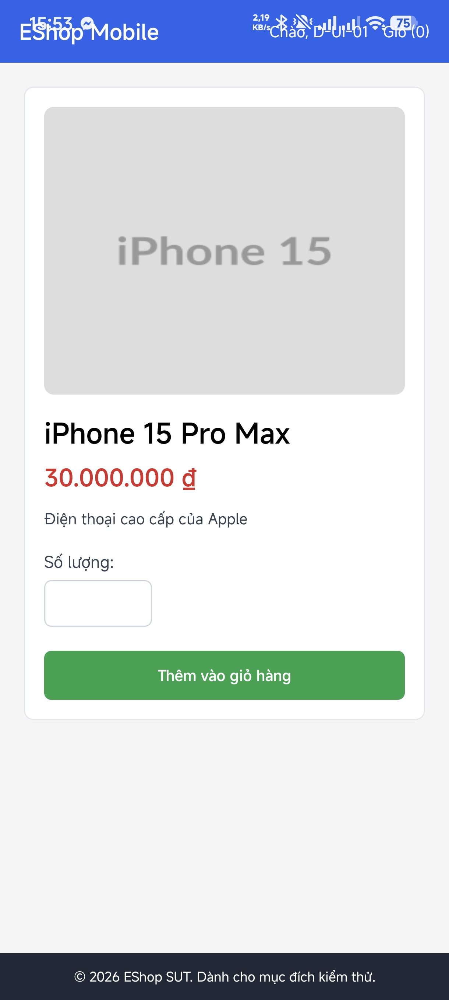

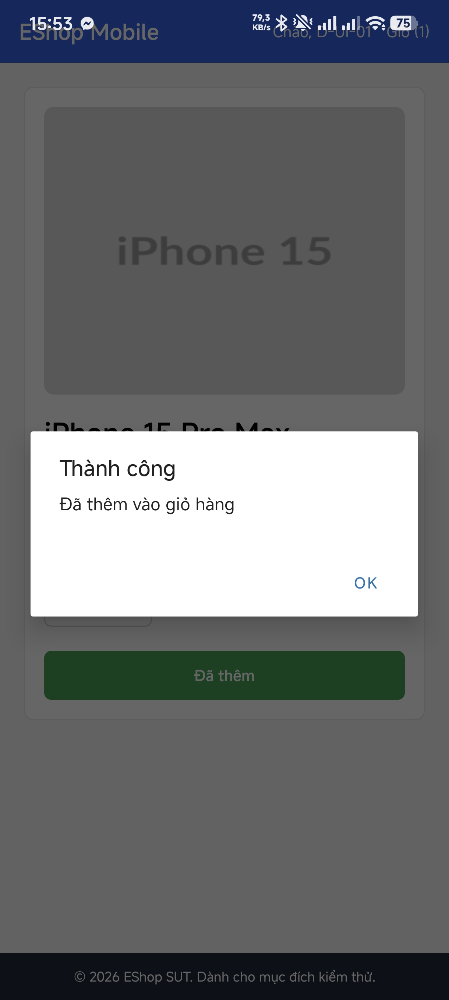


**Evidence còn thiếu:** Không có bước bổ sung bắt buộc cho verdict hiện tại.

### Verdict và rationale

**FAIL** - Có ít nhất một hành vi quan sát trái oracle; bug được nhóm theo behavior, không nhân số bug theo số TC.

<a id="d-ui-02"></a>

## D-UI-02

**Mục tiêu:** Mobile quantity "-1".

| Thuộc tính | Giá trị |
|---|---|
| Technique | Domain |
| Oracle | UI FR-20 with mapped FR-06/07 |
| Domains | D-D3 |
| Seam | UI thật |
| Status | FAIL |
| Bug | BUG-D01 |

### Preconditions

Dùng môi trường UI/fixtures chung. Giữ các điều kiện không phải mục tiêu hợp lệ; các khác biệt của lượt ảnh hiện có được ghi riêng dưới Actual.

### Input - thiết kế

```json
{
  "product": 1,
  "quantity": "-1"
}
```

### Steps

1. Mở Expo Go/Android, ghi account thực tế; xóa giỏ trước TC làm thay đổi giỏ. Mở detail đúng product ID; ghi đơn giá.
2. Thay toàn bộ quantity bằng literal thiết kế; không để ký tự cũ; chụp màn hình trước Add.
3. Bấm Thêm vào giỏ hàng; chụp alert/feedback.
4. Mở cart, không chỉnh quantity trong cart; chụp cùng product và tính đơn giáxquantity. Với invalid, expected là cart không thay đổi.

### Expected

Reject negative; cart unchanged.

### Actual và Evidence

Nhập quantity="-1" vẫn nhận alert thêm thành công; ảnh cart cho thấy sản phẩm có quantity=1.

**Variant / giới hạn:** Không đổi dữ liệu thiết kế.

**Timestamp UI:** không có log chính xác từng lượt; không tự dựng thời gian từ tên ảnh.


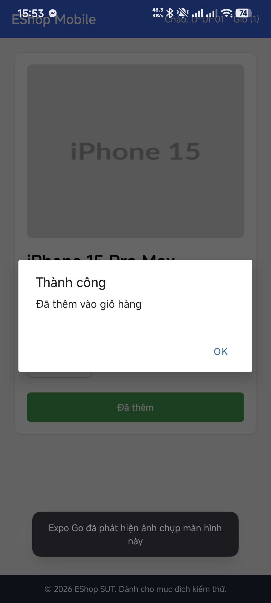


**Evidence còn thiếu:** Không có bước bổ sung bắt buộc cho verdict hiện tại.

### Verdict và rationale

**FAIL** - Có ít nhất một hành vi quan sát trái oracle; bug được nhóm theo behavior, không nhân số bug theo số TC.

<a id="d-ui-03"></a>

## D-UI-03

**Mục tiêu:** Mobile quantity "0".

| Thuộc tính | Giá trị |
|---|---|
| Technique | Domain+BVA |
| Oracle | UI FR-20 with mapped FR-06/07 |
| Domains | D-D3 |
| Seam | UI thật |
| Status | FAIL |
| Bug | BUG-D01 |

### Preconditions

Dùng môi trường UI/fixtures chung. Giữ các điều kiện không phải mục tiêu hợp lệ; các khác biệt của lượt ảnh hiện có được ghi riêng dưới Actual.

### Input - thiết kế

```json
{
  "product": 1,
  "quantity": "0"
}
```

### Steps

1. Mở Expo Go/Android, ghi account thực tế; xóa giỏ trước TC làm thay đổi giỏ. Mở detail đúng product ID; ghi đơn giá.
2. Thay toàn bộ quantity bằng literal thiết kế; không để ký tự cũ; chụp màn hình trước Add.
3. Bấm Thêm vào giỏ hàng; chụp alert/feedback.
4. Mở cart, không chỉnh quantity trong cart; chụp cùng product và tính đơn giáxquantity. Với invalid, expected là cart không thay đổi.

### Expected

Reject zero; cart unchanged.

### Actual và Evidence

Nhập quantity="0" vẫn nhận alert thêm thành công; ảnh cart cho thấy sản phẩm có quantity=1.

**Variant / giới hạn:** Không đổi dữ liệu thiết kế.

**Timestamp UI:** không có log chính xác từng lượt; không tự dựng thời gian từ tên ảnh.


**Evidence còn thiếu:** Không có bước bổ sung bắt buộc cho verdict hiện tại.

### Verdict và rationale

**FAIL** - Có ít nhất một hành vi quan sát trái oracle; bug được nhóm theo behavior, không nhân số bug theo số TC.

<a id="d-ui-04"></a>

## D-UI-04

**Mục tiêu:** Mobile quantity "1".

| Thuộc tính | Giá trị |
|---|---|
| Technique | Domain+BVA |
| Oracle | UI FR-20 with mapped FR-06/07 |
| Domains | D-D4 |
| Seam | UI thật |
| Status | PASS |
| Bug | - |

### Preconditions

Dùng môi trường UI/fixtures chung. Giữ các điều kiện không phải mục tiêu hợp lệ; các khác biệt của lượt ảnh hiện có được ghi riêng dưới Actual.

### Input - thiết kế

```json
{
  "product": 1,
  "quantity": "1"
}
```

### Steps

1. Mở Expo Go/Android, ghi account thực tế; xóa giỏ trước TC làm thay đổi giỏ. Mở detail đúng product ID; ghi đơn giá.
2. Thay toàn bộ quantity bằng literal thiết kế; không để ký tự cũ; chụp màn hình trước Add.
3. Bấm Thêm vào giỏ hàng; chụp alert/feedback.
4. Mở cart, không chỉnh quantity trong cart; chụp cùng product và tính đơn giáxquantity. Với invalid, expected là cart không thay đổi.

### Expected

Cart contains quantity=1, total=30000000.

### Actual và Evidence

Cart Samsung Galaxy S24 Ultra có quantity=1, đơn giá 28000000, thành tiền 28000000.

**Variant / giới hạn:** Product 2 Samsung thay product 1 iPhone; expected được tính lại 28000000x1. Đây vẫn là đại diện quantity=1.

**Timestamp UI:** không có log chính xác từng lượt; không tự dựng thời gian từ tên ảnh.


**Evidence còn thiếu:** Không có bước bổ sung bắt buộc cho verdict hiện tại.

### Verdict và rationale

**PASS** - Tiêu chí thuộc phạm vi đã ghi khớp expected với evidence nêu trên.

<a id="d-ui-05"></a>

## D-UI-05

**Mục tiêu:** Mobile quantity "2".

| Thuộc tính | Giá trị |
|---|---|
| Technique | Domain+BVA |
| Oracle | UI FR-20 with mapped FR-06/07 |
| Domains | D-D4 |
| Seam | UI thật |
| Status | PASS |
| Bug | - |

### Preconditions

Dùng môi trường UI/fixtures chung. Giữ các điều kiện không phải mục tiêu hợp lệ; các khác biệt của lượt ảnh hiện có được ghi riêng dưới Actual.

### Input - thiết kế

```json
{
  "product": 1,
  "quantity": "2"
}
```

### Steps

1. Mở Expo Go/Android, ghi account thực tế; xóa giỏ trước TC làm thay đổi giỏ. Mở detail đúng product ID; ghi đơn giá.
2. Thay toàn bộ quantity bằng literal thiết kế; không để ký tự cũ; chụp màn hình trước Add.
3. Bấm Thêm vào giỏ hàng; chụp alert/feedback.
4. Mở cart, không chỉnh quantity trong cart; chụp cùng product và tính đơn giáxquantity. Với invalid, expected là cart không thay đổi.

### Expected

Cart contains quantity=2, total=60000000.

### Actual và Evidence

Samsung quantity=2, thành tiền 56000000; khớp 28000000x2.

**Variant / giới hạn:** Product 2 Samsung thay iPhone; expected được tính lại 28000000x2.

**Timestamp UI:** không có log chính xác từng lượt; không tự dựng thời gian từ tên ảnh.

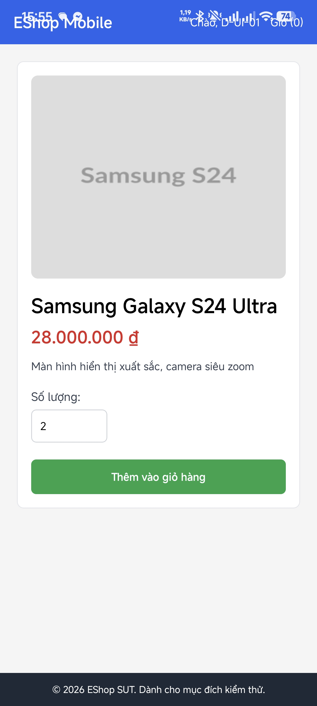


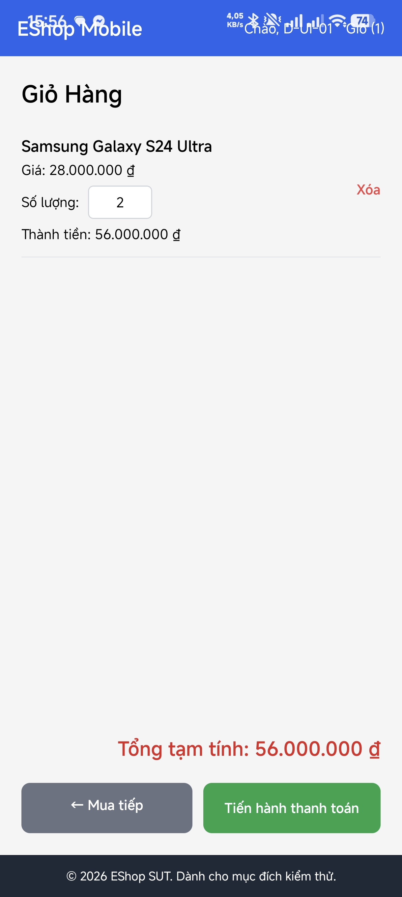

**Evidence còn thiếu:** Không có bước bổ sung bắt buộc cho verdict hiện tại.

### Verdict và rationale

**PASS** - Tiêu chí thuộc phạm vi đã ghi khớp expected với evidence nêu trên.

<a id="d-ui-06"></a>

## D-UI-06

**Mục tiêu:** Mobile quantity "1.5".

| Thuộc tính | Giá trị |
|---|---|
| Technique | Domain |
| Oracle | UI FR-20 with mapped FR-06/07 |
| Domains | D-D5 |
| Seam | UI thật |
| Status | FAIL |
| Bug | BUG-D01 |

### Preconditions

Dùng môi trường UI/fixtures chung. Giữ các điều kiện không phải mục tiêu hợp lệ; các khác biệt của lượt ảnh hiện có được ghi riêng dưới Actual.

### Input - thiết kế

```json
{
  "product": 1,
  "quantity": "1.5"
}
```

### Steps

1. Mở Expo Go/Android, ghi account thực tế; xóa giỏ trước TC làm thay đổi giỏ. Mở detail đúng product ID; ghi đơn giá.
2. Thay toàn bộ quantity bằng literal thiết kế; không để ký tự cũ; chụp màn hình trước Add.
3. Bấm Thêm vào giỏ hàng; chụp alert/feedback.
4. Mở cart, không chỉnh quantity trong cart; chụp cùng product và tính đơn giáxquantity. Với invalid, expected là cart không thay đổi.

### Expected

Reject fractional; cart unchanged.

### Actual và Evidence

Nhập quantity="1.5" vẫn nhận alert thêm thành công; ảnh cart cho thấy sản phẩm có quantity=1.

**Variant / giới hạn:** Không đổi dữ liệu thiết kế.

**Timestamp UI:** không có log chính xác từng lượt; không tự dựng thời gian từ tên ảnh.

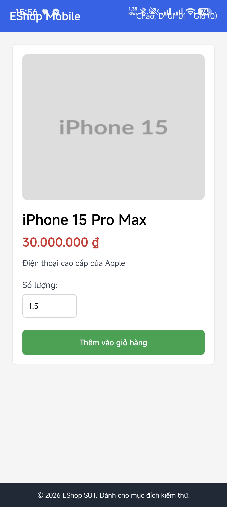


**Evidence còn thiếu:** Không có bước bổ sung bắt buộc cho verdict hiện tại.

### Verdict và rationale

**FAIL** - Có ít nhất một hành vi quan sát trái oracle; bug được nhóm theo behavior, không nhân số bug theo số TC.

<a id="d-ui-07"></a>

## D-UI-07

**Mục tiêu:** Mobile quantity "abc".

| Thuộc tính | Giá trị |
|---|---|
| Technique | Domain |
| Oracle | UI FR-20 with mapped FR-06/07 |
| Domains | D-D5 |
| Seam | UI thật |
| Status | FAIL |
| Bug | BUG-D01 |

### Preconditions

Dùng môi trường UI/fixtures chung. Giữ các điều kiện không phải mục tiêu hợp lệ; các khác biệt của lượt ảnh hiện có được ghi riêng dưới Actual.

### Input - thiết kế

```json
{
  "product": 1,
  "quantity": "abc"
}
```

### Steps

1. Mở Expo Go/Android, ghi account thực tế; xóa giỏ trước TC làm thay đổi giỏ. Mở detail đúng product ID; ghi đơn giá.
2. Thay toàn bộ quantity bằng literal thiết kế; không để ký tự cũ; chụp màn hình trước Add.
3. Bấm Thêm vào giỏ hàng; chụp alert/feedback.
4. Mở cart, không chỉnh quantity trong cart; chụp cùng product và tính đơn giáxquantity. Với invalid, expected là cart không thay đổi.

### Expected

Reject nonnumeric; cart unchanged.

### Actual và Evidence

Nhập quantity="abc" vẫn nhận alert thêm thành công; ảnh cart cho thấy sản phẩm có quantity=1.

**Variant / giới hạn:** Không đổi dữ liệu thiết kế.

**Timestamp UI:** không có log chính xác từng lượt; không tự dựng thời gian từ tên ảnh.


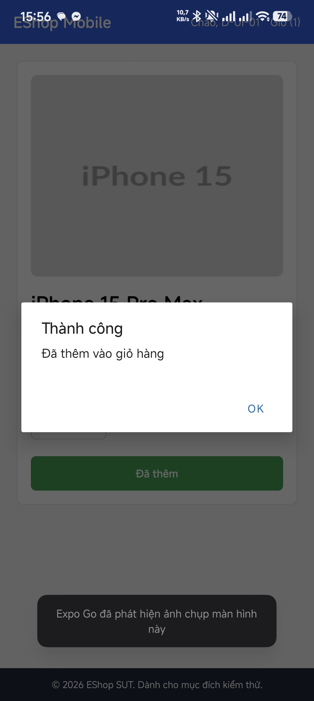

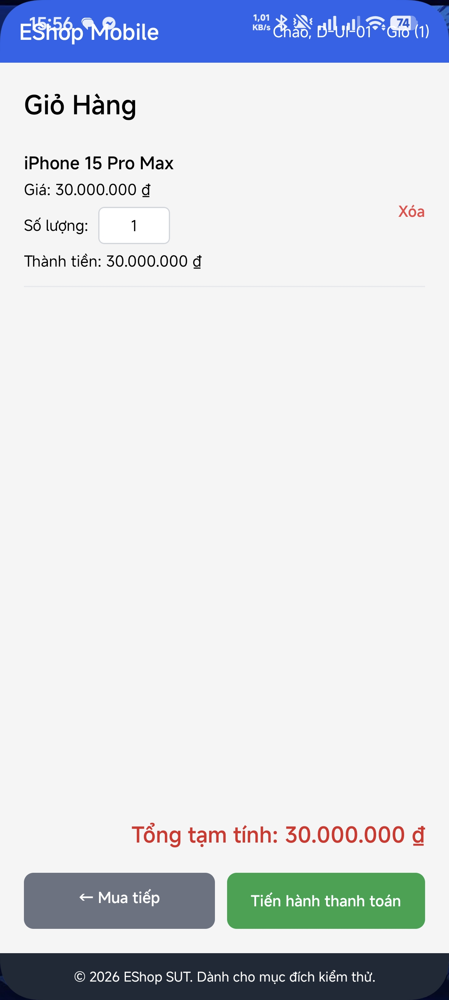

**Evidence còn thiếu:** Không có bước bổ sung bắt buộc cho verdict hiện tại.

### Verdict và rationale

**FAIL** - Có ít nhất một hành vi quan sát trái oracle; bug được nhóm theo behavior, không nhân số bug theo số TC.

<a id="d-ui-08"></a>

## D-UI-08

**Mục tiêu:** Mobile quantity "1abc".

| Thuộc tính | Giá trị |
|---|---|
| Technique | Domain |
| Oracle | UI FR-20 with mapped FR-06/07 |
| Domains | D-D5 |
| Seam | UI thật |
| Status | FAIL |
| Bug | BUG-D01 |

### Preconditions

Dùng môi trường UI/fixtures chung. Giữ các điều kiện không phải mục tiêu hợp lệ; các khác biệt của lượt ảnh hiện có được ghi riêng dưới Actual.

### Input - thiết kế

```json
{
  "product": 1,
  "quantity": "1abc"
}
```

### Steps

1. Mở Expo Go/Android, ghi account thực tế; xóa giỏ trước TC làm thay đổi giỏ. Mở detail đúng product ID; ghi đơn giá.
2. Thay toàn bộ quantity bằng literal thiết kế; không để ký tự cũ; chụp màn hình trước Add.
3. Bấm Thêm vào giỏ hàng; chụp alert/feedback.
4. Mở cart, không chỉnh quantity trong cart; chụp cùng product và tính đơn giáxquantity. Với invalid, expected là cart không thay đổi.

### Expected

Reject mixed text; cart unchanged.

### Actual và Evidence

Input 1abc vẫn nhận alert thêm thành công. Chỉ điều kiện phải từ chối đã bị vi phạm; chưa có ảnh cart để kết luận quantity lưu cho riêng lượt này.

**Variant / giới hạn:** Không đổi dữ liệu thiết kế.

**Timestamp UI:** không có log chính xác từng lượt; không tự dựng thời gian từ tên ảnh.

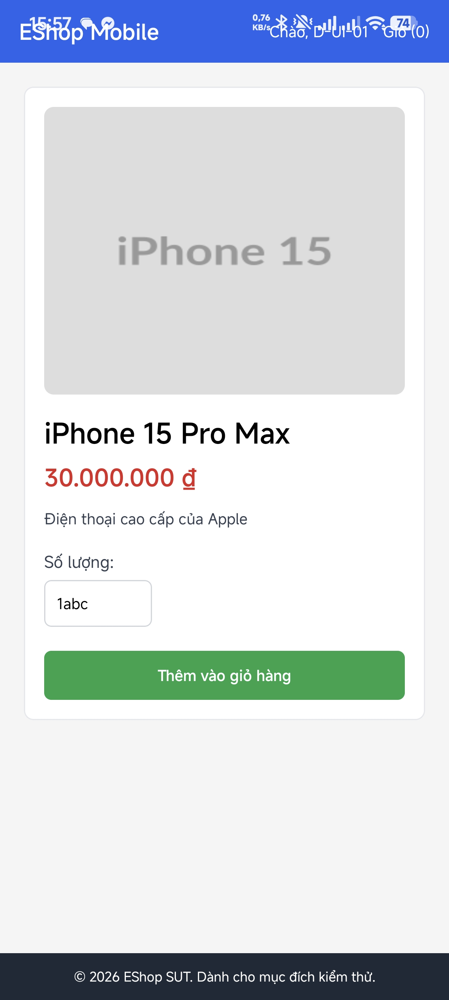


**Evidence còn thiếu:** Ảnh cart là bằng chứng bổ sung cho hậu điều kiện; không bắt buộc để xác nhận lỗi đã chấp nhận input không hợp lệ.

### Verdict và rationale

**FAIL** - Có ít nhất một hành vi quan sát trái oracle; bug được nhóm theo behavior, không nhân số bug theo số TC.

<a id="d-ui-09"></a>

## D-UI-09

**Mục tiêu:** Mobile complete product detail.

| Thuộc tính | Giá trị |
|---|---|
| Technique | Domain |
| Oracle | UI FR-20 with mapped FR-06/07 |
| Domains | D-D1 |
| Seam | UI thật |
| Status | FAIL |
| Bug | BUG-D02 |

### Preconditions

Dùng môi trường UI/fixtures chung. Giữ các điều kiện không phải mục tiêu hợp lệ; các khác biệt của lượt ảnh hiện có được ghi riêng dưới Actual.

### Input - thiết kế

```json
{
  "product": 1
}
```

### Steps

1. Mở Expo Go/Android, ghi account thực tế; xóa giỏ trước TC làm thay đổi giỏ. Mở detail đúng product ID; ghi đơn giá.
2. Đối chiếu lần lượt ảnh, tên, giá, mô tả và category theo checklist FR-06 mapping.
3. Cuộn toàn vùng detail để không nhầm thông tin nằm ngoài viewport; lưu ảnh đầy đủ.

### Expected

Image/name/price/description/category visible and correct; mapped FR-06.

### Actual và Evidence

Detail Samsung có ảnh, tên, giá, mô tả và quantity nhưng không có danh mục. Source renderProductDetail cũng không render category.

**Variant / giới hạn:** Samsung thay iPhone. Kết luận dùng mapping chức năng Mobile FR-20 -> FR-06 được trình bày trong báo cáo; không áp các ràng buộc HTML của Web cho React Native.

**Timestamp UI:** không có log chính xác từng lượt; không tự dựng thời gian từ tên ảnh.

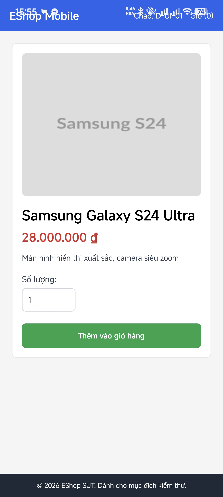

**Evidence còn thiếu:** Không có bước bổ sung bắt buộc cho verdict hiện tại.

### Verdict và rationale

**FAIL** - Có ít nhất một hành vi quan sát trái oracle; bug được nhóm theo behavior, không nhân số bug theo số TC.

<a id="d-ui-10"></a>

## D-UI-10

**Mục tiêu:** Mobile even-id price display.

| Thuộc tính | Giá trị |
|---|---|
| Technique | Domain |
| Oracle | UI FR-20 with mapped FR-06/07 |
| Domains | D-D1 |
| Seam | UI thật |
| Status | PASS |
| Bug | - |

### Preconditions

Dùng môi trường UI/fixtures chung. Giữ các điều kiện không phải mục tiêu hợp lệ; các khác biệt của lượt ảnh hiện có được ghi riêng dưới Actual.

### Input - thiết kế

```json
{
  "product": 2
}
```

### Steps

1. Mở Expo Go/Android, ghi account thực tế; xóa giỏ trước TC làm thay đổi giỏ. Mở detail đúng product ID; ghi đơn giá.
2. Mở Samsung product2; so giá với fixture 28000000; đọc định dạng tiền và quan sát lỗi hiển thị.

### Expected

Samsung price displayed as 28,000,000 ₫ using locale separator; no crash.

### Actual và Evidence

Giá Samsung hiển thị 28.000.000 ₫ dù API product 2 trả price dạng chuỗi số; không có lỗi hiển thị trong ảnh.

**Variant / giới hạn:** Không đổi dữ liệu thiết kế.

**Timestamp UI:** không có log chính xác từng lượt; không tự dựng thời gian từ tên ảnh.


**Evidence còn thiếu:** Không có bước bổ sung bắt buộc cho verdict hiện tại.

### Verdict và rationale

**PASS** - Tiêu chí thuộc phạm vi đã ghi khớp expected với evidence nêu trên.

<a id="d-ui-11"></a>

## D-UI-11

**Mục tiêu:** Mobile add feedback.

| Thuộc tính | Giá trị |
|---|---|
| Technique | Domain |
| Oracle | UI FR-20 with mapped FR-06/07 |
| Domains | D-D6 |
| Seam | UI thật |
| Status | PASS |
| Bug | - |

### Preconditions

Dùng môi trường UI/fixtures chung. Giữ các điều kiện không phải mục tiêu hợp lệ; các khác biệt của lượt ảnh hiện có được ghi riêng dưới Actual.

### Input - thiết kế

```json
{
  "product": 1,
  "quantity": "1"
}
```

### Steps

1. Mở Expo Go/Android, ghi account thực tế; xóa giỏ trước TC làm thay đổi giỏ. Mở detail đúng product ID; ghi đơn giá.
2. Đặt quantity; bấm Add; chụp feedback ngay sau thao tác; mở cart kiểm tra lượt thêm cùng dữ liệu.

### Expected

Visible feedback after Add; cart quantity 1.

### Actual và Evidence

Sau Add, Mobile hiển thị Alert Thành công/Đã thêm vào giỏ hàng. Mục tiêu feedback đạt.

**Variant / giới hạn:** Tái sử dụng lượt Samsung quantity=2 để đánh giá feedback; quantity correctness được tính ở D-UI-05, không tuyên bố lượt quantity=1 đã được quay/chụp riêng.

**Timestamp UI:** không có log chính xác từng lượt; không tự dựng thời gian từ tên ảnh.


**Evidence còn thiếu:** Không có bước bổ sung bắt buộc cho verdict hiện tại.

### Verdict và rationale

**PASS** - Tiêu chí thuộc phạm vi đã ghi khớp expected với evidence nêu trên.

<a id="d-ui-12"></a>

## D-UI-12

**Mục tiêu:** Same product twice.

| Thuộc tính | Giá trị |
|---|---|
| Technique | Domain |
| Oracle | UI FR-20 with mapped FR-06/07 |
| Domains | D-D6 |
| Seam | UI thật |
| Status | PASS |
| Bug | - |

### Preconditions

Dùng môi trường UI/fixtures chung. Giữ các điều kiện không phải mục tiêu hợp lệ; các khác biệt của lượt ảnh hiện có được ghi riêng dưới Actual.

### Input - thiết kế

```json
{
  "product": 1,
  "quantity": "1",
  "repetitions": 2
}
```

### Steps

1. Mở Expo Go/Android, ghi account thực tế; xóa giỏ trước TC làm thay đổi giỏ. Mở detail đúng product ID; ghi đơn giá.
2. Đặt quantity=1 và Add lần1; chụp cart quantity1.
3. Trở lại cùng product, quantity=1; Add lần2.
4. Chụp cart: một dòng quantity2, total bằng 2xđơn giá; giữ evidence cả hai lần.

### Expected

One cart line quantity=2; total=60000000.

### Actual và Evidence

Cart có đúng một dòng iPhone 15 Pro Max, quantity=2, đơn giá30000000 và thành tiền60000000. Sinh viên xác nhận ảnh này thuộc D-UI-12; nó ghi hậu điều kiện của việc thêm cùng sản phẩm hai lần. Ảnh cuối không tự thể hiện toàn bộ chuỗi Add; xác nhận case/thao tác đến từ sinh viên.

**Provenance:** Ảnh thật đã cung cấp; sinh viên làm rõ mapping/case trong hội thoại ngày2026-10-20. Không tạo timestamp thực thi hoặc giả một lần chạy mới.

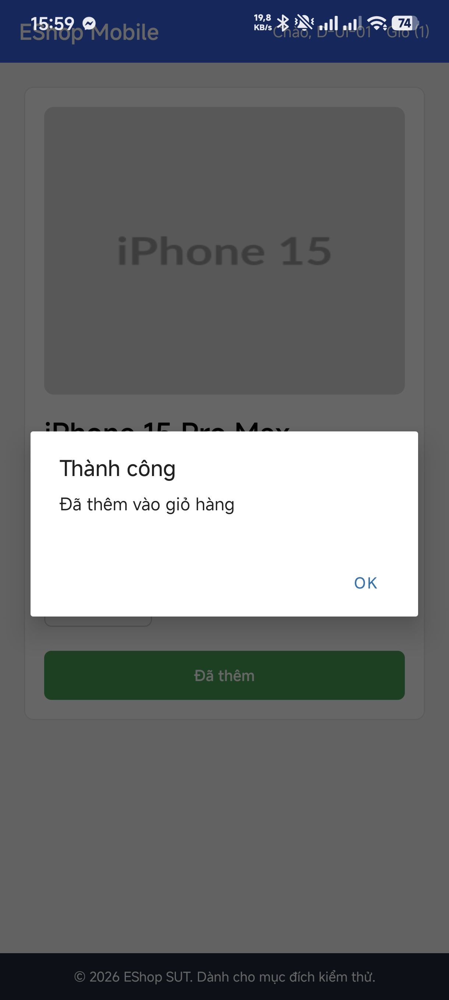

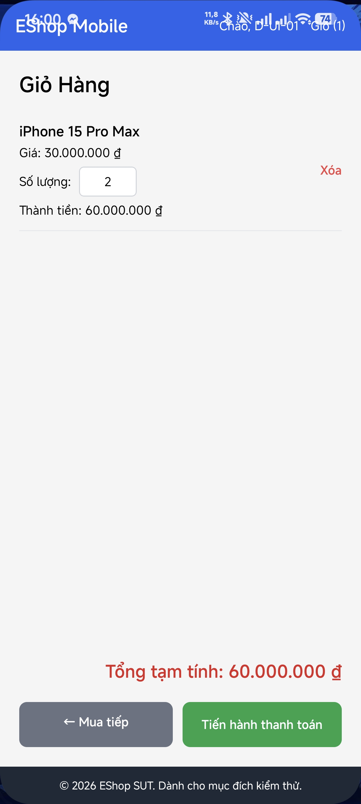

**Evidence còn thiếu cho criterion hiện tại:** không còn; ảnh hậu điều kiện được dùng cùng xác nhận thao tác của sinh viên. Không coi ảnh cuối là video ghi toàn bộ sequence.

### Verdict và rationale

**PASS** - Hậu điều kiện khớp expected; mapping/thao tác đã được sinh viên xác nhận. Phần ảnh và phần xác nhận được ghi riêng theo provenance.

<a id="d-ui-13"></a>

## D-UI-13

**Mục tiêu:** Detail quantity resets after switching products.

| Thuộc tính | Giá trị |
|---|---|
| Technique | Domain |
| Oracle | UI FR-20 with mapped FR-06/07 |
| Domains | D-D7 |
| Seam | UI thật |
| Status | OBSERVATION |
| Bug | - |

### Preconditions

Dùng môi trường UI/fixtures chung. Giữ các điều kiện không phải mục tiêu hợp lệ; các khác biệt của lượt ảnh hiện có được ghi riêng dưới Actual.

### Input - thiết kế

```json
{
  "products": [
    1,
    2
  ],
  "quantity": "2"
}
```

### Steps

1. Mở Expo Go/Android, ghi account thực tế; xóa giỏ trước TC làm thay đổi giỏ. Mở detail đúng product ID; ghi đơn giá.
2. Đặt quantity2 trên SP1; chụp trước khi chuyển.
3. Quay về danh sách, mở SP2; chụp quantity và ID sau chuyển; ghi hành vi, không đặt default oracle mới.

### Expected

Record selected quantity for product 2; SRS does not specify default reset policy.

### Actual và Evidence

Ảnh MacBook có cart quantity=2 và phản hồi Add. Không có chuỗi chuyển product đủ rõ để kết luận reset quantity.

**Variant / giới hạn:** Đây là quan sát khám phá, không phải kiểm tra một default reset rule được SRS quy định.

**Timestamp UI:** không có log chính xác từng lượt; không tự dựng thời gian từ tên ảnh.

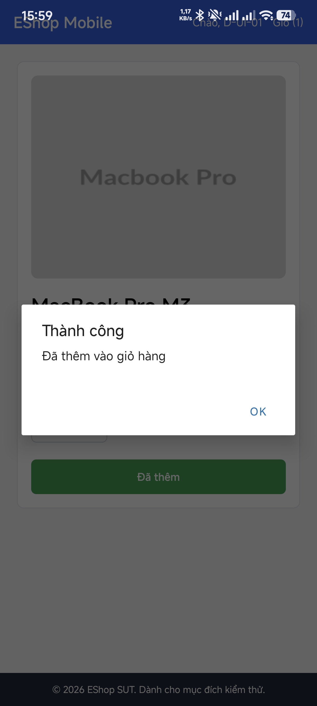


**Evidence còn thiếu:** Nếu bổ sung: chụp quantity trước/sau chuyển từ SP1 sang SP2; chỉ mô tả hành vi, không gọi bug vì SRS không nêu default reset policy.

### Verdict và rationale

**OBSERVATION** - Ghi nhận hành vi trong vùng SRS chưa có oracle chi tiết; không cộng vào PASS/FAIL hoặc bug.

<a id="d-ui-14"></a>

## D-UI-14

**Mục tiêu:** Very large quantity exploratory input.

| Thuộc tính | Giá trị |
|---|---|
| Technique | Domain |
| Oracle | UI FR-20 with mapped FR-06/07 |
| Domains | D-D7 |
| Seam | UI thật |
| Status | OBSERVATION |
| Bug | - |

### Preconditions

Dùng môi trường UI/fixtures chung. Giữ các điều kiện không phải mục tiêu hợp lệ; các khác biệt của lượt ảnh hiện có được ghi riêng dưới Actual.

### Input - thiết kế

```json
{
  "product": 1,
  "quantity": "9007199254740992"
}
```

### Steps

1. Mở Expo Go/Android, ghi account thực tế; xóa giỏ trước TC làm thay đổi giỏ. Mở detail đúng product ID; ghi đơn giá.
2. Ghi literal rất lớn đầy đủ bằng text, không chỉ phần nhìn thấy trong ô cuộn.
3. Add rồi chụp cart/giá trị đầy đủ; mô tả precision/acceptance; không gọi bug chỉ vì vượt giới hạn chưa có trong SRS.

### Expected

Record behavior/precision; upper limit unspecified, do not declare violation solely from size.

### Actual và Evidence

Có input số dài, alert thành công và cart. Ô input có thể cuộn ngang; không đồng nhất literal trong ảnh với 9007199254740992 của thiết kế.

**Variant / giới hạn:** Không đủ evidence cho chuỗi đầu vào đầy đủ và quan hệ chính xác input/cart; SRS không nêu maximum quantity.

**Timestamp UI:** không có log chính xác từng lượt; không tự dựng thời gian từ tên ảnh.

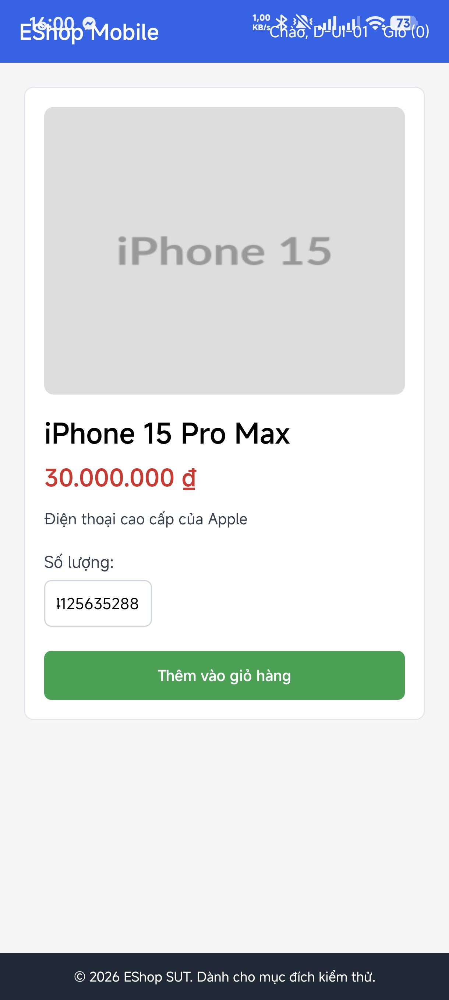


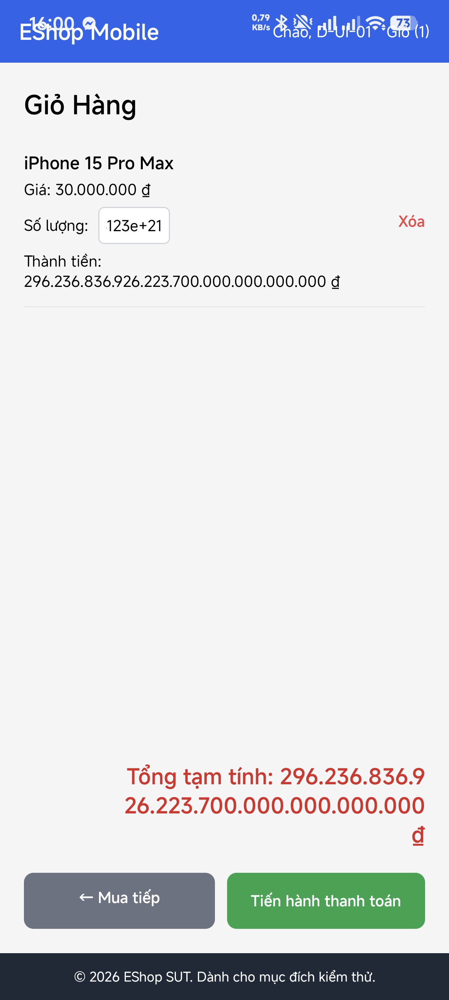

**Evidence còn thiếu:** Nếu phân tích precision: lưu literal đầy đủ bằng bản text kèm quay input/cart. Không đặt stock/MAX_SAFE_INTEGER thành giới hạn nghiệp vụ khi SRS không quy định.

### Verdict và rationale

**OBSERVATION** - Ghi nhận hành vi trong vùng SRS chưa có oracle chi tiết; không cộng vào PASS/FAIL hoặc bug.

## 3. Test Summary

| Scope | Designed | Executed đủ bằng chứng | PASS | FAIL | OBSERVATION | INCOMPLETE | NOT RUN |
|---|---|---|---|---|---|---|---|
| A - API | 22 | 22 | 7 | 14 | 1 | 0 | 0 |
| A - UI | 7 | 7 | 3 | 4 | 0 | 0 | 0 |
| B - API | 26 | 26 | 14 | 12 | 0 | 0 | 0 |
| B - UI | 6 | 6 | 4 | 2 | 0 | 0 | 0 |
| C - API | 30 | 30 | 14 | 16 | 0 | 0 | 0 |
| C - UI | 6 | 6 | 4 | 2 | 0 | 0 | 0 |
| D - API | 3 | 3 | 2 | 0 | 1 | 0 | 0 |
| D - UI | 14 | 14 | 5 | 7 | 2 | 0 | 0 |
| **Tổng** | 114 | 114 | 53 | 57 | 4 | 0 | 0 |

Các số liệu toàn bài dùng chung với README/report; phần INCOMPLETE là test đã có evidence một phần, khác NOT RUN.
